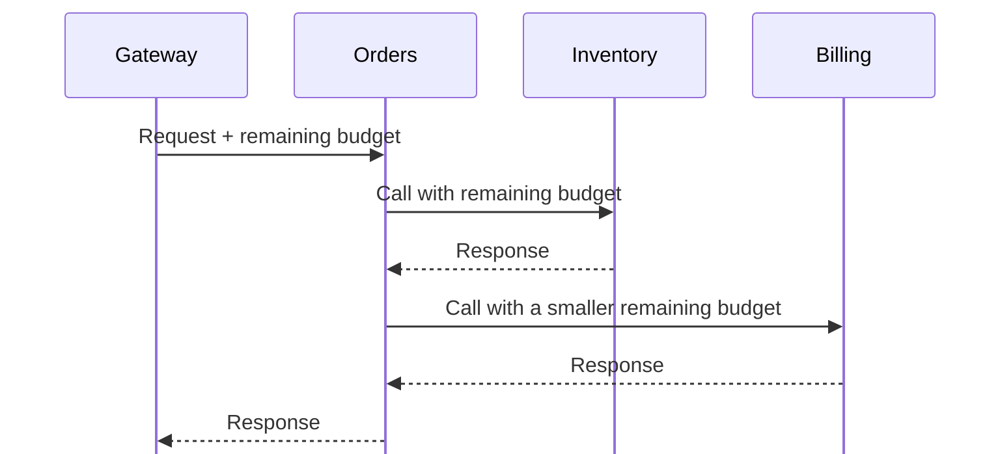

# Timeouts are not deadlines: how latency budgets break across microservices

<div class="bdr-post__hero" data-bdr-post="2026-09-06-timeouts-are-not-deadlines" role="img" aria-label="A shared budget shrinks along a chain; identical per-hop timeouts do not" markdown="0"></div>

A user request rarely stays in one service. It passes through a chain of calls, each with its own timeout, and that looks like enough to keep it from hanging.

But a per-call timeout does not know how much time the request has already spent. A deadline does, so it limits the whole request rather than one wait.

We will follow an Orders service. It reads stock from Inventory over HTTP, then reserves the items and charges the card over gRPC, and Gateway gives each request two seconds.

<!-- more -->

The [lab](../lab/2026-09-06-timeouts-are-not-deadlines/README.md) reproduces the measurements with loopback servers: Python 3.13, httpx 0.28.1, grpcio 1.83.1, deadline-budget 0.1.3, clientwright 0.2.2 and grpc-client-kit 0.1.0. Timings are approximate, and the short examples create a client per call only for brevity.

## A one-second timeout, a four-second response { #a-timeout-limits-an-operation }

First, one HTTP call on its own. Orders reads the stock list from Inventory. In the lab, Inventory is a small asyncio server: it sends the headers at once and then the body one byte every half second, eight bytes in total:

```python
BYTES = 8
INTERVAL = 0.5  # seconds between bytes; the response takes BYTES * INTERVAL


async def drip(reader, writer) -> None:
    await reader.readuntil(b"\r\n\r\n")
    writer.write(b"HTTP/1.1 200 OK\r\nContent-Type: text/plain\r\n" + f"Content-Length: {BYTES}\r\n\r\n".encode())
    await writer.drain()
    try:
        for _ in range(BYTES):
            await asyncio.sleep(INTERVAL)
            writer.write(b"x")
            await writer.drain()
    except ConnectionResetError:
        pass  # the client gave up mid-body
    writer.close()
```

Orders uses HTTPX with a one-second timeout:

```python
import asyncio

import httpx


async def get_report(url):
    async with httpx.AsyncClient(timeout=1.0) as client:
        return await client.get(url)
```

The call succeeds after about four seconds. In HTTPX, `timeout=1.0` is not one limit for the request but four: connect, read, write and waiting for a pooled connection. The [read limit](https://www.python-httpx.org/advanced/timeouts/) bounds the wait for the next chunk, and a byte every half second keeps resetting it. To limit the whole download, put a deadline around the call:

```python
async def get_report_with_deadline(url):
    async with httpx.AsyncClient(timeout=1.0) as client:
        async with asyncio.timeout(1.0):
            return await client.get(url)
```

Now the slow body ends in `TimeoutError` after about a second. With `client.stream()`, keep the body loop inside the block too. [Asyncio timeouts](https://docs.python.org/3/library/asyncio-task.html#timeouts) work by cancelling the task, so code that blocks the event loop delays them, and code that swallows `CancelledError` can defeat them.

## Retries spend the same budget { #retries-multiply-it }

Now Inventory accepts the connection and stays silent. The GET is safe to repeat, so Orders makes up to three attempts:

```python
async def get_stock(client, url):
    for attempt in range(3):
        try:
            return await client.get(url, timeout=1.0)
        except httpx.TimeoutException:
            if attempt == 2:
                raise
```

Each attempt can wait a second, about three seconds in total. Wrapping the loop in `asyncio.timeout(1.0)` would give all attempts one second together. [clientwright](https://bedrock-python.github.io/clientwright/) does the same as a client policy and still returns an `httpx.AsyncClient`; `total` bounds all attempts, including backoff:

```python
from clientwright import ClientConfig, RetryConfig, TimeoutConfig, build


async def get_stock_with_clientwright(url):
    config = ClientConfig(
        service_name="orders",
        timeout=TimeoutConfig(total=1.0),
        retry=RetryConfig(max_attempts=3, initial_backoff=0.01),
    )
    async with build("httpx", config) as client:
        return await client.get(url)
```

| Policy | Result | Approximate wait | Requests received |
|---|---|---|---|
| Manual loop, `timeout=1.0` per attempt | `ReadTimeout` | 3 s + overhead | 3 |
| clientwright, `total=1.0` | `HttpxDeadlineExceededError` | 1 s | 1 |
| clientwright, `total=3.0, read=1.0` | `HttpxDeadlineExceededError` | 3 s | 3 |

With only `total` set, each attempt may use all the time left, so the first one takes the whole second and no retry fits. To leave room for retries, give each attempt a smaller `read` limit, as in the third row. `HttpxDeadlineExceededError` also subclasses `httpx.TimeoutException`, so existing handlers still catch it.

## Fresh timeouts outlive the caller { #across-a-hop-the-timeout-becomes-a-lie }

Now checkout. Gateway calls Orders with a two-second deadline; Orders reserves stock in Inventory, then asks Billing to charge the card. Each operation takes 1.5 seconds in the lab, where `inventory` and `billing` are minimal stubs. The naive handler gives each outgoing RPC its own timeout:

```python
async def submit_with_fresh_timeouts(inventory, billing):
    await inventory.call(b"reserve", timeout=5.0)
    await billing.call(b"charge", timeout=5.0)
```

In gRPC, `timeout` is a deadline for the whole RPC, but here each call gets **a fresh five seconds** regardless of the incoming deadline. grpc-python does not pass the incoming deadline on by itself.

| Time | Event with fresh timeouts |
|---|---|
| 0.0 s | Gateway calls Orders with 2 s; Inventory receives 5 s |
| 1.5 s | Stock reserved; Billing receives a fresh 5 s |
| 2.0 s | Gateway gets `DEADLINE_EXCEEDED`; handlers are cancelled |
| 3.0 s | The simulated charge finishes |

Gateway reports a failure at two seconds, and the charge completes a second later. A retry from Gateway would charge the card twice. The lab keeps the payment running with `asyncio.shield()`, but the point holds without it: cancelling a handler cannot undo an external payment.

## Pass the incoming deadline to outgoing RPCs { #where-the-deadline-lives }

Orders reads the time left on the incoming call with [`context.time_remaining()`](https://grpc.github.io/grpc/python/grpc_asyncio.html#grpc.aio.ServicerContext.time_remaining). [deadline-budget](https://bedrock-python.github.io/deadline-budget/) turns it into a budget, and the interceptors of [grpc-client-kit](https://bedrock-python.github.io/grpc-client-kit/guide/deadlines/) apply that budget to every outgoing RPC. `LeafStub` is the lab's minimal stub:

```python
from deadline_budget import BudgetContext
from grpc_client_kit import (
    ChannelPool,
    DeadlineBudgetConfig,
    GrpcClient,
    GrpcClientConfig,
    TimeoutConfig as GrpcTimeoutConfig,
    build_interceptors,
    use_budget as use_grpc_budget,
)


class Orders:
    def __init__(self, pool: ChannelPool, inventory: str, billing: str):
        chain = build_interceptors(
            timeout=GrpcTimeoutConfig(default=5.0),
            deadline_budget=DeadlineBudgetConfig(),
        )
        self.inventory = GrpcClient(
            LeafStub, GrpcClientConfig(target=inventory, insecure=True),
            pool, interceptors=chain,
        )
        self.billing = GrpcClient(
            LeafStub, GrpcClientConfig(target=billing, insecure=True),
            pool, interceptors=chain,
        )

    async def handle(self, request, context):
        left = context.time_remaining()
        total = 2.0 if left is None else min(left, 2.0)
        if total <= 0:
            await context.abort(grpc.StatusCode.DEADLINE_EXCEEDED, "no time left")
        budget = BudgetContext.create(total_seconds=total, min_timeout=0.0)

        try:
            with use_grpc_budget(budget):
                async with self.inventory as inventory:
                    await inventory.call(b"reserve")
                async with self.billing as billing:
                    await billing.call(b"charge")
        except grpc.aio.AioRpcError as error:
            await context.abort(error.code(), "downstream failed")
        return b"ok"
```

The configured five seconds remain a ceiling: the interceptor takes the smaller of the timeout and the remaining budget. `None` from `time_remaining()` means there is no incoming deadline, so Orders applies its own two seconds. Zero has to be rejected explicitly, because the budget raises `ValueError` for a non-positive total, and Gateway would see that as `UNKNOWN`. `min_timeout=0.0` stops a small remainder from being rounded up to the default 0.1 seconds.

Now Inventory gets about two seconds and Billing about half a second. The lab's services check `time_remaining()` before starting and refuse with `DEADLINE_EXCEEDED` when less than their 1.5 seconds of work is left. Billing refuses, the request fails at about 1.5 seconds, and no charge starts. A real service has to estimate its duration conservatively, and the reservation in Inventory still has to be released: a deadline does not roll back finished work.

<!-- diagram:concept -->
<figure class="bdr-diagram" markdown="1">
<figcaption><span class="bdr-diagram__eyebrow">THE IDEA, VISUALIZED</span><strong>Pass the remaining time, not a fresh timeout</strong></figcaption>
<div class="bdr-diagram__viewport" markdown="1" data-search-exclude>



</div>
<p class="bdr-diagram__caption">Every outgoing call is limited by the time left in the incoming request. Work and retries consume the same end-to-end budget.</p>
</figure>
<!-- /diagram:concept -->

## Leave time for the next step { #the-safety-margin }

Two 1.5-second steps cannot fit into two seconds, so assume faster ones. Orders needs 0.2 seconds to finish its response and wants 0.5 seconds kept for Billing. grpc-client-kit's `reserve_for_next` applies to every call in the chain, so to reserve time only after Inventory, allocate it with `DeadlineBudget` and plain stubs:

```python
from deadline_budget import DeadlineBudget


async def submit_with_reserve(inventory, billing, total):
    # total is the incoming remainder, derived as in Orders.handle.
    budget = DeadlineBudget(
        total_seconds=total, safety_margin=0.2, min_timeout=0.0
    )
    timeout = budget.timeout_for(cap=5.0, reserve_for_next=0.5)
    if timeout <= 0:
        raise TimeoutError("no time for inventory after reserving billing time")
    await inventory.call(b"reserve", timeout=timeout)
    await billing.call(b"charge", timeout=budget.timeout_for(cap=5.0))
```

From two seconds, Inventory gets at most 1.3: `2.0 - 0.2 - 0.5`. If it takes one second, Billing gets 0.8. `DeadlineBudget` raises `ValueError` unless the total exceeds the margin, so refuse a caller with 0.2 seconds or less before calling this function.

## Carry the budget over HTTP too { #carry-the-budget-over-http-too }

HTTP has no standard deadline, so Orders and Inventory agree on an `X-Deadline-Ms` header. clientwright sends the current remainder with every attempt:

```python
from clientwright import AdapterDeps
from clientwright.contrib.deadline import AmbientDeadlineSource, use_budget as use_http_budget


async def read_inventory_twice(url):
    config = ClientConfig(
        service_name="orders",
        timeout=TimeoutConfig(total=10.0),
        retry=RetryConfig(max_attempts=3, initial_backoff=0.3, jitter=0.0),
        deadline_header="X-Deadline-Ms",
    )
    deps = AdapterDeps(deadline_source=AmbientDeadlineSource())
    async with build("httpx", config, deps) as client:
        budget = BudgetContext.create(total_seconds=2.0)
        with use_http_budget(budget):
            first = await client.get(url)
            await asyncio.sleep(0.5)  # Simulated local work.
            second = await client.get(url)
        return first, second
```

Inventory answers the first read with `503`, and Orders checks stock again after half a second of local work. In one run, the server saw `X-Deadline-Ms` values of 1992, 1366 and 832: every attempt, backoff and piece of local work comes out of the same two seconds, and the configured ten seconds do not extend them. In a service, the budget would come from the incoming request.

On the other side, Inventory builds its own budget from the header, with a two-second ceiling and 0.2 seconds kept for completion:

```python
def budget_from_header(value: str | None) -> BudgetContext:
    total = 2.0 if value is None else min(int(value) / 1000, 2.0)
    if total <= 0.2:
        raise TimeoutError("not enough time after the completion margin")
    return BudgetContext.create(
        total_seconds=total, safety_margin=0.2, min_timeout=0.0
    )
```

The guard is required: `BudgetContext.create()` raises `ValueError` when the margin is not smaller than the total. Answer `400` to a malformed header and a deadline error, such as `504`, when too little time is left. Accept the header only from trusted callers, and remember that a relative value ignores transit time, just as gRPC's own `grpc-timeout` does; size the margin for that too. If one handler makes both HTTP and gRPC calls, install the budget with both `use_http_budget()` and `use_grpc_budget()`: they use different context variables.

## What to take into your service { #what-changed-in-the-code }

Give each request one budget and spend it at every step: each attempt, each backoff pause, local work and every outgoing call. [deadline-budget](https://bedrock-python.github.io/deadline-budget/) tracks the remaining time, [clientwright](https://bedrock-python.github.io/clientwright/) applies it to HTTP calls and retries, and [grpc-client-kit](https://bedrock-python.github.io/grpc-client-kit/guide/deadlines/) applies it to outgoing RPCs.

A deadline does not undo a reservation or a charge, a propagated header is approximate and must come from a trusted caller, and an admission check needs a conservative estimate.
