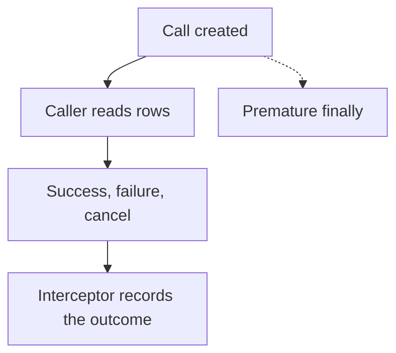

# Why gRPC interceptors break on streaming RPCs {#why-grpc-interceptors-break-on-streaming-rpcs}

<div class="bdr-post__hero" data-bdr-post="2026-09-08-why-grpc-interceptors-break-on-streaming-rpcs" role="img" aria-label="A reporting stream keeps running after a timer around call creation has already stopped" markdown="0"></div>

gRPC interceptors are usually written once, so that logging, metrics and tracing cover every call. They get tested on plain unary calls and then end up wrapping streaming calls too.

Take an export worker that downloads report rows from a reporting service over gRPC. The download takes about 200 ms, but the worker's interceptor records 0.1 ms. When the server fails after two rows, the worker gets an error while the interceptor still reports success.

We will check that the interceptor runs at all, fix what it measures and stop the stream early. The examples run against a real local server with `grpc-client-kit 0.4.0`, `grpcio 1.84.0` and Python `3.13`.

<!-- more -->

## The reporting service we will call {#reporting-service}

The service has one method for each RPC shape. In a shape such as unary-stream, the first part describes the request and the second the response:

| Method | RPC shape | What the worker does |
|---|---|---|
| `Get` | unary-unary | Fetch one report status |
| `Stream` | unary-stream | Download report rows |
| `Upload` | stream-unary | Send rows and receive a count |
| `Chat` | stream-stream | Send rows and receive acknowledgements |

`Stream` sends five rows 30 ms apart. With `b"fail"`, the server aborts with `UNAVAILABLE` after two rows; `b"fast"` drops the pauses, and `b"hold"` sends one row and waits. Every stream ends with trailing metadata `report-id: r-42`. The lab uses byte messages and generic handlers instead of generated protobuf code, but the RPCs are real.

## First, make sure the interceptor actually runs {#the-interceptor-that-is-registered-for-one-kind-out-of-four}

Suppose we put all four `intercept_*` hooks into one class:

```python
from collections import Counter

import grpc.aio


class EverythingInterceptor(
    grpc.aio.UnaryUnaryClientInterceptor,
    grpc.aio.UnaryStreamClientInterceptor,
    grpc.aio.StreamUnaryClientInterceptor,
    grpc.aio.StreamStreamClientInterceptor,
):
    def __init__(self):
        self.calls = Counter()

    async def intercept_unary_unary(self, continuation, details, request):
        self.calls["unary_unary"] += 1
        return await continuation(details, request)

    # The other three hooks count their calls the same way.
```

After one call to each method, `calls` contains only `{"unary_unary": 1}`. The [channel constructor](https://grpc.github.io/grpc/python/_modules/grpc/aio/_channel.html) sorts interceptors with an `isinstance` chain that checks `UnaryUnaryClientInterceptor` first, so an object with all four bases lands only in the unary-unary list, whatever their order. Register one object per RPC shape, or use the adapters `grpc-client-kit` builds below. The lab asserts that every measuring interceptor was entered: one that never ran also reports zero errors and zero time.

## Timing continuation measures only call creation {#what-a-unary-interceptor-measures-on-a-stream}

This interceptor is registered correctly, but its measurement is still wrong:

```python
import asyncio
from time import perf_counter

import grpc


class SetupTimer(grpc.aio.UnaryStreamClientInterceptor):
    def __init__(self):
        self.entered = 0
        self.errors = 0
        self.seconds = None
        self.finished = asyncio.Event()

    async def intercept_unary_stream(self, continuation, details, request):
        self.entered += 1
        started = perf_counter()
        try:
            return await continuation(details, request)
        except grpc.aio.AioRpcError:
            self.errors += 1
            raise
        finally:
            self.seconds = perf_counter() - started
            self.finished.set()
```

`entered` is 1, and `finished` is set before the first row arrives. On the failing stream, the worker gets two rows and `UNAVAILABLE`, while `errors` stays at zero. One run printed:

```text
SetupTimer       OK          rows=5 measured=0.1ms consumer=218.0ms
SetupTimer       UNAVAILABLE rows=2 measured=0.5ms consumer=83.7ms
```

[`continuation`](https://grpc.github.io/grpc/python/grpc_asyncio.html#grpc.aio.UnaryStreamClientInterceptor) returns as soon as the call object exists. The server's status arrives later, inside the caller's `async for`, so the `except` branch never sees it. A unary interceptor has the same trap and a simple fix: await the call it received. A stream has no single response to await; its outcome is known only after the caller stops reading.

<!-- diagram:concept -->
<figure class="bdr-diagram" markdown="1">
<figcaption><span class="bdr-diagram__eyebrow">THE IDEA, VISUALIZED</span><strong>Creating a call does not complete the RPC</strong></figcaption>
<div class="bdr-diagram__viewport" markdown="1" data-search-exclude>



</div>
<p class="bdr-diagram__caption">Wrapping continuation alone stops timing when the call is created. The outcome, whether success, failure or cancellation, is known only after the caller stops reading.</p>
</figure>
<!-- /diagram:concept -->

## Wrap iteration: the simple case {#doing-it-by-hand}

For a worker that always reads to the end, the interceptor can wrap the iteration:

```python
class IterationTimer(grpc.aio.UnaryStreamClientInterceptor):
    def __init__(self):
        self.errors = 0
        self.seconds = None
        self.finished = asyncio.Event()

    async def intercept_unary_stream(self, continuation, details, request):
        started = perf_counter()
        call = await continuation(details, request)

        async def rows():
            try:
                async for row in call:
                    yield row
            except grpc.aio.AioRpcError:
                self.errors += 1
                raise
            finally:
                self.seconds = perf_counter() - started
                self.finished.set()

        return rows()
```

```text
IterationTimer   OK          rows=5 measured=214.9ms consumer=215.0ms
IterationTimer   UNAVAILABLE rows=2 measured=91.2ms consumer=91.3ms
```

Create the call **before** returning the generator: grpcio binds that call to the returned iterator, and without it `code()`, `cancel()` and the call's finalizer fail. This wrapper still covers only unary-stream calls read to the end. Early exit needs a cancellation policy, and for streaming requests it is worse: an interceptor that awaits the final response deadlocks a caller using `write()`, because grpc holds `write()` until the interceptor returns.

## One around_call for all four shapes {#the-four-kinds-one-implementation}

[grpc-client-kit](https://github.com/bedrock-python/grpc-client-kit) provides `AsyncAroundClientInterceptor` for this lifecycle. `around_call()` yields once: setup goes before the `yield`, outcome handling after it, and for a streaming response the `yield` lasts until the stream is consumed. The lab collects records in a queue:

```python
from contextvars import ContextVar

from grpc_client_kit import AsyncAroundClientInterceptor, ClientCall

REQUEST_ID = ContextVar("request_id", default=None)


class Observability(AsyncAroundClientInterceptor):
    def __init__(self):
        self.finished = asyncio.Queue()

    async def around_call(self, call: ClientCall):
        started = perf_counter()
        outcome = "OK"
        try:
            yield
        except grpc.aio.AioRpcError as error:
            outcome = error.code().name
            raise
        except asyncio.CancelledError:
            outcome = "CANCELLED"
            raise
        except Exception:
            outcome = "LOCAL_ERROR"
            raise
        finally:
            self.finished.put_nowait(
                {
                    "kind": call.rpc_type,
                    "method": call.method,
                    "outcome": outcome,
                    "seconds": perf_counter() - started,
                    "request_id": REQUEST_ID.get(),
                }
            )
```

The channel receives it as `interceptors=flatten_interceptors([observer])`, which produces four adapters. Each RPC of any shape then yields exactly one record: a failure after two rows arrives as `AioRpcError`, local cancellation as `CANCELLED`, and the status and `report-id` remain readable from the call. For streaming requests, the kit hands the call back at once and watches the outcome from a separate task, so `write()` does not deadlock. If the exporter itself raises after the `yield`, the kit logs the error and keeps the RPC's result.

**The record closes when the call completes, not when the worker finishes its job.** A stream completes once the caller has read its last message, so work between rows counts toward the RPC duration and work after the last row does not. If the export also writes a file afterwards, time the whole operation separately.

## Keep interceptor context separate from caller context {#the-part-that-only-shows-up-on-streams}

A tracing layer often sets a context variable before a call and resets it after, the way OpenTelemetry's `attach` and `detach` work. On streams, the code after the call may run in another task, and `ContextVar.reset()` rejects a token created in another context:

```python
class TokenScope(AsyncAroundClientInterceptor):
    def __init__(self):
        self.finished = asyncio.Queue()

    async def around_call(self, call: ClientCall):
        token = REQUEST_ID.set("interceptor-only")
        try:
            yield
        finally:
            inside = REQUEST_ID.get()
            REQUEST_ID.reset(token)
            self.finished.put_nowait((inside, REQUEST_ID.get()))
```

On all four shapes the reset succeeds, an inner observer sees `interceptor-only`, and a caller that set `"caller-owned"` still sees its own value: `grpc-client-kit` runs setup and teardown in one context of their own. That context does not reach the caller, and a [`ContextVar`](https://docs.python.org/3/library/contextvars.html#asyncio-support) never travels to the server. To pass a request ID to another service, send it as metadata, for example with the kit's `AsyncClientContextInterceptor`.

## Stop the RPC when the worker stops reading {#what-to-check-in-your-own-interceptors}

For a preview, the worker needs only the first row. The `assert` is the lab's check that the caller sees its own value:

```python
from observers import REQUEST_ID
from report_service import STREAM


async def first_row(channel, request=b"hold"):
    token = REQUEST_ID.set("req-42")
    call = None
    try:
        call = channel.unary_stream(STREAM)(request, timeout=5)
        async for row in call:
            assert REQUEST_ID.get() == "req-42"
            return row
    finally:
        if call is not None:
            call.cancel()
        REQUEST_ID.reset(token)
```

The lab verifies that the server handler stops, exactly one `CANCELLED` record appears and the caller's context is restored. With `break` alone, the RPC stays active until the server finishes, the deadline expires or garbage collection gets to the call. Leaving the loop tells the server nothing; `cancel()` in `finally` does, and it is a no-op on a finished call.

## Run the examples {#labs}

From the website repository root, with uv installed:

```bash
cd docs/blog/lab/2026-09-07-grpc-interceptors-and-streams
uv run --no-project --python 3.13 --with-requirements requirements.txt python interceptors_lab.py
uv run --no-project --python 3.13 --with-requirements requirements.txt python probe.py
```

Both scripts assert outcomes and exit with an error on a mismatch; durations are printed, not asserted. The [lab README](../lab/2026-09-07-grpc-interceptors-and-streams/README.md) lists the files and checks.

<div id="the-pieces" data-search-exclude></div>

## What to take into your service {#conclusion}

Register one interceptor object per RPC shape. Measure until the call completes, not until `continuation` returns. Let the caller own the reading loop and cancel the call when it stops early. [grpc-client-kit](https://github.com/bedrock-python/grpc-client-kit) packages the second rule as `around_call`, and also ships ready-made interceptors such as `AsyncLoggingInterceptor` and `AsyncClientContextInterceptor`. Test whatever you build with a partial read and a failure mid-stream. Channel ownership, deadlines and retries are covered in [production HTTP and gRPC clients](2026-09-13-production-http-grpc-clients.md).
