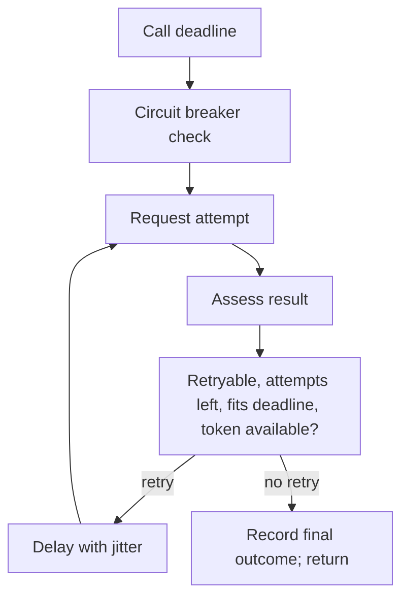

# Building HTTP and gRPC clients for production {#production-http-grpc-clients}

<div class="bdr-post__hero" data-bdr-post="2026-09-13-production-http-grpc-clients" role="img" aria-label="Keep the client; attach the policy beside it" markdown="0"></div>

An orders service calls a warehouse and a payment service, and either can be slow or not answer at all. The first instinct is to retry.

But a retried stock read is harmless, while a retried payment can charge the buyer twice, and the client cannot tell the two apart.

We will configure its HTTP and gRPC clients, break their dependencies and count the requests that actually reach them.

<!-- more -->

<div id="why-i-stopped-wrapping-http-clients" data-search-exclude></div>
<div id="the-life-of-a-wrapper" data-search-exclude></div>
<div id="what-the-wrapper-actually-owns" data-search-exclude></div>
<div id="measured-the-price" data-search-exclude></div>
<div id="capability-honesty" data-search-exclude></div>
<div id="the-shape" data-search-exclude></div>

## Create clients when the application starts {#ownership}

[clientwright](https://bedrock-python.github.io/clientwright/) attaches time limits and a retry policy to HTTPX, and `build('httpx', ...)` still returns a native `httpx.AsyncClient`:

```python
from clientwright import (
    AdapterDeps, ClientConfig, RetryConfig, TimeoutConfig, build,
)


def http_client(name, base_url, *, metrics=None):
    return build(
        'httpx',
        ClientConfig(
            service_name=name,
            base_url=base_url,
            timeout=TimeoutConfig(total=2, connect=0.3, read=0.5),
            retry=RetryConfig(),
            circuit_breaker=None,
            on_unsupported='strict',
        ),
        AdapterDeps(metrics=metrics),
    )
```

`service_name` labels the client's metrics and logs. `RetryConfig()` already means three attempts, the first included, with 100 ms × 2 backoff, ±20% jitter, `Retry-After` support and a retry budget of 0.1. A circuit breaker is on by default (five failures, 60 seconds); `circuit_breaker=None` turns it off until we configure it below. `on_unsupported='strict'` makes a setting the adapter cannot apply fail at construction.

Create both clients in the application's startup scope and close them after active handlers finish:

```python
from contextlib import asynccontextmanager


@asynccontextmanager
async def outbound_clients(inventory_url, payments_url):
    async with (
        http_client('inventory', inventory_url) as inventory,
        http_client('payments', payments_url) as payments,
    ):
        yield inventory, payments
```

Opening them per request would throw away connection reuse, the retry budget and breaker state.

<div id="reliability-is-not-retry3" data-search-exclude></div>
<div id="why-retries-look-free" data-search-exclude></div>
<div id="what-they-cost-when-it-matters" data-search-exclude></div>
<div id="a-deadline-is-the-first-real-mechanism" data-search-exclude></div>
<div id="a-retry-budget-removes-the-amplification" data-search-exclude></div>
<div id="a-circuit-breaker-protects-the-next-wave-not-this-one" data-search-exclude></div>
<div id="what-none-of-them-do" data-search-exclude></div>
<div id="the-list" data-search-exclude></div>
<div id="the-pieces" data-search-exclude></div>

## Give a stock read a total time limit {#budgets}

Inventory answers `GET /stock/{sku}` with `{"sku": "sku-42", "available": 7}`:

```python
async def fetch_stock(client, sku):
    response = await client.get(f'/stock/{sku}')
    response.raise_for_status()
    return response.json()['available']
```

The client allows 0.3 seconds to connect, 0.5 seconds between response chunks and two seconds for the whole call, attempts and backoff included. The [HTTPX read timeout](https://www.python-httpx.org/advanced/timeouts/) limits a pause, not the response: in the [deadline lab](../lab/2026-09-07-reliability-is-not-retry-3/README.md), a server sending a byte every 80 ms completes under a 300 ms read timeout, while `TimeoutConfig(total=0.35, read=0.3)` stops it with `DeadlineExceededError`.

To share the incoming request's time between inventory and payments, give the clients `AdapterDeps(deadline_source=AmbientDeadlineSource())` and set a `BudgetContext` with `use_budget()`, as in the [deadline article](2026-09-06-timeouts-are-not-deadlines.md). Two fresh seconds per client are not a two-second budget for the order.

<div id="retries-can-make-an-outage-worse-designing-a-retry-budget" data-search-exclude></div>
<div id="the-arithmetic" data-search-exclude></div>
<div id="measured-one-hop" data-search-exclude></div>
<div id="when-the-budget-is-invisible-and-when-it-hurts" data-search-exclude></div>
<div id="measured-three-services-deep" data-search-exclude></div>
<div id="where-retries-belong" data-search-exclude></div>
<div id="the-policy" data-search-exclude></div>
<div id="retry-after-backoff-and-jitter-what-a-production-http-client-actually-does" data-search-exclude></div>
<div id="honour-retry-after" data-search-exclude></div>
<div id="jitter-or-the-herd" data-search-exclude></div>
<div id="a-read-timeout-is-not-a-connection-error" data-search-exclude></div>
<div id="what-is-retried-at-all" data-search-exclude></div>
<div id="the-checklist" data-search-exclude></div>

## Retry a payment only when the server can deduplicate it {#retries}

Payments saves a charge and then returns 503. Retrying is safe only if the payments API returns the saved result for the same `Idempotency-Key` and payload, and rejects the key with a different payload. An order has one charge, so the key comes from the order ID:

```python
from clientwright.adapters.httpx import IDEMPOTENT_EXTENSION


async def charge(client, order_id, amount_minor):
    response = await client.post(
        '/payments',
        json={'order_id': order_id, 'amount_minor': amount_minor},
        headers={'Idempotency-Key': f'charge-{order_id}'},
        extensions={IDEMPOTENT_EXTENSION: True},
    )
    response.raise_for_status()
    return response.json()['payment_id']
```

`IDEMPOTENT_EXTENSION` lets clientwright retry the POST; the header lets the server recognize the repeat. The [retry lab](../lab/2026-09-07-retry-after-backoff-jitter/README.md) checks three versions against a local service:

| After the first charge, the response is 503 | HTTP requests for the call | Charges recorded |
| --- | --- | --- |
| Plain POST | 1 | 1; caller receives 503 |
| POST marked idempotent, no server key | 2 | 2 |
| POST with the stable key and client flag | 2 | 1; caller receives the saved payment ID |

A second `charge()` for the same order returns the same payment ID. The lab deduplicates in memory and sequentially; a real API needs durable storage and atomic handling of concurrent duplicates.

### Respect the requested delay and limit extra traffic {#retry-budget}

With the default policy, the first retry waits 80 to 120 ms and the second 160 to 240 ms. `Retry-After: 1` replaces that with one second. If the requested delay cannot fit the remaining deadline, as with `Retry-After: 60` in the lab, the client returns the 503 at once after a single request.

The retry budget lives per origin (scheme, host and port) inside the client. A fresh origin starts with ten tokens, the bucket holds at most ten, and every call adds 0.1. The [budget lab](../lab/2026-09-07-retry-budget/README.md) makes 50 sequential calls to an endpoint that always returns 503, with the breaker off:

| Retry settings | Server requests |
| --- | --- |
| Three attempts, `budget_ratio=None` | 150 |
| Three attempts, `budget_ratio=0.1` | 64 |

That is 50 first attempts, 10 retries from the initial tokens and 4 earned by the calls. Each replica and each new client starts with a full bucket, and an outer retry loop around this client multiplies attempts again: the [adapter lab](../lab/2026-09-07-why-i-stopped-wrapping-http-clients/README.md) turns three outer calls into nine requests. Retry in one layer only.

<div id="circuit-breakers-should-be-per-origin-not-per-client" data-search-exclude></div>
<div id="measured-one-counter-three-upstreams" data-search-exclude></div>
<div id="what-counts-as-a-failure" data-search-exclude></div>
<div id="one-signal-per-logical-call" data-search-exclude></div>
<div id="the-probe" data-search-exclude></div>
<div id="the-configuration" data-search-exclude></div>

## Keep a payments outage from blocking inventory {#circuit-breakers}

Separate clients already have separate breakers. A shared client that calls several origins by full URL needs its breaker keyed by origin, which is the default:

```python
from clientwright import CircuitBreakerConfig


def shared_http_client():
    return build('httpx', ClientConfig(
        service_name='shop-backends',
        timeout=TimeoutConfig(total=2),
        retry=RetryConfig(),
        circuit_breaker=CircuitBreakerConfig(
            fail_threshold=3,
            recovery_timeout=10,
            half_open_max_calls=1,
        ),
    ))
```

In the [breaker lab](../lab/2026-09-07-circuit-breakers-per-origin/README.md), three failed calls to payments make nine attempts, and the fourth raises `CircuitOpenError` without a request, while a stock read on another origin still returns 200. The breaker counts consecutive failed calls with status 500 or above; any other outcome, 400 and 429 included, resets the count. With a test clock, the lab also checks recovery from open through half-open to closed. One breaker check wraps the whole retry loop:

<!-- diagram:concept -->
<figure class="bdr-diagram" markdown="1">
<figcaption><span class="bdr-diagram__eyebrow">THE IDEA, VISUALIZED</span><strong>One HTTP call, several possible attempts</strong></figcaption>
<div class="bdr-diagram__viewport" markdown="1" data-search-exclude>



</div>
<p class="bdr-diagram__caption">The breaker is checked once per call and records the final outcome. Every attempt shares the call deadline and needs a retry token.</p>
</figure>
<!-- /diagram:concept -->

Two failing backends behind one gateway origin need a finer key, such as `CircuitKey.ORIGIN_ROUTE` with `ROUTE_EXTENSION`, or separate clients.

<div id="safe-grpc-retries-which-status-codes-you-should-actually-retry" data-search-exclude></div>
<div id="what-a-status-code-tells-you-about-the-work" data-search-exclude></div>
<div id="measured-five-ways-to-fail-a-charge" data-search-exclude></div>
<div id="the-deadline-is-for-the-call-not-the-attempt" data-search-exclude></div>
<div id="the-breaker-counts-attempts" data-search-exclude></div>
<div id="streams-are-not-calls" data-search-exclude></div>
<div id="the-policy-written-down" data-search-exclude></div>
<div id="grpc-channels-should-not-be-pooled-by-address-alone" data-search-exclude></div>
<div id="what-a-channel-is" data-search-exclude></div>
<div id="measured-the-audit-client-that-retried" data-search-exclude></div>
<div id="the-opposite-mistake-a-channel-per-call" data-search-exclude></div>
<div id="options-are-identity-too" data-search-exclude></div>
<div id="health-per-address" data-search-exclude></div>
<div id="the-pool" data-search-exclude></div>

## Give gRPC an explicit list of repeatable methods {#grpc}

The gRPC inventory has `GetStock` (a read), `Reserve` (a write) and `Export` (a stream). The [gRPC lab](../lab/2026-09-07-safe-grpc-retries/README.md) binds them in `InventoryStub` over raw bytes; generate yours from protobuf. [grpc-client-kit](https://bedrock-python.github.io/grpc-client-kit/) allows retries only for `GetStock`:

```python
import grpc
from grpc_client_kit import (
    RetryConfig as GrpcRetry,
    TimeoutConfig as GrpcTimeout,
    build_interceptors,
)


def inventory_chain():
    return build_interceptors(
        timeout=GrpcTimeout(default=1),
        retry=GrpcRetry(
            max_attempts=3,
            initial_backoff=0.05,
            retryable_codes={grpc.StatusCode.UNAVAILABLE},
            idempotent_methods={'/shop.Inventory/GetStock'},
        ),
    )
```

Without an allowlist, the kit's default `RetryConfig` retries every unary method on `UNAVAILABLE` and `RESOURCE_EXHAUSTED`. But `UNAVAILABLE` does not prove the handler did nothing: the lab's `Reserve` changes stock and then returns it, and the default policy records three reservations. With the allowlist there is one, and the caller gets the error, while `GetStock` still retries and returns `b'7'`. We also leave out `RESOURCE_EXHAUSTED`: a server out of capacity should not get extra traffic. The one-second timeout covers the whole RPC; given 300 ms, a slow first attempt leaves the second only the remainder, and it ends with `DEADLINE_EXCEEDED`.

### Share channels only between compatible clients {#channel-identity}

An audit reader uses the same address but must make one attempt:

```python
from contextlib import asynccontextmanager
from grpc_client_kit import ChannelPool, GrpcClient, GrpcClientConfig


@asynccontextmanager
async def grpc_clients(target):
    config = GrpcClientConfig(
        target=target,
        insecure=True,  # Local lab; configure credentials for a TLS deployment.
        options=[('grpc.enable_retries', 0)],
    )
    async with ChannelPool() as pool:
        orders = GrpcClient(
            InventoryStub, config, pool,
            interceptor_factory=lambda target: inventory_chain(),
        )
        audit = GrpcClient(
            InventoryStub, config, pool,
            interceptor_factory=lambda target: build_interceptors(
                timeout=GrpcTimeout(default=1), retry=None,
            ),
        )
        yield orders, audit
```

`interceptor_factory` creates and caches a chain per target, which keeps channel identity stable. The pool separates channels by security, credentials, options, compression and interceptor chain, not by address alone; the [identity lab](../lab/2026-09-07-grpc-channel-identity/README.md) checks reuse and separation. `ChannelPool` owns the channels and closes them on exit; leaving a `GrpcClient` context does not touch them. `grpc.enable_retries=0` leaves retries to the interceptor, so [native gRPC retries](https://grpc.io/docs/guides/retry/) do not multiply them. For the audit client, `retry=None` removes the retry interceptor; an empty `idempotent_methods` would not mean "retry nothing".

The gRPC client differs from the HTTP one in three ways:

- grpc-client-kit 0.4.0 has no retry budget.
- Its breaker is kept per method and sits inside the retry loop, counting attempts: with a threshold of two, a breaker in the lab blocks the third attempt of the first failing call.
- Restarting `Export` after items `1, 2` can produce `1, 2, 1, 2, 3`. The lab checks both this opt-in behavior and the default failure; keep stream retries off until the protocol can resume or deduplicate. How interceptors see a stream's outcome is covered in [a separate article](2026-09-08-why-grpc-interceptors-break-on-streaming-rpcs.md).

## Count attempts as well as successful calls {#verification}

For a stock endpoint that returns 503 twice and then succeeds, this returns `(7, 1, 3)`: quantity, logical calls and attempts.

```python
from clientwright.core.testing import RecordingMetrics


async def observe_stock(base_url):
    metrics = RecordingMetrics()
    async with http_client('inventory', base_url, metrics=metrics) as client:
        available = await fetch_stock(client, 'sku-42')
    return available, len(metrics.calls), len(metrics.attempts)
```

`RecordingMetrics` is the library's test recorder; production passes its own through `AdapterDeps(metrics=...)`. One successful call can hide three requests. The call duration ends at the response headers, and reading the body is recorded as a separate metric.

## Choose policies for the operations you actually call {#conclusion}

Start with a total time limit and the list of operations that are safe to repeat, then tune the retry budget and the breaker against a dependency that fails on purpose. [clientwright](https://bedrock-python.github.io/clientwright/) does this for HTTP while keeping native clients, and [grpc-client-kit](https://bedrock-python.github.io/grpc-client-kit/) does it for gRPC channels and interceptors.

## Examples and labs {#labs}

The snippets come from the labs and were checked with Python 3.13, `clientwright==0.5.0`, `httpx==0.28.1`, `grpc-client-kit==0.4.0` and `grpcio==1.84.0` against local HTTP and gRPC servers. They test client behavior, not performance, TLS, proxies or payment storage.

- [Native HTTP clients, metrics and nested retries](../lab/2026-09-07-why-i-stopped-wrapping-http-clients/README.md)
- [Read timeout versus total deadline](../lab/2026-09-07-reliability-is-not-retry-3/README.md)
- [Retry-After, payment deduplication and body replay](../lab/2026-09-07-retry-after-backoff-jitter/README.md)
- [Retry budget and server request counts](../lab/2026-09-07-retry-budget/README.md)
- [Circuit breakers per origin](../lab/2026-09-07-circuit-breakers-per-origin/README.md)
- [gRPC retry safety, deadlines and streams](../lab/2026-09-07-safe-grpc-retries/README.md)
- [gRPC channel reuse and isolation](../lab/2026-09-07-grpc-channel-identity/README.md)
