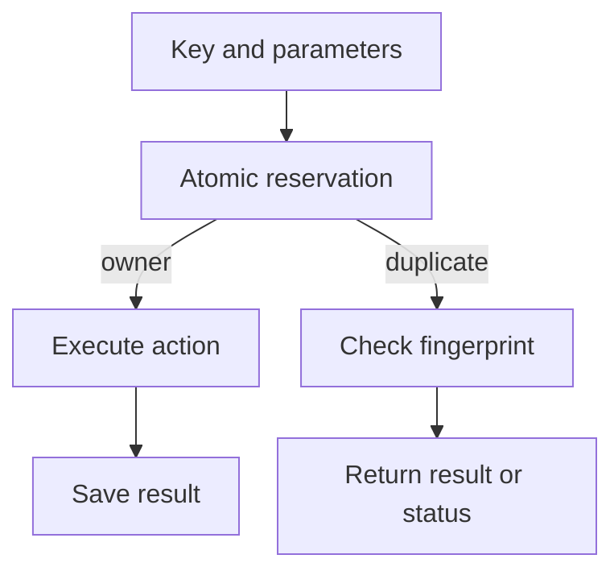

# Idempotency in APIs and background jobs {#idempotency-in-apis-and-background-jobs}

<div class="bdr-post__hero" data-bdr-post="2026-09-14-idempotency-in-apis-and-background-jobs" role="img" aria-label="Retries, redeliveries and lost responses must not repeat a charge or an email" markdown="0"></div>

Networks lose responses, users click twice and brokers redeliver messages. Sooner or later, any request or job arrives twice.

A charge succeeds but its response is lost, so the client retries. An invoice goes out, but its job is redelivered. Neither repeat should charge the buyer or send the email twice.

We will use `idempotency-kit` 0.4.1 with Redis 7 and Python 3.13 for a payment API, a chain of services and a background job, and reproduce the cases where a Redis record alone is not enough.

<!-- more -->

## One payment, several attempts {#payment-example}

The payments service owns the charge. It receives an internal `Payment` command built after authentication: `tenant_id`, `order_id`, a positive `amount` in kopecks and `currency`; a successful charge returns a `Charge`. The gateway and the orders service in front of it only carry the client's key.

The client creates an `Idempotency-Key` when it starts a payment and keeps it for every retry of that payment. A new payment gets a new key, even with the same parameters: a body hash cannot tell two intentions apart. If one order needs several payments, each gets its own key.

<div id="idempotency-keys-the-part-everyone-gets-wrong" data-search-exclude></div>
<div id="what-the-key-promises" data-search-exclude></div>
<div id="measured-the-request-that-is-still-running" data-search-exclude></div>
<div id="it-is-still-not-a-lock" data-search-exclude></div>
<div id="the-key-is-not-the-request" data-search-exclude></div>
<div id="failures-are-not-cached-and-neither-is-the-store" data-search-exclude></div>
<div id="scope-and-lifetime" data-search-exclude></div>
<div id="the-shape" data-search-exclude></div>

## A retry gets the saved result, even while the first is running {#reservation}

The coordinator stores the result under the key and returns it to every retry:

```python
from redis.asyncio import Redis
from idempotency_kit import AsyncIdempotencyCoordinator, IdempotencyDomainService
from idempotency_kit.infra.storage.redis.aio import RedisAsyncIdempotencyRepository


def make_coordinator(redis: Redis) -> AsyncIdempotencyCoordinator:
    return AsyncIdempotencyCoordinator(
        RedisAsyncIdempotencyRepository(redis),
        IdempotencyDomainService(),
        in_flight="raise",
        in_flight_lease_seconds=30,
    )
```

```python
from collections.abc import Awaitable, Callable
from idempotency_kit import (
    IdempotencyIdentifiers, PydanticResultAdapter, fingerprint_of,
)


async def charge_once(
    coordinator: AsyncIdempotencyCoordinator,
    charge: Callable[[Payment, str], Awaitable[Charge]],
    payment: Payment,
    key: str,
) -> Charge:
    ids = IdempotencyIdentifiers(
        operation=f"payment.charge.{payment.tenant_id.hex}",
        idempotency_key=key,
    )
    provider_key = f"{ids.operation}.{ids.idempotency_key}"
    return await coordinator.coordinate(
        ids.operation, ids.idempotency_key, 3600,
        PydanticResultAdapter(Charge), charge, payment, provider_key,
        idempotency_fingerprint=fingerprint_of(
            order_id=payment.order_id,
            amount=payment.amount,
            currency=payment.currency,
        ),
    )
```

The operation name separates tenants' keys, and `fingerprint_of` hashes the parameters. The same key with the same parameters returns the saved `Charge`; a changed amount raises `IdempotencyKeyReuseError`, which we map to 422, as the [IETF Idempotency-Key draft](https://datatracker.ietf.org/doc/draft-ietf-httpapi-idempotency-key-header/) suggests. `IdempotencyIdentifiers` validates the key before the coordinator sees it: an empty key, a colon or more than 255 characters would make `coordinate()` run the action unprotected and store nothing. Answer those with 400.

The hard case is a retry that arrives while the first request is still inside its action. "Read the saved result, charge, save" lets both find nothing. In `wait` and `raise` modes the coordinator reserves the key in Redis first; our API uses `raise`, and its handler maps `IdempotencyInProgressError` to 409 with `payment_in_progress` and `Retry-After: 1`. The lab holds the first call inside its action until the second arrives:

| `in_flight` | What happens to the second request | Charges |
|---|---|---|
| `"run"` | Executes the action too | 2 |
| `"wait"` (the default) | Waits for the first result | 1 |
| `"raise"` (our API) | Receives `IdempotencyInProgressError` | 1 |

The 30-second lease is the library default. Set it above the worst-case action time, including the provider call's timeout: in `wait` mode a duplicate waits up to the lease, and if the first call is still running then, the duplicate runs the action itself. Use `run` only where concurrent duplicates are acceptable.

<!-- diagram:concept -->
<figure class="bdr-diagram" markdown="1">
<figcaption><span class="bdr-diagram__eyebrow">THE IDEA, VISUALIZED</span><strong>Reserve the key before the action</strong></figcaption>
<div class="bdr-diagram__viewport" markdown="1" data-search-exclude>



</div>
<p class="bdr-diagram__caption">The atomic reservation winner executes the action. A duplicate checks its parameters and receives a saved result or an in-progress response.</p>
</figure>
<!-- /diagram:concept -->

<div id="idempotency-across-a-chain-of-microservices" data-search-exclude></div>
<div id="the-shape-of-the-problem" data-search-exclude></div>
<div id="the-mistake-that-looks-like-a-fix" data-search-exclude></div>
<div id="the-key-belongs-to-the-request-not-to-the-attempt" data-search-exclude></div>
<div id="the-line-that-says-the-work-is-not-finished" data-search-exclude></div>
<div id="when-there-is-no-key-to-propagate" data-search-exclude></div>
<div id="what-to-standardise-across-the-chain" data-search-exclude></div>
<div id="the-pieces" data-search-exclude></div>

## A response is lost between services {#propagation}

The gateway calls orders, which calls payments. Both forward the client's key unchanged on their own retries and pass 409 and 422 back to the caller. The lab closes two connections on purpose: after payments has charged and saved the result, and after orders has received it. With two calls to orders and three to payments:

| Design | Charges |
|---|---|
| No coordinator | 3 |
| A coordinator, but the gateway creates a new key on retry | 2 |
| The same key survives every attempt | 1 |

Deadlines and retry delays for such calls are covered in [the HTTP and gRPC clients article](2026-09-13-production-http-grpc-clients.md).

<div id="idempotency-for-background-jobs-and-kafka-consumers" data-search-exclude></div>
<div id="the-crash-before-the-ack" data-search-exclude></div>
<div id="two-workers-one-job" data-search-exclude></div>
<div id="what-the-key-is-made-of" data-search-exclude></div>
<div id="consumers-the-inbox-and-the-key-are-not-the-same-tool" data-search-exclude></div>
<div id="lifetime" data-search-exclude></div>

## The worker sent the invoice but did not acknowledge the job {#jobs}

The queue redelivers an invoice job with a new `delivery_id`. The invoice itself is identified by tenant, order and version, and those fields form its key:

```python
from idempotency_kit import JsonResultAdapter


class InvoiceJob(BaseModel):
    delivery_id: UUID
    tenant_id: UUID
    order_id: UUID
    invoice_version: int = Field(ge=1)
    email: str


async def send_invoice_once(coordinator, send, job: InvoiceJob):
    operation = f"mail.invoice.{job.tenant_id.hex}"
    key = f"{job.order_id.hex}.v{job.invoice_version}"
    return await coordinator.coordinate(
        operation, key, 86400, JsonResultAdapter(),
        send, job, f"{operation}.{key}",
        idempotency_fingerprint=fingerprint_of(email=job.email),
    )
```

`send` calls the mail provider and returns a result such as `{"email_id": "em_1"}`; the worker acknowledges the job only after `send_invoice_once` returns. In the lab, the acknowledgement fails after the result is stored; on redelivery, `send_invoice_once` returns the original `email_id` and the worker acknowledges. Two deliveries, one email. A new invoice version is sent separately, and a changed recipient for an old version is refused by the fingerprint. The worker uses the same `raise` coordinator: on `IdempotencyInProgressError` it does not acknowledge, and the queue delivers the job again later.

## The provider charged, but its response was lost {#effects}

Now the provider charges the buyer, but its response is lost inside `charge`. The function raises, the coordinator deletes the reservation, and the next attempt calls the provider again:

| Provider behavior in the lab | Calls | Charges |
|---|---|---|
| Every call charges the buyer | 2 | 2 |
| Stores a result under the stable provider key | 2 | 1 |

That is why `charge_once` gives the provider a key built from the tenant, the action and the client's key. Whether the provider deduplicates by key, and for how long, is part of the integration contract; without it, an uncertain outcome needs a status check before another charge.

## Redis is unavailable, or the key has expired {#failure-policy}

When Redis fails, idempotency-kit 0.4.1 runs the action without protection (fail open). In the lab, two calls with one key during a Redis outage charge twice at a provider without its own deduplication. So payment protection must hold at the provider, and changes to your own database belong in one transaction with the processing record.

Records expire too. The lease covers a running action, payment results live for an hour and invoice results for a day; once a record is gone, the original key runs the action again, so cover your longest retry or redelivery window. The coordinator keeps TTLs in whole minutes, rounding down, with a one-minute minimum. A crashed process leaves its reservation until the lease runs out, and expiry does not stop a slow first action: the lab shows a second one starting beside it.

## What to take into your service {#conclusion}

Give each action one identity and keep it across every attempt, hop and redelivery. [idempotency-kit](https://bedrock-python.github.io/idempotency-kit/) reserves keys, compares parameters and replays saved results. External actions still need the provider to deduplicate by the same key, and changes in your own database need one transaction with the processing record.

## Examples and labs {#labs}

Redis and HTTP services in the labs are real; the payment and mail providers and the queue are simulated.

- [Lab: idempotency keys](../lab/2026-09-07-idempotency-keys/README.md)
- [Lab: idempotency across a chain of services](../lab/2026-09-07-idempotency-across-a-chain/README.md)
- [Lab: idempotency for background jobs and consumers](../lab/2026-09-07-idempotency-for-jobs-and-consumers/README.md)
