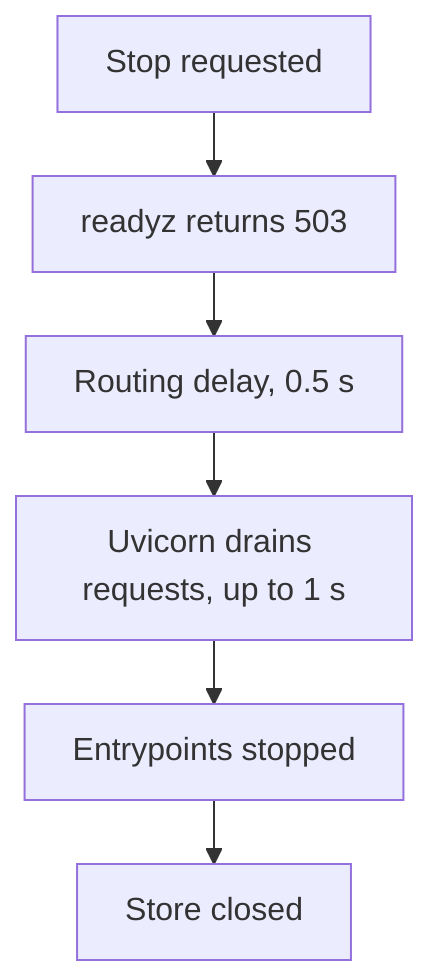

# The Python service lifecycle: startup, health checks and shutdown {#python-service-lifecycle}

<div class="bdr-post__hero" data-bdr-post="2026-09-20-python-service-lifecycle" role="img" aria-label="Stop being routed first, then drain, then finish, then exit" markdown="0"></div>

A service in Kubernetes restarts all the time: on every rollout, on scaling, when a pod moves to another node. Each time it goes through startup, health checks and shutdown, and a mistake in any step costs requests.

During a rollout, for example, a Python service can close its database pool while a request is still using it. Startup checks, readiness and shutdown need one fixed order for every entrypoint, not only for HTTP.

Our example is a reports service: `GET /reports` builds a report on demand, and a worker builds the same report in the background. Both use one database, and an accepted request must finish before the database connection closes.

<!-- more -->

<div id="why-application-lifecycle-should-not-belong-to-fastapi" data-search-exclude></div>
<div id="the-api-as-usually-written" data-search-exclude></div>
<div id="the-worker-as-usually-written" data-search-exclude></div>
<div id="the-framework-is-an-entrypoint" data-search-exclude></div>
<div id="what-fastapis-lifespan-is-still-for" data-search-exclude></div>

## Define the lifecycle once {#ownership}

With HTTP alone, FastAPI lifespan can open the store and close it after Uvicorn drains requests. A worker has no lifespan: its own `main()` must repeat the setup and also handle signals, report readiness and close resources in the right order. The [before example](../lab/2026-09-07-lifecycle-not-fastapi/README.md) shows both hand-written versions.

[servicewright](https://bedrock-python.github.io/servicewright/) gives both entrypoints one set of rules: `AppSpec` describes the application, `Service` runs it, and entrypoints such as FastAPI receive work. The container's `app_scope()` opens the store once; `unit_scope()` hands it to each request, and the worker's loop runs in one long-lived unit scope. In the [shared lifecycle lab](../lab/2026-09-07-one-lifecycle/README.md), `ReportStore` is an in-memory stand-in for a database that fails an assertion if it is used after closing.

<div id="one-lifecycle-for-http-grpc-workers-and-cron-jobs" data-search-exclude></div>
<div id="host-and-entrypoints" data-search-exclude></div>
<div id="one-process" data-search-exclude></div>
<div id="two-processes" data-search-exclude></div>
<div id="what-the-entrypoints-look-like" data-search-exclude></div>
<div id="the-one-thing-to-get-right" data-search-exclude></div>

## Check the store, then start HTTP and the worker {#startup}

Opening a client object does not prove its dependency is reachable. Before accepting work, run a bounded warmup:

```python
import asyncio
from servicewright import AsyncWarmer


class StoreWarmer(AsyncWarmer):
    def __init__(self, store):
        super().__init__()
        self.store = store

    async def warmup(self):
        async with asyncio.timeout(2):
            await self.store.ping()
```

If `ping()` fails or stalls for two seconds, startup fails: the application scope closes the store, and the HTTP port never opens. The handler and the worker then get the same prepared store:

```python
from fastapi import APIRouter
from servicewright.adapters.fastapi import UnitScopeDep

router = APIRouter()


@router.get('/reports')
async def report(unit: UnitScopeDep) -> dict[str, int]:
    store = await unit.get(ReportStore)
    return await store.report('http')
```

```python
async def periodic_report(scope, stop: asyncio.Event):
    store = await scope.get(ReportStore)
    while True:
        try:
            await asyncio.wait_for(stop.wait(), timeout=0.5)
            return
        except TimeoutError:
            pass
        async with asyncio.timeout(1):
            await store.report('worker')
```

The worker waits half a second between reports, checks the stop event before each one and gives a report at most one second. The spec and the process roles tie everything together; the three drain settings are explained in the shutdown section:

```python
from servicewright import AppSpec


def make_spec(container):
    return AppSpec(
        service_name='reports',
        create_container=lambda settings: container,
        warmers=[StoreWarmer(container.store)],
        drain_delay_seconds=0.5,
        drain_grace_seconds=3,
        cleanup_timeout_seconds=2,
    )
```

```python
from servicewright import DaemonEntrypoint, Service
from servicewright.adapters.fastapi import FastApiEntrypoint, HttpConfig


def build_service(role, *, port=8080, store=None):
    container = Container(store if store is not None else ReportStore())
    api = FastApiEntrypoint(
        config=HttpConfig(host='127.0.0.1', port=port, graceful_timeout=1),
        routers=(router,),
    )
    worker = DaemonEntrypoint(periodic_report)
    roles = {'api': [api], 'worker': [worker], 'all': [api, worker]}
    service = Service(make_spec(container), entrypoints=roles[role])
    return service, api, container
```

`build_service('all')` runs HTTP and the worker in one process with one store; `api` and `worker` as separate deployments each open their own store under the same rules. In production, `run_sync(service, settings)` installs SIGTERM and SIGINT handlers, and a second signal forces an exit. Start the process in exec form, so that it receives SIGTERM directly.

<div id="warmup-readiness-and-liveness-are-three-different-things" data-search-exclude></div>
<div id="the-whole-life-of-a-pod-in-six-transitions" data-search-exclude></div>
<div id="warmup-is-not-readiness-and-neither-is-it-liveness" data-search-exclude></div>
<div id="liveness-is-about-the-process-not-the-dependencies" data-search-exclude></div>
<div id="readiness-has-to-go-false-before-the-pod-stops-serving" data-search-exclude></div>
<div id="the-three-in-one-table" data-search-exclude></div>
<div id="the-pieces" data-search-exclude></div>

## Disconnect a dependency and watch the right probe fail {#health}

Suppose the service also keeps background-job status in Redis, and a pod without Redis cannot do useful new work. Add a readiness check:

```python
from redis.exceptions import RedisError
from servicewright import HealthRegistry


class RedisReady:
    def __init__(self, redis):
        self.redis = redis

    async def check(self) -> bool:
        try:
            async with asyncio.timeout(0.25):
                return bool(await self.redis.ping())
        except (RedisError, TimeoutError):
            return False


def redis_health(redis):
    health = HealthRegistry()
    health.add_check('job-state', RedisReady(redis))
    return health
```

The [health lab](../lab/2026-09-07-warmup-readiness-liveness/README.md) sets `spec.health = redis_health(client)`, adds a Redis warmer and closes the client with the application scope. Each probe sends a live `PING` within 250 ms, client retries included; `HealthRegistry(readiness_cache_ttl=...)` can cache the result instead. The lab pauses a real Redis container:

| Situation | `livez` | `readyz` | Direct `/reports` |
| --- | --- | --- | --- |
| Redis paused | 200 | 503 | 200 |
| Stop requested, routing delay running | 200 | 503 | 200 |

Before the outage and after Redis returns, `readyz` answers 200. `/reports` does not use Redis, so a direct request still works: readiness affects routing, not the handler. Put a dependency into readiness only when the pod cannot do useful work without it, and keep an optional cache out. Remember the cost: a shared Redis outage makes every replica unready at once, the Service is left without endpoints, and clients get the load balancer's error instead of your 503.

In servicewright 0.13.1, the FastAPI listener opens after warmup, so the startup probe uses `livez`. Its window, `failureThreshold × periodSeconds`, must exceed the total warmup limit, which defaults to 60 seconds. For Kubernetes, drop the lab's `host` override: the default `0.0.0.0` lets probes reach the pod IP.

```yaml
# Fragment of spec.containers[0]; the container listens on port 8080.
startupProbe:
  httpGet: {path: /system/health/livez, port: 8080}
  periodSeconds: 2
  failureThreshold: 35
readinessProbe:
  httpGet: {path: /system/health/readyz, port: 8080}
  periodSeconds: 2
livenessProbe:
  httpGet: {path: /system/health/livez, port: 8080}
  periodSeconds: 10
  failureThreshold: 3
```

Readiness decides whether the pod receives Service traffic; repeated liveness failures restart the container. The built-in `livez` confirms that the HTTP path and the event loop respond, not that the database is healthy. See [Kubernetes probes](https://kubernetes.io/docs/tasks/configure-pod-container/configure-liveness-readiness-startup-probes/).

<div id="graceful-shutdown-in-kubernetes-is-a-protocol-not-a-signal-handler" data-search-exclude></div>
<div id="what-kubernetes-actually-does" data-search-exclude></div>
<div id="the-measurement" data-search-exclude></div>
<div id="the-protocol" data-search-exclude></div>
<div id="the-same-measurement-with-the-protocol" data-search-exclude></div>
<div id="sizing-the-numbers" data-search-exclude></div>
<div id="not-only-http" data-search-exclude></div>
<div id="what-changed-in-the-code" data-search-exclude></div>

## Finish an accepted report before closing its store {#shutdown}

Take the API-only role. A 0.8-second report is in progress when shutdown starts:

<!-- diagram:concept -->
<figure class="bdr-diagram" markdown="1">
<figcaption><span class="bdr-diagram__eyebrow">THE IDEA, VISUALIZED</span><strong>The HTTP shutdown sequence</strong></figcaption>
<div class="bdr-diagram__viewport" markdown="1" data-search-exclude>



</div>
<p class="bdr-diagram__caption">Readiness goes false first, routing gets time to catch up, active requests finish within the graceful timeout, and only then do resources close.</p>
</figure>
<!-- /diagram:concept -->

| Setting in the example | What it limits |
| --- | --- |
| `drain_delay_seconds=0.5` | The pause after readiness goes false, before drain starts |
| `HttpConfig.graceful_timeout=1` | Uvicorn's wait for active requests |
| `drain_grace_seconds=3` | The drain allowance passed to each entrypoint; for HTTP, Uvicorn's smaller limit wins ([servicewright #89](https://github.com/bedrock-python/servicewright/issues/89)) |
| `cleanup_timeout_seconds=2` | Each runtime cleanup step; closing your own resources in `app_scope()` is not covered, so bound the pool's close yourself |

The [shutdown lab](../lab/2026-09-07-graceful-shutdown/README.md) starts the report, requests a stop and checks that the report returns 200 before the store closes: `store.events.index('http:done') < store.events.index('store:close')`. A 30-second report exceeds Uvicorn's one-second limit and is cancelled first; with no response started, the client gets 500. A response already streaming would be cut off mid-body. In the `all` role, the sequence starts only after the worker's current report finishes, at most one second here; servicewright waits for a daemon function to return, so a queue consumer has to bound its own drain inside it.

In Kubernetes, a terminating pod's endpoints are marked not ready as soon as deletion starts; the `readyz` 503 matters for load balancers that poll it. The routing delay covers the time it takes EndpointSlice changes to reach kube-proxy and ingress controllers, usually seconds, so 0.5 seconds is only a lab value. Set `terminationGracePeriodSeconds` above the sum of the `preStop` hook, the worker's current task, the routing delay, the drain, the cleanup steps and your resources' close. See [Pod termination](https://kubernetes.io/docs/concepts/workloads/pods/pod-lifecycle/#pod-termination-flow).

## What to use in your service {#conclusion}

Before deploying, check three things: the startup probe window exceeds the warmup limit, the routing delay covers endpoint propagation in your cluster, and the grace period exceeds the whole shutdown sequence. [servicewright](https://bedrock-python.github.io/servicewright/) keeps that sequence the same for HTTP, workers and other entrypoints; an HTTP-only service can stay with FastAPI lifespan.

## Examples and labs {#labs}

The labs use Python 3.13, `servicewright==0.13.1`, `fastapi==0.141.1`, `uvicorn==0.53.0` and `httpx==0.28.1`. HTTP, Redis and servicewright are real and the store is in memory; the drivers stop the service through an event, so they do not test SIGTERM delivery or a Kubernetes rollout.

- [FastAPI lifespan and a separately wired worker](../lab/2026-09-07-lifecycle-not-fastapi/README.md)
- [One lifecycle for HTTP and a worker](../lab/2026-09-07-one-lifecycle/README.md)
- [Warmup, readiness and liveness with real Redis](../lab/2026-09-07-warmup-readiness-liveness/README.md)
- [Completion and cancellation of HTTP requests during shutdown](../lab/2026-09-07-graceful-shutdown/README.md)
