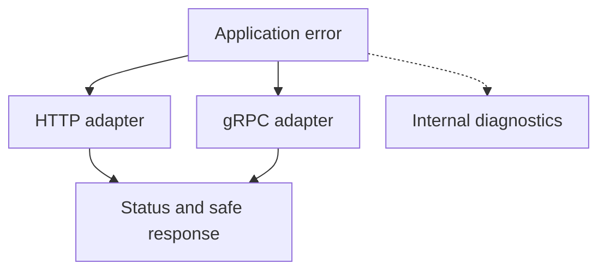

# Preparing a Python gRPC server for production {#production-python-grpc-server}

<div class="bdr-post__hero" data-bdr-post="2026-09-23-production-python-grpc-server" role="img" aria-label="Errors, limits, health checks and shutdown around one gRPC method" markdown="0"></div>

Starting a gRPC server in Python is easy: a handler and a few lines of startup code. Making it behave predictably when things go wrong is the hard part.

Take a `GetInvoice` method. It works on the happy path, but it still has to survive a request for someone else's order, a database outage, overload and a rollout. We will handle all of them in one gRPC server and check what the client actually receives.

The code was verified with grpc-server-kit 0.2.0, servicewright 0.13.1 and grpcio 1.84.0 on Python 3.13.

<!-- more -->

<div id="the-anatomy-of-a-production-python-grpc-server" data-search-exclude></div>
<div id="the-handler-that-raises" data-search-exclude></div>
<div id="where-the-reporting-interceptor-goes" data-search-exclude></div>
<div id="message-size" data-search-exclude></div>
<div id="shutdown" data-search-exclude></div>
<div id="health" data-search-exclude></div>
<div id="tls-and-the-file-permissions" data-search-exclude></div>
<div id="reflection-and-the-rest-of-the-list" data-search-exclude></div>
<div id="the-order" data-search-exclude></div>
<div id="the-pieces" data-search-exclude></div>

## Start with the invoice operation {#pipeline}

A buyer requests the invoice of a paid order. The buyer's identity comes from verified authentication; the application function checks ownership and payment. Its errors are servicewright `ServiceError` subclasses: `kind` is the category, `code` is a stable string for clients, and `public` (true by default) allows that code to leave the service. None of them knows about HTTP or gRPC:

```python
from servicewright import ErrorKind, ServiceError


class OrderNotFound(ServiceError):
    kind = ErrorKind.NOT_FOUND
    code = "order_not_found"


class InvoiceNotReady(ServiceError):
    kind = ErrorKind.PRECONDITION_FAILED
    code = "invoice_not_ready"


class InvoiceAccessDenied(ServiceError):
    kind = ErrorKind.FORBIDDEN
    code = "invoice_access_denied"


class InvoiceStoreUnavailable(ServiceError):
    kind = ErrorKind.UNAVAILABLE
    code = "invoice_store_unavailable"
```

```python
async def get_invoice(store, order_id: str, buyer_id: str) -> dict:
    async with store.read(order_id) as order:
        if order is None:
            raise OrderNotFound("Order not found")
        if order["buyer_id"] != buyer_id:
            raise InvoiceAccessDenied("Access denied")
        if not order["paid"]:
            raise InvoiceNotReady("The order has not been paid")
        return {"invoice_id": order["invoice_id"], "amount": order["amount"]}
```

`store.read()` releases its resource on exceptions and cancellation too. The function checks existence before ownership, so `NOT_FOUND` and `PERMISSION_DENIED` reveal which order IDs exist; check permission first if that matters. In the lab, the method is registered over raw bytes and the buyer is fixed fixture data.

<div id="mapping-python-exceptions-to-grpc-status-codes-without-leaking-internals" data-search-exclude></div>
<div id="what-happens-with-no-map-at-all" data-search-exclude></div>
<div id="the-default-map" data-search-exclude></div>
<div id="the-map-is-a-client-contract-not-a-formatting-decision" data-search-exclude></div>
<div id="details-the-two-tier-rule" data-search-exclude></div>
<div id="what-belongs-where" data-search-exclude></div>

## The order is unpaid: what does the client receive? {#errors}

`InvoiceNotReady` becomes `FAILED_PRECONDITION`: retrying without changing the order cannot help. The other statuses follow the [gRPC status guide](https://grpc.io/docs/guides/status-codes/). We take them from each error's `kind`, so the gRPC table cannot drift from the HTTP one:

```python
import grpc
from grpc_server_kit.aio.interceptors import AsyncExceptionHandlerInterceptor
from servicewright.adapters.grpc import GRPC_STATUS_BY_KIND


SERVICE = "orders.Invoices"
PUBLIC_ERRORS = (
    OrderNotFound, InvoiceNotReady, InvoiceAccessDenied, InvoiceStoreUnavailable,
)
ERROR_STATUS = {error: GRPC_STATUS_BY_KIND[error.kind] for error in PUBLIC_ERRORS}


def public_details(error, status):
    if isinstance(error, PUBLIC_ERRORS) and error.public:
        return error.code
    return "internal_error"


def exception_handler():
    return AsyncExceptionHandlerInterceptor(
        error_status_map=ERROR_STATUS,
        detail_factory=public_details,
        merge_defaults=False,
    )
```

`public_details` sends only the stable code of a known public error, never the exception text; anything else becomes `internal_error`. `merge_defaults=False` keeps only our table, because the library's defaults map `ValueError` to `INVALID_ARGUMENT` and would blame the client for an internal bug. The lab raises an internal `ValueError` through a real RPC:

| Server assembly | Status for an internal `ValueError` | What the client sees |
|---|---|---|
| No exception interceptor | `UNKNOWN` | Exception text with internal data |
| Default interceptor | `INVALID_ARGUMENT` | Safe details, but the wrong classification |
| Our mapping | `INTERNAL` | `internal_error` |

An explicit `await context.abort(...)`, for example from an authentication check, keeps its status; only uncaught exceptions are mapped. One gap remains: in grpc-server-kit 0.2.0, a `grpc.RpcError` from a downstream call passes through unchanged and reaches the client as `UNKNOWN`, together with the downstream service's details. Catch such errors in the handler and convert them. Logs need their own secret filtering: a safe response does not sanitize them.

<div id="transport-independent-errors-one-domain-error-http-and-grpc-responses" data-search-exclude></div>
<div id="the-domain-raises-and-does-not-format" data-search-exclude></div>
<div id="the-same-seven-calls-two-transports" data-search-exclude></div>
<div id="what-each-layer-is-allowed-to-know" data-search-exclude></div>
<div id="testing-it-once" data-search-exclude></div>
<div id="what-this-does-not-solve" data-search-exclude></div>

## Bound message sizes and active calls {#operations}

```python
from grpc_server_kit import GrpcApp, GrpcServerConfig


def server_config():
    return GrpcServerConfig(
        host="127.0.0.1", port=0,
        max_receive_message_length=64 * 1024,
        max_send_message_length=64 * 1024,
        max_concurrent_rpcs=32,
        grace_period=1.0,
    )
```

These are lab values. In production, listen on the pod address rather than `127.0.0.1`, give `grace_period` enough time for real RPCs (the default is 5 seconds) and size the limits from your messages and capacity; the 64 KiB limit applies to requests and responses alike. The lab lowers the RPC limit to one and holds the first request inside its read:

| Next request | Result |
|---|---|
| On the same HTTP/2 connection | Waits for a stream slot and may exceed its deadline |
| Through a separate connection | Gets `RESOURCE_EXHAUSTED` from the server-wide RPC limit |
| With a 65 KiB body under a 64 KiB limit | Gets `RESOURCE_EXHAUSTED` before accessing storage |

`max_concurrent_rpcs` sets both the server-wide limit and the connection's `grpc.max_concurrent_streams`, so overload does not always produce an immediate refusal: clients still need deadlines to bound their wait.

## Metrics need the status; diagnostics need the original exception {#interceptors}

```python
from grpc_server_kit.aio.interceptors import (
    AsyncMetricsInterceptor, AsyncSentryInterceptor,
)
from grpc_server_kit.aio.interceptors.exception_handler import find_mapped_status


def build_app(store, metrics, reporter, *, config=None):
    app = GrpcApp(config or server_config(), interceptors=[
        AsyncMetricsInterceptor(metrics, service_name=SERVICE),
        exception_handler(),
        AsyncSentryInterceptor(reporter, capture_filter=lambda error:
            find_mapped_status(type(error), ERROR_STATUS) in {
                grpc.StatusCode.INTERNAL, grpc.StatusCode.UNAVAILABLE,
            }),
    ])
    app.register(lambda server: register_invoice_service(server, store))
    return app
```

`metrics` and `reporter` are lab recorders; `AsyncSentryInterceptor` accepts any reporter. The list runs outermost first, and exceptions travel back outward: the reporter sees the original exception, the handler turns it into `INTERNAL`, and metrics record the final status. The filter reports internal errors and storage outages but not refusals such as `InvoiceNotReady`. With the reporter placed outside the exception handler, the lab shows it receiving a finished abort instead of the original exception.

## Health checks report readiness {#readiness}

```python
class InvoiceStoreHealth:
    def __init__(self, store):
        self.store = store

    async def check(self) -> bool:
        return await self.store.ping()


def enable_readiness(app, store):
    app.enable_health(
        checkers=[InvoiceStoreHealth(store)],
        service_names=[SERVICE],
        cache_ttl=0,
        check_timeout=0.2,
    )
```

Call `enable_readiness(app, store)` before starting the server; `check_timeout` bounds the whole round of checks. With `cache_ttl=0`, the lab sees `SERVING`, `NOT_SERVING` and `SERVING` again as storage fails and recovers, and a hanging check becomes `NOT_SERVING` after the timeout. In production, cache the result so load-balancer probes do not hit storage on every call. A direct `GetInvoice` call still reaches the handler: the [health service](https://grpc.io/docs/guides/health-checking/) reports state, it does not block RPCs.

## The client leaves, then the server shuts down {#shutdown-example}

Release resources with context managers and `finally`, and do not treat `CancelledError` as an application failure. In the lab, both cancellation and a client deadline end the read and release the store; the client sees `DEADLINE_EXCEEDED`, while the server's metric records `CANCELLED`, two views of one termination.

```python
async def serve_invoices(app, store):
    try:
        await app.run()
    finally:
        await store.close()
```

`app.run()` installs signal handlers and serves until a signal or `app.request_shutdown()`. It then stops accepting RPCs and gives active ones `grace_period` to finish: a short request returns its response, a stuck one is cancelled and its client gets `UNAVAILABLE`. Storage closes only after that. If servicewright owns the process, it stops entrypoints and resources in order, as in [the lifecycle article](2026-09-20-python-service-lifecycle.md).

## Enable TLS and verify the client {#tls-example}

TLS needs `ssl_enabled`, `ssl_cert_file` and `ssl_key_file` in `GrpcServerConfig`; `ssl_ca_file` with `ssl_client_auth=True` also requires client certificates (mTLS). The lab generates temporary certificates and checks real connections: a TLS client succeeds, mTLS requires a client certificate, and plaintext fails in both setups. The library checks PEM files only for their BEGIN/END markers. On Unix it refuses a private key readable by group or others; on Windows, ACLs control access instead.

## One application function for HTTP and gRPC {#two-transports}

The [transport lab](../lab/2026-09-07-transport-independent-errors/README.md) serves the same `get_invoice` through servicewright's FastAPI and gRPC entrypoints. servicewright maps each error by its `kind`:

| Cause | HTTP | gRPC | Shared error code |
|---|---|---|---|
| Missing order | 404 | `NOT_FOUND` | `order_not_found` |
| Unpaid order | 412 | `FAILED_PRECONDITION` | `invoice_not_ready` |
| Another buyer's order | 403 | `PERMISSION_DENIED` | `invoice_access_denied` |
| Storage temporarily unavailable | 503 | `UNAVAILABLE` | `invoice_store_unavailable` |
| Internal failure | 500 | `INTERNAL` | `internal_error` |

<!-- diagram:concept -->
<figure class="bdr-diagram" markdown="1">
<figcaption><span class="bdr-diagram__eyebrow">THE IDEA, VISUALIZED</span><strong>Translate errors at the transport boundary</strong></figcaption>
<div class="bdr-diagram__viewport" markdown="1" data-search-exclude>



</div>
<p class="bdr-diagram__caption">Application code reports the failure. Each transport adapter selects a status and the public details; internal details stay in diagnostics.</p>
</figure>
<!-- /diagram:concept -->

The stable code travels in the problem JSON body and in `x-error-code` trailing metadata. Unlike our `GrpcApp`, servicewright also sends the message of a public error to the client, as gRPC details and as the HTTP `detail`, so keep those messages fit for clients. The 412 is servicewright's choice: RFC 9110 reserves 412 for failed conditional headers, and Google's API guidelines map `FAILED_PRECONDITION` to 400. The entrypoint does not reuse the `GrpcApp` assembled above either: its limits, interceptors, health and TLS are configured separately.

## What to use in your service {#conclusion}

Give every expected failure a `kind` and a stable code, derive statuses from that one place, and check what actually reaches the client, internal and downstream errors included. [grpc-server-kit](https://bedrock-python.github.io/grpc-server-kit/) assembles the gRPC server with these interceptors, limits, health checks and TLS; [servicewright](https://bedrock-python.github.io/servicewright/) runs HTTP and gRPC under one lifecycle. Failures while reading streams need their own checks, covered in [the streaming interceptors article](2026-09-08-why-grpc-interceptors-break-on-streaming-rpcs.md).

## Examples and labs {#labs}

- [Lab: the anatomy of a production gRPC server](../lab/2026-09-07-production-grpc-server/README.md)
- [Lab: Python exceptions to gRPC status codes](../lab/2026-09-07-python-exceptions-to-grpc-status-codes/README.md)
- [Lab: one domain error, two transports](../lab/2026-09-07-transport-independent-errors/README.md)
