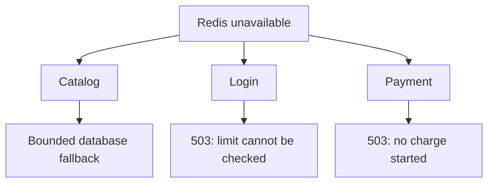

# Redis is down: which routes keep working, and why PING won't tell you {#redis-failures-and-health-checks}

<div class="bdr-post__hero" data-bdr-post="2026-09-30-redis-failures-and-health-checks" role="img" aria-label="The absent dependency is one thing; what to do without it is three different decisions" markdown="0"></div>

In an online shop, Redis usually sits next to the main database: it caches prices, counts login attempts and gates repeated payment clicks. While it works, nobody thinks about it.

When Redis goes down, the shop can still show prices from PostgreSQL, but must refuse sign-in and payment it can no longer protect. A successful PING will not tell you which is which.

We will take Redis offline and decide each route's behavior. The examples were checked with Python 3.13, `redis-client-kit[settings]==0.3.0`, `redis==8.1.0` and Redis 7.4.11; the [lab](../lab/2026-09-07-when-should-redis-fail-open/README.md) has the complete code.

<!-- more -->

## Bound the wait for Redis {#timeouts}

Prices live in PostgreSQL, so the cache has a fallback, but only if waiting for Redis leaves time to read the database. [redis-client-kit](https://bedrock-python.github.io/redis-client-kit/) builds the shared `redis-py` client from settings; the application creates it at startup and closes it with `await redis.aclose()`:

```python
from redis_client_kit import create_async_redis_client
from redis_client_kit.settings import (
    BaseRedisSettings,
    RedisConnectionSettings,
    RedisPoolSettings,
    RedisResponseSettings,
    RedisRetrySettings,
)


def make_redis(host="localhost", port=6379):
    return create_async_redis_client(BaseRedisSettings(
        key_prefix="shop",
        connection=RedisConnectionSettings(host=host, port=port),
        pool=RedisPoolSettings(
            max_connections=10,
            socket_connect_timeout=0.1,
            socket_timeout=0.1,
        ),
        response=RedisResponseSettings(decode_responses=True),
        retry=RedisRetrySettings(enabled=False, max_attempts=0),
        health_check_interval=0,
    ))
```

redis-py 8 retries a failed command ten times by default; the kit passes zero unless retries are enabled, and the snippet spells that out. In the lab, one attempt fails after 0.10 seconds, two retries stretch it to 0.33, and the 0.15-second limit below caps it at 0.16. `health_check_interval=0` turns off redis-py's `PING` before commands on an idle connection: without retries it cannot save a dead connection and only adds a round trip. `key_prefix` is required by the settings model but not applied to keys, so the commands include `shop:` themselves. The pool does not wait for a free connection either: with `max_connections=10`, the eleventh concurrent command fails at once, so size it for the process's concurrent Redis calls.

Each Redis call gets a total limit:

```python
import asyncio
import logging

from redis.exceptions import RedisError

log = logging.getLogger("shop")
REDIS_FAILURES = (RedisError, TimeoutError)


class ServiceUnavailable(Exception):
    pass


async def redis_call(command):
    async with asyncio.timeout(0.15):
        return await command
```

The caller's cancellation still propagates, because `CancelledError` is not in `REDIS_FAILURES`. A command that was already sent may still execute on the server. Choose the limits from the [request deadline](2026-09-06-timeouts-are-not-deadlines.md): with the values here, the slowest catalog path takes 0.15 + 0.5 + 0.15 seconds.

<div id="when-should-redis-fail-open" data-search-exclude></div>
<div id="before-deciding-anything-how-long-does-it-take-to-know" data-search-exclude></div>
<div id="the-cache-open-always" data-search-exclude></div>
<div id="the-rate-limiter-open-and-say-so" data-search-exclude></div>
<div id="the-idempotency-store-it-depends-on-what-repeating-costs" data-search-exclude></div>
<div id="health-what-readiness-should-depend-on" data-search-exclude></div>
<div id="and-then-it-comes-back" data-search-exclude></div>
<div id="the-shape" data-search-exclude></div>

## Three operations, three failure decisions {#failure-policy}

For each route we decide whether to keep working without Redis (fail open) or to refuse (fail closed).

### Catalog: fall back to the database {#cache-fallback}

`load_price(sku)` reads a price from PostgreSQL; the lab substitutes a counted lookup:

```python
db_slots = asyncio.Semaphore(8)


async def product_price(redis, load_price, sku):
    key = f"shop:price:{sku}"
    cache_available = True
    try:
        cached = await redis_call(redis.get(key))
        if cached is not None:
            return cached
    except REDIS_FAILURES:
        cache_available = False
        log.warning("cache_read_failed", exc_info=True)

    try:
        async with asyncio.timeout(0.5):
            async with db_slots:
                price = await load_price(sku)
    except TimeoutError as error:
        raise ServiceUnavailable("Catalog is busy") from error

    if cache_available:
        try:
            await redis_call(redis.set(key, price, ex=60))
        except REDIS_FAILURES:
            log.warning("cache_write_failed", exc_info=True)
    return price
```

On a miss or a Redis error, the function reads the database; if Redis was unavailable, it skips the cache write. The semaphore keeps database concurrency at eight per process, and no request waits more than half a second for a slot and the read. Overload raises `ServiceUnavailable`, which the HTTP handler maps to 503. The lab checks that two consecutive requests need one database read, that a paused Redis sends the next read to the database and that a full semaphore refuses an extra request.

### Login: fail closed {#login-rate-limit}

The limit is five attempts per account per minute, counted from the first attempt. Without Redis the limit cannot be checked, so the route returns 503; exceeding it on a working Redis gives 429. `INCR` and `PEXPIRE` run in one Lua script, as in the [Redis rate limiter pattern](https://redis.io/docs/latest/commands/incr/#pattern-rate-limiter), so a crash between them cannot leave a counter without a TTL:

```python
LOGIN_WINDOW = """
local count = redis.call('INCR', KEYS[1])
if count == 1 then
    redis.call('PEXPIRE', KEYS[1], ARGV[1])
end
return count
"""


class TooManyRequests(Exception):
    pass


async def allow_login(redis, account_id):
    try:
        count = await redis_call(redis.eval(
            LOGIN_WINDOW, 1, f"shop:login:{account_id}", 60_000,
        ))
    except REDIS_FAILURES as error:
        raise ServiceUnavailable("Login protection unavailable") from error
    if count > 5:
        raise TooManyRequests("Login limit reached")
```

`account_id` comes from the normalized login name, and the check runs before the password. Eight concurrent attempts in the lab admit five and reject three. If the `EVAL` reply is lost, the attempt may already be counted, so the command is not retried. A per-account limit also lets anyone lock out a known account; real login flows add limits by request source.

### Payment: no charge without admission {#payment-admission}

A double click on Pay must not run the payment flow twice. A temporary `SET NX` key admits one handler; the other gets `PaymentBusy`, which the HTTP layer maps to 409. The provider supports idempotent charges: the same key and amount, even concurrently, never create a second payment, and our retries reuse both:

```python
class PaymentBusy(Exception):
    pass


async def pay_order(redis, charge, order_id, amount_minor):
    try:
        acquired = await redis_call(redis.set(
            f"shop:payment:{order_id}", "pending", nx=True, ex=30,
        ))
    except REDIS_FAILURES as error:
        raise ServiceUnavailable("Payment admission unavailable") from error
    if not acquired:
        raise PaymentBusy("A payment attempt already exists")

    return await charge(
        amount_minor=amount_minor,
        idempotency_key=f"shop:order:{order_id}",
    )
```

So the provider protects against a second charge, and Redis only keeps our own flow from running twice. When Redis is unavailable, the shop returns 503 and starts no charge. That is a conservative choice: with a provider that deduplicates concurrent calls, failing open would also be defensible.

The code never deletes the key, so for 30 seconds every repeat gets 409, a declined card included. If the provider charged but its response was lost, a retry after the TTL sends the same `idempotency_key` and receives the existing result; the lab checks that the charge count does not grow. Since that key is per order, a provider that also stores declines would replay a decline, so use a key per payment attempt if buyers may retry with another card. Without provider support, you need tracking and reconciliation, covered in the [idempotency article](2026-09-14-idempotency-in-apis-and-background-jobs.md).

<!-- diagram:concept -->
<figure class="bdr-diagram" markdown="1">
<figcaption><span class="bdr-diagram__eyebrow">THE IDEA, VISUALIZED</span><strong>One Redis outage, three shop routes</strong></figcaption>
<div class="bdr-diagram__viewport" markdown="1" data-search-exclude>



</div>
<p class="bdr-diagram__caption">The catalog falls back to a bounded database read. Login and payment return 503 rather than skip their checks.</p>
</figure>
<!-- /diagram:concept -->

<div id="redis-health-checks-ping-is-not-the-whole-story" data-search-exclude></div>
<div id="what-ping-answers" data-search-exclude></div>
<div id="liveness-and-readiness-are-different-questions" data-search-exclude></div>
<div id="what-it-costs-and-what-it-does-not-answer" data-search-exclude></div>
<div id="the-rule" data-search-exclude></div>
<div id="the-pieces" data-search-exclude></div>

## Redis answers PING but rejects writes {#capabilities}

After a failover, the configured address can end up pointing at a demoted primary that is now a read-only replica. `PING` succeeds, yet login and payment fail because they write. A primary at `maxmemory` under `noeviction` behaves the same way. With `write_key`, `redis-client-kit` runs `PING` and then a `SET` with a 60-second TTL:

```python
from redis_client_kit import check_async_redis_health


async def redis_health(redis, *, require_write=False):
    try:
        return await redis_call(check_async_redis_health(
            redis,
            write_key="shop:health:write" if require_write else None,
        ))
    except TimeoutError:
        return False
```

Real servers in the [health lab](../lab/2026-09-07-redis-health-checks/README.md) produced these results:

| Redis state | `PING` | `PING` + `SET` |
|---|---|---|
| Healthy primary | `True` | `True` |
| Memory limit reached, `noeviction` | `True` | `False` |
| Read-only replica | `True` | `False` |
| Paused process | `False` | `False` |
| Resumed, same client | `True` | `True` |

Use a dedicated probe key the application may write. A successful `SET` does not test `EVAL`, large writes or every Cluster slot, and a passing check does not guarantee the next request.

## What readiness and liveness should do {#health}

The shop serves the catalog during a Redis outage, while login and payment refuse on their own routes, so readiness stays independent of Redis. Track Redis errors, database fallbacks, limiter 429s and 503s caused by unavailable protection as separate metrics. A periodic `require_write=True` check, stored with its timestamp, can feed a degradation metric without a network call per probe.

If a separate payment service required Redis on every request and put it into readiness, a shared outage would leave that Service with no endpoints: clients would get the load balancer's generic error instead of "Payment admission unavailable", and recovery would wait for probe periods. Redis does not belong in liveness at all: restarting a healthy process does not bring back an external store, as the [Kubernetes probe guide](https://kubernetes.io/docs/concepts/workloads/pods/probes/) explains.

## What to take into your service {#conclusion}

The catalog survives a cache outage while the database can carry the fallback, login stops when its limit cannot be checked, and payment refuses to start without admission while the provider guards against a second charge. A successful `PING` tells you none of this. [redis-client-kit](https://bedrock-python.github.io/redis-client-kit/) replaces redis-py's ten default retries with zero and adds the write probe; the route decisions stay in your application.

## Examples and labs {#labs}

- [Cache, limiter, payment and Redis waiting time](../lab/2026-09-07-when-should-redis-fail-open/README.md)
- [Write capability: primary, exhausted memory and replica](../lab/2026-09-07-redis-health-checks/README.md)
