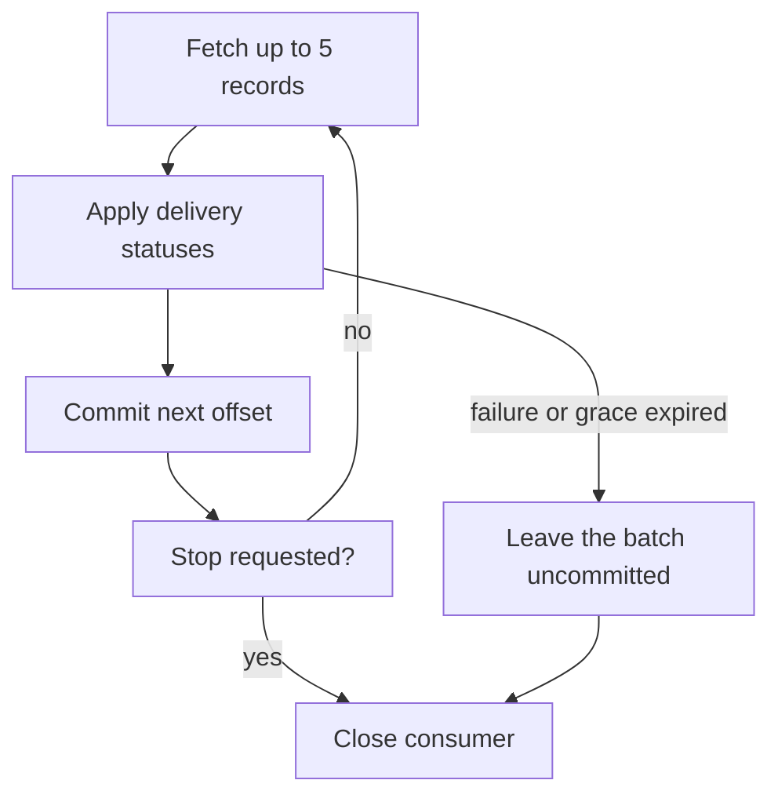

# Kafka in Python: publishing, processing and stopping safely {#kafka-in-python-services}

<div class="bdr-post__hero" data-bdr-post="2026-10-02-kafka-in-python-services" role="img" aria-label="Delivery statuses: publish, process, commit and finish the current batch on shutdown" markdown="0"></div>

A delivery service publishes parcel statuses to Kafka, and a tracking service reads them to show buyers where their order is. The fragile part is not publishing but the moment the consumer tells Kafka a record is done.

A consumer that commits before its handler finishes skips that work after a restart. One stopped halfway through a batch must either finish the batch or leave it uncommitted for the next instance.

We build both services with aiokafka-foundation-kit, fail a handler and stop the consumer mid-batch, checking each time where the next instance resumes.

<!-- more -->

<div id="the-production-checklist-for-aiokafka" data-search-exclude></div>
<div id="the-producer" data-search-exclude></div>
<div id="the-consumer" data-search-exclude></div>
<div id="topics-and-health" data-search-exclude></div>
<div id="the-list-short" data-search-exclude></div>
<div id="the-pieces" data-search-exclude></div>

## Publish a delivery status {#producer}

Agree on the message contract first:

| Field | Our example |
| --- | --- |
| Topic | `delivery.status`, provisioned before service startup |
| Key | Delivery ID as UTF-8 bytes, so one delivery's statuses stay in one partition, in order |
| Value | JSON with `delivery_id`, `status` and an increasing `revision` |
| Consumer group | `tracking`, shared by replicas of the tracking service |

[aiokafka-foundation-kit](https://bedrock-python.github.io/aiokafka-foundation-kit/) provides settings, JSON serialization and client lifecycle; its Pydantic settings models come with the `[models]` extra. The code is from the [client lab](../lab/2026-09-07-aiokafka-checklist/README.md)'s `kafka_flow.py`. The delivery service opens one producer for its whole lifetime:

```python
from contextlib import asynccontextmanager

from aiokafka_foundation_kit import producer_lifecycle
from aiokafka_foundation_kit.contrib.models import BaseKafkaProducerSettings

TOPIC = "delivery.status"


@asynccontextmanager
async def delivery_producer(bootstrap):
    settings = BaseKafkaProducerSettings(
        bootstrap_servers=bootstrap,
        acks="all", enable_idempotence=True, compression_type="gzip",
    )
    async with producer_lifecycle(settings) as producer:
        yield producer
```

`acks="all"`, idempotence and gzip are the kit's defaults, spelled out here. `acks="all"` waits for the in-sync replicas, so with `min.insync.replicas=1` the leader alone is enough.

```python
async def publish_status(producer, delivery_id, status, revision):
    return await producer.send_and_wait(
        TOPIC,
        value={"delivery_id": delivery_id, "status": status, "revision": revision},
        key=delivery_id.encode("utf-8"),
    )
```

Awaiting it returns the broker's acknowledgement with partition and offset; it does not mean that tracking has applied the update. Idempotence covers only the producer's own retries ([aiokafka producer guarantees](https://aiokafka.readthedocs.io/en/stable/producer.html#idempotent-produce)): if your code calls `publish_status()` again after a timeout, the update can land twice. Saving data together with a message needs the [Outbox flow](2026-10-03-reliable-events-outbox-inbox-kafka.md).

## Update the tracking view, then commit {#consumer}

The handler keeps each delivery's latest status and ignores repeated or older revisions:

```python
class TrackingView:
    def __init__(self):
        self.deliveries = {}

    async def process(self, message):
        event = message.value
        delivery_id = event["delivery_id"]
        previous = self.deliveries.get(delivery_id)
        if previous is None or event["revision"] > previous["revision"]:
            self.deliveries[delivery_id] = event
```

The dictionary is the lab's observable effect; a real view needs durable storage. Keeping the highest `revision` suits complete status snapshots. If every transition matters (say, each triggers a notification), the highest revision isn't enough: events need a gap-free sequence number and the handler must detect gaps. The consumer commits manually:

```python
from aiokafka_foundation_kit import consumer_lifecycle
from aiokafka_foundation_kit.contrib.models import BaseKafkaConsumerSettings


def tracking_settings(bootstrap, group="tracking"):
    return BaseKafkaConsumerSettings(
        bootstrap_servers=bootstrap, group_id=group,
        enable_auto_commit=False, auto_offset_reset="earliest",
        max_poll_records=5, max_poll_interval_ms=30_000,
    )
```

`earliest` applies only when the group has no committed offset; a replacement resumes from its committed position. The loop gets a started consumer from `consumer_lifecycle`, shown in the shutdown section:

```python
import asyncio


async def consume_batches(consumer, process, stop):
    while not stop.is_set():
        batches = await consumer.getmany(timeout_ms=500, max_records=5)
        async with asyncio.timeout(10):
            for partition, messages in batches.items():
                for message in messages:
                    await process(message)
                if messages:
                    await consumer.commit({partition: messages[-1].offset + 1})
```

Each poll returns at most five records, and `asyncio.timeout(10)` bounds processing and commits for each batch. Each partition commits after its records succeed: completing offsets 0–4 stores offset 5, the next one to read. If processing raises or times out, the loop exits without committing past the failed record; finished partitions keep their progress, and replayed records are absorbed by the revision check. The lab checks one partition:

| Scenario | Processed offsets | Committed offset | Replacement starts at |
| --- | --- | --- | --- |
| Handler fails on the third record | 0, 1 | None | 0 |
| All five records finish, manual commit | 0-4 | 5 | 5 |
| Auto-commit runs after fetching five but processing two | 0, 1 | 5 | 5 |

The last row is why auto-commit is wrong for this contract: it moves the recovery point past work that has not happened, and an ordinary restart skips those records. After a failure, close the consumer, or seek back to the committed offset, before consuming again: its in-memory position is already past the failed batch. A record that always fails stops its partition on every restart, so decide on a skip or dead-letter policy. Malformed JSON is the hard case: it fails inside `getmany()`, no handler sees it, and `consumer_lifecycle()` in 0.1.3 cannot take another deserializer ([aiokafka-foundation-kit #50](https://github.com/bedrock-python/aiokafka-foundation-kit/issues/50)). Until then, build the consumer with `create_async_kafka_consumer(settings, topics, value_deserializer=...)` and a deserializer that passes undecodable bytes through, then dead-letter them in the handler. A failed commit must stop the loop too, and a rebalance can still move a partition while work is in flight ([aiokafka consumer groups](https://aiokafka.readthedocs.io/en/stable/consumer.html#consumer-groups-and-topic-subscriptions)).

<div id="should-your-application-create-kafka-topics-on-startup" data-search-exclude></div>
<div id="what-the-broker-does-for-you" data-search-exclude></div>
<div id="what-the-application-does" data-search-exclude></div>
<div id="the-shape-is-decided-once-forever" data-search-exclude></div>
<div id="three-replicas-start-at-the-same-time" data-search-exclude></div>
<div id="a-shape-the-cluster-cannot-give-you" data-search-exclude></div>
<div id="so-should-it" data-search-exclude></div>

## Create the topic before starting the service {#topics}

Partition count is hard to change: you can only add partitions, and that moves keys and breaks per-key order. Partitions, retention and permissions should come from the owning team, not whichever service starts first; a service that creates topics also needs the right to create them. Let the delivery team's deploy step create `delivery.status`:

```python
from aiokafka_foundation_kit import TopicConfig, ensure_topics_async


async def provision_delivery_topic(bootstrap, *, partitions=3, replicas=1):
    settings = BaseKafkaProducerSettings(bootstrap_servers=bootstrap)
    await ensure_topics_async([
        TopicConfig(
            name=TOPIC, num_partitions=partitions, replication_factor=replicas,
            topic_configs={"retention.ms": "604800000"},
        ),
    ], settings)
```

One replica only fits the lab's single broker. `ensure_topics_async()` creates missing topics and does not reconcile existing ones, as the [topic lab](../lab/2026-09-07-topics-on-startup/README.md) shows:

| Request | Result |
| --- | --- |
| Three callers request the same three-partition topic at once | All succeed; one three-partition topic exists |
| The next call requests six partitions for that topic | The existing topic still has three |
| Request three replicas from one broker | `InvalidReplicationFactorError` |

Creating a list is not atomic: for `[valid_topic, invalid_topic, next_topic]`, the first stays created, the second raises and the third is never attempted. So the deploy step should also check an existing topic's partitions and settings, and report a partial result before workers start. With `producer_lifecycle(..., topics=[...])`, topics are created only if you also pass `auto_create_topics=True`. Separately, the labs set the broker's `auto.create.topics.enable=false`, so a forgotten provisioning step shows up as an error rather than a silently created default topic.

<div id="graceful-kafka-consumer-shutdown-in-kubernetes" data-search-exclude></div>
<div id="what-the-group-does-when-a-member-disappears" data-search-exclude></div>
<div id="measured-the-consumer-that-exits" data-search-exclude></div>
<div id="the-protocol" data-search-exclude></div>
<div id="the-numbers-to-set" data-search-exclude></div>

## Stop halfway through a batch {#shutdown}

During a deploy, the old tracking instance has fetched five records and finished two when its stop event is set. Finishing the other three lets it commit offset 5; cancelling leaves the batch for replay:

```python
async def run_tracking(bootstrap, process, stop, *, group="tracking", grace=5):
    async with consumer_lifecycle(
        tracking_settings(bootstrap, group), topics=(TOPIC,),
    ) as consumer:
        worker = asyncio.create_task(consume_batches(consumer, process, stop))
        stopping = asyncio.create_task(stop.wait())
        try:
            await asyncio.wait({worker, stopping}, return_when=asyncio.FIRST_COMPLETED)
            async with asyncio.timeout(grace):
                await worker
        finally:
            worker.cancel()
            stopping.cancel()
            await asyncio.gather(worker, stopping, return_exceptions=True)
```

`consume_batches()` checks `stop` before the next poll, so a stop during processing finishes only the accepted batch. After the stop, `grace` gives that batch five seconds, less than the ten-second batch limit, so `grace` fires first; when it expires the worker is cancelled before committing the unfinished partition, and the consumer closes. In the lab's servicewright service, `DaemonEntrypoint` passes the stop event to `run_tracking()`, and servicewright runs its drain phase only after the function returns, so `drain_grace_seconds` does not limit this wait ([servicewright #88](https://github.com/bedrock-python/servicewright/issues/88)): `grace` is the only bound. On expiry `run_tracking()` raises `TimeoutError` and the service exits with an error. With ten records in one partition, and a 0.05-second grace for the expiry case:

| Scenario | Processed offsets | Committed offset | Replacement starts at |
| --- | --- | --- | --- |
| Cancel after two records | 0, 1 | None | 0 |
| Finish the batch | 0-4 | 5 | 5 |
| Grace expires | 0, 1 | None | 0 |

<!-- diagram:concept -->
<figure class="bdr-diagram" markdown="1">
<figcaption><span class="bdr-diagram__eyebrow">THE IDEA, VISUALIZED</span><strong>Finish the accepted batch before stopping</strong></figcaption>
<div class="bdr-diagram__viewport" markdown="1" data-search-exclude>



</div>
<p class="bdr-diagram__caption">A finished batch commits the next offset. A failure or an expired grace leaves the batch uncommitted for replay, and the consumer closes.</p>
</figure>
<!-- /diagram:concept -->

These checks use a stop event, a real broker and replacement consumers, not a Kubernetes rollout; deployment ordering is covered in the [service lifecycle article](2026-09-20-python-service-lifecycle.md).

## Commit only finished work {#conclusion}

Commit only completed work and let a failure end the loop. Watch the committed lag (log end minus committed offset), not only the position lag: in the lab, a consumer that has fetched five records while its committed offset is still 0 shows position lag 0 and committed lag 5. [aiokafka-foundation-kit](https://bedrock-python.github.io/aiokafka-foundation-kit/) covers settings, JSON clients and lifecycle; the topic contract, the durable effect, the commit decision and the policy for records that always fail stay in your application.

## Examples and labs {#labs}

Checked with Python 3.13, aiokafka-foundation-kit 0.1.3, aiokafka 0.14.0 and servicewright 0.13.1 against `confluentinc/cp-kafka:7.6.0` in KRaft mode.

- [Lab: JSON, commits and repeated delivery](../lab/2026-09-07-aiokafka-checklist/README.md)
- [Lab: topic creation and concurrent startup](../lab/2026-09-07-topics-on-startup/README.md)
- [Lab: draining a consumer and exceeding its shutdown budget](../lab/2026-09-07-kafka-consumer-shutdown/README.md)
