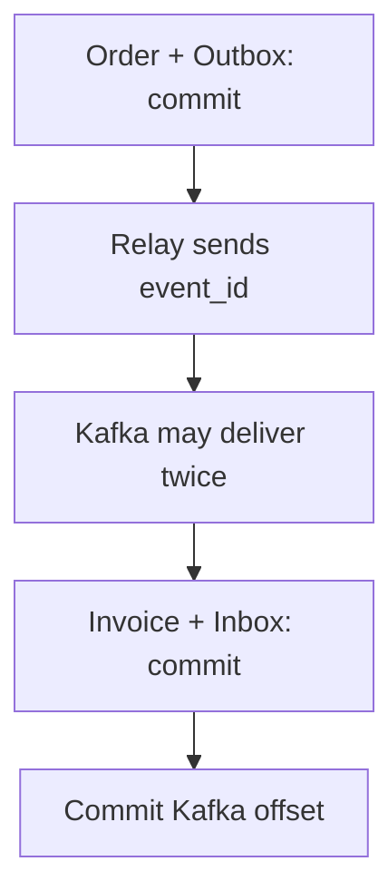

# Reliable event delivery with Outbox, Inbox and Kafka {#reliable-events-outbox-inbox-kafka}

<div class="bdr-post__hero" data-bdr-post="2026-10-03-reliable-events-outbox-inbox-kafka" role="img" aria-label="The order and event commit together; billing handles repeated delivery" markdown="0"></div>

Picture this: a customer places an order. The order service saves it in PostgreSQL and publishes an event to Kafka. Billing reads the event and issues an invoice.

This works until a process crashes in the gap between two writes: the database and the broker share no transaction. If the order service crashes after the commit but before the publish, `order.created` is lost and no invoice follows. If billing crashes after the invoice commit but before the offset commit, it rereads the event after a restart and issues a second invoice.

Outbox and Inbox tables in PostgreSQL close both gaps. We build the services on omni-box, crash them at each commit boundary and during a broker outage, and check what is left in PostgreSQL and Kafka.

<!-- more -->

<div id="the-transactional-outbox-pattern-in-python-omni-box" data-search-exclude></div>
<div id="the-dual-write-problem" data-search-exclude></div>
<div id="the-outbox-pattern" data-search-exclude></div>
<div id="using-omni-box" data-search-exclude></div>
<div id="the-inbox-side" data-search-exclude></div>
<div id="why-a-library" data-search-exclude></div>

## The order exists, but its event is missing {#outbox}

Calling `producer.send_and_wait()` after the commit leaves that gap, and publishing first only moves it, as the [delivery lab](../lab/2026-09-07-exactly-once-effects/README.md) shows:

| Sequence and failure | Orders in PostgreSQL | Records in Kafka |
| --- | --- | --- |
| Commit order; crash before publication | 1 | 0 |
| Publish event; roll back the order transaction | 0 | 1 |

Reordering two independent commits cannot make them atomic, and Kafka transactions do not include a PostgreSQL transaction either ([Kafka's delivery semantics](https://kafka.apache.org/41/design/design/#message-delivery-semantics)). Instead, save the order and a row describing its event, the Outbox row, in **one PostgreSQL transaction**. [omni-box](https://bedrock-python.github.io/omni-box/) provides the event models, repositories and delivery components, and the application keeps control of commit. The lab's `models.py` defines the tables; `session_factory` is a SQLAlchemy `async_sessionmaker`:

```python
from uuid import UUID

from sqlalchemy.ext.asyncio import AsyncSession, async_sessionmaker

from omni_box import OmniBoxDomainService
from omni_box.infra.storage.postgres import PostgresOutboxRepository

from models import Order, OutboxEventDB


async def record_order(session: AsyncSession, order_id: UUID) -> UUID:
    session.add(Order(id=order_id))
    event = OmniBoxDomainService().create_outbox_event(
        aggregate_type="order",
        aggregate_id=order_id,
        event_type="order.created",
        topic="orders.created",
        partition_key=str(order_id),
        payload={"order_id": str(order_id)},
    )
    repo = PostgresOutboxRepository(session, model_class=OutboxEventDB)
    await repo.create(event)
    return event.id


async def place_order(session_factory: async_sessionmaker, order_id: UUID) -> UUID:
    async with session_factory.begin() as session:
        return await record_order(session, order_id)
```

`record_order()` adds both rows without committing; `place_order()` owns the transaction, so both rows are saved or neither is. Once it returns, the order is accepted and delivery is pending, and the request path never touches Kafka.

### Publish the saved events {#relay}

A separate worker, the **relay**, reads the Outbox and sends events through an idempotent `AIOKafkaProducer` wrapped in omni-box's `KafkaEventPublisher`. With omni-box's `EnvelopeEventConverter`, the publisher wraps the payload in an envelope and puts the row's ID in the `event_id` header, the same on every attempt:

```python
from omni_box import OutboxPublisher
from omni_box.infra.brokers.kafka import KafkaEventPublisher


async def relay_batch(session: AsyncSession, broker: KafkaEventPublisher):
    repo = PostgresOutboxRepository(session, model_class=OutboxEventDB)
    return await OutboxPublisher(repo, broker, publish_timeout=2).publish_batch(
        worker_id="relay-1", batch_size=20,
    )


async def relay_once(session_factory: async_sessionmaker, broker: KafkaEventPublisher):
    async with session_factory.begin() as session:
        return await relay_batch(session, broker)
```

In omni-box 0.3.0, the PostgreSQL repository claims pending rows with `FOR UPDATE SKIP LOCKED`, and the surrounding transaction holds the connection and row locks while the batch is sent. The two-second limit is per publication. Start the next cycle at once only after a full batch that published something (`processed_event_ids` not empty); otherwise pause. In 0.3.0 a counted failure is retried with no delay ([omni-box #61](https://github.com/bedrock-python/omni-box/issues/61)), so without the pause one bad row spends its six attempts in milliseconds.

Now interrupt the relay after Kafka acknowledges the send but before PostgreSQL commits. The completion mark rolls back, and the next cycle sends the row again: the lab ends with two Kafka records carrying one `event_id`. Producer idempotence covers the producer's own retries, not two publications of the same row, so billing has to recognize the repeat.

<!-- diagram:concept -->
<figure class="bdr-diagram" markdown="1">
<figcaption><span class="bdr-diagram__eyebrow">THE IDEA, VISUALIZED</span><strong>From an order to one invoice</strong></figcaption>
<div class="bdr-diagram__viewport" markdown="1" data-search-exclude>



</div>
<p class="bdr-diagram__caption">Order and event commit together. Invoice and Inbox commit together. Kafka delivery between them may repeat.</p>
</figure>
<!-- /diagram:concept -->

<div id="transactional-inbox-the-other-half-of-the-outbox-pattern" data-search-exclude></div>
<div id="the-consumers-two-problems" data-search-exclude></div>
<div id="the-inbox-row" data-search-exclude></div>
<div id="measured-the-handler-fails-halfway" data-search-exclude></div>
<div id="what-the-inbox-does-not-do" data-search-exclude></div>
<div id="the-pair" data-search-exclude></div>

## Two deliveries, one invoice {#inbox}

Billing stores an **Inbox** row next to the invoice, recording which event this consumer has processed. Both writes use the same session and transaction:

```python
from contextlib import asynccontextmanager

from omni_box.infra.storage.postgres import PostgresInboxRepository

from models import InboxEventDB


class InboxTransaction:
    def __init__(self, session_factory: async_sessionmaker):
        self.session_factory = session_factory

    @asynccontextmanager
    async def transaction(self):
        async with self.session_factory.begin() as session:
            yield PostgresInboxRepository(session, model_class=InboxEventDB)
```

```python
from sqlalchemy import insert

from omni_box import InboxEvent

from models import Invoice


async def create_invoice(event: InboxEvent, repo: PostgresInboxRepository):
    await repo.session.execute(
        insert(Invoice).values(order_id=UUID(str(event.payload["order_id"])))
    )
```

In the lab, `Invoice.order_id` has no unique constraint, so a second insert would stay visible; in production, "one invoice per order" deserves its own constraint. Billing reads `orders.created` with automatic commits off, and the selected strategy commits the offset only after the Inbox transaction succeeds:

```python
from aiokafka import AIOKafkaConsumer

from omni_box import AckStrategy, InboxConsumerRunner
from omni_box.infra.brokers.kafka import KafkaEventConsumer


def billing_runner(session_factory, bootstrap, *, topic="orders.created",
                   group="billing", handler=create_invoice):
    consumer = AIOKafkaConsumer(
        topic, bootstrap_servers=bootstrap, group_id=group,
        auto_offset_reset="earliest", enable_auto_commit=False,
    )
    return InboxConsumerRunner(
        consumer=KafkaEventConsumer(consumer),
        transaction_provider=InboxTransaction(session_factory),
        handler=handler,
        worker_id="billing-1", consumer_group=group,
        ack_strategy=AckStrategy.EXACTLY_ONCE_INBOX,
    )
```

Fed the two records from the interrupted relay, the runner creates the invoice and commits on the first delivery, recognizes the second as a duplicate and only commits its offset: one invoice. The Inbox key is `(message_id, consumer_group)`, where `consumer_group` is omni-box's argument, not Kafka's `group_id`. `message_id` comes from the `event_id` header, unless the producer sets a `message_id` header, which must then stay stable too.

### The handler failed: what should the worker do? {#consumer-restart}

If `create_invoice()` raises after its `INSERT`, the transaction rolls back both the invoice and the Inbox row. `process_one()` returns `committed=False` when the handler raises or times out or the Inbox transaction fails after inserting its row; it raises when the record can't be read or decoded, or when the Inbox insert or offset commit fails. Either way the worker has to stop itself:

```python
async def run_billing(runner: InboxConsumerRunner):
    try:
        await runner.start()
        while True:
            result = await runner.process_one()
            if not result.committed:
                raise RuntimeError(f"Retry message {result.message_id}")
    finally:
        await runner.stop()
```

Do not use `runner.run_forever()` here: in omni-box 0.3.0 it carries on after `committed=False`. Kafka's position advances when a record is fetched, so if the record at offset 0 fails and the worker moves on, the record at offset 1 commits offset 2, and after a restart the group resumes at 2 and never retries 0. Run it under a supervisor that restarts it with backoff in the same group, and give an event that keeps failing an explicit repair or dead-letter policy. Signal failure by raising. In omni-box 0.3.0, returning `handler_retry(...)` commits the handler's writes and leaves the Inbox row locked, so `run_billing()` would stop on that record after every restart ([omni-box #59](https://github.com/bedrock-python/omni-box/issues/59)).

One more window, also checked in the [Inbox lab](../lab/2026-09-07-transactional-inbox/README.md): PostgreSQL has committed the invoice, but the offset commit fails. On restart, the runner receives the same record again, finds the completed Inbox row, skips the handler and commits the offset.

<div id="exactly-once-is-a-lie-exactly-once-effects-are-not" data-search-exclude></div>
<div id="messages-versus-effects" data-search-exclude></div>
<div id="every-window-measured" data-search-exclude></div>
<div id="the-outbox-closes-the-producer-side" data-search-exclude></div>
<div id="the-inbox-closes-the-consumer-side" data-search-exclude></div>
<div id="the-http-edge" data-search-exclude></div>
<div id="the-whole-path" data-search-exclude></div>
<div id="why-the-library-must-not-own-the-transaction" data-search-exclude></div>
<div id="what-it-looks-like" data-search-exclude></div>

## Where this protection ends {#boundaries}

The same lab changes one condition at a time:

| Change | Observed result |
| --- | --- |
| Publish two copies without `event_id` or `message_id` | Each record falls back to `topic:partition:offset`; two invoices are inserted |
| Read the event with another `group` (new Kafka group and new omni-box `consumer_group`) | It is a different Inbox recipient; the handler runs again |
| Delete the completed Inbox row, then replay the event | The previous result is forgotten; the handler runs again |

Keep the event ID end to end, keep omni-box's `consumer_group` stable for the same logical handler, and keep Inbox rows at least as long as the topic's retention plus the worst lag. `delete_old_completed(retention_days)` deletes up to `batch_size` older completed rows per call, so call it until it returns 0.

Order is not guaranteed either. `partition_key=order_id` sends one order's events to one partition, but even a single relay can publish a later event first, because a deferred or failing row does not hold back the rows behind it. If billing must apply `created` before `cancelled`, carry an order version and decide how to treat gaps and stale versions.

An external action is the last boundary: a rollback cannot unsend an email sent from inside the transaction. Persist a notification intent in the same transaction and give the external call its own [idempotency contract](2026-09-14-idempotency-in-apis-and-background-jobs.md).

<div id="what-happens-when-kafka-is-down-for-an-hour" data-search-exclude></div>
<div id="publishing-from-the-request-path" data-search-exclude></div>
<div id="the-outbox-during-the-outage" data-search-exclude></div>
<div id="what-an-hour-actually-costs-you" data-search-exclude></div>
<div id="what-it-does-not-solve" data-search-exclude></div>
<div id="the-pieces" data-search-exclude></div>

## Kafka is unavailable; new orders keep arriving {#outage}

Pause the broker and place three orders: the order service saves them with their Outbox rows. In the [outage lab](../lab/2026-09-07-when-kafka-is-down/README.md), three relay cycles with the broker paused leave the unfinished rows grouped by status like this:

```text
status  | events | attempts
pending | 3      | 0
```

In omni-box 0.3.0, a publication timeout or `TransientError` defers the work without spending an attempt. Any other error counts as an attempt; after six attempts the row becomes `failed` and stays there until someone requeues it. After Kafka returns, all three events reach the broker and nothing is left pending. A timed-out send can still arrive, so the lab checks event IDs, not a record count.

For a longer outage, do the arithmetic. At 100 events per second, an hour adds 360,000 events. If the relay sustains 300 a second (measure it), clearing that backlog while 100 new events arrive each second takes about 30 minutes. Monitor the pending count, the age of the oldest pending event and failed rows.

## Outbox and Inbox together {#conclusion}

**Outbox saves the event with the order; Inbox records the processed event ID with the invoice.** Retries keep the event ID, and offsets are committed only after the database commit, so delivery can resume after any of these failures with one invoice per order. [omni-box](https://bedrock-python.github.io/omni-box/) provides the repositories, `OutboxPublisher` and `InboxConsumerRunner`; the relay and worker loops, transaction boundaries, retention and the failing-event policy stay yours.

## Examples and labs {#labs}

Checked with Python 3.13, omni-box 0.3.0, aiokafka 0.14.0, SQLAlchemy 2.0.54 and asyncpg 0.31.0 against `postgres:17-alpine` and `confluentinc/cp-kafka:7.6.0` in KRaft mode.

- [Lab: order, event and repeated delivery](../lab/2026-09-07-exactly-once-effects/README.md)
- [Lab: handler failure and Inbox boundaries](../lab/2026-09-07-transactional-inbox/README.md)
- [Lab: broker outage and backlog recovery](../lab/2026-09-07-when-kafka-is-down/README.md)
