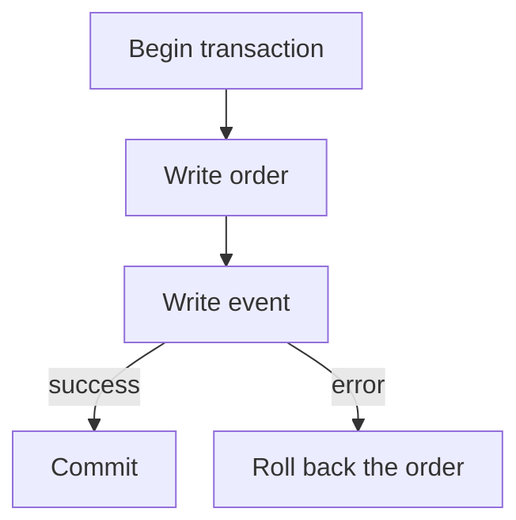

# SQLAlchemy sessions and transactions: who owns commit {#sqlalchemy-sessions-and-transactions}

<div class="bdr-post__hero" data-bdr-post="2026-10-08-sqlalchemy-sessions-and-transactions" role="img" aria-label="One transaction boundary owned by the use case, one commit at its edge" markdown="0"></div>

Picture the order service of an online shop. A customer places an order, and the service saves it and writes a `created` event that tells the warehouse and delivery about it.

A common way to write this: the order repository commits to get an `id`, and the event repository commits its own row. One day the event insert fails. The order is already in the database and the customer sees it in their account, but the warehouse never hears about it. Sharing one `AsyncSession` does not help here. One transaction around the whole business operation does, with the operation itself committing, not the repositories.

We reproduce the failure on PostgreSQL, fix it, then add a shipping quote, a newsletter subscription and a read-only lookup. Verified with Python 3.13, SQLAlchemy 2.0.54, asyncpg 0.31.0, sqlalchemy-foundation-kit 0.4.0 and PostgreSQL 17.11.

<!-- more -->

<div id="stop-passing-asyncsession-everywhere" data-search-exclude></div>
<div id="what-the-parameter-is-hiding" data-search-exclude></div>
<div id="what-the-same-session-is-worth" data-search-exclude></div>
<div id="what-it-costs-the-pool" data-search-exclude></div>
<div id="one-session-one-task" data-search-exclude></div>
<div id="what-leaves-the-block" data-search-exclude></div>
<div id="what-it-looks-like-when-the-session-has-an-owner" data-search-exclude></div>
<div id="the-pieces" data-search-exclude></div>

## One engine per process, one session per operation {#ownership}

`Order` lives in `orders` and `OrderEvent` in `order_events`, with a foreign key to the order and `CHECK (kind <> '')`, so an empty event kind gives a reproducible PostgreSQL error. The event is a row in the same database; delivering it to a broker is covered in the [outbox article](2026-10-03-reliable-events-outbox-inbox-kafka.md). At startup, create an engine and a session factory:

```python
from sqlalchemy.ext.asyncio import async_sessionmaker, create_async_engine


def open_database(url):
    engine = create_async_engine(
        url, pool_size=2, max_overflow=0, pool_timeout=0.5,
    )
    session_factory = async_sessionmaker(engine, expire_on_commit=False)
    return engine, session_factory
```

Call `open_database(url)` once and `await engine.dispose()` at shutdown. The tiny pool (two connections, 0.5 s `pool_timeout`) only makes the pool-exhaustion experiment below reproducible; don't copy it to production. `expire_on_commit=False` keeps loaded attributes readable after commit: by default, commit expires them, and reading `order.id` would need a database query that `AsyncSession` cannot run implicitly. Each operation opens its own session; a session tracks objects and takes a connection only on its first SQL statement, while the transaction decides which writes commit together.

<div id="the-unit-of-work-pattern-in-sqlalchemy-2" data-search-exclude></div>
<div id="before-repositories-that-commit" data-search-exclude></div>
<div id="after-the-use-case-owns-the-boundary" data-search-exclude></div>
<div id="read-only-means-read-only" data-search-exclude></div>
<div id="savepoints-one-failed-step-not-one-failed-transaction" data-search-exclude></div>
<div id="the-use-case-under-test" data-search-exclude></div>
<div id="who-owns-the-transaction" data-search-exclude></div>

## Two commits leave a partial operation {#partial-commit}

Strip the repository wrappers from the example in the introduction, and the sequence looks like this:

```python
from models import Order, OrderEvent


async def place_order_broken(session_factory, sku, *, event_kind="created"):
    async with session_factory() as session:
        order = Order(sku=sku, delivery_cents=0)
        session.add(order)
        await session.commit()

        session.add(OrderEvent(order_id=order.id, kind=event_kind))
        await session.commit()
        return {"order_id": order.id}
```

With `event_kind=""`, the order is saved, and then PostgreSQL rejects the event with `IntegrityError`. One session ran two transactions, and rolling back the second cannot undo the first. Reading through another session:

```text
two commits + rejected event: orders=1, events=0
```

## Commit the order and event in one transaction {#transaction}

Move the commit decision to the whole operation; SQLAlchemy's `session_factory.begin()` is enough:

```python
async def place_order_native(session_factory, sku, *, event_kind="created"):
    async with session_factory.begin() as session:
        order = Order(sku=sku, delivery_cents=0)
        session.add(order)
        await session.flush()
        session.add(OrderEvent(order_id=order.id, kind=event_kind))
        result = {"order_id": order.id}
    return result
```

`flush()` sends the order's `INSERT` and gives it an `id` while the transaction stays open. On block exit, SQLAlchemy commits, or rolls back both rows if the event violates its constraint. The same failure now leaves `orders=0, events=0`. Between `flush()` and commit, another session cannot see the order: an assigned ID is not a committed order.

<!-- diagram:concept -->
<figure class="bdr-diagram" markdown="1">
<figcaption><span class="bdr-diagram__eyebrow">THE IDEA, VISUALIZED</span><strong>One transaction for the order and its event</strong></figcaption>
<div class="bdr-diagram__viewport" markdown="1" data-search-exclude>



</div>
<p class="bdr-diagram__caption">If recording the event fails, the order rolls back. A successful transaction saves both rows together.</p>
</figure>
<!-- /diagram:concept -->

## Assemble the repositories into a Unit of Work {#unit-of-work}

The business operation owns commit; repositories only add and flush. [sqlalchemy-foundation-kit](https://bedrock-python.github.io/sqlalchemy-foundation-kit/) packages this as `AsyncSQLAlchemyUnitOfWork`. For a single function, `session_factory.begin()` does the same job; the gain is that business code receives a `uow` instead of a session factory: it reaches repositories only through `transaction()` or `query()`, and savepoints and isolation levels are set the same way everywhere.

```python
class OrderRepository:
    def __init__(self, session):
        self.session = session

    async def add(self, sku, delivery_cents=0):
        order = Order(sku=sku, delivery_cents=delivery_cents)
        self.session.add(order)
        await self.session.flush()
        return order


class EventRepository:
    def __init__(self, session):
        self.session = session

    async def add(self, order_id, kind="created"):
        self.session.add(OrderEvent(order_id=order_id, kind=kind))
        await self.session.flush()
```

```python
from sqlalchemy_foundation_kit import (
    AsyncSQLAlchemyUnitOfWork,
    AsyncSQLAlchemyUowTransaction,
)


class OrderTransaction(AsyncSQLAlchemyUowTransaction):
    @property
    def orders(self):
        return OrderRepository(self.session)

    @property
    def events(self):
        return EventRepository(self.session)


def make_uow(session_factory):
    return AsyncSQLAlchemyUnitOfWork(
        session_factory, transaction_factory=OrderTransaction,
    )


async def place_order(uow, sku, *, delivery_cents=0, event_kind="created"):
    async with uow.transaction() as tx:
        order = await tx.orders.add(sku, delivery_cents)
        await tx.events.add(order.id, event_kind)
        result = {"order_id": order.id}
    return result
```

Each `uow.transaction()` opens its own session: normal exit commits, an exception rolls back. Since `uow` holds only the session factory, concurrent tasks can share one `uow` but must never share an `AsyncSession` ([SQLAlchemy's documentation](https://docs.sqlalchemy.org/en/20/orm/extensions/asyncio.html#using-asyncsession-with-concurrent-tasks)). If one of several concurrent orders fails, the ones already committed stay committed; under `asyncio.TaskGroup` the ones still running are cancelled and roll back. A batch that must succeed or fail as a whole needs one transaction.

## Get the shipping quote before opening the transaction {#lifetime}

The delivery price comes from an external shipping service; ask it before opening the transaction:

```python
async def place_order_after_quote(uow, quote_shipping, sku):
    delivery_cents = await quote_shipping(sku)
    return await place_order(uow, sku, delivery_cents=delivery_cents)
```

Waiting for the quote inside the transaction would hold a connection for the whole wait: in the [session lab](../lab/2026-09-07-stop-passing-asyncsession-everywhere/README.md), two such requests take the entire pool, and a third times out. Fetched first, the quote holds no connection while waiting, but it can go stale before commit; if it has an expiry, check it inside the transaction.

## Savepoint: keep the order when the subscription already exists {#savepoints}

At checkout, the buyer also opts into a newsletter. The address is the primary key of `newsletter_subscriptions`, and if it is already there, the order must still go through. Wrap only the optional insert in a savepoint:

```python
from sqlalchemy.exc import IntegrityError

from models import NewsletterSubscription


async def place_order_with_subscription(uow, sku, email):
    async with uow.transaction() as tx:
        order = await tx.orders.add(sku)
        await tx.events.add(order.id)
        try:
            async with tx.savepoint():
                tx.session.add(NewsletterSubscription(email=email))
                await tx.session.flush()
        except IntegrityError as error:
            if error.orig.sqlstate != "23505":
                raise
        result = {"order_id": order.id}
    return result
```

The table has no other unique key, so `23505` can only mean the address exists; other errors propagate and roll back everything. After the savepoint exits, the outer transaction is usable again: in the lab, two orders with the same address both survive with one subscription. Keep required writes outside the savepoint and already flushed: `begin_nested()` flushes pending changes before SAVEPOINT, so an error from an unflushed required write would surface inside the `try` meant for the subscription. Here the repositories have flushed already ([SAVEPOINT documentation](https://docs.sqlalchemy.org/en/20/orm/session_transaction.html#using-savepoint)). For a single insert, PostgreSQL's `insert(...).on_conflict_do_nothing()` from `sqlalchemy.dialects.postgresql` is simpler; a savepoint pays off when the optional step is several statements or code you do not control.

## Read the order and explicitly prohibit writes {#read-only}

`uow.query()` closes its session without committing. In version 0.4.0 it does not stop writes, and the session implicitly begins a transaction on its first statement and holds the connection until the block exits ([sqlalchemy-foundation-kit #56](https://github.com/bedrock-python/sqlalchemy-foundation-kit/issues/56)). To have PostgreSQL reject writes, run `SET TRANSACTION READ ONLY` before any write:

```python
from sqlalchemy import text


async def read_order(uow, order_id):
    async with uow.query() as tx:
        await tx.session.execute(text("SET TRANSACTION READ ONLY"))
        order = await tx.session.get(Order, order_id)
        if order is None:
            raise LookupError(order_id)
        return {
            "order_id": order.id,
            "sku": order.sku,
            "delivery_cents": order.delivery_cents,
        }
```

In the lab, a write in a plain `query()` block disappears without commit, yet an explicit commit is still possible. After [`SET TRANSACTION READ ONLY`](https://www.postgresql.org/docs/17/sql-set-transaction.html), PostgreSQL rejects the `INSERT` with code `25006`. The function returns a finished dictionary while the session is open, so serializing the response needs no further database access.

## What to take into your service {#conclusion}

The business operation owns commit, not the repositories. Wait for external services before the transaction, give concurrent tasks separate sessions, use a savepoint only for the optional part and let PostgreSQL enforce read-only access. If the response to `COMMIT` itself is lost, the outcome is unknown, so retrying the operation safely needs [idempotency](2026-09-14-idempotency-in-apis-and-background-jobs.md). [sqlalchemy-foundation-kit](https://bedrock-python.github.io/sqlalchemy-foundation-kit/) wraps commit/rollback as `transaction()` and savepoints as `savepoint()`, while `query()` only closes the session without commit.

## Examples and labs {#labs}

- [Commit, rollback, savepoint and READ ONLY on PostgreSQL](../lab/2026-09-07-unit-of-work-sqlalchemy-2/README.md)
- [External API waiting, connection pools and concurrent tasks](../lab/2026-09-07-stop-passing-asyncsession-everywhere/README.md)
