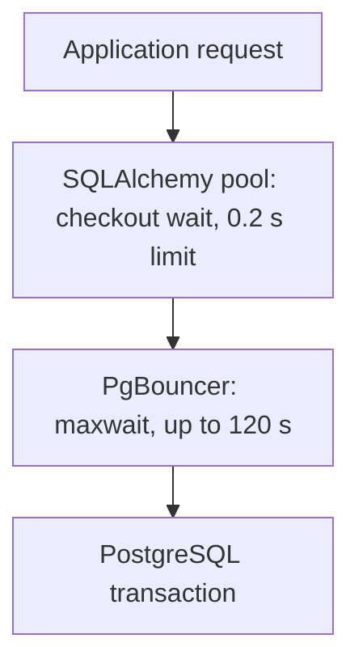

# SQLAlchemy and PgBouncer: configuring and diagnosing connection pools {#sqlalchemy-pgbouncer-pools}

<div class="bdr-post__hero" data-bdr-post="2026-10-09-sqlalchemy-pgbouncer-pools" role="img" aria-label="Transaction pooling reassigns the lane on every transaction, and session state does not survive it" markdown="0"></div>

Once there are enough services and pods, PostgreSQL runs out of connections and PgBouncer goes in front of it. The application code usually stays the same, even though it now talks to the database differently.

Behind PgBouncer in transaction mode, cached prepared statements can break and startup parameters get rejected or dropped. A slow request may then wait in PgBouncer, not in the SQLAlchemy pool.

We reproduce each case on an orders service that reads order 42 and asks a shipping service for a quote, and configure the application pool and its metrics with `sqlalchemy-foundation-kit`.

<!-- more -->

<div id="pgbouncer-transaction-mode-and-async-sqlalchemy-the-production-setup-nobody-documents-enough" data-search-exclude></div>
<div id="what-transaction-mode-takes-away" data-search-exclude></div>
<div id="the-prepared-statement-error-and-when-it-stopped-happening" data-search-exclude></div>
<div id="the-setting-that-actually-breaks-the-connection" data-search-exclude></div>
<div id="pool-sizing-when-there-is-a-pool-in-front-of-your-pool" data-search-exclude></div>
<div id="what-to-monitor" data-search-exclude></div>
<div id="closing-pools-during-a-rollout" data-search-exclude></div>
<div id="the-configuration" data-search-exclude></div>

## Read an order through PgBouncer {#pooling}

The lab's PgBouncer runs in transaction mode:

```ini
[pgbouncer]
pool_mode = transaction
default_pool_size = 2
max_client_conn = 50
max_prepared_statements = 200
```

After every commit or rollback, PgBouncer returns the PostgreSQL connection to its pool, and the client's next transaction may run on a different one. Session state therefore does not follow the client. Worse, a plain `SET` of a parameter PgBouncer does not track, such as `search_path` or `statement_timeout`, stays on the server connection and leaks to whichever client gets it next; the [feature table](https://www.pgbouncer.org/features.html) lists what works. The kit gets PgBouncer's host and port instead of PostgreSQL's:

```python
from pydantic import SecretStr
from sqlalchemy_foundation_kit import create_async_session_manager
from sqlalchemy_foundation_kit.contrib.settings import (
    BasePostgresConfig, ConnectionSettings, PoolSettings, QuerySettings,
)


def database_config(host, port, user, password, database):
    return BasePostgresConfig(
        connection=ConnectionSettings(
            host=host, port=port, user=user,
            password=SecretStr(password), database=database,
        ),
        application_name="orders-api",
        db_schema="app",
        jit=None,
        use_orjson_serialization=False,
        pool=PoolSettings(size=2, max_overflow=0, timeout=0.2, pre_ping=False),
        query=QuerySettings(
            statement_cache_size=100,
            prepared_statement_cache_size=100,
        ),
    )
```

`size=2` and `max_overflow=0` cap the manager at two client connections, and `timeout=0.2` caps the wait for a free one at 200 ms. The kit enables pre-ping by default; it is off here on purpose. SQLAlchemy runs each ping in its own transaction, so behind transaction-mode PgBouncer it costs an extra server transaction per checkout, and its wait for PgBouncer would count as checkout time. The price: a broken connection to PgBouncer fails the first query instead of being replaced. `use_orjson_serialization=False` is needed because the default requires the optional `orjson` extra. Create the manager once with `create_async_session_manager(config)`. An order lookup then looks like this:

```python
from sqlalchemy import text


async def get_order(manager, order_id):
    async with manager.get_transaction() as session:
        row = (await session.execute(
            text("SELECT id, total FROM orders WHERE id = :id"),
            {"id": order_id},
        )).mappings().one()
        return dict(row)
```

`get_order(manager, 42)` returns `{"id": 42, "total": 1999}`; leaving `get_transaction()` commits or rolls back and returns the connection.

### Prepared statements need PgBouncer's tracking {#prepared-statements}

If asyncpg's `statement_cache_size` is above zero, SQLAlchemy's statements get names and have to survive a change of PostgreSQL connection. That needs PgBouncer 1.21 or newer with [`max_prepared_statements`](https://www.pgbouncer.org/config.html#max_prepared_statements) above zero; since 1.24 the default is 200. With tracking off, keep both caches at zero, the kit's default: asyncpg 0.31 then sends unnamed statements that never outlive a transaction ([SQLAlchemy's notes on the prepared statement cache](https://docs.sqlalchemy.org/en/20/dialects/postgresql.html#prepared-statement-cache)). The lab reproduces a backend switch on raw asyncpg, without SQLAlchemy: client A prepares a named statement, client B takes the freed server connection, and A's next transaction lands on another backend:

| Setup | Result after the backend changes |
|---|---|
| Tracking enabled, `max_prepared_statements=200` | The same prepared statement returns `42` |
| Tracking disabled, `max_prepared_statements=0` | Reusing that statement fails with SQLSTATE `26000` |

The lab's SQLAlchemy workload (four workers, 40 statements) passes in both safe setups: tracking on with both caches at 100, as configured above, and tracking off with both caches at zero.

### Apply settings inside the transaction {#transaction-settings}

Pass `jit=off` and `search_path=app` as startup parameters, and the lab's PgBouncer rejects the connection. `ignore_startup_parameters=jit,search_path` lets it through but [drops the settings](https://www.pgbouncer.org/config.html#ignore_startup_parameters): PostgreSQL still reports `jit=on` and the default `search_path`. So `jit=None` omits the parameter, and the kit applies `db_schema="app"` at the start of each transaction with transaction-local scope. Through PgBouncer, `SHOW` then returns `search_path=app` and `application_name=orders-api` (PgBouncer tracks `application_name`), and after the transaction `search_path` returns to its previous value. To turn JIT off, use `ALTER ROLE … SET jit = off` or `SET LOCAL jit = off`.

A statement limit works the same way: `SET LOCAL statement_timeout = '100ms'` cancels a slow `pg_sleep(1)` with SQLSTATE `57014`, and the next transaction is back to the original value. It bounds only SQL execution, not the wait for a connection or the whole incoming request.

## Count connections across processes {#capacity}

With four pods, two worker processes per pod and one manager per process, the application can open `4 × 2 × (2 + 0) = 16` connections to PgBouncer, well within `max_client_conn=50`. PgBouncer keeps at most two PostgreSQL connections for this database and user, though, so only two transactions run at once and the rest queue inside PgBouncer for up to `query_wait_timeout`, 120 seconds by default, far longer than the local 200 ms. Each PgBouncer instance has its own pools, so instances × database/user pairs × (`default_pool_size` + `reserve_pool_size`) must fit PostgreSQL's `max_connections`, with room left for admin connections. Choose production limits from measured database capacity.

<!-- diagram:concept -->
<figure class="bdr-diagram" markdown="1">
<figcaption><span class="bdr-diagram__eyebrow">THE IDEA, VISUALIZED</span><strong>Two queues before a query</strong></figcaption>
<div class="bdr-diagram__viewport" markdown="1" data-search-exclude>



</div>
<p class="bdr-diagram__caption">A request first waits for a connection in the SQLAlchemy pool, measured as checkout wait, and then for a server connection inside PgBouncer; with pre-ping off, that second wait shows only in the statistics of PgBouncer itself.</p>
</figure>
<!-- /diagram:concept -->

<div id="what-to-monitor-in-a-sqlalchemy-connection-pool" data-search-exclude></div>
<div id="the-run" data-search-exclude></div>
<div id="saturation-is-not-an-incident" data-search-exclude></div>
<div id="the-wait-is-the-requests-latency" data-search-exclude></div>
<div id="held-time-is-the-cause" data-search-exclude></div>
<div id="the-timeout-counter-is-your-error-budget" data-search-exclude></div>
<div id="throughput-and-what-it-tells-you-about-capacity" data-search-exclude></div>
<div id="the-six-to-graph" data-search-exclude></div>
<div id="the-pieces" data-search-exclude></div>

## Find where the request spends its time {#metrics}

Pass `PostgresMetrics` when creating the manager, so the kit measures how long a request waits for a connection and how long it holds one:

```python
from sqlalchemy_foundation_kit.contrib.metrics import PostgresMetrics


def instrumented_manager(config, prefix="orders"):
    metrics = PostgresMetrics(prefix=prefix)
    return create_async_session_manager(config, metrics=metrics)
```

Create it once at startup: the metrics register in Prometheus's default registry, and a second manager with the same prefix raises `DuplicateTimeseries`. Full metric names start with `orders_postgres_db_`:

| Suffix | What it tells us |
|---|---|
| `connection_checkout_wait_seconds` | Time to obtain a local connection, including creating it and pre-ping when enabled |
| `connection_held_duration_seconds` | Time from checkout until the connection returns |
| `connection_timeouts_total` | Acquisition timeouts; in 0.4.0 it also counts driver timeouts during a query |
| `pool_size`, `pool_checked_out` | Pool capacity and usage |

### Case 1: the application pool is full {#local-pool-wait}

In Cases 1 and 2 the lab connects to PostgreSQL directly, without PgBouncer, to look at the application pool alone. With the pool reduced to one connection and a transaction held open, a second `get_order` cannot get a connection within 200 ms: SQLAlchemy raises `sqlalchemy.exc.TimeoutError`, and `connection_timeouts_total` goes up by one. Once the first transaction ends, the next lookup succeeds.

### Case 2: SQL is fast, but shipping is slow {#held-connection}

If the handler waits for `shipping.quote(order_id)` inside the transaction, one connection stays checked out the whole time, although the SQL has finished. Two such requests exhaust `size=2`, and the third runs into Case 1. If the operation only reads, finish the database work first and call shipping afterwards:

```python
async def order_with_quote_after(manager, order_id, shipping):
    order = await get_order(manager, order_id)
    quote = await shipping.quote(order_id)
    return {**order, "shipping": quote}
```

Now no connection is checked out during the wait, and the response combines the order as read with a later quote. Slow SQL lengthens held time too: `SELECT pg_sleep(0.2)` adds about 200 ms to it. To tell the causes apart, compare held time with execution time from `pg_stat_statements`: a large gap means the code holds the connection while doing something other than SQL. Operations that also write are covered in [sessions and transactions](2026-10-08-sqlalchemy-sessions-and-transactions.md).

### Case 3: checkout succeeds, but PgBouncer is waiting {#pgbouncer-wait}

In the lab, PgBouncer gets one server connection (`default_pool_size=1`) and SQLAlchemy two; pre-ping and the schema hook are off, so no extra SQL runs before the query. The first transaction holds the server connection; the second request completes checkout, then waits on its first statement, `SELECT 42`. PgBouncer's [admin console](https://www.pgbouncer.org/usage.html) shows `cl_waiting=1` in `SHOW POOLS`, while the local timeout counter stays at zero; releasing the first transaction lets the second return `42`. For alerts, use `maxwait` from `SHOW POOLS` and `avg_wait_time` from `SHOW STATS`. With pre-ping on, the same wait would happen inside checkout and show up in `connection_checkout_wait_seconds` instead.

## What to take into your service {#conclusion}

- Unless PgBouncer tracks prepared statements, keep both `statement_cache_size` and `prepared_statement_cache_size` at zero, the kit's default.
- Set session parameters per transaction with `SET LOCAL` or per role with `ALTER ROLE`. As startup parameters, send only what PgBouncer tracks, such as `application_name`. Never use a plain `SET`.
- Do not wait for external services inside a transaction.
- Alert on the kit's checkout wait and timeouts and on PgBouncer's `maxwait` and `avg_wait_time`.

At shutdown, finish accepted work before `await manager.aclose()`, as described in the [service lifecycle](2026-09-20-python-service-lifecycle.md). [sqlalchemy-foundation-kit](https://bedrock-python.github.io/sqlalchemy-foundation-kit/) provides pool settings, transaction context managers and metrics for checkout wait and held time.

## Examples and labs {#labs}

The labs run real PostgreSQL 17 and PgBouncer 1.25.2 containers with SQLAlchemy 2.0.54, asyncpg 0.31.0 and sqlalchemy-foundation-kit 0.4.0.

- [Lab: PgBouncer transaction mode and async SQLAlchemy](../lab/2026-09-07-pgbouncer-async-sqlalchemy/README.md)
- [Lab: what to monitor in a SQLAlchemy connection pool](../lab/2026-09-07-sqlalchemy-pool-metrics/README.md)
