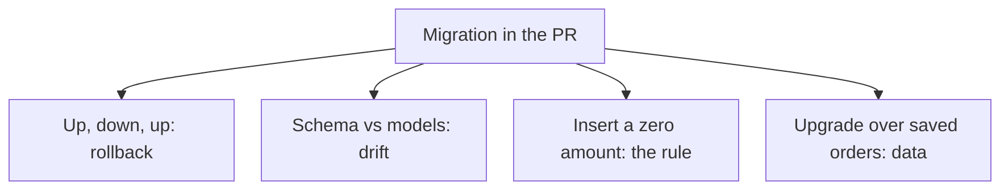

# Testing Alembic migrations in CI {#testing-alembic-migrations-in-ci}

<div class="bdr-post__hero" data-bdr-post="2026-10-11-testing-alembic-migrations-in-ci" role="img" aria-label="A revision history walked up, back and up again, then checked against the models, the rules and the data" markdown="0"></div>

Schema migrations are usually checked in CI with one step: apply them to an empty database. If the step is green, the migration is considered safe.

But a green `alembic upgrade head` on an empty database proves only that migrations apply once. It misses a broken rollback, a weakened CHECK and an upgrade that deletes rows.

We will catch each of these on a shop with users and orders, then see which checks alembic-gauntlet can take over. The lab uses PostgreSQL 17, Alembic 1.20.0, SQLAlchemy 2.0.54, asyncpg 0.31.0 and alembic-gauntlet 0.3.0.

<!-- more -->

<div id="the-five-migration-tests-every-python-project-should-run-in-ci" data-search-exclude></div>
<div id="the-test-most-pipelines-have" data-search-exclude></div>
<div id="five-bugs-one-file-each" data-search-exclude></div>
<div id="five-tests-by-hand" data-search-exclude></div>
<div id="what-each-test-caught" data-search-exclude></div>
<div id="the-thing-the-naming-test-taught-me" data-search-exclude></div>
<div id="running-it-in-ci" data-search-exclude></div>
<div id="the-contract-with-envpy" data-search-exclude></div>
<div id="the-five-tests-as-one-import" data-search-exclude></div>

## Four revisions, several ways to break them {#checks}

The shop's history is linear:

| Revision | Change |
|---|---|
| `0001` | Create `users` with a unique email |
| `0002` | Create `orders`, its foreign key, an index and the `order_status` enum: `new`, `paid`, `shipped` |
| `0003` | Add CHECK `amount > 0` named `amount_positive`; the naming convention turns it into `chk_orders_amount_positive` |
| `0004` | Add `users.is_active`, NOT NULL with a server default of `true` |

The lab keeps this correct history and fourteen broken variants, each changing one migration file. No single test catches them all:

<!-- diagram:concept -->
<figure class="bdr-diagram" markdown="1">
<figcaption><span class="bdr-diagram__eyebrow">THE IDEA, VISUALIZED</span><strong>One check per kind of mistake</strong></figcaption>
<div class="bdr-diagram__viewport" markdown="1" data-search-exclude>



</div>
<p class="bdr-diagram__caption">The round trip catches a broken rollback, the model comparison catches schema drift, an insert checks the rule and rows saved before the upgrade check the data.</p>
</figure>
<!-- /diagram:concept -->

<div id="testing-database-migrations-with-testcontainers-up-down-and-up-again" data-search-exclude></div>
<div id="step-1-a-database-that-exists-only-for-the-test-session" data-search-exclude></div>
<div id="step-2-pytest-configuration" data-search-exclude></div>
<div id="step-3-the-contract-with-envpy" data-search-exclude></div>
<div id="step-4-the-test-file" data-search-exclude></div>
<div id="step-5-ci" data-search-exclude></div>
<div id="what-it-costs" data-search-exclude></div>

## Connect Alembic to the test database {#isolation}

`tests/conftest.py` starts one PostgreSQL container per pytest session. Set `MIGRATION_TEST_URL` to use an existing database instead; the lab's `run_matrix.py` (see CI below) uses it to share one container across all histories:

```python
@pytest.fixture(scope="session")
def migration_db_url():
    if url := os.getenv("MIGRATION_TEST_URL"):
        yield url
        return
    with PostgresContainer("postgres:17-alpine", driver="asyncpg") as postgres:
        yield postgres.get_connection_url()
```

`alembic_config` points Alembic at the history under test; the `VARIANT` environment variable picks it, `clean` by default:

```python
@pytest.fixture
def alembic_config() -> Config:
    config = Config("alembic.ini")
    config.set_main_option("version_locations", f"migrations/versions/{VARIANT}")
    return config
```

alembic-gauntlet's pytest plugin builds the `migration_engine` fixture from `migration_db_url`. Tests create and drop schemas and downgrade to base, and if the schema ever fails to reach `env.py`, it falls back to `public`. Point `MIGRATION_TEST_URL` only at a disposable database.

`env.py` has to accept the connection and schema that the test passes in:

```python
# The test runner injects the schema it created for this test; production gets "public".
target_schema = config.attributes.get("target_schema") or os.getenv("MIGRATION_SCHEMA", "public")


def do_run_migrations(connection: Connection) -> None:
    quoted_schema = connection.dialect.identifier_preparer.quote_schema(target_schema)
    connection.execute(
        text("SELECT set_config('search_path', :schema, true)"),
        {"schema": quoted_schema},
    )
    context.configure(
        connection=connection,
        target_metadata=target_metadata,
        version_table_schema=target_schema,
    )
    with context.begin_transaction():
        context.run_migrations()
```

`version_table_schema` puts `alembic_version` next to the tables, and the transaction-local `search_path` sends unqualified names into the test schema. A test that passes a connection owns its transaction; without one, `env.py` creates an engine and `engine.begin()` commits the migrations:

```python
injected = config.attributes.get("connection")
if injected is not None:
    do_run_migrations(injected)  # the test runner owns the connection and the transaction
else:
    asyncio.run(run_migrations_online())
```

`run_migrations_online()` opens an async engine and calls `connection.run_sync(do_run_migrations)`, the bridge described in the [Alembic cookbook](https://alembic.sqlalchemy.org/en/latest/cookbook.html#using-asyncio-with-alembic).

## Apply, roll back, apply again {#round-trip}

If the downgrade of `0003` drops `positive_amount` instead of `amount_positive`, rollback fails on a constraint that does not exist. Any downgrade test catches that. A leftover enum is subtler: remove `order_status.drop(op.get_bind())` from the downgrade of `0002`, and dropping `orders` still succeeds, but the PostgreSQL type stays. Applying `0002` again fails because the type already exists.

The test applies each revision, rolls back one step and applies it again:

```python
async def test_every_revision_up_down_up(migration_engine: AsyncEngine, alembic_config: Config) -> None:
    """The stairway: each revision applied, rolled back one step, applied again."""
    revisions = revisions_base_to_head(alembic_config)
    async with fresh_schema(migration_engine) as schema:
        for i, revision in enumerate(revisions):
            await migrate(migration_engine, alembic_config, schema, command.upgrade, revision)
            assert await current_revision(migration_engine, schema) == revision
            await migrate(migration_engine, alembic_config, schema, command.downgrade, revisions[i - 1] if i else "base")
            await migrate(migration_engine, alembic_config, schema, command.upgrade, revision)
```

The helpers live in `tests/helpers.py`: `revisions_base_to_head` reads the history, `migrate` runs an Alembic command on a test connection and `current_revision` reads the version table. alembic-gauntlet exports equivalents (`create_isolated_migration_schema`, `run_alembic_upgrade`, `get_current_revision`, `get_all_revisions`); the lab keeps its own to show the mechanics. A project with intentionally irreversible migrations should test its supported recovery path instead.

<div id="your-models-and-your-schema-have-drifted-would-ci-notice" data-search-exclude></div>
<div id="where-drift-comes-from" data-search-exclude></div>
<div id="the-six-drifts" data-search-exclude></div>
<div id="the-check-that-catches-half-of-them" data-search-exclude></div>
<div id="the-one-it-will-not-look-at-unless-you-ask" data-search-exclude></div>
<div id="the-two-it-will-never-look-at" data-search-exclude></div>
<div id="what-to-run-in-ci" data-search-exclude></div>
<div id="the-pieces" data-search-exclude></div>

## Compare the database with the models {#schema-drift}

Suppose the migration makes `is_active` nullable while the model requires a value, or sets the default to `false` while the model says `true`. Both histories apply to empty tables without errors. Checks like these repeat from project to project, and alembic-gauntlet ships them as a base class; this is all of `tests/test_gauntlet.py`:

```python
import pytest
from alembic_gauntlet import MigrationTestBase
from sqlalchemy import MetaData

from shop.models import Base


@pytest.mark.integration
class TestMigrations(MigrationTestBase):
    migration_diff_compare_server_default = True

    @pytest.fixture
    def orm_metadata(self) -> MetaData:
        return Base.metadata
```

Inheriting from `MigrationTestBase` adds seven tests in 0.3.0: a revision stairway, a schema/model comparison, a single head, downgrade to base, naming conventions, CHECK names and enum values. Server defaults are compared only on request: without `migration_diff_compare_server_default = True`, the gauntlet misses the `false` default above.

| Deliberate error | Check that fails |
|---|---|
| `0003` and `0004` both descend from `0002` | Single head; `upgrade head` fails too |
| Wrong nullable flag, type or default, a missing index, an extra column | Schema/model comparison |
| `chk_orders_amount_positive` is missing | CHECK-name comparison |
| `order_status` lacks `shipped` | Enum-value comparison |
| A CHECK added with raw SQL, so the convention never names it | Naming-convention and CHECK-name checks |

By default, Alembic's `compare_metadata` skips CHECK constraints and enum members (1.20 has an opt-in by-name CHECK plugin), so the gauntlet compares them separately: CHECKs by name, not by expression, and enum types by their ordered values.

The gauntlet's stairway never applies the newest revision a second time. In the `head_noop_downgrade` variant, the downgrade of `0004` does nothing: all seven checks pass, and only our up/down/up test fails because `is_active` already exists. Keep the handwritten round trip next to the base class.

## Test the rule, not the name {#constraint-behavior}

Change `amount > 0` to `amount >= 0` and keep the constraint name. All seven inherited checks still pass, but the database now accepts an order for zero. Only an insert notices:

```python
@pytest.mark.parametrize("amount", [0, -1])
async def test_order_amount_must_be_positive(migrated_connection, amount):
    await migrated_connection.execute(
        text("INSERT INTO users (id, email) VALUES (1, 'buyer@example.test')")
    )
    with pytest.raises(IntegrityError) as raised:
        async with migrated_connection.begin_nested():
            await migrated_connection.execute(
                text("INSERT INTO orders (id, user_id, amount, status) "
                     "VALUES (42, 1, :amount, 'new')"),
                {"amount": amount},
            )
    assert raised.value.orig.sqlstate == "23514"
```

The `migrated_connection` fixture applies `head` and opens a transaction in the test schema. The user goes in first, so the foreign key is satisfied; a savepoint isolates the failed insert, and SQLSTATE `23514` confirms the CHECK rejected it. The correct history rejects both `0` and `-1`; with `>= 0`, the `0` case fails with `DID NOT RAISE`.

## Upgrade a database that already has orders {#data}

Put `DELETE FROM orders` into the upgrade of `0004`. The schema still matches the models, and all seven inherited checks pass on empty tables. To catch it, save rows at `0003`, upgrade and read them back:

```python
async def test_existing_orders_survive(migration_engine, alembic_config):
    async with fresh_schema(migration_engine) as schema:
        await migrate(migration_engine, alembic_config, schema, command.upgrade, "0003")
        async with migration_engine.begin() as connection:
            await connection.execute(text(f'SET LOCAL search_path TO "{schema}"'))
            await connection.execute(text(
                "INSERT INTO users (id, email) VALUES (1, 'buyer@example.test')"
            ))
            await connection.execute(text(
                "INSERT INTO orders (id, user_id, amount, status) "
                "VALUES (42, 1, 19.99, 'paid')"
            ))

        await migrate(migration_engine, alembic_config, schema, command.upgrade, "0004")
        async with migration_engine.connect() as connection:
            await connection.execute(text(f'SET LOCAL search_path TO "{schema}"'))
            users = (await connection.execute(
                text("SELECT id, email, is_active FROM users ORDER BY id")
            )).all()
            orders = (await connection.execute(
                text("SELECT id, user_id, amount, status FROM orders ORDER BY id")
            )).all()
        assert users == [(1, "buyer@example.test", True)]
        assert orders == [(42, 1, Decimal("19.99"), "paid")]
```

With the correct migration, user `1` gets `is_active=True`, and order `42` keeps its user, amount and `paid` status. The destructive variant returns no orders: structural checks cannot know which data a migration must keep. For a migration that converts values, add their boundary cases to this test. Lock duration on large tables needs a separate rehearsal at realistic scale.

## Run the same checks in CI {#ci}

Run from the lab directory; Docker and `uv` are all you need:

```bash
uv run --no-project --python 3.13 --with-requirements requirements.txt python -m pytest -q
uv run --no-project --python 3.13 --with-requirements requirements.txt python run_matrix.py
```

The first command runs the correct history: 20 tests, seven of them inherited. The second goes through all fifteen histories and fails if a broken history passes, if its expected check does not fail, or if a skip or setup error hides a gap. The lab's GitHub Actions template runs the first command; point `working-directory` at your own migration tests:

```yaml
name: Migration checks
on:
  pull_request:
  push:
    branches: [master]
permissions:
  contents: read
jobs:
  migrations:
    runs-on: ubuntu-24.04
    timeout-minutes: 10
    defaults:
      run:
        working-directory: docs/blog/lab/2026-09-07-five-alembic-migration-tests
    steps:
      - uses: actions/checkout@v7
      - uses: astral-sh/setup-uv@v10.3.0
      - run: uv run --no-project --python 3.13 --with-requirements requirements.txt python -m pytest -q
```

We ran both commands locally; the workflow is a template, not a report from hosted CI.

## What to bring into your project {#conclusion}

A single upgrade on an empty database would have missed everything here except the two heads: a broken rollback, a leftover enum, a no-op downgrade, schema drift, a weakened CHECK and lost orders.

Let [alembic-gauntlet](https://bedrock-python.github.io/alembic-gauntlet/) handle schema isolation and the recurring history, naming and model checks. Keep three handwritten tests beside it: up/down/up through the newest revision, the database rules your code relies on, and a check that rows written before the new revision survive it.

## Examples and labs {#labs}

- [Lab: Alembic migration tests](../lab/2026-09-07-five-alembic-migration-tests/README.md)
