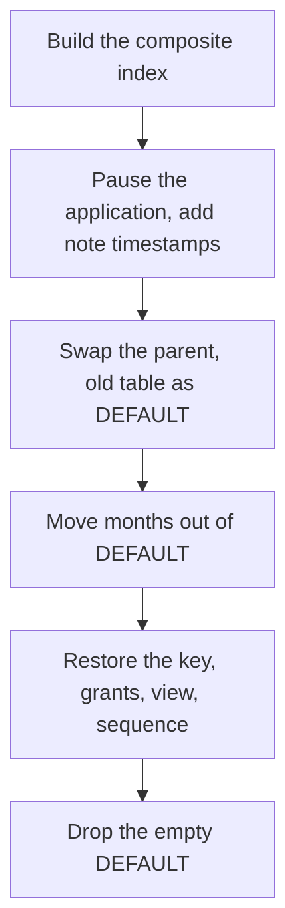

# Partitioning an existing PostgreSQL table {#partitioning-an-existing-postgresql-table}

<div class="bdr-post__hero" data-bdr-post="2026-10-17-partitioning-an-existing-postgresql-table" role="img" aria-label="Prepare keys, attach the old table as DEFAULT and verify each migration step" markdown="0"></div>

An events table grows for years until its size gets in the way of queries and cleanup, and it gets split into monthly partitions.

But PostgreSQL cannot turn an existing table into a partitioned one. A new parent needs the partition column in its primary key, and foreign keys, views and grants stay behind.

We move an analytics service's `events` table, referenced by `event_notes`, to monthly partitions and keep the name `events` for application queries. The application stays paused for a maintenance window until data and dependencies are verified. It runs on PostgreSQL 17 with pg-partsmith 1.8.0, SQLAlchemy 2.0.54 and asyncpg 0.31.0.

<!-- more -->

## Start with the table and its references {#keys}

Here is the starting schema. `events_app` stands for the application's permissions, and `event_summary` is a deliberately simple reporting view:

```sql
CREATE TABLE events (
    id bigserial PRIMARY KEY,
    created_at timestamptz NOT NULL,
    kind text NOT NULL,
    payload text NOT NULL
);
CREATE INDEX events_created_at_idx ON events (created_at);
CREATE TABLE event_notes (
    id bigserial PRIMARY KEY,
    event_id bigint NOT NULL REFERENCES events (id),
    note text NOT NULL
);
CREATE VIEW event_summary AS SELECT count(*) AS total FROM events;
CREATE ROLE events_app NOLOGIN;
GRANT USAGE ON SCHEMA public TO events_app;
GRANT SELECT, INSERT ON events TO events_app;
GRANT USAGE ON SEQUENCE events_id_seq TO events_app;
```

The lab fills it with 616 events for July–September 2026 and twenty notes, and saves copies for comparison.

The tempting `CREATE TABLE ... (LIKE events INCLUDING ALL) PARTITION BY RANGE (created_at)` fails with SQLSTATE `0A000`: `PRIMARY KEY (id)` does not include the partition key, and the [PostgreSQL 17 restrictions](https://www.postgresql.org/docs/17/ddl-partitioning.html#DDL-PARTITIONING-DECLARATIVE-LIMITATIONS) require it. Dropping that key fails too, with `2BP01`, because `event_notes` references it.

We make `(id, created_at)` the new primary key, so notes will reference both values. **`id` alone is no longer guaranteed unique**: the lab checks that the same pair is rejected, but the same id with another timestamp is accepted. If `id` must stay unique on its own, time-based partitioning does not fit; settle that before the migration.

Build the new unique index before the pause; `CONCURRENTLY` does not block writes. A failed build leaves an INVALID index that must be dropped before a retry:

```python
async def build_key_index(connection):
    await connection.execute("""
        CREATE UNIQUE INDEX CONCURRENTLY events_id_created_at_key
        ON events (id, created_at)
    """)
```

Then pause the application, let active transactions finish, and give notes the event timestamp:

```python
async def prepare_notes(connection):
    await connection.execute("""
        ALTER TABLE event_notes ADD COLUMN event_created_at timestamptz;
        UPDATE event_notes AS n
        SET event_created_at = e.created_at
        FROM events AS e WHERE e.id = n.event_id;
        ALTER TABLE event_notes ALTER COLUMN event_created_at SET NOT NULL;
    """)
```

`event_created_at` is NOT NULL so a note cannot bypass the future composite foreign key with a missing timestamp. Code that writes notes has to supply it too; keeping the table name does not save that change.

<div id="how-to-partition-an-existing-postgresql-table-without-rewriting-your-application" data-search-exclude></div>
<div id="step-1-the-primary-key-has-to-contain-the-partition-column" data-search-exclude></div>
<div id="step-2-the-swap" data-search-exclude></div>
<div id="step-3-the-first-maintenance-tick" data-search-exclude></div>
<div id="step-4-the-drain" data-search-exclude></div>
<div id="step-5-the-foreign-key-comes-back-composite" data-search-exclude></div>
<div id="step-6-the-empty-default-and-the-sequence" data-search-exclude></div>
<div id="the-result" data-search-exclude></div>
<div id="the-order-and-where-the-risk-is" data-search-exclude></div>
<div id="the-pieces" data-search-exclude></div>

## Replace the parent in one transaction {#cutover}

Rename the old table, create the partitioned parent and attach the old table as its DEFAULT partition:

```python
async def cutover(connection):
    async with connection.transaction():
        await connection.execute("SET LOCAL lock_timeout = '200ms'")
        await connection.execute("""
            LOCK TABLE events, event_notes IN ACCESS EXCLUSIVE MODE;
            ALTER TABLE event_notes DROP CONSTRAINT event_notes_event_id_fkey;
            ALTER TABLE events DROP CONSTRAINT events_pkey,
                ADD CONSTRAINT events_pkey PRIMARY KEY USING INDEX events_id_created_at_key;
            ALTER TABLE events RENAME TO events_legacy;
            ALTER TABLE events_legacy RENAME CONSTRAINT events_pkey TO events_legacy_pkey;
            ALTER INDEX events_created_at_idx RENAME TO events_legacy_created_at_idx;
            CREATE TABLE events (LIKE events_legacy INCLUDING ALL)
                PARTITION BY RANGE (created_at);
            ALTER TABLE events ATTACH PARTITION events_legacy DEFAULT;
        """)
```

The renames free the names `events_pkey` and `events_created_at_idx`, so `LIKE ... INCLUDING ALL` gives the new parent clean ones. Attaching as DEFAULT with no other partitions needs no validation scan, and the parent adopts the existing primary key and index instead of building new ones. Attaching the old table as one historical range would avoid moving rows, but history would then stay in one partition that cannot be retired by month.

`lock_timeout` matters because a waiting ACCESS EXCLUSIVE request queues every later query on `events` behind it; 200 ms is a lab value. In the lab, a reader's open transaction makes `cutover` fail with `55P03` and roll back with everything intact; once the reader finishes, the cutover succeeds.

The new parent now returns all 616 rows from `events_legacy`. Four things did not move to the new parent: the foreign key (we dropped it), the grants, the view (it still points at `events_legacy`) and the sequence's `OWNED BY`. Inventory triggers, row-level security, incoming foreign keys, views and privileges in your own schema the same way.

<!-- diagram:concept -->
<figure class="bdr-diagram" markdown="1">
<figcaption><span class="bdr-diagram__eyebrow">THE IDEA, VISUALIZED</span><strong>Six steps from a table to partitions</strong></figcaption>
<div class="bdr-diagram__viewport" markdown="1" data-search-exclude>



</div>
<p class="bdr-diagram__caption">Only the composite index is built under traffic. Everything from the pause to dropping the empty DEFAULT partition runs in the maintenance window.</p>
</figure>
<!-- /diagram:concept -->

## Move rows out of DEFAULT and inspect intermediate results {#movement}

Creating a July partition right away fails with SQLSTATE `23514`: a new range narrows DEFAULT, and PostgreSQL refuses while DEFAULT still holds rows for it.

[pg-partsmith](https://bedrock-python.github.io/pg-partsmith/) works around this. It creates an unattached table for a month, moves rows into it in batches, one `DELETE ... RETURNING` / `INSERT` statement each, and attaches the table once that month has left DEFAULT. Until then those rows are invisible through the parent, which is why the application stays paused. Each ATTACH also scans whatever is left in DEFAULT under an ACCESS EXCLUSIVE lock, so N months of history cost N scans of a shrinking DEFAULT on top of moving every row once; `batch_rows` changes how that work is split, not how much there is.

```python
def migration_toolkit(engine):
    config = TablePartitionConfig(
        schema="public",
        table_name="events",
        partition_column="created_at",
        granularity=PartitionGranularity.MONTH,
    )
    return PartitionToolkit.from_engine(engine), config


async def move_batch(toolkit, config, *, max_batches=10):
    result = await toolkit.service.partition_data(
        config, batch_rows=100, max_batches=max_batches,
    )
    if result.issues:
        raise RuntimeError(f"Data movement needs attention: {result.issues}")
    return result


async def finish_ranges(toolkit, config):
    while True:
        result = await move_batch(toolkit, config)
        if result.complete:
            return result
        if result.rows_moved == 0:
            raise RuntimeError("Data movement made no progress")
```

`engine` is a SQLAlchemy `AsyncEngine` for the same database. `move_batch(toolkit, config, max_batches=1)` stops after one batch, and the intermediate state is measurable:

| Observation after the first batch | Result |
|---|---|
| `rows_moved`, `batches`, `complete` | `100`, `1`, `False` |
| Rows visible through `events` | `516` |
| Rows in the unattached `events__2026_07` | `100` |
| Rows from both locations combined | Exactly the original 616 |

The lab then disposes the engine, builds a new toolkit and calls `finish_ranges`. That function continues from committed state, checks `issues` after every call and stops if a call moves nothing; afterwards every saved row must be visible through `events` again. If `max_batches` runs out right after a batch empties a month, that month stays unattached until the next call, and `plan()` reports it as `unattached_rows`. Still compare counts through the parent.

## Restore references before reopening the service {#verification}

The old single-column foreign key cannot come back: the parent has no unique constraint on `id` alone. Add the composite one only after all rows have moved; with it in place, `partition_data` refuses to move referenced rows and reports an issue instead. Restore the reference, make `events.id` own the sequence again, rebuild the view and grant access to the parent:

```python
async def restore_references(connection):
    async with connection.transaction():
        await connection.execute("SET LOCAL lock_timeout = '200ms'")
        await connection.execute("""
            ALTER TABLE event_notes ADD CONSTRAINT event_notes_event_fkey
                FOREIGN KEY (event_id, event_created_at)
                REFERENCES events (id, created_at);
            ALTER SEQUENCE events_id_seq OWNED BY events.id;
            CREATE OR REPLACE VIEW event_summary AS SELECT count(*) AS total FROM events;
            GRANT SELECT, INSERT ON events TO events_app;
        """)
```

Existing notes are checked as the key is added. A note without a timestamp still fails with `23502` (NOT NULL), and a nonexistent `(event_id, event_created_at)` pair now fails with `23503`. Without the new view, `event_summary` keeps counting the drained `events_legacy` and reports zero. Without `OWNED BY`, the sequence still belongs to `events_legacy` and would go with it, while the default of `events.id` needs it, so PostgreSQL refuses the drop with `2BP01`.

Before dropping DEFAULT, create the next month (the lab creates October): without DEFAULT, a write to a month with no partition fails with `23514`. Then drop DEFAULT, checking under the parent's lock that it is empty:

```python
async def remove_empty_default(connection):
    async with connection.transaction():
        await connection.execute("SET LOCAL lock_timeout = '200ms'")
        await connection.execute("LOCK TABLE events IN ACCESS EXCLUSIVE MODE")
        remaining = await connection.fetchval("SELECT count(*) FROM ONLY events_legacy")
        if remaining:
            raise RuntimeError(f"DEFAULT still contains {remaining} rows")
        await connection.execute("ALTER TABLE events DETACH PARTITION events_legacy")
        await connection.execute("DROP TABLE events_legacy")
```

The finished rehearsal checks more than a row count:

| Check | Expected result |
|---|---|
| All saved events and notes | Unchanged |
| The composite foreign key | Wrong references are rejected |
| The application's original insert as `events_app` | Works with the restored grants and sequence |
| `event_summary` | Counts rows through the new parent |
| A July range in `EXPLAIN (FORMAT JSON)` | Scans only `events__2026_07` |
| An insert for a month with no partition | Fails with `23514` |

Rejecting such writes is this example's policy; keeping a monitored DEFAULT partition is another. Regular [partition maintenance](2026-10-18-postgresql-partition-maintenance.md) comes next.

<div id="uuidv7-as-a-postgresql-partition-key" data-search-exclude></div>
<div id="one-column-in-the-primary-key" data-search-exclude></div>
<div id="the-bounds-are-uuids" data-search-exclude></div>
<div id="pruning-happens-on-the-id-not-on-the-timestamp" data-search-exclude></div>
<div id="the-three-ids-that-do-not-fit" data-search-exclude></div>
<div id="retention-has-the-same-edge" data-search-exclude></div>
<div id="when-to-reach-for-it" data-search-exclude></div>

## When UUIDv7 can keep a single-column primary key {#uuidv7}

If the id is already a UUIDv7 and its embedded time is the axis you want, PostgreSQL accepts `id uuid PRIMARY KEY ... PARTITION BY RANGE (id)`, because the key includes the partition column. pg-partsmith's `UUIDv7BoundaryCodec` turns month boundaries into UUID bounds: a query by an id range scans one partition, while the same condition on a separate `created_at` column scans all of them. Rows land by the id's time, not by `created_at`, and range bounds do not check the UUID version, so a crafted v4 id can fall into a month unless a CHECK on the version rejects it. PostgreSQL 18 adds `uuidv7()`; on 17 the application generates the ids. This is a different key design, not a way to convert existing random ids.

## What to take into your migration {#conclusion}

- Build the composite unique index `CONCURRENTLY` before the pause; everything else runs in the window.
- Attach the old table as DEFAULT: no scan, and its indexes are adopted. Each monthly ATTACH then rescans what is left of DEFAULT; that and moving the rows is what the window is spent on.
- Add the composite foreign key only after the rows have moved, and restore grants, views and sequence ownership explicitly.
- Before reopening, compare the rows through the parent with the saved copy.

## Examples and labs {#labs}

Each lab starts a disposable PostgreSQL 17 container; its README has the `uv` command.

- [Lab: partitioning an existing table in a maintenance window](../lab/2026-09-07-partition-existing-table/README.md)
- [Lab: UUIDv7 as a PostgreSQL partition key](../lab/2026-09-07-uuidv7-partition-key/README.md)
