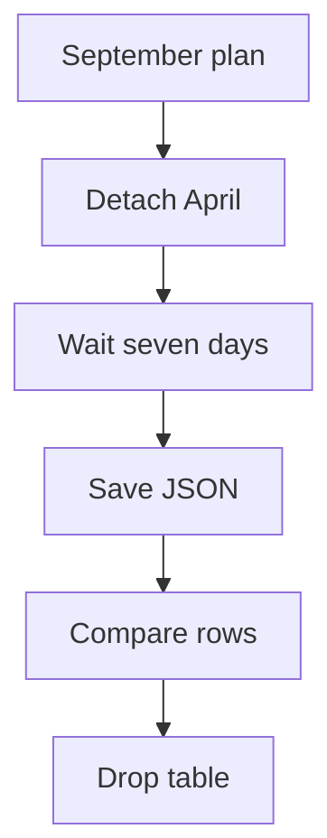

# PostgreSQL partition maintenance: from a plan to a verified archive {#postgresql-partition-maintenance}

<div class="bdr-post__hero" data-bdr-post="2026-10-18-postgresql-partition-maintenance" role="img" aria-label="Create future ranges, detach expired partitions, verify the archive before deletion" markdown="0"></div>

Monthly partitions need routine care: every month someone has to create next month's table and retire an old one.

That routine breaks in two places: inserts fail when next month's table is missing, and old tables get dropped before anyone has checked their archive.

We follow one maintenance run of an analytics service on September 15, 2026: October is missing, a receipt still references a May event, and an old table may be dropped only seven days after detachment and after its archive is verified. Then we hand a table over from pg_partman. The labs run PostgreSQL 17 and pg-partsmith 1.8.0.

<!-- more -->

<div id="managing-postgresql-partitions-one-failure-at-a-time" data-search-exclude></div>
<div id="not-knowing-what-maintenance-will-do" data-search-exclude></div>
<div id="dropping-something-you-did-not-make" data-search-exclude></div>
<div id="two-replicas-tick-at-once" data-search-exclude></div>
<div id="the-team-with-no-python-in-it" data-search-exclude></div>
<div id="the-archiver-has-to-run-before-the-drop" data-search-exclude></div>
<div id="wiring-it-with-an-assistant-in-the-loop" data-search-exclude></div>

## Define the policy in calendar months {#planning}

`events` has `id bigint`, `created_at timestamptz` and `payload text`, with primary key `(id, created_at)` and partition key `created_at`. A receipt holds a composite `(event_id, event_at)` reference to a May event. Reports need the current month and the previous two, and writers need two months prepared ahead:

```python
def events_config(*, protect_references=True):
    retention = KeepNewest(count=3)
    if protect_references:
        retention = ExpireIf(
            when=AllOf(members=(retention, Unreferenced())),
        )
    return TablePartitionConfig(
        schema="public",
        table_name="events",
        partition_column="created_at",
        granularity=PartitionGranularity.MONTH,
        lifecycle=LifecyclePolicy(
            creation=CreateAhead(count=3),
            retention=retention,
            drop=DropAfter(grace=timedelta(days=7)),
        ),
    )
```

| September setting | Meaning |
|---|---|
| `CreateAhead(count=3)` | Ensure September, October and November: the current month counts as one |
| `KeepNewest(count=3)` | Keep July, August and September; future ranges do not reduce that history |
| `Unreferenced()` combined with retention | Keep an old partition attached while another table references its rows |
| `DropAfter(grace=timedelta(days=7))` | Drop a detached table no earlier than seven days after its detach stamp |

The rules apply to whole months, so there is no fixed row age: a September row stays until December's run detaches September.

A plan is built without DDL, printed for review and applied as a separate step; `toolkit` is `PartitionToolkit.from_engine(engine)` over a SQLAlchemy `AsyncEngine`:

```python
async def preview(toolkit, config, *, now=None):
    plan = await toolkit.service.plan(config, now=now)
    print(plan.describe())
    return plan


async def apply_reviewed(toolkit, config, plan):
    result = await toolkit.service.apply(config, plan)
    if result.error or result.issues:
        raise RuntimeError(f"Maintenance needs attention: {result}")
    return result
```

The database also holds three unusual tables:

| Table | Result |
|---|---|
| `events_may_manual`, created by hand with May bounds | Managed like any monthly partition; for now protected by the receipt |
| `events__2026_03`, spanning February 1 to April 1 | Left alone, with an `unmanaged_partition` finding |
| `events_export_2025_01`, standalone and unmarked | Not in the plan |

The lab plans with `now=datetime(2026, 9, 15, tzinfo=UTC)`. The plan creates October and November, detaches April and June and keeps referenced May; no drops yet. Planning changes nothing in the catalog.

## Understand which tables the library will manage {#ownership}

For an attached RANGE partition, pg-partsmith looks at its bounds, not at its name or creator: if the bounds fit inside one configured period, the partition is managed. Monthly partitions created by hand or by another tool therefore become detach candidates, while an irregular range like February–March is reported and left alone.

Just before detaching, the library writes a table comment with the parent and the detach time. Later runs use that marker to find tables they may drop.

<div id="where-to-read-more" data-search-exclude></div>
<div id="partition-retention-is-not-drop-table" data-search-exclude></div>
<div id="the-job-everybody-writes" data-search-exclude></div>
<div id="print-the-plan-first" data-search-exclude></div>
<div id="detach-and-drop-are-two-steps" data-search-exclude></div>
<div id="the-archive-runs-before-the-drop-and-may-refuse-it" data-search-exclude></div>
<div id="what-a-foreign-key-does-to-retention" data-search-exclude></div>

## Detach old ranges while preserving their data {#retention}

After `apply_reviewed`, the counters are `created=2`, `detached=2`, `dropped=0`. An October insert, rejected with SQLSTATE `23514` before maintenance, now succeeds. April and June disappear from queries through `events`, but their tables and four rows still exist. A late April event now fails with `23514`, because there is no DEFAULT partition.

To test foreign-key protection, plan without `Unreferenced()`. May appears in the plan, but PostgreSQL refuses to detach it because of the receipt: the result has `success=True` and a non-empty `issues`, and both May and the receipt survive. **`success` means no fatal error, not that every operation succeeded.** Once the receipt is deleted, the regular policy detaches May. The refused attempt leaves one trace in 1.8.0: the detach stamp written before the statement stays on May, and the later real detach keeps it, so the seven-day grace counts from the failed attempt ([#105](https://github.com/bedrock-python/pg-partsmith/issues/105)).

Operations do not share one transaction: a later failure does not roll back partitions already created or detached, so a retry starts from the current state. In the default `AUTO` mode, pg-partsmith uses `DETACH ... CONCURRENTLY`, which takes only SHARE UPDATE EXCLUSIVE on the parent but waits for every transaction using it to finish. PostgreSQL refuses this form, for example when the parent has a DEFAULT partition, and only then does pg-partsmith fall back to a plain DETACH: ACCESS EXCLUSIVE on the parent and the partition, plus SHARE, which blocks writes, on every table whose foreign keys reference the parent. Blocking steps wait at most `ddl_lock_timeout_ms`, three seconds by default, and report an issue instead of queueing behind long transactions. Dropping an already detached table no longer touches the parent, which is why detach and drop are separate steps; [ALTER TABLE](https://www.postgresql.org/docs/17/sql-altertable.html#SQL-ALTERTABLE-DETACH-PARTITION) lists the remaining restrictions.

<!-- diagram:concept -->
<figure class="bdr-diagram" markdown="1">
<figcaption><span class="bdr-diagram__eyebrow">THE IDEA, VISUALIZED</span><strong>The April partition before deletion</strong></figcaption>
<div class="bdr-diagram__viewport" markdown="1" data-search-exclude>



</div>
<p class="bdr-diagram__caption">September maintenance detaches April. After seven days, the hook saves and verifies the archive before the table can be dropped.</p>
</figure>
<!-- /diagram:concept -->

## Archive the rows before permitting a drop {#archive}

The `before_drop` hook runs before each table is dropped. Raising in it stops the run before that DROP and skips every later operation; with `continue_on_error=True` the failure becomes an issue instead. Our hook first checks that the table still has the OID from the plan, then saves its rows as JSON, rereads the file and compares every field:

```python
class JsonArchive(BasePartitionLifecycleHooks):
    def __init__(self, connection, directory: Path):
        self.connection = connection
        self.directory = directory

    async def before_drop(self, event: PartitionEvent):
        oid = await self.connection.fetchval("SELECT to_regclass($1)::oid", event.partition.name)
        if oid != event.operation.oid:
            raise RuntimeError(f"{event.partition.name} is not the planned table")
        schema, name = event.partition.name.split(".", 1)
        quoted = ".".join('"' + part.replace('"', '""') + '"' for part in (schema, name))
        rows = await self.connection.fetch(
            f"SELECT id, created_at, payload FROM {quoted} ORDER BY id, created_at",
        )
        data = [[row["id"], row["created_at"].isoformat(), row["payload"]] for row in rows]
        document = {"table": event.partition.name, "rows": data}
        path = self.directory / f"{oid}.json"
        if not path.exists():
            temporary = path.with_suffix(".tmp")
            temporary.write_text(json.dumps(document, ensure_ascii=False), encoding="utf-8")
            temporary.replace(path)
        if json.loads(path.read_text(encoding="utf-8")) != document:
            raise RuntimeError(f"Archive verification failed: {path.name}")
```

Register it with `PartitionToolkit.from_engine(engine, hooks=[JsonArchive(connection, directory)])`, passing an `asyncpg.Connection` and an existing directory. The file is named after the OID, so a repeated call verifies the existing archive, and a mismatch refuses the drop. A real archive needs streaming export to durable storage and its own restore check; stop any writes to detached tables before export.

The lab checks the whole path:

| Situation | Database and archive assertion |
|---|---|
| Seven days have not passed | The plan contains no `DROP` |
| Grace has passed, storage is unavailable | The hook raises; both tables remain |
| An existing archive has wrong contents | Verification refuses the drop |
| Retry after fixing the problem | Two tables are dropped; all four rows are restored from JSON into a temporary table and match the originals |

## Schedule a run and notice partial failures {#scheduling}

Run maintenance from a CronJob with `concurrencyPolicy: Forbid`, or from every replica: the table's advisory lock lets only one worker in at a time.

```python
async def maintenance_tick(toolkit, config):
    try:
        result = await toolkit.maintainer.run_maintenance(config)
    except LockAcquisitionError:
        print({"skipped": "another worker holds the maintenance lock"})
        return None
    print({
        "created": result.created_count,
        "detached": result.detached_count,
        "dropped": result.dropped_count,
        "duration_ms": result.duration_ms,
        "issues": [issue.model_dump() for issue in result.issues],
    })
    if result.issues:
        raise RuntimeError("Partition maintenance finished with issues")
    return result
```

`run_maintenance` plans and applies under the table's advisory lock. If another worker holds it, `LockAcquisitionError` turns this tick into a skip, not a failure; any other exception fails the job, and so do `issues`, even with `success=True`. We do not use `run_maintenance_safe`: it turns every exception, cancellation included, into `result.error`, so `asyncio.timeout()` cannot stop it ([#107](https://github.com/bedrock-python/pg-partsmith/issues/107)).

The lock is a session-level `pg_try_advisory_lock`, so workers need a direct database connection, not PgBouncer in transaction mode, and the same `lock_prefix`; it does not coordinate with other tools. Alert separately on the time since the last clean run and on upcoming range coverage. With a DEFAULT partition, count its rows yourself: 1.8.0 reports them as `rows_in_default`, but not under a policy with `Unreferenced()` like this one ([#108](https://github.com/bedrock-python/pg-partsmith/issues/108)).

<div id="the-checklist-for-a-retention-job" data-search-exclude></div>
<div id="the-pieces" data-search-exclude></div>
<div id="migrating-from-pg_partman-to-application-managed-partitions" data-search-exclude></div>
<div id="what-pg_partman-built" data-search-exclude></div>
<div id="the-configuration-is-the-migration" data-search-exclude></div>
<div id="adoption-is-not-a-step" data-search-exclude></div>
<div id="running-both-at-once" data-search-exclude></div>
<div id="switching-pg_partman-off" data-search-exclude></div>
<div id="what-you-give-up-and-what-you-get" data-search-exclude></div>

## Hand maintenance over from pg_partman {#migration}

The second lab hands a monthly table over from pg_partman 5.5.0, and three settings map directly. `premake = N` future tables becomes `CreateAhead(count=N + 1)`, because pg-partsmith also counts the current month; `retention = '3 months'` keeps the current month and three before it, which is `KeepNewest(count=4)`; `retention_keep_table = true` becomes `DropNever()`. With that mapping the first pg-partsmith plan is empty, and that is the acceptance test of the handover.

Save `part_config`, table OIDs and row counts first. Set `automatic_maintenance = 'off'` and stop jobs that call `run_maintenance('public.events')` explicitly: [the flag does not stop them](https://github.com/pgpartman/pg_partman/blob/v5.5.0/doc/pg_partman.md#maintenance-objects). Wait for running calls, then delete the table's row from `partman.part_config`; after that even a targeted call changes nothing. At the next month boundary, check that pg-partsmith created the partition: in the lab it creates one and detaches the oldest.

Some leftovers stay yours: pg_partman's `events_default` forces blocking detaches, its template table remains, tables it detached earlier carry no pg-partsmith marker and are never dropped, and new partitions follow the `events__YYYY_MM` scheme next to the old `events_pYYYYMMDD`.

## Bring the checks into your service {#conclusion}

Before enabling scheduled maintenance, check that partitions exist at least one month ahead, that every DETACH in the next plan is one you would approve, and that `before_drop` refuses a mismatched archive. Alert on exceptions and `issues`, never on `success`.

## Examples and labs {#labs}

Each lab starts a disposable PostgreSQL 17 container; the pg_partman lab first builds its image, as its README shows.

- [Lab: partition retention and archive verification](../lab/2026-09-07-partition-retention/README.md)
- [Lab: adopting a pg_partman-managed table](../lab/2026-09-07-migrating-from-pg-partman/README.md)
