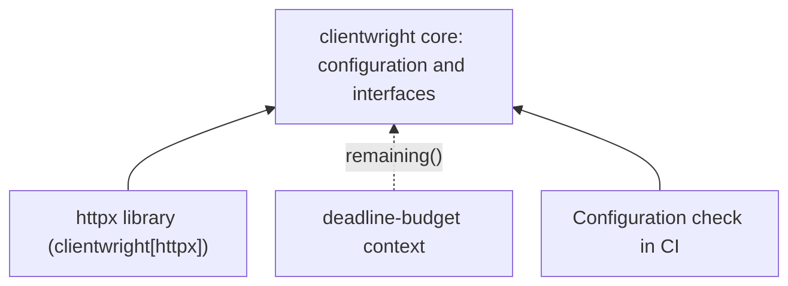

# A core without dependencies: install the integrations your service needs {#zero-dependency-cores-why-optional-dependencies-matter-in-infrastructure-libraries}

<div class="bdr-post__hero" data-bdr-post="2026-10-21-zero-dependency-cores" role="img" aria-label="A shared client configuration works on its own; the orders API adds HTTP and deadline integrations" markdown="0"></div>

An infrastructure library ends up in many services, and each of its mandatory dependencies lands in every one of them, including those that never use it.

Take clientwright. An orders API uses it to read stock from a warehouse over HTTP, and a CI job loads the same client configuration and reads what each transport adapter declares it supports. The API needs an HTTP library; the CI job does not, and neither does a service that uses aiohttp instead of httpx. An unneeded dependency costs version constraints, image size and import time.

We will see what works on a bare install, where the first missing-extra error appears and what each extra installs. An **extra** is a named set of optional dependencies in a package's metadata: `clientwright[httpx]` installs clientwright plus httpx. Python's packaging guide describes how to declare [optional dependencies](https://packaging.python.org/en/latest/guides/writing-pyproject-toml/#dependencies-and-requirements).

<!-- more -->

## Share configuration before choosing a transport {#what-a-good-core-looks-like}

Our `warehouse_policy.py` defines the client configuration with types from the [clientwright](https://github.com/bedrock-python/clientwright) core:

```python
from clientwright import ClientConfig, RetryConfig, TimeoutConfig


def warehouse_config(base_url):
    return ClientConfig(
        service_name="warehouse",
        base_url=base_url,
        timeout=TimeoutConfig(total=2),
        retry=RetryConfig(max_attempts=1),
        circuit_breaker=None,
        deadline_header="X-Deadline-Ms",
        on_unsupported="strict",
    )
```

Retries and the circuit breaker are off to keep the example about dependencies. `deadline_header` sends the remaining time in milliseconds, and `on_unsupported="strict"` makes `build()` fail if the chosen adapter cannot apply a setting.

With only `clientwright==0.5.0` installed, the lab creates this configuration, reads the capability matrix and lists the registered adapters: `aiohttp`, `httpx`, `httpx2`, `requests` and `urllib3`. A registered name does not mean its library is installed; `find_spec("httpx")` confirms that httpx is absent. The registry stores import paths, so even `import clientwright.adapters.httpx` loads no HTTP code until `build()` selects the adapter. The CI job can read what each adapter declares without any transport, but only `build()` with `on_unsupported="strict"` confirms that an adapter applies the whole configuration.

<!-- diagram:concept -->
<figure class="bdr-diagram" markdown="1">
<figcaption><span class="bdr-diagram__eyebrow">THE IDEA, VISUALIZED</span><strong>What connects to the core</strong></figcaption>
<div class="bdr-diagram__viewport" markdown="1" data-search-exclude>



</div>
<p class="bdr-diagram__caption">Client configuration and the budget interface work without an HTTP library. The httpx library and deadline-budget are installed only where the application needs them.</p>
</figure>
<!-- /diagram:concept -->

## A missing extra names itself {#the-message-is-the-feature}

Now the orders API tries to create its client in the same bare environment:

```python
from clientwright import build
from warehouse_policy import warehouse_config

build("httpx", warehouse_config("http://127.0.0.1:1"))
```

```text
ImportError: httpx support requires clientwright[httpx]; install it.
```

Without the guard, the error would be `No module named 'httpx'`, and the obvious fix, installing httpx on its own, could pick a version clientwright does not support. The extra carries the supported range, `httpx>=0.28,<1`. Since importing the adapter module succeeds on a bare install, test the operation that needs the integration, not the import.

servicewright, the library that manages service startup and shutdown, fails earlier: the bare package imports fine, and importing `servicewright.adapters.fastapi` raises an error naming `servicewright[fastapi]`. Its guard matters more, because the adapter also needs starlette, pydantic and deadline-budget, and without the guard a missing one would be reported under its own name.

## Install the extra and make the request {#install-extra}

With `"clientwright[httpx]==0.5.0"` in the API's dependencies, the service fetches stock with the same configuration:

```python
from clientwright import build

from warehouse_policy import warehouse_config


async def fetch_stock(base_url, deps=None):
    async with build("httpx", warehouse_config(base_url), deps) as client:
        response = await client.get("/stock/sku-42")
        response.raise_for_status()
        return response.json()
```

The lab's local server returns `{"available": 3}` and receives at most 2000 in `X-Deadline-Ms`. `build()` returns an actual `httpx.AsyncClient`, so code written against httpx stays unchanged. FastAPI, aiohttp and requests are still absent. The configuration module imports only clientwright; the service creates the transport client when it needs HTTP.

## Accept a small interface for the remaining time {#protocols}

Suppose the warehouse lookup must finish within 500 ms, less than the client's two-second ceiling. The application passes a deadline-budget context to `build()` as the deadline source:

```python
from clientwright import AdapterDeps
from deadline_budget import BudgetContext

from http_flow import fetch_stock


async def fetch_with_budget(base_url):
    budget = BudgetContext.create(total_seconds=0.5)
    return await fetch_stock(base_url, AdapterDeps(deadline_source=budget))
```

clientwright's `DeadlineSource` protocol requires one method, `remaining() -> float | None`. `BudgetContext` has it, so clientwright never imports deadline-budget. The `[deadline]` extra only pins a compatible version, `>=0.1,<1`. The server now receives at most 500 in `X-Deadline-Ms`. Without deadline-budget installed, `budget_flow.py` fails to import, and we keep it that way: an application that promises 500 ms should not silently fall back to two seconds. Since the application imports deadline-budget itself, it should list it in its own dependencies. An integration can be optional for a library and required by a service.

## What is actually installed {#what-each-library-costs}

| Installation | Distributions | What the lab verifies |
|---|---|---|
| `deadline-budget==0.1.3` | 1 | A budget works without HTTP or web packages |
| `clientwright==0.5.0` | 1 | Configuration and capability discovery work |
| `clientwright[httpx]==0.5.0` | 8 | The httpx client sends a request; deadline-budget is still absent |
| `clientwright[httpx,deadline]==0.5.0` | 9 | The same request carries at most 500 in `X-Deadline-Ms` |
| `servicewright==0.13.1` | 1 | The FastAPI adapter names its missing extra |
| `servicewright[fastapi]==0.13.1` | 22 | The adapter imports and its entrypoint can be constructed |

The counts are from Python 3.13 on Windows and include the library itself. The httpx extra adds seven distributions; the FastAPI extra adds twenty-one, because it also brings uvicorn with its standard extras and Prometheus instrumentation. On Linux and macOS, uvloop makes it twenty-two.

## Keep unrelated version constraints out of a service {#the-failure-mode-this-prevents}

If a lifecycle library required FastAPI, a worker that uses only the lifecycle would inherit FastAPI's constraints on starlette and pydantic. One incompatible pydantic elsewhere in the worker, and its environment stops resolving, although it never serves HTTP. An extra limits that problem to the applications that select it. It does **not** remove conflicts where FastAPI is actually needed, and installing `[all]` everywhere gives the benefit up.

## When a dependency belongs in the base install {#when-a-hard-dependency-is-right}

The test is whether the library has a useful scenario without that dependency. clientwright supports five transports, and a service on aiohttp needs none of the other four. A worker can use servicewright without FastAPI. A package whose purpose is SQLAlchemy integration can reasonably require SQLAlchemy. The cost of optional integrations is real: import guards, more combinations to test, and a missing extra that fails in `build()` of a deployed service rather than at install time. The [composition lab](../lab/2026-09-07-what-every-microservice-reimplements/README.md) shows one service with `servicewright[fastapi,postgres]`, `clientwright[httpx,deadline]` and deadline-budget.

<div id="the-pieces" data-search-exclude></div>

## Start with the core, add the integration you use {#conclusion}

Use `clientwright[httpx]` when a service needs an httpx client, `[deadline]` plus deadline-budget in its own dependencies when it passes a budget, `servicewright[fastapi]` for a FastAPI entrypoint, and the base install wherever the core is enough. If you maintain a library with extras, give each extra its own CI job: bare install and core tests first, then the extra and its tests. A developer environment with every extra installed cannot show that the bare install works.

## Run the example {#labs}

From the website repository root, with uv installed:

```bash
cd docs/blog/lab/2026-09-07-zero-dependency-cores
uv run --no-project --python 3.13 python footprint.py
```

The script creates temporary environments and a local HTTP server; it needs network access for packages but no Docker. `--report results.json` saves the inventories, and `--measure` adds import timings. The [lab README](../lab/2026-09-07-zero-dependency-cores/README.md) describes the checks and measurement limits.
