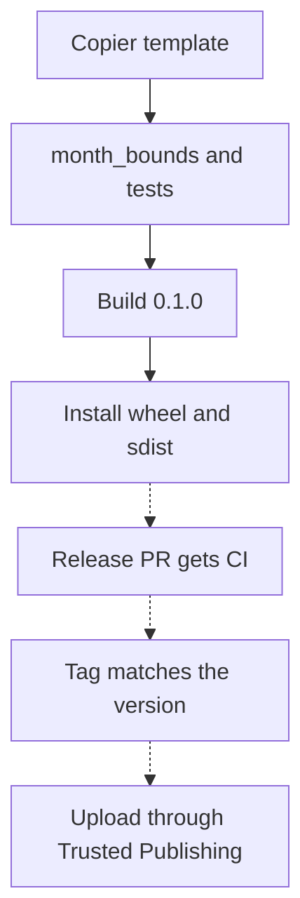

# A Python library from template to release {#python-library-from-template-to-release}

<div class="bdr-post__hero" data-bdr-post="2026-10-22-python-library-from-template-to-release" role="img" aria-label="A report-period library moves from project generation through tests to an installed package" markdown="0"></div>

Small shared code often lives as copies: each service has its own helper, and over time they drift apart.

That is what happened to a reporting service and an export worker: each computes UTC month boundaries with its own helper, and one of them gets December wrong. We move that code into a tested library.

The library is `report-periods` with one public function, `month_bounds()`. We generate it from the Bedrock template, add the function and its tests, build `0.1.0`, install both distribution formats in clean environments and fix two places where the template's CI and release workflows would let a mistake through.

<!-- more -->

<div id="how-i-start-a-production-grade-python-library-in-2026" data-search-exclude></div>
<div id="one-command" data-search-exclude></div>
<div id="what-is-in-the-forty-one" data-search-exclude></div>
<div id="the-gate-has-to-run-what-it-claims" data-search-exclude></div>
<div id="the-things-a-template-cannot-give-you" data-search-exclude></div>
<div id="the-order-i-actually-work-in" data-search-exclude></div>
<div id="the-pieces" data-search-exclude></div>

## Generate a project for the reporting library {#template}

The example uses [python-library-template at commit `a1a1e7d`](https://github.com/bedrock-python/python-library-template/tree/a1a1e7d5eafdcac08aeed7c1a0daaff31c67ac8c) and Copier `9.18.2`; the template also needs the `jinja2-time` extension for the copyright year:

```bash
uvx --from copier==9.18.2 --with jinja2-time==0.2.0 copier copy --trust --vcs-ref a1a1e7d gh:bedrock-python/python-library-template report-periods
```

Among Copier's questions, answer `report-periods` for the distribution, `report_periods` for the import and `3.11` for the minimum Python version. `--trust` is required because the template runs a Jinja extension and a post-generation task; at this commit the task only prints next steps, but [review executable template features](https://copier.readthedocs.io/en/stable/configuring/#unsafe) before trusting another revision.

The generated `report_periods/` holds `__version__.py`, `__init__.py` and the `py.typed` marker. The baseline checks, from the project directory:

```bash
uv sync --python 3.13 --group dev
uv run ruff check .
uv run ruff format --check .
uv run mypy report_periods
uv run pytest --cov=report_periods --cov-fail-under=90
```

They pass with one test of the exported version. `pytest -m integration` selects no tests and exits with code `5`, which the generated CI explicitly allows.

## Add the function both services need {#checks}

Our contract is a half-open interval: `start <= timestamp < end`. Both boundaries are midnight in UTC. An input with an explicit offset is converted to UTC first; an input without an offset is rejected. These are UTC reporting months, not months in the customer's local timezone.

- `2026-12-31T23:59:59+00:00` falls in December: `[2026-12-01, 2027-01-01)` in UTC.
- `2026-10-01T00:30:00+03:00` is still September in UTC: `[2026-09-01, 2026-10-01)`.

Add `report_periods/periods.py`:

```python
"""UTC month boundaries for reports."""

from datetime import UTC, datetime


def month_bounds(value: datetime) -> tuple[datetime, datetime]:
    """Return the inclusive start and exclusive end of the containing UTC month."""
    if value.utcoffset() is None:
        raise ValueError("An explicit UTC offset is required")
    value = value.astimezone(UTC)
    start = value.replace(day=1, hour=0, minute=0, second=0, microsecond=0)
    if start.month == 12:
        return start, start.replace(year=start.year + 1, month=1)
    return start, start.replace(month=start.month + 1)
```

Expose the function through `report_periods/__init__.py`, so consumers can write `from report_periods import month_bounds`:

```python
"""UTC month boundaries for reports."""

from .__version__ import __version__
from .periods import month_bounds

__all__ = ["__version__", "month_bounds"]
```

The tests in `tests/unit/test_periods.py` cover a normal month, December, leap-year February, both directions of timezone conversion and a missing offset:

```python
"""Behavior tests copied into the generated package's unit suite."""

from datetime import UTC, datetime

import pytest

from report_periods import month_bounds

pytestmark = pytest.mark.unit


@pytest.mark.parametrize(
    ("value", "expected_start", "expected_end"),
    [
        ("2026-09-15T12:00:00+00:00", "2026-09-01", "2026-10-01"),
        ("2026-12-31T23:59:59+00:00", "2026-12-01", "2027-01-01"),
        ("2024-02-29T12:00:00+00:00", "2024-02-01", "2024-03-01"),
        ("2026-10-01T00:30:00+03:00", "2026-09-01", "2026-10-01"),
        ("2026-09-30T23:30:00-03:00", "2026-10-01", "2026-11-01"),
    ],
)
def test__month_bounds__aware_input__returns_utc_range(value: str, expected_start: str, expected_end: str) -> None:
    start, end = month_bounds(datetime.fromisoformat(value))
    assert start == datetime.fromisoformat(expected_start).replace(tzinfo=UTC)
    assert end == datetime.fromisoformat(expected_end).replace(tzinfo=UTC)
    assert start.tzinfo is UTC and end.tzinfo is UTC
    assert start <= datetime.fromisoformat(value) < end


def test__month_bounds__missing_offset__raises() -> None:
    value = datetime.fromisoformat("2026-09-01T00:00:00")
    with pytest.raises(ValueError, match="explicit UTC offset"):
        month_bounds(value)
```

Together with the generated version test, that is seven passing tests on Python `3.11`, `3.12` and `3.13`; Ruff, formatting, mypy and the coverage threshold pass too. The lab then removes the December year increment and checks that the test fails, and inserts a naive `datetime.now()` to check that Ruff reports `DTZ005`.

<div id="twelve-libraries-one-engineering-standard-no-monorepo" data-search-exclude></div>
<div id="what-one-standard-means-in-practice" data-search-exclude></div>
<div id="the-template" data-search-exclude></div>
<div id="the-script" data-search-exclude></div>
<div id="releases-without-a-human-typing-a-version" data-search-exclude></div>
<div id="the-three-things-i-got-wrong" data-search-exclude></div>
<div id="why-not-a-monorepo" data-search-exclude></div>

## Make the required CI status mean what it says {#repositories}

The template's [`scripts/setup_repo.py`](https://github.com/bedrock-python/python-library-template/blob/a1a1e7d5eafdcac08aeed7c1a0daaff31c67ac8c/scripts/setup_repo.py) makes `All checks passed` the only required status check. In the generated CI, that job fails on `failure` and `cancelled` but accepts `skipped`. None of the three checked jobs has an `if:` today, so a job is skipped only after a failed dependency, which already fails the gate. Once someone adds an `if:` to `test-unit`, for example from a paths filter, a skipped test job leaves the gate green ([#16](https://github.com/bedrock-python/python-library-template/issues/16)). Add `skipped` to the condition:

```yaml
# Replace jobs.all-checks-passed in the generated ci.yml with this job.
all-checks-passed:
  name: All checks passed
  if: always()
  needs: [lint, test-unit, test-integration]
  runs-on: ubuntu-latest
  steps:
    - name: Check all jobs succeeded
      run: |
        if [[ "${{ contains(needs.*.result, 'failure') || contains(needs.*.result, 'cancelled') || contains(needs.*.result, 'skipped') }}" == "true" ]]; then
          echo "One or more required checks failed or were skipped."
          exit 1
        fi
        echo "All checks passed."
```

The lab evaluates this condition for all 64 result combinations of the three jobs: only all-success passes, while the original accepted seven combinations with a skipped job. With the stricter gate, a job skipped by design must leave `needs` or get its own check: pg-partsmith's `dependency-review` runs only on pull requests, so in `needs` it would fail every push to master. The gate sees job results, not their content: an integration job with no tests still succeeds.

`setup_repo.py` changes GitHub settings through `gh` and has no dry-run mode: read what it changes and wait for the project's first green CI before running it.

## Prepare version 0.1.0 and build it {#release}

The project starts at `0.0.0`. In a real repository, Release Please turns commit messages into a release PR with the version and changelog; the lab writes the same `0.1.0` values into `report_periods/__version__.py`, `.release-please-manifest.json` and `CHANGELOG.md` locally, without a tag. Build from the project directory:

```bash
uv build
```

The output is `dist/report_periods-0.1.0-py3-none-any.whl` and `dist/report_periods-0.1.0.tar.gz`. The lab checks that both archives contain the same modules and `py.typed`, and that the wheel's metadata has the name, version, `Requires-Python >=3.11` and no runtime dependencies.

<!-- diagram:concept -->
<figure class="bdr-diagram" markdown="1">
<figcaption><span class="bdr-diagram__eyebrow">THE IDEA, VISUALIZED</span><strong>From a useful function to an installed package</strong></figcaption>
<div class="bdr-diagram__viewport" markdown="1" data-search-exclude>



</div>
<p class="bdr-diagram__caption">The lab runs the solid steps locally, from generation to installation in clean environments. The dashed steps happen on GitHub and PyPI and depend on the settings described below.</p>
</figure>
<!-- /diagram:concept -->

## Install the package in a clean environment {#verification}

A passing import from the project directory can hide a broken package: Python may find the source tree. The lab creates separate Python `3.11` environments for the wheel and the sdist, installs each with `uv pip install`, changes to an empty directory and runs this script with `python -I`:

```python
"""Run with the isolated interpreter of each clean installation."""
from datetime import UTC, datetime
from importlib.metadata import version
from importlib.resources import files
from pathlib import Path
import sys

import report_periods

assert report_periods.__version__ == version("report-periods") == "0.1.0"
assert Path(report_periods.__file__).resolve().is_relative_to(Path(sys.prefix).resolve())
assert files("report_periods").joinpath("py.typed").is_file()
assert report_periods.month_bounds(datetime.fromisoformat("2026-10-01T00:30:00+03:00")) == (
    datetime(2026, 9, 1, tzinfo=UTC), datetime(2026, 10, 1, tzinfo=UTC),
)
print("PASS installed artifact: version, public API, UTC result, py.typed, import from the clean environment")
```

The path assertion confirms that the import comes from the clean environment; the rest exercises the public API and metadata. Installing the sdist also builds it from the source archive. Both installations pass.

<div id="publishing-to-pypi-without-api-tokens-trusted-publishing-end-to-end" data-search-exclude></div>
<div id="what-replaces-the-token" data-search-exclude></div>
<div id="the-environment-is-the-gate" data-search-exclude></div>
<div id="from-a-merged-pull-request-to-a-tag" data-search-exclude></div>
<div id="the-publish-trigger-and-why-it-is-a-workflow_run" data-search-exclude></div>
<div id="the-day-something-goes-wrong" data-search-exclude></div>
<div id="what-this-buys-concretely" data-search-exclude></div>

## Before the first PyPI release {#publishing}

With [Trusted Publishing](https://docs.pypi.org/trusted-publishers/), PyPI checks the OIDC token that GitHub issues to the workflow and hands out short-lived upload credentials. A project that does not exist on PyPI yet needs a [pending publisher](https://docs.pypi.org/trusted-publishers/creating-a-project-through-oidc/), which also asks for the project name; the name is not reserved until the first upload:

| PyPI publisher field | Example value |
|---|---|
| PyPI project name | `report-periods` |
| Repository owner | `example-org` |
| Repository name | `report-periods` |
| Workflow filename | `publish.yml` |
| Environment name | `pypi` |

The publishing job runs with `environment: pypi`. PyPI requires `id-token: write`; `contents: read` is for the checkout:

```yaml
permissions:
  contents: read
  id-token: write
```

The `pypi` environment protects nothing by itself: restrict which branches and tags may deploy to it and, if you want, require approval.

The template starts publishing when Release Please finishes:

```yaml
on:
  workflow_run:
    workflows: ["Release Please"]
    types: [completed]
```

[`workflow_run`](https://docs.github.com/en/actions/reference/workflows-and-actions/events-that-trigger-workflows#workflow_run) is needed because tags and releases created with `GITHUB_TOKEN` do not trigger `push: tags` or `release` workflows. The publish job does not wait for CI on the tagged commit ([#11](https://github.com/bedrock-python/python-library-template/issues/11)), and a `workflow_dispatch` path publishes any tag passed as input ([#10](https://github.com/bedrock-python/python-library-template/issues/10)); the check below fixes neither, only the next problem. Before building, the template rewrites `__version__.py` from the tag. A wrong tag then publishes silently, and the uploaded version no longer matches the committed version file, changelog and manifest. Replace that step with a check:

```yaml
# Replace the "Set version from release tag" step in the generated publish.yml with this step.
- name: Check that the tag matches the committed version
  env:
    TAG: ${{ needs.check.outputs.tag }}
  shell: python
  run: |
    import os, pathlib, re
    source = pathlib.Path("report_periods/__version__.py").read_text()
    version = re.search(r'__version__ = "([^"]+)"', source)[1]
    if os.environ["TAG"] not in (f"v{version}", f"report-periods-v{version}"):
        raise SystemExit(f"Tag {os.environ['TAG']} does not match version {version}")
```

The lab runs this step's code against the committed version: `v0.1.0` and `report-periods-v0.1.0` pass, while `v0.2.0`, `other-v0.1.0`, `v0.1.0-extra` and `main` fail.

CI on release PRs that Release Please opens with `GITHUB_TOKEN` waits for an approval nobody gives and expires, so the required check never reports on them. Bedrock libraries close and reopen each release PR; a GitHub App token for Release Please avoids that ([#12](https://github.com/bedrock-python/python-library-template/issues/12)). The lab checks none of these GitHub settings, OIDC or an upload.

## What we have at the end {#conclusion}

`report-periods` has a month-boundary function with edge-case tests, a CI gate that fails on skipped jobs, a publish step that refuses a tag that does not match the version, and both distribution formats verified in clean environments. Two things remain before a real upload: making publish wait for CI on the tagged commit, and the GitHub and PyPI settings above.

## Reproduce the walkthrough {#labs}

The [lab](../lab/2026-09-07-twelve-libraries-one-standard/README.md) runs everything above except GitHub and PyPI. From the website repository, with Git, uv and network access:

```bash
uv run --no-project --python 3.13 --with-requirements docs/blog/lab/2026-09-07-twelve-libraries-one-standard/requirements.txt python docs/blog/lab/2026-09-07-twelve-libraries-one-standard/generate_and_check.py --output build/report-periods-lab
```
