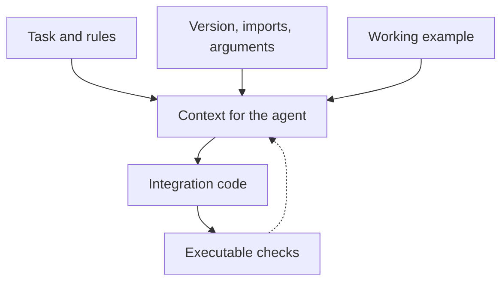

# Documentation that lets an AI coding agent write checkable code {#we-started-writing-documentation-for-ai-coding-agents}

<div class="bdr-post__hero" data-bdr-post="2026-10-26-documentation-for-ai-coding-agents" role="img" aria-label="A task, a versioned API description and a working example lead to code that can be checked" markdown="0"></div>

More and more service code is written by AI coding agents, and they write it from whatever documentation the project has. Whatever it leaves out, the agent fills in, not always correctly.

Take an ordinary task: add a shipping quote to an orders service. The quote checks stock, then shipping: 600 ms for both steps, at most 400 ms for each. The project uses [deadline-budget](https://bedrock-python.github.io/deadline-budget/). Its overview explains the idea but not what the code depends on: the exact import, which methods are synchronous, the timeout units and who cancels work.

We will put that into a task prompt and a short API brief, implement the function and test what the documentation promises. This is an example of writing documentation, not a benchmark of an AI model.

<!-- more -->

## Give the reader enough context for the task {#two-readers-two-questions}

“Use deadline-budget” leaves several questions open. Does creating a budget start the countdown? Does `timeout_for_call()` need `await`? Will the library cancel the warehouse request? A plausible guess at any of these can produce incorrect code, whether an agent or a human writes it. For this task, the prompt can look like this, with the relevant files attached:

> Implement `shipping_quote(sku, *, stock, shipping)` using `deadline-budget==0.1.3` on Python 3.13.
>
> Share 600 ms across the stock check and the shipping calculation; cap each step at 400 ms. Cancel the whole operation at 600 ms and let `DeadlineExceededError` and `TimeoutError` propagate. Return `None` when the stock count is zero or negative; otherwise return the quote.
>
> Read the attached API brief and adapter contract before choosing calls. For anything they do not cover, read the [deadline-budget 0.1.3 agent guide](https://github.com/bedrock-python/deadline-budget/blob/deadline-budget-v0.1.3/docs/agents.md) instead of guessing. Run the behavior tests in `test_contract.py` and report the result.

The adapters belong to our application: `stock` returns an integer count, `shipping` returns a quote. Both are async, take `sku` and a keyword-only `timeout` in seconds, apply that timeout themselves and propagate cancellation. Saying so stops the reader from assuming that deadline-budget ships a warehouse client.

## Put imports, defaults and ownership together {#one-page-per-library}

The [Bedrock library template](https://github.com/bedrock-python/python-library-template/blob/master/template/docs/agents.md.jinja) includes a `docs/agents.md` page for this purpose. For our task, a small API brief is enough:

| Question | Answer for this example |
|---|---|
| What is installed? | `deadline-budget==0.1.3`, tested with Python 3.13 |
| Where are the names imported from? | `from deadline_budget import BudgetContext, DeadlineExceededError` |
| How is a context created? | `BudgetContext.create(total_seconds, call_caps=None, *, min_timeout=0.1, safety_margin=0.0)` |
| When does the countdown start? | At `create()` |
| Which calls need `await`? | None: `create()`, `remaining()` and `timeout_for_call()` are synchronous; only the adapters are awaited |
| What are the units? | Seconds, as a `float` |
| Who owns the budget? | One context per quote, shared by both steps |
| Who cancels work? | The adapters and the application's `asyncio.timeout()` |
| Which errors matter? | `DeadlineExceededError` when a timeout is calculated after the budget ran out; `TimeoutError` from `asyncio.timeout()` or an adapter |

The [lab README](../lab/2026-09-07-documentation-for-ai-coding-agents/README.md) holds the same brief with runnable code. It names its version and scope, so the reader knows when to switch to the [full agent guide](https://github.com/bedrock-python/deadline-budget/blob/deadline-budget-v0.1.3/docs/agents.md). Add a short reading map labeled by question, for example the [deadline article](2026-09-06-timeouts-are-not-deadlines.md) for passing a budget between services, instead of pasting every page into every task.

## Show the mistake and its replacement {#wrong-then-right}

The dangerous mistakes here are silent. This one creates a new context for the second step:

```python
caps = {"stock": 0.4, "shipping": 0.4}

# WRONG: the second context starts a fresh 600 ms
ctx = BudgetContext.create(total_seconds=0.6, min_timeout=0, call_caps=caps)
available = await stock(sku, timeout=ctx.timeout_for_call("stock"))
ctx = BudgetContext.create(total_seconds=0.6, min_timeout=0, call_caps=caps)
quote = await shipping(sku, timeout=ctx.timeout_for_call("shipping"))
```

Nothing fails. If the stock check takes 250 ms, shipping still gets 400 ms instead of 350, and the quote can run past 600 ms. A louder mistake, `await BudgetContext.create(...)`, raises `TypeError` on the first run, so a page for agents should spend its WRONG/RIGHT pair on the silent kind. The lab runs both.

## Make the rules visible in a working example {#rules-that-hold-or-break-the-code}

Here is `shipping.py`. Its only external import is the real budget API; `stock` and `shipping` come from the application:

```python
import asyncio

from deadline_budget import BudgetContext


async def shipping_quote(sku, *, stock, shipping):
    ctx = BudgetContext.create(
        total_seconds=0.6,
        min_timeout=0,
        call_caps={"stock": 0.4, "shipping": 0.4},
    )
    async with asyncio.timeout(ctx.remaining()):
        available = await stock(sku, timeout=ctx.timeout_for_call("stock"))
        if available <= 0:
            return None
        return await shipping(sku, timeout=ctx.timeout_for_call("shipping"))
```

One context, created before the stock check; each timeout is calculated just before its call. Three details belong next to this code:

- `min_timeout` defaults to 100 ms in 0.1.3, so an adapter could be told to wait 100 ms when only 20 ms remain. The example sets zero.
- The budget only calculates numbers. [`asyncio.timeout()`](https://docs.python.org/3.13/library/asyncio-task.html#asyncio.timeout) cancels the task when the time is up. Both expire together, so a slow step that yields control ends in `TimeoutError`; `DeadlineExceededError` before the second step means the first one blocked or swallowed the cancellation.
- An unknown name in `call_caps` has no cap. With the typo `"stcok"`, the call gets the whole 600 ms instead of 400, and nothing reports an error.

## Test the statements that can become stale {#keeping-it-true}

The lab checks the version, imports, defaults and the function's behavior. It also compares `shipping.py` with its copies in the lab README and in this article, in both languages, by syntax tree, so a code change without the matching documentation change fails. Those sync checks are for the page's maintainers; an agent's implementation is judged by the behavior tests.

<!-- diagram:concept -->
<figure class="bdr-diagram" markdown="1">
<figcaption><span class="bdr-diagram__eyebrow">THE IDEA, VISUALIZED</span><strong>From a task description to verifiable code</strong></figcaption>
<div class="bdr-diagram__viewport" markdown="1" data-search-exclude>



</div>
<p class="bdr-diagram__caption">The task, API details and working example form the context. Integration code is checked, and discovered errors feed back into the documentation.</p>
</figure>
<!-- /diagram:concept -->

The behavior tests replace the clock inside the budget module, so they can spend budget time without waiting; asyncio keeps its real clock. They check the 400 and 350 ms timeouts, the WRONG version above, a 20 ms remainder passed on unchanged, empty stock, the misspelled call name, a stalled step cancelled by `asyncio.timeout()` and a step that overruns without yielding. Fourteen checks run with the pinned package and the standard library's `unittest`, without a model, network services or Docker:

```bash
cd docs/blog/lab/2026-09-07-documentation-for-ai-coding-agents
uv run --no-project --python 3.13 --with-requirements requirements.txt python test_contract.py
```

When a check fails, fix the brief or the example along with the code: the next reader, human or agent, starts from them. Keep the brief to the calls the task uses, and test those.

## Give the agent the actual page contents {#the-page-has-to-reach-the-model}

A URL in a prompt is not evidence that the page was read. Give an agent that fetches files a direct link to Markdown, or put the page into its context. Bedrock library docs are published as Markdown next to the HTML: the [deadline-budget agent page](https://bedrock-python.github.io/deadline-budget/agents.md), for example, is a plain `.md` file produced by the template's [export script](https://github.com/bedrock-python/python-library-template/blob/master/template/scripts/emit_markdown.py).

<div id="what-it-did-for-the-humans" data-search-exclude></div>

## Leave the next reader a verifiable starting point {#conclusion}

For the shipping task, the brief needed a version, imports, defaults, adapter responsibilities, one working function and a command that checks it. A reviewer reading the resulting code needs the same facts. For a Bedrock integration, start with the library's agent page at the tag of the version you install; for your own package, start from the [template](https://github.com/bedrock-python/python-library-template) and add tests for the behavior its examples promise.
