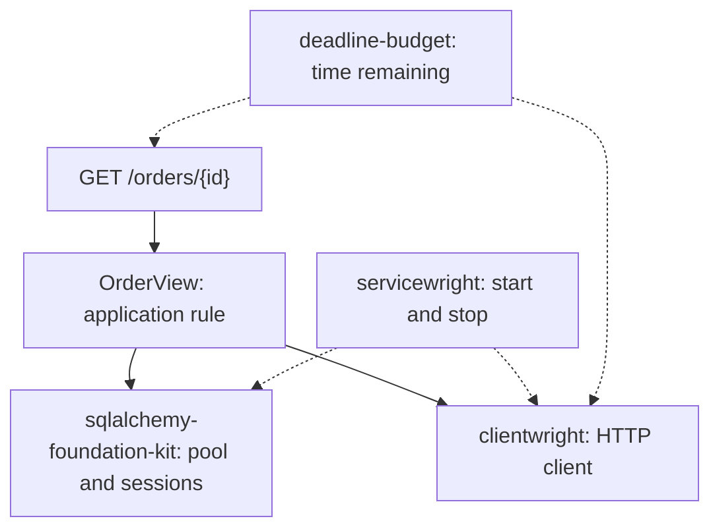

# Why extract Python service infrastructure into libraries {#why-bedrock-python-libraries}

<div class="bdr-post__hero" data-bdr-post="2026-10-27-why-bedrock-python-libraries" role="img" aria-label="An orders API combines a database session, an HTTP client, a deadline and resource cleanup" markdown="0"></div>

Once there is more than one service, they start sharing plumbing: connection pools, retries, request deadlines, shutdown order. It usually gets copied from repo to repo, and each copy carries the same bugs and needs the same fixes.

Bedrock Python grew out of extracting that plumbing into separate libraries. This article shows the result on an orders API that reads an order from PostgreSQL, asks a warehouse for stock and says whether there is enough: what the libraries take over, what the service still decides, and how to check that the pieces work together.

<!-- more -->

<div id="welcome-to-the-bedrock-python-blog" data-search-exclude></div>
<div id="why-this-exists" data-search-exclude></div>
<div id="the-decision" data-search-exclude></div>
<div id="what-to-expect-from-this-blog" data-search-exclude></div>

## Start with the decision the service owns {#boundaries}

An unknown order gets `404`; for a known one, the API compares stock with the ordered quantity, and an unavailable warehouse is an error, not a zero balance. In `orders.py`, `OrderStore` and `StockReader` are small Python protocols, and the use case imports neither FastAPI nor any infrastructure:

```python
class OrderView:
    def __init__(self, store: OrderStore, stock: StockReader):
        self.store, self.stock = store, stock

    async def get(self, order_id: int) -> dict:
        order = await self.store.find(order_id)
        if order is None:
            raise OrderMissing(order_id)
        available = await self.stock.available(order.sku)
        return {
            "order_id": order.id,
            "available": available,
            "can_fulfill": available >= order.quantity,
        }
```

The lab checks this class with plain in-memory objects. Libraries provide connections and retries; the comparison and the missing-order rule stay here. This is a stock view, not a reservation: stock can change right after the response.

<div id="what-every-production-python-microservice-reimplements" data-search-exclude></div>
<div id="the-list" data-search-exclude></div>
<div id="why-not-a-framework" data-search-exclude></div>
<div id="a-hundred-lines" data-search-exclude></div>
<div id="run" data-search-exclude></div>
<div id="how-the-pieces-stay-apart" data-search-exclude></div>

## Connect PostgreSQL and the warehouse {#example}

`OrderStore` is implemented with [sqlalchemy-foundation-kit](https://github.com/bedrock-python/sqlalchemy-foundation-kit). Its `AsyncSessionManager` creates the engine and hands out sessions; on `aclose()` it disposes the engine shielded from cancellation, for at most 30 seconds by default, and then refuses new sessions. The adapter chooses the query and the session boundary:

```python
class SqlOrderStore:
    def __init__(self, db):
        self.db = db

    async def find(self, order_id):
        async with self.db.get_session() as session:
            row = (
                (
                    await session.execute(
                        text("SELECT id, sku, quantity FROM orders WHERE id = :id"),
                        {"id": order_id},
                    )
                )
                .mappings()
                .one_or_none()
            )
            return Order(**row) if row is not None else None
```

The `async with` closes before `OrderView` goes to the warehouse, so a slow HTTP response does not hold a database connection. Writes would use `get_transaction()` instead.

The shared HTTP client comes from [clientwright](https://github.com/bedrock-python/clientwright):

```python
def stock_client(base_url):
    return build(
        "httpx",
        ClientConfig(
            service_name="orders",
            base_url=base_url,
            timeout=TimeoutConfig(total=5),
            retry=RetryConfig(max_attempts=2, methods=frozenset({"GET"})),
            deadline_header="X-Deadline-Ms",
            on_unsupported="strict",
        ),
        AdapterDeps(deadline_source=AmbientDeadlineSource()),
    )
```

Only `GET` is retried, and only once (`max_attempts=2`), because a stock lookup changes nothing; the default retry budget and per-origin circuit breaker stay on. The client has a five-second ceiling, but `AmbientDeadlineSource` shortens it to the request's remaining time, and `X-Deadline-Ms` carries that remainder to the warehouse, which decides whether to honor it. `on_unsupported="strict"` makes `build()` fail if the httpx adapter cannot apply a setting.

The stock adapter checks the response. A `503` that survives the retry and malformed stock data become the application's `StockUnavailable`; timeouts pass through so the handler can answer `504`:

```python
class HttpStockReader:
    def __init__(self, client):
        self.client = client

    async def available(self, sku):
        try:
            response = await self.client.get(f"/stock/{sku}")
            response.raise_for_status()
            available = response.json()["available"]
            if type(available) is not int or available < 0:
                raise ValueError("Expected a nonnegative stock count")
            return available
        except httpx.TimeoutException:
            raise
        except (httpx.HTTPError, ValueError, KeyError, TypeError) as error:
            raise StockUnavailable(sku) from error
```

These policies suit a read. Retrying a payment needs different rules, covered in [the HTTP and gRPC clients article](2026-09-13-production-http-grpc-clients.md).

## Give the whole operation one time limit {#deadline}

The request may spend time in PostgreSQL before its first HTTP attempt, so the handler gives the whole operation one time budget from [deadline-budget](https://github.com/bedrock-python/deadline-budget) instead of restarting the clock for each step:

```python
@router.get("/orders/{order_id}")
async def get_order(
    order_id: int,
    unit: UnitScopeDep,
    x_deadline_ms: int = Header(default=800, ge=50, le=2000),
):
    budget = BudgetContext.create(total_seconds=x_deadline_ms / 1000)
    try:
        with use_budget(budget):
            async with asyncio.timeout(budget.remaining()):
                view = await unit.get(OrderView)
                return await view.get(order_id)
    except OrderMissing as error:
        raise HTTPException(404, "Order not found") from error
    except StockUnavailable as error:
        raise HTTPException(503, "Stock is temporarily unavailable") from error
    except (TimeoutError, httpx.TimeoutException) as error:
        raise HTTPException(504, "Order lookup deadline exceeded") from error
```

By default a request gets 800 ms; `X-Deadline-Ms` is accepted only between 50 and 2,000 ms, otherwise FastAPI answers `422`. `use_budget()` from clientwright exposes the remaining time to the HTTP client, and `asyncio.timeout()` bounds everything the handler awaits, including the database read. deadline-budget only keeps the clock here; clientwright does not import it and accepts any object with `remaining()` and `expired()`. `UnitScopeDep` from servicewright's FastAPI adapter returns the request's scope, `unit.get(OrderView)` resolves the use case, and the handler maps application errors to `404`, `503` and `504`.

## Create shared resources once and close them last {#composition}

[servicewright](https://github.com/bedrock-python/servicewright) runs the process lifecycle. Our `Container` implements its two scopes: `app_scope()` owns shared resources, and `unit_scope()` gives each request the use case:

```python
@asynccontextmanager
async def app_scope(self):
    async with AsyncExitStack() as stack:
        self.db = await stack.enter_async_context(
            AsyncSessionManager(
                self.settings.database_url,
                poolclass="async_adapted_queue",
            )
        )
        self.http = await stack.enter_async_context(
            stock_client(self.settings.warehouse_url)
        )
        view = OrderView(SqlOrderStore(self.db), HttpStockReader(self.http))
        self.scope = Scope(self.db, view)
        yield self.scope
```

`AsyncExitStack` closes the HTTP client and then the database manager, including when a later startup step fails. `poolclass="async_adapted_queue"` matters: the manager defaults to NullPool, which opens a new connection for every session. `Scope` is a small class in the lab that resolves `OrderView`.

Now configure the runtime and its FastAPI entrypoint:

```python
def build_service(settings, *, port=0, container=None):
    container = container or Container(settings)
    spec = AppSpec(
        service_name="orders",
        create_container=lambda _: container,
        warmers_factory=lambda ctx: [PostgresWarmer(ctx.container.db, timeout=2)],
        drain_delay_seconds=0.2,
        drain_grace_seconds=3,
        cleanup_timeout_seconds=2,
    )

    async def register_health(scope):
        spec.health.add_check(
            "postgres", PostgresHealthCheck(scope.db.session_maker, timeout=1)
        )

    spec.lifecycle.add_pre_start_hook(register_health)
    api = FastApiEntrypoint(
        config=HttpConfig(host="127.0.0.1", port=port, graceful_timeout=2),
        routers=(router,),
    )
    return Service(spec, entrypoints=[api]), api
```

PostgreSQL warmup runs a real query before the HTTP listener starts. Readiness checks PostgreSQL; a warehouse outage only fails the order endpoint. On shutdown, readiness drops and the listener keeps accepting for `drain_delay_seconds`, so the load balancer can notice. In-flight requests then get two seconds, the longest deadline the endpoint accepts: `HttpConfig(graceful_timeout=2)` becomes uvicorn's `timeout_graceful_shutdown`, after which uvicorn cancels whatever is still running. For HTTP that, not `drain_grace_seconds=3`, is the real limit ([servicewright #89](https://github.com/bedrock-python/servicewright/issues/89)). `cleanup_timeout_seconds` bounds servicewright's own steps after that, such as stopping the listener and running hooks; closing the container's resources is not covered, and the session manager has its own 30-second dispose limit. `run_sync()` in `service.py` installs SIGTERM and SIGINT handlers; the lab calls `service.run(settings, stop=stop)` and sets the event itself, so the same test runs on Windows and Linux.

<!-- diagram:concept -->
<figure class="bdr-diagram" markdown="1">
<figcaption><span class="bdr-diagram__eyebrow">THE IDEA, VISUALIZED</span><strong>One use case with explicit resource owners</strong></figcaption>
<div class="bdr-diagram__viewport" markdown="1" data-search-exclude>



</div>
<p class="bdr-diagram__caption">servicewright manages shared resources. OrderView reads the order and queries stock; the handler sets the time budget and maps errors to HTTP responses.</p>
</figure>
<!-- /diagram:concept -->

## Check the behavior, not just the imports {#verification}

The lab starts PostgreSQL 17 in Docker, a local warehouse over HTTP and the orders API, then checks:

| Situation | Expected result |
|---|---|
| Known order | Read by ID, request stock by SKU, compare quantities |
| Unknown order | `404`, no warehouse request |
| Invalid deadline header | `422` |
| Warehouse returns one `503` | One retry, with a smaller remaining budget |
| Warehouse keeps returning `503` or sends invalid data | `503` |
| Warehouse stops responding | `504` under the operation budget |
| Shutdown during a warehouse call | Request finishes within grace; shared resources close afterwards |
| PostgreSQL warmup fails | No HTTP listener; opened resources close |

During the held warehouse call, it also checks that no connection is checked out from the database pool. The [lab](../lab/2026-09-07-what-every-microservice-reimplements/README.md) pins `servicewright[fastapi,postgres]` 0.13.1, `sqlalchemy-foundation-kit` 0.4.0, `clientwright[httpx,deadline]` 0.5.0 and `deadline-budget` 0.1.3; its README has the run command.

## When a separate library earns its cost {#tradeoffs}

Two real fixes show the gain. In clientwright 0.2.0, the total deadline stopped at the response headers, so a slowly dripping body escaped `total=1.0`; 0.2.2 fixed it once for every service that upgrades ([#25](https://github.com/bedrock-python/clientwright/issues/25)). servicewright got `drain_delay_seconds`, used above, after [#46](https://github.com/bedrock-python/servicewright/issues/46) showed no window between readiness going false and the listener closing.

The cost is just as concrete. servicewright[grpc] 0.13.0 capped grpc-server-kit below 0.2 and could not be installed with the 0.2.0 released half an hour earlier; 0.13.1, pinned here, fixed that ([#66](https://github.com/bedrock-python/servicewright/issues/66)). Independent packages also need joint checks: this example would break if the HTTP client ignored the ambient budget or closed before the request finished, even with every package's own tests green. The lab is part of that cost.

A package pays off when its boundary is small (a session owner, a client policy, a resource lifecycle) and it has a second consumer. A few local lines used by one service do not justify releases, compatibility work and documentation.

## What the libraries take and what stays {#conclusion}

The libraries took the pool, retries, the deadline and shutdown order. The service kept the `404` rule, the stock comparison and the error mapping. The [library catalog](../../libraries/index.md) and the articles on [lifecycle](2026-09-20-python-service-lifecycle.md), [transactions](2026-10-08-sqlalchemy-sessions-and-transactions.md) and [optional dependencies](2026-10-21-zero-dependency-cores.md) cover the next decisions.

## Examples and labs {#labs}

- [Lab: an orders API on four libraries](../lab/2026-09-07-what-every-microservice-reimplements/README.md)
