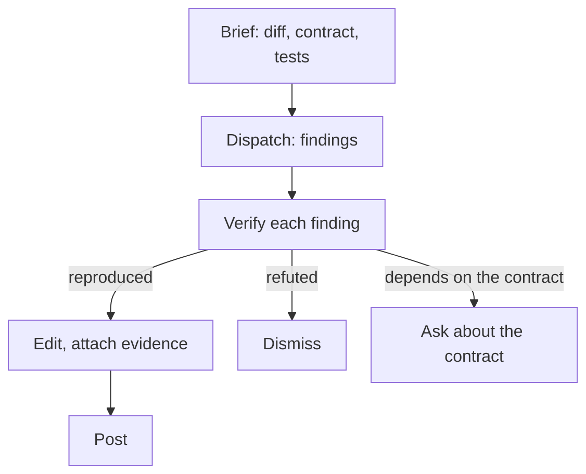

# Why AI review findings need verification {#ai-code-review-should-not-be-fully-autonomous}

<div class="bdr-post__hero" data-bdr-post="2026-10-29-ai-code-review-should-not-be-fully-autonomous" role="img" aria-label="Four review findings go through verification; only one becomes a comment with evidence" markdown="0"></div>

Many teams now run an AI reviewer on merge requests. It writes findings as confidently as a senior colleague, but confidence does not make a finding true.

Say an AI reviewer flags a colleague's merge request: the new retry around a warehouse reservation can create a duplicate when the reply is lost. Before that finding becomes a comment, someone has to check that it is true for this warehouse.

The same pass returns three more findings. We will verify all four, publish the one that holds and recheck it after the author's fix. The reproduction and the fix are runnable; the findings are written for this walkthrough, not taken from a model evaluation.

<!-- more -->

## Start with the change and its contract {#how-i-started}

The orders service calls `warehouse.reserve(order_id)`. In this example, every accepted call creates a new reservation, the warehouse does not deduplicate by order ID, and a `TimeoutError` does not tell the caller whether the write happened. The MR adds a second attempt:

```python
async def reserve_with_retry(order_id, warehouse):
    for attempt in range(2):
        try:
            return await warehouse.reserve(order_id)
        except TimeoutError:
            if attempt == 1:
                raise
```

That contract is not in the repository, so the model cannot know it unless we supply it. In [mr-review](https://github.com/bedrock-python/mr-review#how-it-works), it goes into the custom instructions of the Brief stage, together with the purpose of the change; [the documentation article](2026-10-26-documentation-for-ai-coding-agents.md) shows how to prepare such context.

## Reproduce the suspected bug {#the-pipeline}

Dispatch returns four findings about the loop:

1. A lost reply can create two reservations.
2. After the second timeout, the loop falls through and returns `None`.
3. The call should send an idempotency key.
4. `attempt` deserves a better name.

The first is the serious one, and it can be checked. In the lab, `WarehouseStub` scripts the outcome of each call in order: `"timeout_after_write"` creates a reservation and raises `TimeoutError`, as if the reply was lost; `"ok"` creates another one and returns it. The check counts reservations and ignores `ReservationOutcomeUnknown`, the exception of the fix we will see later:

```python
from reservation import ReservationOutcomeUnknown
from warehouse_stub import WarehouseStub


async def check_lost_reply(reserve):
    warehouse = WarehouseStub("timeout_after_write", "ok")
    try:
        await reserve("order-42", warehouse)
    except ReservationOutcomeUnknown:
        pass
    print(f"calls={len(warehouse.calls)}, reservations={len(warehouse.reservations)}")
    assert len(warehouse.reservations) == 1, (
        "One operation created duplicate reservations"
    )
```

With `reserve_with_retry`, it prints `calls=2, reservations=2` and fails: the caller sees a normal result, and the first reservation is still there. The stub proves this under the assumed contract only; the real warehouse needs its documentation or an integration test.

## Sort the findings: bug, false claim, open question, noise {#what-goes-wrong-when-the-bot-posts}

| Finding | What we can establish | Action |
|---|---|---|
| A lost reply can create two reservations | The reproduction shows two writes under the assumed contract | Publish, with the scenario and the test |
| After the second timeout, the loop returns `None` | On `attempt == 1` the `except` re-raises; a test with two lost replies gets `TimeoutError` | Dismiss |
| Send an idempotency key | Helps only if the warehouse enforces it, and the contract says it does not | Ask about the contract first |
| Rename `attempt` | No behavior problem | Leave to linters and conventions |

Posted automatically, this pass would open four threads: one real bug, one false claim the author has to refute, one fix that depends on an unchecked API and one style nit. Dismissing a false claim in a draft costs the reviewer a minute; posting it costs the author an investigation, and every false alarm makes the next real finding easier to ignore. An agent could write the reproduction too. What it cannot do is read a contract that is not in the repository, decide what the buyer sees after an unknown outcome, or answer for the comment when the author replies.

## Where the person stands in the pipeline {#the-copilot-not-the-gatekeeper}

mr-review splits a review into **Brief → Dispatch → Polish → Post**: context and instructions, the model's findings, the reviewer's edits, and inline comments on the MR. It does not run code, so the reproduction happens outside it while the finding waits in Polish.

<!-- diagram:concept -->
<figure class="bdr-diagram" markdown="1">
<figcaption><span class="bdr-diagram__eyebrow">THE IDEA, VISUALIZED</span><strong>From a finding to a checked comment</strong></figcaption>
<div class="bdr-diagram__viewport" markdown="1" data-search-exclude>



</div>
<p class="bdr-diagram__caption">Each finding from Dispatch is verified before Post. A reproduced bug is published with evidence, a refuted claim is dismissed, and a finding that depends on the contract becomes a question.</p>
</figure>
<!-- /diagram:concept -->

An author can run the same loop before asking for review. Either way, a pass with no findings does not prove the MR is correct.

## Publish a short comment you can defend {#review-is-a-conversation}

> If the warehouse creates the reservation and the reply is lost, this retry creates a second reservation for the same order. The attached test times out after the write and ends with two reservations. Could we drop the automatic retry until the warehouse API offers deduplication?

Attach the test itself, so the author can run it in their branch. If the author replies that the real warehouse deduplicates by order ID, check that and update or withdraw the comment. A bot replying on its own would keep defending an objection that is no longer true.

## The author's fix {#what-the-person-adds}

The author agrees and pushes a narrow correction: no automatic retry, and an explicit unknown outcome:

```python
class ReservationOutcomeUnknown(RuntimeError):
    def __init__(self, order_id):
        self.order_id = order_id
        super().__init__(f"Reservation outcome is unknown for order {order_id}")


async def reserve_once(order_id, warehouse):
    try:
        return await warehouse.reserve(order_id)
    except TimeoutError as error:
        raise ReservationOutcomeUnknown(order_id) from error
```

This drops the MR's goal for now: a timeout still fails the request, but the caller learns that the outcome is unknown. `ReservationOutcomeUnknown` is not a `TimeoutError`, so generic retry-on-timeout code will not repeat it, and callers that caught `TimeoutError` must be updated. Unknown is not failed: the application has to resolve it with a status check or reconciliation. Deduplication may be the better long-term design, but an `Idempotency-Key` header on our side is not enough; the warehouse has to enforce it, as the [idempotency article](2026-09-14-idempotency-in-apis-and-background-jobs.md) explains. Who resolves an unknown reservation and what the buyer sees is a team decision, not something a reproduction can settle.

## Recheck the finding against the new revision {#what-it-costs}

After the push, the comment describes a loop that no longer exists. The same check now prints `calls=1, reservations=1` and passes, and the tests confirm that a timeout before the write raises the same `ReservationOutcomeUnknown`. Resolve the thread rather than carrying the old text forward, and check any draft written before a push against the current diff.

## Run the example {#labs}

With uv installed, run from the website repository root:

```bash
cd docs/blog/lab/2026-09-13-ai-code-review-should-not-be-fully-autonomous
uv run --no-project --python 3.13 python reproduce.py before
uv run --no-project --python 3.13 python reproduce.py after
uv run --no-project --python 3.13 python test_review.py
```

`before` intentionally fails its assertion, `after` passes, and seven tests cover both implementations. The lab uses only the standard library: no model, no warehouse, no posted comments. The [lab README](../lab/2026-09-13-ai-code-review-should-not-be-fully-autonomous/README.md) lists the assumptions.

## Keep the evidence with the finding {#conclusion}

One of four plausible findings survived verification; one was false and one turned into a question about the contract. For a team, that comes down to three rules: put the task and the contracts into the Brief, verify every finding before Post, and let the person who published a comment handle the discussion. The model produced the findings in seconds. Deciding which of them were true took a contract, a test and a person willing to answer for the comment.
