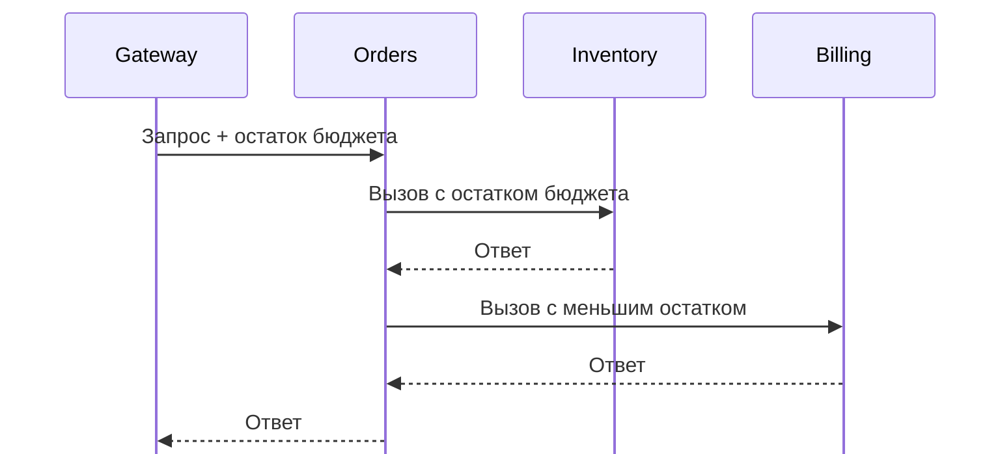

# Почему таймаут не заменяет дедлайн в микросервисах {#timeouts-are-not-deadlines-how-latency-budgets-break-across-microservices}

<div class="bdr-post__hero" data-bdr-post="2026-09-06-timeouts-are-not-deadlines" role="img" aria-label="Общий бюджет времени тает с каждым вызовом в цепочке, а отдельные таймауты не знают, сколько уже потрачено" markdown="0"></div>

Запрос пользователя редко обслуживает один сервис. Обычно он проходит цепочку вызовов, у каждого вызова свой таймаут, и кажется, что этого хватит, чтобы запрос не висел вечно.

Но таймаут отдельного вызова не знает, сколько времени запрос уже потратил. Дедлайн знает, поэтому он ограничивает весь запрос, а не одно ожидание.

Проследим это на сервисе заказов Orders. Он запрашивает остатки у Inventory по HTTP, а затем через gRPC резервирует товар и списывает деньги с карты; Gateway даёт каждому запросу две секунды.

<!-- more -->

Измерения воспроизводятся в [практикуме](../lab/2026-09-06-timeouts-are-not-deadlines/README.md) на локальных серверах: Python 3.13, httpx 0.28.1, grpcio 1.83.1, deadline-budget 0.1.3, clientwright 0.2.2 и grpc-client-kit 0.1.0. Время приблизительное, а клиент в коротких примерах создаётся на каждый вызов только ради краткости.

## Таймаут в секунду, а ответ идёт четыре { #a-timeout-limits-an-operation }

Сначала один HTTP-вызов сам по себе. Orders запрашивает у Inventory список остатков. В практикуме Inventory сделан маленьким сервером на asyncio: он сразу отдаёт заголовки, а тело присылает по байту каждые полсекунды, всего восемь байт:

```python
BYTES = 8
INTERVAL = 0.5  # seconds between bytes; the response takes BYTES * INTERVAL


async def drip(reader, writer) -> None:
    await reader.readuntil(b"\r\n\r\n")
    writer.write(b"HTTP/1.1 200 OK\r\nContent-Type: text/plain\r\n" + f"Content-Length: {BYTES}\r\n\r\n".encode())
    await writer.drain()
    try:
        for _ in range(BYTES):
            await asyncio.sleep(INTERVAL)
            writer.write(b"x")
            await writer.drain()
    except ConnectionResetError:
        pass  # the client gave up mid-body
    writer.close()
```

Orders использует HTTPX с таймаутом в одну секунду:

```python
import asyncio

import httpx


async def get_report(url):
    async with httpx.AsyncClient(timeout=1.0) as client:
        return await client.get(url)
```

Запрос успешно завершается примерно через четыре секунды. `timeout=1.0` в HTTPX задаёт не один лимит на запрос, а четыре: на подключение, чтение, запись и ожидание свободного соединения в пуле. [Таймаут чтения](https://www.python-httpx.org/advanced/timeouts/) ограничивает паузу до следующей порции данных, а байт каждые полсекунды каждый раз сбрасывает отсчёт. Чтобы ограничить загрузку целиком, поставим дедлайн вокруг вызова:

```python
async def get_report_with_deadline(url):
    async with httpx.AsyncClient(timeout=1.0) as client:
        async with asyncio.timeout(1.0):
            return await client.get(url)
```

Теперь медленный ответ обрывается с `TimeoutError` примерно через секунду. С `client.stream()` внутрь блока нужно поместить и цикл чтения тела. [Таймауты asyncio](https://docs.python.org/3/library/asyncio-task.html#timeouts) работают через отмену задачи: код, который блокирует event loop, их задерживает, а код, который проглатывает `CancelledError`, может отключить их вовсе.

## Повторы тратят то же время { #retries-multiply-it }

Теперь Inventory принимает соединение и молчит. GET можно безопасно повторить, и Orders делает до трёх попыток:

```python
async def get_stock(client, url):
    for attempt in range(3):
        try:
            return await client.get(url, timeout=1.0)
        except httpx.TimeoutException:
            if attempt == 2:
                raise
```

Каждая попытка может прождать секунду, всего около трёх секунд. Если обернуть цикл в `asyncio.timeout(1.0)`, все попытки вместе уложатся в одну секунду. [clientwright](https://bedrock-python.github.io/clientwright/) делает то же самое как политика клиента и по-прежнему возвращает `httpx.AsyncClient`; `total` ограничивает все попытки вместе с паузами:

```python
from clientwright import ClientConfig, RetryConfig, TimeoutConfig, build


async def get_stock_with_clientwright(url):
    config = ClientConfig(
        service_name="orders",
        timeout=TimeoutConfig(total=1.0),
        retry=RetryConfig(max_attempts=3, initial_backoff=0.01),
    )
    async with build("httpx", config) as client:
        return await client.get(url)
```

| Политика | Результат | Ожидание, примерно | Запросов дошло до сервера |
|---|---|---|---|
| Свой цикл, `timeout=1.0` на попытку | `ReadTimeout` | 3 с + накладные расходы | 3 |
| clientwright, `total=1.0` | `HttpxDeadlineExceededError` | 1 с | 1 |
| clientwright, `total=3.0, read=1.0` | `HttpxDeadlineExceededError` | 3 с | 3 |

Если задан только `total`, попытка может занять всё оставшееся время: первая съедает всю секунду, и на повтор ничего не остаётся. Чтобы повторы успевали, дайте каждой попытке лимит `read` поменьше, как в третьей строке. `HttpxDeadlineExceededError` наследуется и от `httpx.TimeoutException`, так что существующие обработчики его поймают.

## Свежие таймауты переживают вызывающего { #across-a-hop-the-timeout-becomes-a-lie }

Теперь оформление заказа. Gateway вызывает Orders с дедлайном в две секунды; Orders резервирует товар в Inventory, потом просит Billing списать деньги. В практикуме каждая операция занимает 1,5 секунды, а `inventory` и `billing` сделаны минимальными stub. Наивный обработчик даёт каждому исходящему RPC свой таймаут:

```python
async def submit_with_fresh_timeouts(inventory, billing):
    await inventory.call(b"reserve", timeout=5.0)
    await billing.call(b"charge", timeout=5.0)
```

В gRPC `timeout` означает дедлайн на весь RPC, но здесь каждый вызов получает **свежие пять секунд**, сколько бы ни осталось у входящего запроса. Сам grpc-python входящий дедлайн дальше не передаёт.

| Время | Что происходит со свежими таймаутами |
|---|---|
| 0,0 с | Gateway вызывает Orders с лимитом 2 с; Inventory получает 5 с |
| 1,5 с | Товар зарезервирован; Billing получает свежие 5 с |
| 2,0 с | Gateway получает `DEADLINE_EXCEEDED`, обработчики отменяются |
| 3,0 с | Имитация списания всё равно доходит до конца |

Gateway сообщает об ошибке на второй секунде, а списание завершается секундой позже. Повтор со стороны Gateway спишет деньги дважды. В практикуме платёж продолжается благодаря `asyncio.shield()`, но вывод верен и без него: отмена обработчика не отменяет внешний платёж.

## Передаём входящий дедлайн в исходящие RPC { #where-the-deadline-lives }

Сколько времени осталось у входящего вызова, Orders узнаёт из [`context.time_remaining()`](https://grpc.github.io/grpc/python/grpc_asyncio.html#grpc.aio.ServicerContext.time_remaining). [deadline-budget](https://bedrock-python.github.io/deadline-budget/) превращает его в бюджет, а интерцепторы [grpc-client-kit](https://bedrock-python.github.io/grpc-client-kit/guide/deadlines/) применяют этот бюджет к каждому исходящему RPC. `LeafStub` здесь минимальный stub из практикума:

```python
from deadline_budget import BudgetContext
from grpc_client_kit import (
    ChannelPool,
    DeadlineBudgetConfig,
    GrpcClient,
    GrpcClientConfig,
    TimeoutConfig as GrpcTimeoutConfig,
    build_interceptors,
    use_budget as use_grpc_budget,
)


class Orders:
    def __init__(self, pool: ChannelPool, inventory: str, billing: str):
        chain = build_interceptors(
            timeout=GrpcTimeoutConfig(default=5.0),
            deadline_budget=DeadlineBudgetConfig(),
        )
        self.inventory = GrpcClient(
            LeafStub, GrpcClientConfig(target=inventory, insecure=True),
            pool, interceptors=chain,
        )
        self.billing = GrpcClient(
            LeafStub, GrpcClientConfig(target=billing, insecure=True),
            pool, interceptors=chain,
        )

    async def handle(self, request, context):
        left = context.time_remaining()
        total = 2.0 if left is None else min(left, 2.0)
        if total <= 0:
            await context.abort(grpc.StatusCode.DEADLINE_EXCEEDED, "no time left")
        budget = BudgetContext.create(total_seconds=total, min_timeout=0.0)

        try:
            with use_grpc_budget(budget):
                async with self.inventory as inventory:
                    await inventory.call(b"reserve")
                async with self.billing as billing:
                    await billing.call(b"charge")
        except grpc.aio.AioRpcError as error:
            await context.abort(error.code(), "downstream failed")
        return b"ok"
```

Заданные пять секунд остаются потолком: интерцептор берёт меньшее из таймаута и остатка бюджета. `None` из `time_remaining()` значит, что входящего дедлайна нет, и Orders ставит свои две секунды. Ноль нужно отсечь явно: бюджет бросает `ValueError` на неположительный срок, и Gateway увидел бы `UNKNOWN`. `min_timeout=0.0` не даёт маленькому остатку округлиться вверх до стандартных 0,1 секунды.

Теперь Inventory получает около двух секунд, а Billing около половины секунды. Сервисы практикума перед началом работы смотрят на `time_remaining()` и отказывают с `DEADLINE_EXCEEDED`, если их 1,5 секунды работы не помещаются. Billing отказывает, запрос падает примерно на 1,5 секунде, и списание не начинается. Настоящему сервису придётся оценивать свою длительность с запасом, а резерв в Inventory всё равно нужно снять: дедлайн не откатывает сделанную работу.

<!-- diagram:concept -->
<figure class="bdr-diagram" markdown="1">
<figcaption><span class="bdr-diagram__eyebrow">ИДЕЯ В СХЕМЕ</span><strong>Передавайте остаток времени, а не новый таймаут</strong></figcaption>
<div class="bdr-diagram__viewport" markdown="1" data-search-exclude>



</div>
<p class="bdr-diagram__caption">Каждый исходящий вызов получает столько времени, сколько осталось у входящего запроса. Работа и повторы тратят один общий бюджет.</p>
</figure>
<!-- /diagram:concept -->

## Оставляем время следующему шагу { #the-safety-margin }

Два шага по 1,5 секунды в две секунды не помещаются, так что возьмём операции побыстрее. Orders нужно 0,2 секунды, чтобы собрать ответ, и после Inventory надо придержать 0,5 секунды для Billing. `reserve_for_next` в grpc-client-kit действует на каждый вызов цепочки, поэтому, чтобы придержать время только после Inventory, распределим его через `DeadlineBudget` и обычные stub:

```python
from deadline_budget import DeadlineBudget


async def submit_with_reserve(inventory, billing, total):
    # total is the incoming remainder, derived as in Orders.handle.
    budget = DeadlineBudget(
        total_seconds=total, safety_margin=0.2, min_timeout=0.0
    )
    timeout = budget.timeout_for(cap=5.0, reserve_for_next=0.5)
    if timeout <= 0:
        raise TimeoutError("no time for inventory after reserving billing time")
    await inventory.call(b"reserve", timeout=timeout)
    await billing.call(b"charge", timeout=budget.timeout_for(cap=5.0))
```

Из двух секунд Inventory получает не больше 1,3: `2.0 - 0.2 - 0.5`. Если он справится за секунду, Billing достанется 0,8. `DeadlineBudget` бросает `ValueError`, если общий срок не больше запаса, так что вызывающему с 0,2 секунды и меньше нужно отказать до вызова этой функции.

## Передаём бюджет и по HTTP { #carry-the-budget-over-http-too }

Стандартного дедлайна в HTTP нет, поэтому Orders и Inventory договариваются о заголовке `X-Deadline-Ms`. clientwright отправляет актуальный остаток с каждой попыткой:

```python
from clientwright import AdapterDeps
from clientwright.contrib.deadline import AmbientDeadlineSource, use_budget as use_http_budget


async def read_inventory_twice(url):
    config = ClientConfig(
        service_name="orders",
        timeout=TimeoutConfig(total=10.0),
        retry=RetryConfig(max_attempts=3, initial_backoff=0.3, jitter=0.0),
        deadline_header="X-Deadline-Ms",
    )
    deps = AdapterDeps(deadline_source=AmbientDeadlineSource())
    async with build("httpx", config, deps) as client:
        budget = BudgetContext.create(total_seconds=2.0)
        with use_http_budget(budget):
            first = await client.get(url)
            await asyncio.sleep(0.5)  # Simulated local work.
            second = await client.get(url)
        return first, second
```

Inventory отвечает на первое чтение `503`, а Orders после полсекунды локальной работы проверяет остатки ещё раз. В одном из запусков сервер получил в `X-Deadline-Ms` значения 1992, 1366 и 832: каждая попытка, пауза и локальная работа тратят одни и те же две секунды, а десять секунд из конфигурации их не растягивают. В настоящем сервисе бюджет пришёл бы из входящего запроса.

На своей стороне Inventory строит бюджет из заголовка: не больше двух секунд и 0,2 секунды в запасе на завершение:

```python
def budget_from_header(value: str | None) -> BudgetContext:
    total = 2.0 if value is None else min(int(value) / 1000, 2.0)
    if total <= 0.2:
        raise TimeoutError("not enough time after the completion margin")
    return BudgetContext.create(
        total_seconds=total, safety_margin=0.2, min_timeout=0.0
    )
```

Проверка обязательна: `BudgetContext.create()` бросает `ValueError`, если запас не меньше общего срока. На некорректный заголовок отвечайте `400`, а если времени слишком мало, отвечайте ошибкой дедлайна, например `504`. Принимайте заголовок только от доверенных сервисов и помните, что относительное значение не учитывает время в сети, как и собственный `grpc-timeout` в gRPC; запас должен покрывать и это. Если один обработчик ходит и по HTTP, и по gRPC, установите бюджет и через `use_http_budget()`, и через `use_grpc_budget()`: они пишут в разные контекстные переменные.

## Что взять в свой сервис { #what-changed-in-the-code }

Выдавайте запросу один бюджет и тратьте его на каждом шаге: на каждую попытку, каждую паузу, локальную работу и каждый исходящий вызов. [deadline-budget](https://bedrock-python.github.io/deadline-budget/) считает остаток, [clientwright](https://bedrock-python.github.io/clientwright/) применяет его к HTTP-запросам и повторам, а [grpc-client-kit](https://bedrock-python.github.io/grpc-client-kit/guide/deadlines/) применяет его к исходящим RPC.

Дедлайн не отменяет резерв и не возвращает деньги, переданный в заголовке остаток приблизителен и должен приходить от доверенного сервиса, а проверка перед началом работы требует оценки с запасом.
