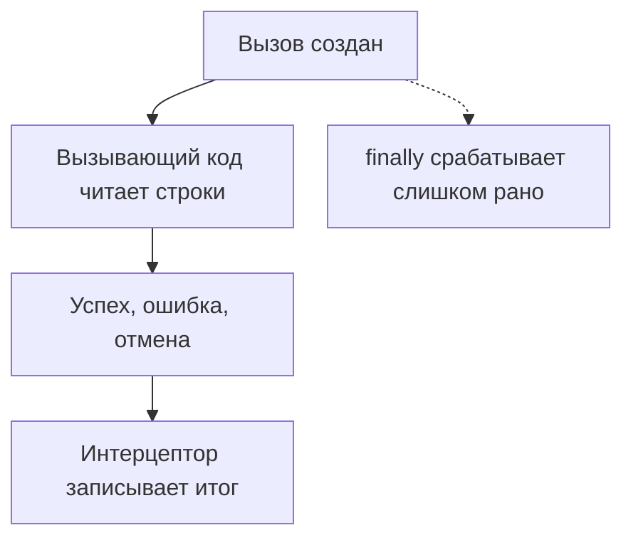

# Почему интерцепторы gRPC ломаются на потоковых RPC {#why-grpc-interceptors-break-on-streaming-rpcs}

<div class="bdr-post__hero" data-bdr-post="2026-09-08-why-grpc-interceptors-break-on-streaming-rpcs" role="img" aria-label="Поток отчёта ещё идёт, а таймер вокруг создания вызова уже остановлен" markdown="0"></div>

Интерцепторы в gRPC обычно пишут один раз, чтобы логи, метрики и трассировка работали для всех вызовов сразу. Проверяют их на обычных unary-вызовах, а потом они оборачивают и потоковые.

Возьмём воркер выгрузки, который скачивает строки из сервиса отчётов по gRPC. Загрузка занимает около 200 мс, а интерцептор воркера записывает 0,1 мс. Когда сервер падает после двух строк, воркер получает ошибку, а интерцептор по-прежнему считает вызов успешным.

Проверим, что интерцептор вообще вызывается, исправим то, что он измеряет, и научимся останавливать поток досрочно. Примеры работают с настоящим локальным сервером: `grpc-client-kit 0.4.0`, `grpcio 1.84.0`, Python `3.13`.

<!-- more -->

## Какой сервис вызываем {#reporting-service}

В сервисе по одному методу на каждый вид RPC. В названии вида, например unary-stream, первая часть относится к запросу, а вторая к ответу:

| Метод | Вид RPC | Что делает воркер |
|---|---|---|
| `Get` | unary-unary | Получает статус отчёта |
| `Stream` | unary-stream | Скачивает строки отчёта |
| `Upload` | stream-unary | Отправляет строки, получает их количество |
| `Chat` | stream-stream | Отправляет строки, получает подтверждения |

`Stream` отдаёт пять строк с интервалом 30 мс. На `b"fail"` сервер после двух строк прерывает вызов с `UNAVAILABLE`, `b"fast"` убирает паузы, а `b"hold"` отдаёт одну строку и ждёт. Каждый поток заканчивается завершающими метаданными `report-id: r-42`. Вместо сгенерированного protobuf-кода практикум передаёт байты через generic-обработчики, но вызовы настоящие.

## Сначала убеждаемся, что интерцептор вообще вызывается {#the-interceptor-that-is-registered-for-one-kind-out-of-four}

Допустим, мы собрали все четыре метода `intercept_*` в одном классе:

```python
from collections import Counter

import grpc.aio


class EverythingInterceptor(
    grpc.aio.UnaryUnaryClientInterceptor,
    grpc.aio.UnaryStreamClientInterceptor,
    grpc.aio.StreamUnaryClientInterceptor,
    grpc.aio.StreamStreamClientInterceptor,
):
    def __init__(self):
        self.calls = Counter()

    async def intercept_unary_unary(self, continuation, details, request):
        self.calls["unary_unary"] += 1
        return await continuation(details, request)

    # The other three hooks count their calls the same way.
```

После одного вызова каждого метода в `calls` только `{"unary_unary": 1}`. [Конструктор канала](https://grpc.github.io/grpc/python/_modules/grpc/aio/_channel.html) раскладывает интерцепторы цепочкой проверок `isinstance`, где первой идёт `UnaryUnaryClientInterceptor`, поэтому объект с четырьмя базовыми классами попадает только в список unary-unary, в каком порядке их ни перечисляй. Регистрируйте отдельный объект на каждый вид RPC или берите адаптеры, которые `grpc-client-kit` соберёт ниже. Практикум проверяет, что каждый измеряющий интерцептор действительно вызвался: тот, что ни разу не сработал, тоже покажет ноль ошибок и ноль миллисекунд.

## Таймер вокруг continuation измеряет только создание вызова {#what-a-unary-interceptor-measures-on-a-stream}

Этот интерцептор зарегистрирован правильно, но замер всё равно неверный:

```python
import asyncio
from time import perf_counter

import grpc


class SetupTimer(grpc.aio.UnaryStreamClientInterceptor):
    def __init__(self):
        self.entered = 0
        self.errors = 0
        self.seconds = None
        self.finished = asyncio.Event()

    async def intercept_unary_stream(self, continuation, details, request):
        self.entered += 1
        started = perf_counter()
        try:
            return await continuation(details, request)
        except grpc.aio.AioRpcError:
            self.errors += 1
            raise
        finally:
            self.seconds = perf_counter() - started
            self.finished.set()
```

`entered` равен 1, а `finished` установлено ещё до первой строки. На сломанном потоке воркер получает две строки и `UNAVAILABLE`, а `errors` остаётся нулём. Один из запусков напечатал:

```text
SetupTimer       OK          rows=5 measured=0.1ms consumer=218.0ms
SetupTimer       UNAVAILABLE rows=2 measured=0.5ms consumer=83.7ms
```

[`continuation`](https://grpc.github.io/grpc/python/grpc_asyncio.html#grpc.aio.UnaryStreamClientInterceptor) возвращается, как только создан объект вызова. Статус от сервера приходит позже, внутри `async for` в вызывающем коде, и ветка `except` его не видит. Unary-интерцептор попадает в ту же ловушку, но исправить его просто: дождаться полученного вызова через `await`. У потока нет одного ответа, которого можно дождаться: его итог известен, только когда вызывающий код перестал читать.

<!-- diagram:concept -->
<figure class="bdr-diagram" markdown="1">
<figcaption><span class="bdr-diagram__eyebrow">ИДЕЯ В СХЕМЕ</span><strong>Вызов создан, но RPC ещё не завершён</strong></figcaption>
<div class="bdr-diagram__viewport" markdown="1" data-search-exclude>



</div>
<p class="bdr-diagram__caption">Обёртка вокруг одного continuation останавливает замер при создании вызова. Итог RPC (успех, ошибка или отмена) известен только после того, как вызывающий код перестал читать.</p>
</figure>
<!-- /diagram:concept -->

## Оборачиваем чтение: простой случай {#doing-it-by-hand}

Если воркер всегда дочитывает поток до конца, интерцептор может обернуть само чтение:

```python
class IterationTimer(grpc.aio.UnaryStreamClientInterceptor):
    def __init__(self):
        self.errors = 0
        self.seconds = None
        self.finished = asyncio.Event()

    async def intercept_unary_stream(self, continuation, details, request):
        started = perf_counter()
        call = await continuation(details, request)

        async def rows():
            try:
                async for row in call:
                    yield row
            except grpc.aio.AioRpcError:
                self.errors += 1
                raise
            finally:
                self.seconds = perf_counter() - started
                self.finished.set()

        return rows()
```

```text
IterationTimer   OK          rows=5 measured=214.9ms consumer=215.0ms
IterationTimer   UNAVAILABLE rows=2 measured=91.2ms consumer=91.3ms
```

Вызов нужно создать **до** того, как возвращается генератор: grpcio связывает этот вызов с возвращённым итератором, и без него `code()`, `cancel()` и финализатор вызова падают. Но и такая обёртка годится только для unary-stream, который дочитывают до конца. Для досрочного выхода нужна политика отмены, а с потоковыми запросами ещё хуже: интерцептор, который ждёт финального ответа, загоняет в дедлок вызывающий код с `write()`, потому что grpc придерживает `write()`, пока интерцептор не вернёт управление.

## Один around_call на четыре вида RPC {#the-four-kinds-one-implementation}

Для этого в [grpc-client-kit](https://github.com/bedrock-python/grpc-client-kit) есть `AsyncAroundClientInterceptor`. `around_call()` делает один `yield`: до него идёт подготовка, после него обработка результата, а для потокового ответа `yield` длится, пока поток не дочитан. Практикум складывает записи в очередь:

```python
from contextvars import ContextVar

from grpc_client_kit import AsyncAroundClientInterceptor, ClientCall

REQUEST_ID = ContextVar("request_id", default=None)


class Observability(AsyncAroundClientInterceptor):
    def __init__(self):
        self.finished = asyncio.Queue()

    async def around_call(self, call: ClientCall):
        started = perf_counter()
        outcome = "OK"
        try:
            yield
        except grpc.aio.AioRpcError as error:
            outcome = error.code().name
            raise
        except asyncio.CancelledError:
            outcome = "CANCELLED"
            raise
        except Exception:
            outcome = "LOCAL_ERROR"
            raise
        finally:
            self.finished.put_nowait(
                {
                    "kind": call.rpc_type,
                    "method": call.method,
                    "outcome": outcome,
                    "seconds": perf_counter() - started,
                    "request_id": REQUEST_ID.get(),
                }
            )
```

Канал получает его как `interceptors=flatten_interceptors([observer])`, то есть четыре адаптера. Теперь любой RPC даёт ровно одну запись: ошибка после двух строк приходит как `AioRpcError`, локальная отмена приходит как `CANCELLED`, а статус и `report-id` по-прежнему читаются из вызова. Для потоковых запросов библиотека сразу возвращает вызов и следит за итогом в отдельной задаче, так что `write()` не попадает в дедлок. Если экспорт метрик сам упадёт после `yield`, библиотека запишет ошибку в лог и сохранит результат RPC.

**Запись закрывается, когда завершается вызов, а не когда воркер закончил свою работу.** Поток завершается, как только прочитано последнее сообщение, поэтому работа между строками входит в длительность RPC, а работа после последней строки не входит. Если выгрузка потом ещё пишет файл, измеряйте всю операцию отдельно.

## Не смешиваем контекст интерцептора и вызывающего кода {#the-part-that-only-shows-up-on-streams}

Слой трассировки часто выставляет контекстную переменную перед вызовом и сбрасывает после него. Так работают `attach` и `detach` в OpenTelemetry. На потоках код после вызова может выполняться в другой задаче, а `ContextVar.reset()` не принимает токен из другого контекста:

```python
class TokenScope(AsyncAroundClientInterceptor):
    def __init__(self):
        self.finished = asyncio.Queue()

    async def around_call(self, call: ClientCall):
        token = REQUEST_ID.set("interceptor-only")
        try:
            yield
        finally:
            inside = REQUEST_ID.get()
            REQUEST_ID.reset(token)
            self.finished.put_nowait((inside, REQUEST_ID.get()))
```

На всех четырёх видах RPC сброс проходит, вложенный наблюдатель видит `interceptor-only`, а вызывающий код, выставивший `"caller-owned"`, видит своё значение: `grpc-client-kit` выполняет подготовку и завершение в собственном общем контексте. До вызывающего кода этот контекст не доходит, а [`ContextVar`](https://docs.python.org/3/library/contextvars.html#asyncio-support) вообще не передаётся на сервер. Чтобы передать идентификатор запроса другому сервису, отправляйте его в метаданных, например через `AsyncClientContextInterceptor` из той же библиотеки.

## Отменяем RPC, когда воркер прекращает чтение {#what-to-check-in-your-own-interceptors}

Для предпросмотра воркеру нужна только первая строка. `assert` здесь проверяет для практикума, что вызывающий код видит своё значение:

```python
from observers import REQUEST_ID
from report_service import STREAM


async def first_row(channel, request=b"hold"):
    token = REQUEST_ID.set("req-42")
    call = None
    try:
        call = channel.unary_stream(STREAM)(request, timeout=5)
        async for row in call:
            assert REQUEST_ID.get() == "req-42"
            return row
    finally:
        if call is not None:
            call.cancel()
        REQUEST_ID.reset(token)
```

Практикум проверяет, что обработчик на сервере останавливается, появляется ровно одна запись `CANCELLED`, а контекст вызывающего кода восстанавливается. Если просто выйти через `break`, RPC останется активным, пока сервер не закончит, не истечёт дедлайн или сборщик мусора не доберётся до вызова. Выход из цикла ничего не сообщает серверу; `cancel()` в `finally` сообщает, а для завершённого вызова ничего не делает.

## Запускаем примеры {#labs}

Из корня репозитория сайта, с установленным uv:

```bash
cd docs/blog/lab/2026-09-07-grpc-interceptors-and-streams
uv run --no-project --python 3.13 --with-requirements requirements.txt python interceptors_lab.py
uv run --no-project --python 3.13 --with-requirements requirements.txt python probe.py
```

Оба скрипта сверяют результаты и падают при расхождении; длительности печатаются, но не проверяются. Файлы и проверки перечислены в [README практикума](../lab/2026-09-07-grpc-interceptors-and-streams/README.md).

<div id="the-pieces" data-search-exclude></div>

## Что взять в свой сервис {#conclusion}

Регистрируйте отдельный объект интерцептора на каждый вид RPC. Измеряйте до завершения вызова, а не до возврата `continuation`. Цикл чтения принадлежит вызывающему коду, и он же отменяет вызов, если прекращает читать раньше. [grpc-client-kit](https://github.com/bedrock-python/grpc-client-kit) упаковывает второе правило в `around_call`, а ещё в нём есть готовые интерцепторы, например `AsyncLoggingInterceptor` и `AsyncClientContextInterceptor`. Что бы вы ни строили, проверяйте это на частичном чтении и ошибке посреди потока.
