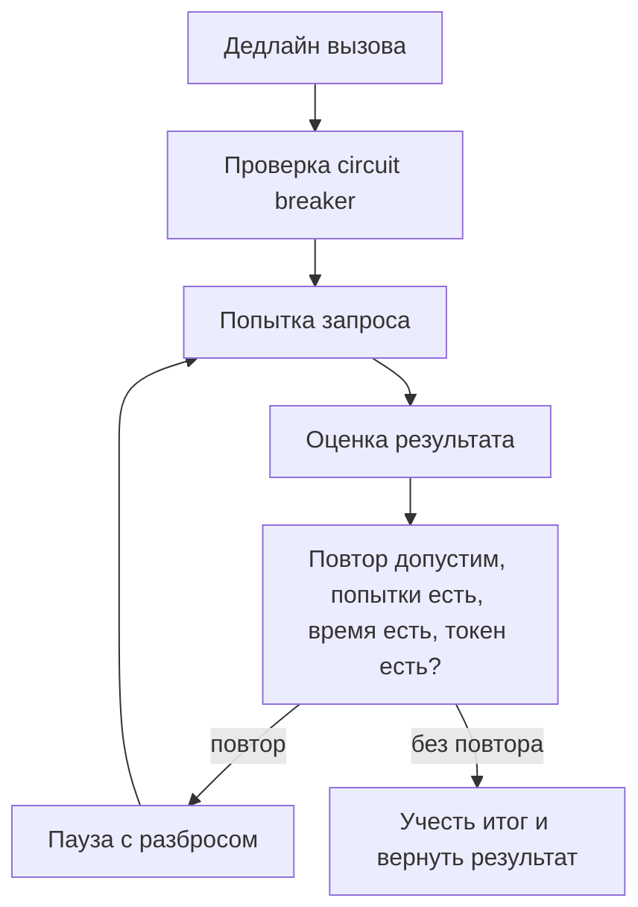

# Как строить HTTP- и gRPC-клиенты для продакшена {#production-http-grpc-clients}

<div class="bdr-post__hero" data-bdr-post="2026-09-13-production-http-grpc-clients" role="img" aria-label="Оставьте родной клиент и подключите политику рядом с ним" markdown="0"></div>

Сервис заказов ходит на склад и в платёжный сервис, и любой из них иногда отвечает медленно или не отвечает вовсе. Первое, что хочется сделать, это повторить запрос.

Но повторный запрос остатков безвреден, а повторный платёж может списать деньги дважды, и сам клиент одно от другого не отличит.

Настроим его HTTP- и gRPC-клиенты, сломаем их зависимости и посчитаем, сколько запросов на самом деле до них дошло.

<!-- more -->

<div id="why-i-stopped-wrapping-http-clients" data-search-exclude></div>
<div id="the-life-of-a-wrapper" data-search-exclude></div>
<div id="what-the-wrapper-actually-owns" data-search-exclude></div>
<div id="measured-the-price" data-search-exclude></div>
<div id="capability-honesty" data-search-exclude></div>
<div id="the-shape" data-search-exclude></div>

## Создаём клиентов при запуске приложения {#ownership}

[clientwright](https://bedrock-python.github.io/clientwright/) добавляет к HTTPX ограничения времени и политику повторов, а `build('httpx', ...)` по-прежнему возвращает обычный `httpx.AsyncClient`:

```python
from clientwright import (
    AdapterDeps, ClientConfig, RetryConfig, TimeoutConfig, build,
)


def http_client(name, base_url, *, metrics=None):
    return build(
        'httpx',
        ClientConfig(
            service_name=name,
            base_url=base_url,
            timeout=TimeoutConfig(total=2, connect=0.3, read=0.5),
            retry=RetryConfig(),
            circuit_breaker=None,
            on_unsupported='strict',
        ),
        AdapterDeps(metrics=metrics),
    )
```

`service_name` подписывает метрики и логи клиента. `RetryConfig()` уже означает три попытки вместе с первой, паузы 100 мс с удвоением, разброс ±20 %, учёт `Retry-After` и бюджет повторов 0,1. Circuit breaker включён по умолчанию (пять неудач, 60 секунд); `circuit_breaker=None` выключает его, пока мы не настроим его ниже. `on_unsupported='strict'` превращает настройку, которую адаптер не умеет применить, в ошибку при создании клиента.

Создаём обоих клиентов в области приложения и закрываем после завершения активных обработчиков:

```python
from contextlib import asynccontextmanager


@asynccontextmanager
async def outbound_clients(inventory_url, payments_url):
    async with (
        http_client('inventory', inventory_url) as inventory,
        http_client('payments', payments_url) as payments,
    ):
        yield inventory, payments
```

Если открывать их на каждый запрос, пропадут переиспользование соединений, бюджет повторов и состояние breaker. Где разместить область приложения, показано в [статье о жизненном цикле сервиса](2026-09-20-python-service-lifecycle.md).

<div id="reliability-is-not-retry3" data-search-exclude></div>
<div id="why-retries-look-free" data-search-exclude></div>
<div id="what-they-cost-when-it-matters" data-search-exclude></div>
<div id="a-deadline-is-the-first-real-mechanism" data-search-exclude></div>
<div id="a-retry-budget-removes-the-amplification" data-search-exclude></div>
<div id="a-circuit-breaker-protects-the-next-wave-not-this-one" data-search-exclude></div>
<div id="what-none-of-them-do" data-search-exclude></div>
<div id="the-list" data-search-exclude></div>
<div id="the-pieces" data-search-exclude></div>

## Ограничиваем общее время запроса остатков {#budgets}

Склад отвечает на `GET /stock/{sku}` телом `{"sku": "sku-42", "available": 7}`:

```python
async def fetch_stock(client, sku):
    response = await client.get(f'/stock/{sku}')
    response.raise_for_status()
    return response.json()['available']
```

Клиент даёт 0,3 секунды на подключение, 0,5 секунды между порциями ответа и две секунды на весь вызов вместе с попытками и паузами. [Таймаут чтения HTTPX](https://www.python-httpx.org/advanced/timeouts/) ограничивает паузу, а не весь ответ: в [практикуме с дедлайном](../lab/2026-09-07-reliability-is-not-retry-3/README.md) сервер, отдающий по байту каждые 80 мс, укладывается в таймаут чтения 300 мс, а `TimeoutConfig(total=0.35, read=0.3)` обрывает его с `DeadlineExceededError`.

Чтобы склад и оплата делили время входящего запроса, передайте клиентам `AdapterDeps(deadline_source=AmbientDeadlineSource())` и установите `BudgetContext` через `use_budget()`, как в [статье о дедлайнах](2026-09-06-timeouts-are-not-deadlines.md). Две новые секунды на каждого клиента не равны двухсекундному бюджету на заказ.

<div id="retries-can-make-an-outage-worse-designing-a-retry-budget" data-search-exclude></div>
<div id="the-arithmetic" data-search-exclude></div>
<div id="measured-one-hop" data-search-exclude></div>
<div id="when-the-budget-is-invisible-and-when-it-hurts" data-search-exclude></div>
<div id="measured-three-services-deep" data-search-exclude></div>
<div id="where-retries-belong" data-search-exclude></div>
<div id="the-policy" data-search-exclude></div>
<div id="retry-after-backoff-and-jitter-what-a-production-http-client-actually-does" data-search-exclude></div>
<div id="honour-retry-after" data-search-exclude></div>
<div id="jitter-or-the-herd" data-search-exclude></div>
<div id="a-read-timeout-is-not-a-connection-error" data-search-exclude></div>
<div id="what-is-retried-at-all" data-search-exclude></div>
<div id="the-checklist" data-search-exclude></div>

## Повторяем платёж, только если сервер умеет распознавать дубли {#retries}

Сервис оплаты сохраняет платёж, а потом отвечает 503. Повторять безопасно, только если API оплаты на тот же `Idempotency-Key` с тем же телом возвращает сохранённый результат, а тот же ключ с другим телом отклоняет. На заказ приходится одно списание, поэтому ключ строим из ID заказа:

```python
from clientwright.adapters.httpx import IDEMPOTENT_EXTENSION


async def charge(client, order_id, amount_minor):
    response = await client.post(
        '/payments',
        json={'order_id': order_id, 'amount_minor': amount_minor},
        headers={'Idempotency-Key': f'charge-{order_id}'},
        extensions={IDEMPOTENT_EXTENSION: True},
    )
    response.raise_for_status()
    return response.json()['payment_id']
```

`IDEMPOTENT_EXTENSION` разрешает clientwright повторять POST, а заголовок позволяет серверу узнать повтор. [Практикум с повторами](../lab/2026-09-07-retry-after-backoff-jitter/README.md) проверяет три варианта на локальном сервисе:

| После первого списания сервер вернул 503 | HTTP-запросов на вызов | Списаний |
| --- | --- | --- |
| Обычный POST | 1 | 1; клиент получает 503 |
| POST с флагом идемпотентности, но без ключа на сервере | 2 | 2 |
| POST со стабильным ключом и клиентским флагом | 2 | 1; клиент получает ID сохранённого платежа |

Повторный `charge()` для того же заказа возвращает тот же ID платежа. Практикум убирает дубли в памяти и последовательно; рабочему API нужны база данных и атомарная обработка одновременных дублей, подробнее в статье про [идемпотентность в API и фоновых задачах](2026-09-14-idempotency-in-apis-and-background-jobs.md).

### Учитываем паузу сервера и ограничиваем лишние запросы {#retry-budget}

С политикой по умолчанию первый повтор ждёт от 80 до 120 мс, второй от 160 до 240 мс. `Retry-After: 1` заменяет это одной секундой. Если запрошенная пауза не помещается в оставшееся время, как `Retry-After: 60` при общем лимите 0,3 секунды в практикуме, клиент сразу возвращает 503 после единственного запроса.

Бюджет повторов хранится внутри клиента для каждого origin, то есть сочетания схемы, хоста и порта. Новый origin получает десять токенов, больше десяти в запасе не бывает, а каждый вызов добавляет 0,1. [Практикум с бюджетом](../lab/2026-09-07-retry-budget/README.md) делает 50 последовательных вызовов к серверу, который всегда отвечает 503; breaker выключен:

| Настройки повторов | Запросов на сервере |
| --- | --- |
| Три попытки, `budget_ratio=None` | 150 |
| Три попытки, `budget_ratio=0.1` | 64 |

Это 50 первых попыток, 10 повторов из начального запаса и 4 заработанных вызовами. Каждая реплика и каждый новый клиент начинают с полным запасом, а внешний цикл повторов вокруг такого клиента снова умножает попытки: в [практикуме с адаптерами](../lab/2026-09-07-why-i-stopped-wrapping-http-clients/README.md) три внешних вызова превращаются в девять запросов. Повторяйте только на одном уровне.

<div id="circuit-breakers-should-be-per-origin-not-per-client" data-search-exclude></div>
<div id="measured-one-counter-three-upstreams" data-search-exclude></div>
<div id="what-counts-as-a-failure" data-search-exclude></div>
<div id="one-signal-per-logical-call" data-search-exclude></div>
<div id="the-probe" data-search-exclude></div>
<div id="the-configuration" data-search-exclude></div>

## Сбой оплаты не должен блокировать склад {#circuit-breakers}

У отдельных клиентов и breaker отдельные. Общему клиенту, который ходит в несколько origin по полным URL, нужен breaker с ключом по origin, и по умолчанию так и сделано:

```python
from clientwright import CircuitBreakerConfig


def shared_http_client():
    return build('httpx', ClientConfig(
        service_name='shop-backends',
        timeout=TimeoutConfig(total=2),
        retry=RetryConfig(),
        circuit_breaker=CircuitBreakerConfig(
            fail_threshold=3,
            recovery_timeout=10,
            half_open_max_calls=1,
        ),
    ))
```

В [практикуме с breaker](../lab/2026-09-07-circuit-breakers-per-origin/README.md) три неудачных вызова оплаты дают девять попыток, а четвёртый вызов получает `CircuitOpenError` без запроса; запрос остатков к другому origin при этом возвращает 200. Breaker считает подряд идущие неудачные вызовы со статусом 500 и выше; любой другой исход, включая 400 и 429, сбрасывает счёт. С тестовыми часами практикум проверяет и восстановление: из open через half-open в closed. Проверка breaker охватывает весь цикл повторов целиком:

<!-- diagram:concept -->
<figure class="bdr-diagram" markdown="1">
<figcaption><span class="bdr-diagram__eyebrow">ИДЕЯ В СХЕМЕ</span><strong>Один HTTP-вызов, несколько возможных попыток</strong></figcaption>
<div class="bdr-diagram__viewport" markdown="1" data-search-exclude>



</div>
<p class="bdr-diagram__caption">Breaker проверяется один раз на вызов и учитывает итоговый результат. Все попытки делят дедлайн вызова, и каждому повтору нужен токен бюджета.</p>
</figure>
<!-- /diagram:concept -->

Если за одним origin шлюза стоят два независимо отказывающих сервиса, нужен ключ точнее, например `CircuitKey.ORIGIN_ROUTE` вместе с `ROUTE_EXTENSION`, или отдельные клиенты.

<div id="safe-grpc-retries-which-status-codes-you-should-actually-retry" data-search-exclude></div>
<div id="what-a-status-code-tells-you-about-the-work" data-search-exclude></div>
<div id="measured-five-ways-to-fail-a-charge" data-search-exclude></div>
<div id="the-deadline-is-for-the-call-not-the-attempt" data-search-exclude></div>
<div id="the-breaker-counts-attempts" data-search-exclude></div>
<div id="streams-are-not-calls" data-search-exclude></div>
<div id="the-policy-written-down" data-search-exclude></div>
<div id="grpc-channels-should-not-be-pooled-by-address-alone" data-search-exclude></div>
<div id="what-a-channel-is" data-search-exclude></div>
<div id="measured-the-audit-client-that-retried" data-search-exclude></div>
<div id="the-opposite-mistake-a-channel-per-call" data-search-exclude></div>
<div id="options-are-identity-too" data-search-exclude></div>
<div id="health-per-address" data-search-exclude></div>
<div id="the-pool" data-search-exclude></div>

## Явно перечисляем gRPC-методы, которые можно повторять {#grpc}

У gRPC-версии склада есть `GetStock` (чтение), `Reserve` (запись) и `Export` (поток). [gRPC-практикум](../lab/2026-09-07-safe-grpc-retries/README.md) связывает их в `InventoryStub` на сырых байтах; свой stub генерируйте из protobuf. [grpc-client-kit](https://bedrock-python.github.io/grpc-client-kit/) разрешает повторы только для `GetStock`:

```python
import grpc
from grpc_client_kit import (
    RetryConfig as GrpcRetry,
    TimeoutConfig as GrpcTimeout,
    build_interceptors,
)


def inventory_chain():
    return build_interceptors(
        timeout=GrpcTimeout(default=1),
        retry=GrpcRetry(
            max_attempts=3,
            initial_backoff=0.05,
            retryable_codes={grpc.StatusCode.UNAVAILABLE},
            idempotent_methods={'/shop.Inventory/GetStock'},
        ),
    )
```

Без списка методов `RetryConfig` по умолчанию повторяет любой unary-метод при `UNAVAILABLE` и `RESOURCE_EXHAUSTED`. Но `UNAVAILABLE` не доказывает, что обработчик ничего не сделал: `Reserve` в практикуме меняет остаток и потом возвращает этот статус, и политика по умолчанию фиксирует три резервирования. Со списком резервирование одно, а клиент получает ошибку; `GetStock` при этом повторяется и возвращает `b'7'`. `RESOURCE_EXHAUSTED` мы тоже не повторяем: серверу, у которого кончились ресурсы, лишний трафик не нужен. Секундный таймаут относится ко всему RPC: если дать вызову 300 мс, медленная первая попытка оставит второй только остаток, и та завершится с `DEADLINE_EXCEEDED`.

### Переиспользуем каналы только при совместимых настройках {#channel-identity}

Клиент аудита ходит по тому же адресу, но должен делать ровно одну попытку:

```python
from contextlib import asynccontextmanager
from grpc_client_kit import ChannelPool, GrpcClient, GrpcClientConfig


@asynccontextmanager
async def grpc_clients(target):
    config = GrpcClientConfig(
        target=target,
        insecure=True,  # Local lab; configure credentials for a TLS deployment.
        options=[('grpc.enable_retries', 0)],
    )
    async with ChannelPool() as pool:
        orders = GrpcClient(
            InventoryStub, config, pool,
            interceptor_factory=lambda target: inventory_chain(),
        )
        audit = GrpcClient(
            InventoryStub, config, pool,
            interceptor_factory=lambda target: build_interceptors(
                timeout=GrpcTimeout(default=1), retry=None,
            ),
        )
        yield orders, audit
```

`interceptor_factory` создаёт и кеширует цепочку интерцепторов для каждого адреса, и идентичность канала остаётся стабильной. Пул различает каналы по настройкам безопасности, учётным данным, параметрам, сжатию и цепочке интерцепторов, а не по одному адресу; [практикум с пулом](../lab/2026-09-07-grpc-channel-identity/README.md) проверяет переиспользование и разделение. Каналами владеет `ChannelPool` и закрывает их при выходе; выход из контекста `GrpcClient` каналы не трогает. `grpc.enable_retries=0` оставляет повторы интерцептору, чтобы [встроенные повторы gRPC](https://grpc.io/docs/guides/retry/) их не умножали. Для клиента аудита `retry=None` убирает интерцептор повторов; пустой `idempotent_methods` не означал бы «ничего не повторять».

От HTTP-клиента gRPC-клиент отличается тремя вещами:

- В grpc-client-kit 0.4.0 нет бюджета повторов.
- Breaker хранится отдельно для каждого метода и стоит внутри цикла повторов, считая попытки: при пороге два breaker в практикуме блокирует третью попытку уже в первом неудачном вызове.
- Перезапуск `Export` после элементов `1, 2` может дать `1, 2, 1, 2, 3`. Практикум проверяет и этот явно включённый режим, и обычное завершение с ошибкой; не включайте повторы потоков, пока протокол не умеет продолжать с нужного места или убирать дубли. Как интерцептор видит итог потокового вызова, разобрано в [отдельной статье](2026-09-08-why-grpc-interceptors-break-on-streaming-rpcs.md).

## Считаем попытки, а не только успешные вызовы {#verification}

Для склада, который дважды ответил 503, а потом успешно, эта функция возвращает `(7, 1, 3)`: количество товара, число вызовов и число попыток.

```python
from clientwright.core.testing import RecordingMetrics


async def observe_stock(base_url):
    metrics = RecordingMetrics()
    async with http_client('inventory', base_url, metrics=metrics) as client:
        available = await fetch_stock(client, 'sku-42')
    return available, len(metrics.calls), len(metrics.attempts)
```

`RecordingMetrics` взят из библиотеки как тестовый сборщик; в рабочем сервисе свою реализацию передают через `AdapterDeps(metrics=...)`. Один успешный вызов может скрывать три запроса. Длительность вызова заканчивается на заголовках ответа, а чтение тела записывается отдельной метрикой.

## Настраиваем политики под операции, которые действительно вызываем {#conclusion}

Начните с общего ограничения времени и списка операций, которые безопасно повторять, а потом подберите бюджет повторов и breaker на зависимости, которая намеренно отказывает. [clientwright](https://bedrock-python.github.io/clientwright/) делает это для HTTP, сохраняя родные клиенты, а [grpc-client-kit](https://bedrock-python.github.io/grpc-client-kit/) делает то же для gRPC-каналов и интерцепторов.

## Примеры и практикумы {#labs}

Фрагменты кода взяты из практикумов и проверены на Python 3.13, `clientwright==0.5.0`, `httpx==0.28.1`, `grpc-client-kit==0.4.0` и `grpcio==1.84.0` с локальными HTTP- и gRPC-серверами. Они проверяют поведение клиентов, а не производительность, TLS, прокси или хранение платежей.

- [HTTP-клиенты, метрики и вложенные повторы](../lab/2026-09-07-why-i-stopped-wrapping-http-clients/README.md)
- [Таймаут чтения и общий дедлайн](../lab/2026-09-07-reliability-is-not-retry-3/README.md)
- [Retry-After, защита платежей от дублей и повтор тела запроса](../lab/2026-09-07-retry-after-backoff-jitter/README.md)
- [Бюджет повторов и число запросов на сервере](../lab/2026-09-07-retry-budget/README.md)
- [Отдельный circuit breaker для каждого origin](../lab/2026-09-07-circuit-breakers-per-origin/README.md)
- [Безопасность повторов gRPC, дедлайны и потоки](../lab/2026-09-07-safe-grpc-retries/README.md)
- [Переиспользование и изоляция gRPC-каналов](../lab/2026-09-07-grpc-channel-identity/README.md)
