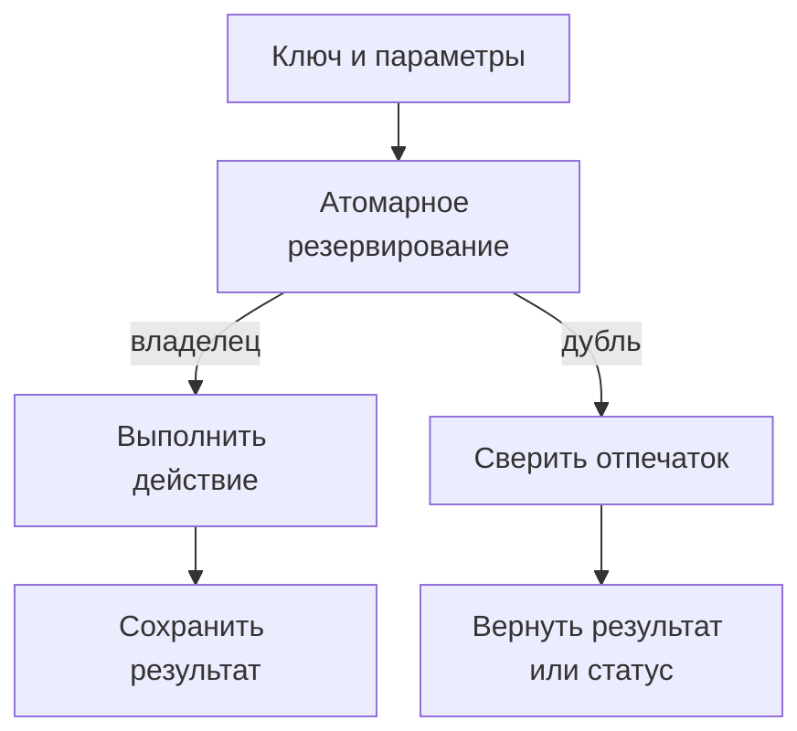

# Идемпотентность в API и фоновых задачах {#idempotency-in-apis-and-background-jobs}

<div class="bdr-post__hero" data-bdr-post="2026-09-14-idempotency-in-apis-and-background-jobs" role="img" aria-label="Повторы, повторные доставки и потерянные ответы не должны повторять списание или письмо" markdown="0"></div>

Сеть теряет ответы, пользователи нажимают кнопку второй раз, брокеры доставляют сообщения повторно. Поэтому любой запрос и любое задание однажды придут дважды.

Списание прошло, но ответ потерялся, и клиент повторяет запрос. Счёт отправлен, но задание доставлено ещё раз. Ни один из повторов не должен снова списать деньги или отправить письмо.

Возьмём `idempotency-kit` 0.4.1 с Redis 7 и Python 3.13 для платёжного API, цепочки сервисов и фоновой задачи и воспроизведём случаи, когда одной записи в Redis недостаточно.

<!-- more -->

## Один платёж, несколько попыток {#payment-example}

Списанием занимается платёжный сервис. Он получает внутреннюю команду `Payment`, собранную после аутентификации: `tenant_id`, `order_id`, положительную сумму `amount` в копейках и `currency`; успешное списание возвращает `Charge`. Шлюз и сервис заказов перед ним только передают ключ клиента.

Клиент создаёт `Idempotency-Key`, когда начинает платёж, и сохраняет его для всех повторов этого платежа. Новый платёж получает новый ключ, даже с теми же параметрами: хеш тела запроса не отличит два разных намерения. Если заказу нужно несколько платежей, у каждого свой ключ.

<div id="idempotency-keys-the-part-everyone-gets-wrong" data-search-exclude></div>
<div id="what-the-key-promises" data-search-exclude></div>
<div id="measured-the-request-that-is-still-running" data-search-exclude></div>
<div id="it-is-still-not-a-lock" data-search-exclude></div>
<div id="the-key-is-not-the-request" data-search-exclude></div>
<div id="failures-are-not-cached-and-neither-is-the-store" data-search-exclude></div>
<div id="scope-and-lifetime" data-search-exclude></div>
<div id="the-shape" data-search-exclude></div>

## Повтор получает сохранённый результат, даже пока первый запрос выполняется {#reservation}

Координатор сохраняет результат под ключом и возвращает его каждому повтору:

```python
from redis.asyncio import Redis
from idempotency_kit import AsyncIdempotencyCoordinator, IdempotencyDomainService
from idempotency_kit.infra.storage.redis.aio import RedisAsyncIdempotencyRepository


def make_coordinator(redis: Redis) -> AsyncIdempotencyCoordinator:
    return AsyncIdempotencyCoordinator(
        RedisAsyncIdempotencyRepository(redis),
        IdempotencyDomainService(),
        in_flight="raise",
        in_flight_lease_seconds=30,
    )
```

```python
from collections.abc import Awaitable, Callable
from idempotency_kit import (
    IdempotencyIdentifiers, PydanticResultAdapter, fingerprint_of,
)


async def charge_once(
    coordinator: AsyncIdempotencyCoordinator,
    charge: Callable[[Payment, str], Awaitable[Charge]],
    payment: Payment,
    key: str,
) -> Charge:
    ids = IdempotencyIdentifiers(
        operation=f"payment.charge.{payment.tenant_id.hex}",
        idempotency_key=key,
    )
    provider_key = f"{ids.operation}.{ids.idempotency_key}"
    return await coordinator.coordinate(
        ids.operation, ids.idempotency_key, 3600,
        PydanticResultAdapter(Charge), charge, payment, provider_key,
        idempotency_fingerprint=fingerprint_of(
            order_id=payment.order_id,
            amount=payment.amount,
            currency=payment.currency,
        ),
    )
```

Имя операции разделяет ключи разных арендаторов, а `fingerprint_of` хеширует параметры. Тот же ключ с теми же параметрами возвращает сохранённый `Charge`; изменённая сумма вызывает `IdempotencyKeyReuseError`, и мы отвечаем 422, как предлагает [черновик IETF об Idempotency-Key](https://datatracker.ietf.org/doc/draft-ietf-httpapi-idempotency-key-header/). `IdempotencyIdentifiers` проверяет ключ раньше координатора: с пустым ключом, двоеточием или длиной больше 255 символов `coordinate()` выполнил бы действие без защиты и ничего не сохранил. На такие ключи отвечайте 400.

Сложнее всего с повтором, который приходит, пока первый запрос ещё внутри действия. «Прочитать сохранённый результат, списать, сохранить» позволяет обоим ничего не найти. В режимах `wait` и `raise` координатор сначала резервирует ключ в Redis; наш API использует `raise`, и его обработчик отвечает на `IdempotencyInProgressError` кодом 409 с `payment_in_progress` и `Retry-After: 1`. Практикум задерживает первый вызов внутри действия, пока не придёт второй:

| `in_flight` | Что происходит со вторым запросом | Списаний |
|---|---|---|
| `"run"` | Тоже выполняет действие | 2 |
| `"wait"` (по умолчанию) | Ждёт результата первого | 1 |
| `"raise"` (наш API) | Получает `IdempotencyInProgressError` | 1 |

Резерв на 30 секунд библиотека ставит по умолчанию. Делайте его больше худшего времени действия вместе с таймаутом вызова провайдера: в режиме `wait` дубль ждёт не дольше резерва, и если первый вызов к тому моменту ещё работает, дубль выполнит действие сам. `run` подходит только там, где одновременные дубли допустимы.

<!-- diagram:concept -->
<figure class="bdr-diagram" markdown="1">
<figcaption><span class="bdr-diagram__eyebrow">ИДЕЯ В СХЕМЕ</span><strong>Сначала резервируем ключ, потом выполняем действие</strong></figcaption>
<div class="bdr-diagram__viewport" markdown="1" data-search-exclude>



</div>
<p class="bdr-diagram__caption">Действие выполняет тот, кто выиграл атомарное резервирование. Дубль сверяет параметры и получает сохранённый результат или ответ о том, что операция ещё выполняется.</p>
</figure>
<!-- /diagram:concept -->

<div id="idempotency-across-a-chain-of-microservices" data-search-exclude></div>
<div id="the-shape-of-the-problem" data-search-exclude></div>
<div id="the-mistake-that-looks-like-a-fix" data-search-exclude></div>
<div id="the-key-belongs-to-the-request-not-to-the-attempt" data-search-exclude></div>
<div id="the-line-that-says-the-work-is-not-finished" data-search-exclude></div>
<div id="when-there-is-no-key-to-propagate" data-search-exclude></div>
<div id="what-to-standardise-across-the-chain" data-search-exclude></div>
<div id="the-pieces" data-search-exclude></div>

## Ответ теряется между сервисами {#propagation}

Шлюз вызывает сервис заказов, а тот вызывает платёжный сервис. Оба передают ключ клиента без изменений при своих повторах и возвращают 409 и 422 вызывающей стороне. Практикум намеренно рвёт два соединения: после того как платёжный сервис списал деньги и сохранил результат и после того как сервис заказов получил этот результат. При двух обращениях к заказам и трёх к платежам:

| Подход | Списаний |
|---|---|
| Без координатора | 3 |
| Координатор есть, но шлюз при повторе создаёт новый ключ | 2 |
| Один ключ на всех попытках | 1 |

Дедлайны и паузы между повторами для таких вызовов разобраны в [статье об HTTP- и gRPC-клиентах](2026-09-13-production-http-grpc-clients.md).

<div id="idempotency-for-background-jobs-and-kafka-consumers" data-search-exclude></div>
<div id="the-crash-before-the-ack" data-search-exclude></div>
<div id="two-workers-one-job" data-search-exclude></div>
<div id="what-the-key-is-made-of" data-search-exclude></div>
<div id="consumers-the-inbox-and-the-key-are-not-the-same-tool" data-search-exclude></div>
<div id="lifetime" data-search-exclude></div>

## Воркер отправил счёт, но не подтвердил задание {#jobs}

Очередь повторно доставляет задание на отправку счёта с новым `delivery_id`. Сам счёт определяется арендатором, заказом и версией, из них и складывается ключ:

```python
from idempotency_kit import JsonResultAdapter


class InvoiceJob(BaseModel):
    delivery_id: UUID
    tenant_id: UUID
    order_id: UUID
    invoice_version: int = Field(ge=1)
    email: str


async def send_invoice_once(coordinator, send, job: InvoiceJob):
    operation = f"mail.invoice.{job.tenant_id.hex}"
    key = f"{job.order_id.hex}.v{job.invoice_version}"
    return await coordinator.coordinate(
        operation, key, 86400, JsonResultAdapter(),
        send, job, f"{operation}.{key}",
        idempotency_fingerprint=fingerprint_of(email=job.email),
    )
```

`send` вызывает почтовый сервис и возвращает результат вроде `{"email_id": "em_1"}`; воркер подтверждает задание только после того, как `send_invoice_once` вернул результат. В практикуме подтверждение падает уже после сохранения результата; при повторной доставке `send_invoice_once` возвращает исходный `email_id`, и воркер подтверждает задание. Две доставки дают одно письмо. Новая версия счёта отправляется отдельно, а смена получателя у старой версии отклоняется по отпечатку. Воркер использует тот же координатор в режиме `raise`: получив `IdempotencyInProgressError`, он не подтверждает задание, и очередь доставит его позже.

## Провайдер списал деньги, но ответ потерялся {#effects}

Теперь провайдер списывает деньги, но ответ теряется внутри `charge`. Функция бросает исключение, координатор удаляет резерв, и следующая попытка снова вызывает провайдера:

| Поведение провайдера в практикуме | Вызовов | Списаний |
|---|---|---|
| Каждый вызов списывает деньги | 2 | 2 |
| Сохраняет результат под стабильным ключом провайдера | 2 | 1 |

Поэтому `charge_once` передаёт провайдеру ключ из арендатора, действия и ключа клиента. Умеет ли провайдер убирать дубли по ключу и как долго он это помнит, определяет контракт интеграции; без этого неопределённый исход требует проверки статуса перед новым списанием.

## Redis недоступен или ключ истёк {#failure-policy}

Когда Redis недоступен, idempotency-kit 0.4.1 выполняет действие без защиты (fail open). В практикуме два вызова с одним ключом во время сбоя Redis дают два списания у провайдера без собственной защиты от дублей. Поэтому платёж должен защищать сам провайдер, а изменения в вашей базе нужно делать в одной транзакции с записью об обработке.

Записи тоже истекают. Резерв покрывает выполняющееся действие, результат платежа хранится час, а результат отправки счёта сутки; когда запись пропала, исходный ключ снова выполнит действие, поэтому срок хранения должен покрывать самое долгое окно повторов или повторной доставки. Координатор хранит TTL в целых минутах с округлением вниз и минимумом в одну минуту. Упавший процесс оставляет свой резерв до истечения срока, а истечение не останавливает медленное первое действие: практикум показывает, как рядом с ним запускается второе.

## Что взять в свой сервис {#conclusion}

Дайте каждому действию одну идентичность и сохраняйте её на всех попытках, переходах между сервисами и повторных доставках. [idempotency-kit](https://bedrock-python.github.io/idempotency-kit/) резервирует ключи, сверяет параметры и возвращает сохранённые результаты. Внешним действиям всё равно нужен провайдер, который убирает дубли по тому же ключу, а изменения в вашей базе должны идти в одной транзакции с записью об обработке.

## Примеры и практикумы {#labs}

Redis и HTTP-сервисы в практикумах настоящие; платёжный и почтовый провайдеры и очередь имитируются.

- [Практикум: ключи идемпотентности](../lab/2026-09-07-idempotency-keys/README.md)
- [Практикум: идемпотентность в цепочке сервисов](../lab/2026-09-07-idempotency-across-a-chain/README.md)
- [Практикум: идемпотентность фоновых задач и потребителей](../lab/2026-09-07-idempotency-for-jobs-and-consumers/README.md)
