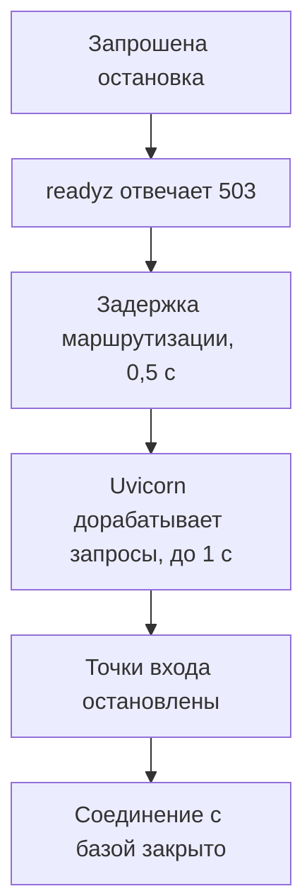

# Жизненный цикл Python-сервиса: запуск, проверки состояния и остановка {#python-service-lifecycle}

<div class="bdr-post__hero" data-bdr-post="2026-09-20-python-service-lifecycle" role="img" aria-label="Сначала сервис перестаёт получать трафик, потом дорабатывает запросы, завершает работу и выходит" markdown="0"></div>

Сервис в Kubernetes перезапускают постоянно: при выкатке, масштабировании, переезде пода на другой узел. Каждый раз он проходит запуск, проверки состояния и остановку, и ошибка на любом шаге стоит запросов.

Например, во время выкатки Python-сервис может закрыть пул соединений с базой, пока запрос ещё им пользуется. Проверки при запуске, readiness и остановка должны идти в одном порядке для всех точек входа, а не только для HTTP.

Разберём это на сервисе отчётов: `GET /reports` строит отчёт по запросу, а воркер строит тот же отчёт в фоне. Оба работают с одной базой данных, и принятый запрос должен завершиться до того, как закроется соединение с базой.

<!-- more -->

<div id="why-application-lifecycle-should-not-belong-to-fastapi" data-search-exclude></div>
<div id="the-api-as-usually-written" data-search-exclude></div>
<div id="the-worker-as-usually-written" data-search-exclude></div>
<div id="the-framework-is-an-entrypoint" data-search-exclude></div>
<div id="what-fastapis-lifespan-is-still-for" data-search-exclude></div>

## Описываем жизненный цикл один раз {#ownership}

Если у сервиса только HTTP, подключение к базе можно открыть в lifespan FastAPI и закрыть после того, как Uvicorn дождётся запросов. У воркера lifespan нет: в его `main()` придётся повторить настройку, а заодно обработку сигналов, сообщение о готовности и закрытие ресурсов в правильном порядке. Обе ручные версии есть в [примере «до»](../lab/2026-09-07-lifecycle-not-fastapi/README.md).

[servicewright](https://bedrock-python.github.io/servicewright/) даёт обеим точкам входа одни правила: `AppSpec` описывает приложение, `Service` его запускает, а точки входа вроде FastAPI принимают работу. `app_scope()` контейнера открывает подключение к базе один раз, `unit_scope()` выдаёт его каждому запросу, а цикл воркера целиком работает в одной долгой unit-области. В [практикуме про общий жизненный цикл](../lab/2026-09-07-one-lifecycle/README.md) базу данных заменяет `ReportStore`: он хранит данные в памяти и падает на `assert`, если им пользуются после закрытия.

<div id="one-lifecycle-for-http-grpc-workers-and-cron-jobs" data-search-exclude></div>
<div id="host-and-entrypoints" data-search-exclude></div>
<div id="one-process" data-search-exclude></div>
<div id="two-processes" data-search-exclude></div>
<div id="what-the-entrypoints-look-like" data-search-exclude></div>
<div id="the-one-thing-to-get-right" data-search-exclude></div>

## Проверяем базу данных, потом запускаем HTTP и воркер {#startup}

Созданный объект клиента ещё не доказывает, что зависимость доступна. Перед приёмом работы выполним прогрев с ограничением по времени:

```python
import asyncio
from servicewright import AsyncWarmer


class StoreWarmer(AsyncWarmer):
    def __init__(self, store):
        super().__init__()
        self.store = store

    async def warmup(self):
        async with asyncio.timeout(2):
            await self.store.ping()
```

Если `ping()` упал или завис на две секунды, запуск проваливается: область приложения закрывает подключение к базе, а HTTP-порт так и не открывается. Обработчик и воркер получают одно и то же подготовленное подключение:

```python
from fastapi import APIRouter
from servicewright.adapters.fastapi import UnitScopeDep

router = APIRouter()


@router.get('/reports')
async def report(unit: UnitScopeDep) -> dict[str, int]:
    store = await unit.get(ReportStore)
    return await store.report('http')
```

```python
async def periodic_report(scope, stop: asyncio.Event):
    store = await scope.get(ReportStore)
    while True:
        try:
            await asyncio.wait_for(stop.wait(), timeout=0.5)
            return
        except TimeoutError:
            pass
        async with asyncio.timeout(1):
            await store.report('worker')
```

Воркер ждёт полсекунды между отчётами, перед каждым проверяет сигнал остановки и даёт отчёту не больше секунды. Спецификация и роли процесса связывают всё вместе; три настройки остановки разобраны в разделе про остановку:

```python
from servicewright import AppSpec


def make_spec(container):
    return AppSpec(
        service_name='reports',
        create_container=lambda settings: container,
        warmers=[StoreWarmer(container.store)],
        drain_delay_seconds=0.5,
        drain_grace_seconds=3,
        cleanup_timeout_seconds=2,
    )
```

```python
from servicewright import DaemonEntrypoint, Service
from servicewright.adapters.fastapi import FastApiEntrypoint, HttpConfig


def build_service(role, *, port=8080, store=None):
    container = Container(store if store is not None else ReportStore())
    api = FastApiEntrypoint(
        config=HttpConfig(host='127.0.0.1', port=port, graceful_timeout=1),
        routers=(router,),
    )
    worker = DaemonEntrypoint(periodic_report)
    roles = {'api': [api], 'worker': [worker], 'all': [api, worker]}
    service = Service(make_spec(container), entrypoints=roles[role])
    return service, api, container
```

`build_service('all')` запускает HTTP и воркер в одном процессе с одним подключением к базе; роли `api` и `worker` в отдельных развёртываниях открывают каждая своё подключение по тем же правилам. В продакшене `run_sync(service, settings)` ставит обработчики SIGTERM и SIGINT, а второй сигнал завершает процесс принудительно. Запускайте процесс в exec-форме, чтобы SIGTERM доходил до него напрямую.

<div id="warmup-readiness-and-liveness-are-three-different-things" data-search-exclude></div>
<div id="the-whole-life-of-a-pod-in-six-transitions" data-search-exclude></div>
<div id="warmup-is-not-readiness-and-neither-is-it-liveness" data-search-exclude></div>
<div id="liveness-is-about-the-process-not-the-dependencies" data-search-exclude></div>
<div id="readiness-has-to-go-false-before-the-pod-stops-serving" data-search-exclude></div>
<div id="the-three-in-one-table" data-search-exclude></div>
<div id="the-pieces" data-search-exclude></div>

## Отключаем зависимость и смотрим, какая проверка падает {#health}

Допустим, сервис хранит в Redis ещё и статусы фоновых задач, и без Redis под не может делать полезную новую работу. Добавим проверку готовности:

```python
from redis.exceptions import RedisError
from servicewright import HealthRegistry


class RedisReady:
    def __init__(self, redis):
        self.redis = redis

    async def check(self) -> bool:
        try:
            async with asyncio.timeout(0.25):
                return bool(await self.redis.ping())
        except (RedisError, TimeoutError):
            return False


def redis_health(redis):
    health = HealthRegistry()
    health.add_check('job-state', RedisReady(redis))
    return health
```

[Практикум с проверками](../lab/2026-09-07-warmup-readiness-liveness/README.md) задаёт `spec.health = redis_health(client)`, добавляет прогрев Redis и закрывает клиента вместе с областью приложения. Каждая проверка отправляет живой `PING` с лимитом 250 мс вместе с повторами клиента; `HealthRegistry(readiness_cache_ttl=...)` умеет вместо этого кешировать результат. Практикум ставит на паузу настоящий контейнер Redis:

| Ситуация | `livez` | `readyz` | Прямой запрос `/reports` |
| --- | --- | --- | --- |
| Redis на паузе | 200 | 503 | 200 |
| Остановка запрошена, идёт задержка маршрутизации | 200 | 503 | 200 |

До сбоя и после возвращения Redis `readyz` отвечает 200. `/reports` Redis не использует, поэтому прямой запрос работает: readiness влияет на маршрутизацию, а не на обработчик. Включайте зависимость в readiness, только если без неё под не может делать полезную работу, а необязательный кеш держите снаружи. И помните цену: сбой общего Redis делает неготовыми все реплики сразу, у Service не остаётся endpoints, и клиенты получают ошибку балансировщика вместо вашего 503.

В servicewright 0.13.1 HTTP-порт FastAPI открывается после прогрева, поэтому startup probe смотрит на `livez`. Его окно, `failureThreshold × periodSeconds`, должно быть больше общего лимита прогрева, по умолчанию 60 секунд. Для Kubernetes уберите `host` из практикума: адрес по умолчанию `0.0.0.0` позволяет проверкам достучаться до IP пода.

```yaml
# Fragment of spec.containers[0]; the container listens on port 8080.
startupProbe:
  httpGet: {path: /system/health/livez, port: 8080}
  periodSeconds: 2
  failureThreshold: 35
readinessProbe:
  httpGet: {path: /system/health/readyz, port: 8080}
  periodSeconds: 2
livenessProbe:
  httpGet: {path: /system/health/livez, port: 8080}
  periodSeconds: 10
  failureThreshold: 3
```

Readiness решает, получает ли под трафик Service; повторные неудачи liveness перезапускают контейнер. Встроенный `livez` подтверждает, что отвечают HTTP и цикл событий, а не что здорова база. Подробнее в [документации Kubernetes о проверках](https://kubernetes.io/docs/tasks/configure-pod-container/configure-liveness-readiness-startup-probes/).

<div id="graceful-shutdown-in-kubernetes-is-a-protocol-not-a-signal-handler" data-search-exclude></div>
<div id="what-kubernetes-actually-does" data-search-exclude></div>
<div id="the-measurement" data-search-exclude></div>
<div id="the-protocol" data-search-exclude></div>
<div id="the-same-measurement-with-the-protocol" data-search-exclude></div>
<div id="sizing-the-numbers" data-search-exclude></div>
<div id="not-only-http" data-search-exclude></div>
<div id="what-changed-in-the-code" data-search-exclude></div>

## Дорабатываем принятый отчёт до закрытия соединения с базой {#shutdown}

Возьмём роль только с API. Отчёт на 0,8 секунды уже строится, когда начинается остановка:

<!-- diagram:concept -->
<figure class="bdr-diagram" markdown="1">
<figcaption><span class="bdr-diagram__eyebrow">ИДЕЯ В СХЕМЕ</span><strong>Порядок остановки HTTP</strong></figcaption>
<div class="bdr-diagram__viewport" markdown="1" data-search-exclude>



</div>
<p class="bdr-diagram__caption">Сначала readiness становится false, маршрутизация получает время догнать изменения, активные запросы завершаются в пределах graceful timeout, и только потом закрываются ресурсы.</p>
</figure>
<!-- /diagram:concept -->

| Настройка в примере | Что ограничивает |
| --- | --- |
| `drain_delay_seconds=0.5` | Паузу после перехода readiness в false до начала дренажа |
| `HttpConfig.graceful_timeout=1` | Ожидание активных запросов в Uvicorn |
| `drain_grace_seconds=3` | Время на дренаж, которое получает каждая точка входа; для HTTP действует меньший лимит Uvicorn ([servicewright #89](https://github.com/bedrock-python/servicewright/issues/89)) |
| `cleanup_timeout_seconds=2` | Каждый шаг очистки среды выполнения; закрытие ваших ресурсов в `app_scope()` сюда не входит, так что ограничьте закрытие пула сами |

[Практикум с остановкой](../lab/2026-09-07-graceful-shutdown/README.md) запускает отчёт, запрашивает остановку и проверяет, что отчёт вернул 200 до закрытия соединения с базой: `store.events.index('http:done') < store.events.index('store:close')`. Отчёт на 30 секунд превышает секундный лимит Uvicorn и отменяется раньше; ответ ещё не начат, и клиент получает 500. Ответ, который уже передаётся потоком, оборвётся на середине. В роли `all` эта последовательность начинается, только когда воркер закончит текущий отчёт, здесь не больше секунды; servicewright ждёт, пока daemon-функция вернёт управление, поэтому потребитель очереди должен сам ограничивать дренаж внутри неё.

В Kubernetes endpoints удаляемого пода помечаются неготовыми сразу, как только начинается удаление; 503 из `readyz` важен для балансировщиков, которые сами опрашивают эту проверку. Задержка маршрутизации покрывает время, за которое изменения EndpointSlice доходят до kube-proxy и ingress-контроллеров, обычно секунды, так что 0,5 секунды годятся только для практикума. `terminationGracePeriodSeconds` должен быть больше суммы: хук `preStop`, текущая задача воркера, задержка маршрутизации, дренаж, шаги очистки и закрытие ваших ресурсов. Подробнее в описании [завершения пода](https://kubernetes.io/docs/concepts/workloads/pods/pod-lifecycle/#pod-termination-flow).

## Что взять в свой сервис {#conclusion}

Перед выкаткой проверьте три вещи: окно startup probe больше лимита прогрева, задержка маршрутизации покрывает распространение endpoints в вашем кластере, а grace period больше всей последовательности остановки. [servicewright](https://bedrock-python.github.io/servicewright/) держит эту последовательность одинаковой для HTTP, воркеров и других точек входа; сервису только с HTTP хватит lifespan FastAPI.

## Примеры и практикумы {#labs}

Практикумы используют Python 3.13, `servicewright==0.13.1`, `fastapi==0.141.1`, `uvicorn==0.53.0` и `httpx==0.28.1`. HTTP, Redis и servicewright настоящие, а база данных заменена объектом в памяти; драйверы останавливают сервис через событие, поэтому доставку SIGTERM и выкатку в Kubernetes они не проверяют.

- [Lifespan FastAPI и отдельно настроенный воркер](../lab/2026-09-07-lifecycle-not-fastapi/README.md)
- [Общий жизненный цикл HTTP и воркера](../lab/2026-09-07-one-lifecycle/README.md)
- [Прогрев, readiness и liveness с настоящим Redis](../lab/2026-09-07-warmup-readiness-liveness/README.md)
- [Завершение и отмена HTTP-запросов при остановке](../lab/2026-09-07-graceful-shutdown/README.md)
