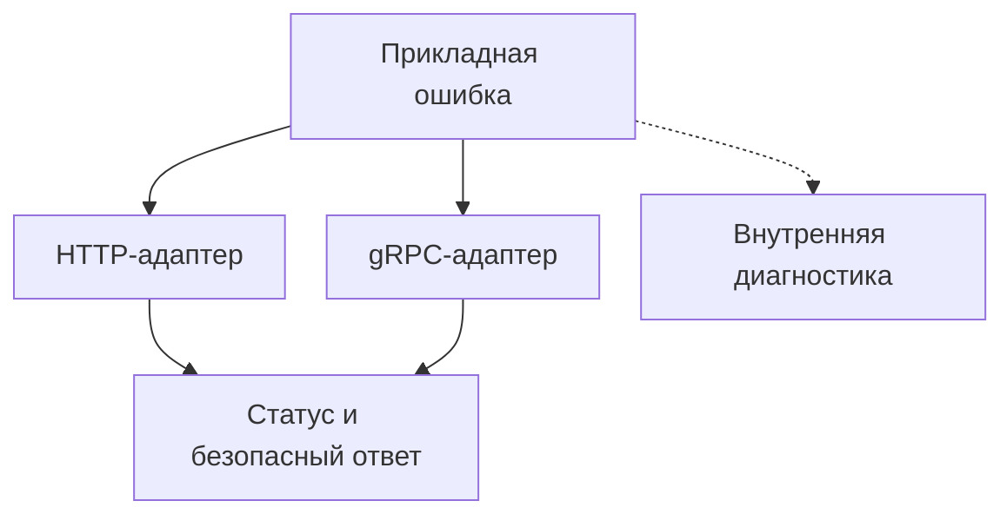

# Как подготовить gRPC-сервер на Python к продакшену {#production-python-grpc-server}

<div class="bdr-post__hero" data-bdr-post="2026-09-23-production-python-grpc-server" role="img" aria-label="Ошибки, лимиты, проверки состояния и остановка вокруг одного gRPC-метода" markdown="0"></div>

Поднять gRPC-сервер на Python несложно: хватает обработчика и пары строк запуска. Сложнее добиться, чтобы он вёл себя предсказуемо, когда что-то идёт не так.

Возьмём метод `GetInvoice`. На успешном сценарии он работает, но должен пережить ещё запрос чужого заказа, сбой базы данных, перегрузку и выкатку. Разберём все эти случаи на одном gRPC-сервере и проверим, что на самом деле получает клиент.

Код проверен на grpc-server-kit 0.2.0, servicewright 0.13.1 и grpcio 1.84.0 под Python 3.13.

<!-- more -->

<div id="the-anatomy-of-a-production-python-grpc-server" data-search-exclude></div>
<div id="the-handler-that-raises" data-search-exclude></div>
<div id="where-the-reporting-interceptor-goes" data-search-exclude></div>
<div id="message-size" data-search-exclude></div>
<div id="shutdown" data-search-exclude></div>
<div id="health" data-search-exclude></div>
<div id="tls-and-the-file-permissions" data-search-exclude></div>
<div id="reflection-and-the-rest-of-the-list" data-search-exclude></div>
<div id="the-order" data-search-exclude></div>
<div id="the-pieces" data-search-exclude></div>

## Начинаем с операции получения счёта {#pipeline}

Покупатель запрашивает счёт по оплаченному заказу. Кто он, определяет проверенная аутентификация, а прикладная функция проверяет владельца и оплату. Её ошибки наследуются от `ServiceError` из servicewright: `kind` задаёт категорию, `code` даёт клиентам стабильную строку, а `public` (по умолчанию true) разрешает этому коду выходить за пределы сервиса. Ни одна из ошибок ничего не знает об HTTP или gRPC:

```python
from servicewright import ErrorKind, ServiceError


class OrderNotFound(ServiceError):
    kind = ErrorKind.NOT_FOUND
    code = "order_not_found"


class InvoiceNotReady(ServiceError):
    kind = ErrorKind.PRECONDITION_FAILED
    code = "invoice_not_ready"


class InvoiceAccessDenied(ServiceError):
    kind = ErrorKind.FORBIDDEN
    code = "invoice_access_denied"


class InvoiceStoreUnavailable(ServiceError):
    kind = ErrorKind.UNAVAILABLE
    code = "invoice_store_unavailable"
```

```python
async def get_invoice(store, order_id: str, buyer_id: str) -> dict:
    async with store.read(order_id) as order:
        if order is None:
            raise OrderNotFound("Order not found")
        if order["buyer_id"] != buyer_id:
            raise InvoiceAccessDenied("Access denied")
        if not order["paid"]:
            raise InvoiceNotReady("The order has not been paid")
        return {"invoice_id": order["invoice_id"], "amount": order["amount"]}
```

`store.read()` освобождает ресурс и при исключениях, и при отмене. Функция проверяет существование заказа раньше владельца, поэтому `NOT_FOUND` и `PERMISSION_DENIED` выдают, какие ID заказов существуют; если это важно, проверяйте права первыми. В практикуме метод зарегистрирован на сырых байтах, а покупатель задан фикстурой.

<div id="mapping-python-exceptions-to-grpc-status-codes-without-leaking-internals" data-search-exclude></div>
<div id="what-happens-with-no-map-at-all" data-search-exclude></div>
<div id="the-default-map" data-search-exclude></div>
<div id="the-map-is-a-client-contract-not-a-formatting-decision" data-search-exclude></div>
<div id="details-the-two-tier-rule" data-search-exclude></div>
<div id="what-belongs-where" data-search-exclude></div>

## Заказ не оплачен: что получит клиент? {#errors}

`InvoiceNotReady` превращается в `FAILED_PRECONDITION`: повтор без изменения заказа не поможет. Остальные статусы следуют [руководству по статусам gRPC](https://grpc.io/docs/guides/status-codes/). Мы берём их из `kind` каждой ошибки, так что таблица для gRPC не разойдётся с HTTP:

```python
import grpc
from grpc_server_kit.aio.interceptors import AsyncExceptionHandlerInterceptor
from servicewright.adapters.grpc import GRPC_STATUS_BY_KIND


SERVICE = "orders.Invoices"
PUBLIC_ERRORS = (
    OrderNotFound, InvoiceNotReady, InvoiceAccessDenied, InvoiceStoreUnavailable,
)
ERROR_STATUS = {error: GRPC_STATUS_BY_KIND[error.kind] for error in PUBLIC_ERRORS}


def public_details(error, status):
    if isinstance(error, PUBLIC_ERRORS) and error.public:
        return error.code
    return "internal_error"


def exception_handler():
    return AsyncExceptionHandlerInterceptor(
        error_status_map=ERROR_STATUS,
        detail_factory=public_details,
        merge_defaults=False,
    )
```

`public_details` отправляет только стабильный код известной публичной ошибки и никогда не отправляет текст исключения; всё остальное превращается в `internal_error`. `merge_defaults=False` оставляет только нашу таблицу: стандартная таблица библиотеки отображает `ValueError` в `INVALID_ARGUMENT` и свалила бы внутреннюю ошибку на клиента. Практикум вызывает внутренний `ValueError` через настоящий RPC:

| Сборка сервера | Статус для внутреннего `ValueError` | Что видит клиент |
|---|---|---|
| Без интерцептора исключений | `UNKNOWN` | Текст исключения с внутренними данными |
| Интерцептор по умолчанию | `INVALID_ARGUMENT` | Безопасные подробности, но неверная категория |
| Наша таблица | `INTERNAL` | `internal_error` |

Явный `await context.abort(...)`, например из проверки аутентификации, сохраняет свой статус; отображаются только неперехваченные исключения. Одна дыра остаётся: в grpc-server-kit 0.2.0 `grpc.RpcError` из вызова другого сервиса проходит насквозь и доходит до клиента как `UNKNOWN` вместе с подробностями того сервиса. Перехватывайте такие ошибки в обработчике и преобразуйте. Логам нужна своя фильтрация секретов: безопасный ответ их не очищает.

<div id="transport-independent-errors-one-domain-error-http-and-grpc-responses" data-search-exclude></div>
<div id="the-domain-raises-and-does-not-format" data-search-exclude></div>
<div id="the-same-seven-calls-two-transports" data-search-exclude></div>
<div id="what-each-layer-is-allowed-to-know" data-search-exclude></div>
<div id="testing-it-once" data-search-exclude></div>
<div id="what-this-does-not-solve" data-search-exclude></div>

## Ограничиваем размер сообщений и число активных вызовов {#operations}

```python
from grpc_server_kit import GrpcApp, GrpcServerConfig


def server_config():
    return GrpcServerConfig(
        host="127.0.0.1", port=0,
        max_receive_message_length=64 * 1024,
        max_send_message_length=64 * 1024,
        max_concurrent_rpcs=32,
        grace_period=1.0,
    )
```

Это значения для практикума. В продакшене слушайте адрес пода, а не `127.0.0.1`, давайте `grace_period` достаточно времени на настоящие RPC (по умолчанию 5 секунд) и подбирайте лимиты по своим сообщениям и мощностям; лимит 64 КиБ действует и на запросы, и на ответы. Практикум снижает лимит до одного RPC и задерживает первый запрос внутри чтения:

| Следующий запрос | Результат |
|---|---|
| По тому же HTTP/2-соединению | Ждёт свободного потока и может выйти за дедлайн |
| По отдельному соединению | Получает `RESOURCE_EXHAUSTED` от общего лимита сервера |
| С телом 65 КиБ при лимите 64 КиБ | Получает `RESOURCE_EXHAUSTED` ещё до обращения к базе данных |

`max_concurrent_rpcs` задаёт и общий лимит сервера, и `grpc.max_concurrent_streams` соединения, поэтому перегрузка не всегда даёт мгновенный отказ: клиентам всё равно нужны дедлайны, чтобы ограничить ожидание.

## Метрикам нужен статус, а диагностике исходное исключение {#interceptors}

```python
from grpc_server_kit.aio.interceptors import (
    AsyncMetricsInterceptor, AsyncSentryInterceptor,
)
from grpc_server_kit.aio.interceptors.exception_handler import find_mapped_status


def build_app(store, metrics, reporter, *, config=None):
    app = GrpcApp(config or server_config(), interceptors=[
        AsyncMetricsInterceptor(metrics, service_name=SERVICE),
        exception_handler(),
        AsyncSentryInterceptor(reporter, capture_filter=lambda error:
            find_mapped_status(type(error), ERROR_STATUS) in {
                grpc.StatusCode.INTERNAL, grpc.StatusCode.UNAVAILABLE,
            }),
    ])
    app.register(lambda server: register_invoice_service(server, store))
    return app
```

`metrics` и `reporter` в практикуме сделаны простыми сборщиками; `AsyncSentryInterceptor` принимает любой reporter. Список выполняется от внешнего интерцептора к внутреннему, а исключения возвращаются наружу: reporter видит исходное исключение, обработчик превращает его в `INTERNAL`, метрики записывают итоговый статус. Фильтр сообщает о внутренних ошибках и сбоях базы данных, но не об отказах вроде `InvoiceNotReady`. Если поставить reporter снаружи обработчика исключений, практикум показывает, что он получает уже завершённый abort вместо исходного исключения.

## Проверки состояния сообщают о готовности {#readiness}

```python
class InvoiceStoreHealth:
    def __init__(self, store):
        self.store = store

    async def check(self) -> bool:
        return await self.store.ping()


def enable_readiness(app, store):
    app.enable_health(
        checkers=[InvoiceStoreHealth(store)],
        service_names=[SERVICE],
        cache_ttl=0,
        check_timeout=0.2,
    )
```

Вызовите `enable_readiness(app, store)` до запуска сервера; `check_timeout` ограничивает весь раунд проверок. С `cache_ttl=0` практикум видит `SERVING`, `NOT_SERVING` и снова `SERVING`, пока база данных падает и восстанавливается, а зависшая проверка через таймаут становится `NOT_SERVING`. В продакшене кешируйте результат, чтобы проверки балансировщика не ходили в базу при каждом вызове. Прямой вызов `GetInvoice` всё равно доходит до обработчика: [сервис health](https://grpc.io/docs/guides/health-checking/) сообщает состояние, но не блокирует RPC.

## Клиент ушёл, затем сервер останавливается {#shutdown-example}

Освобождайте ресурсы через менеджеры контекста и `finally` и не считайте `CancelledError` прикладной ошибкой. В практикуме и отмена, и клиентский дедлайн завершают чтение и освобождают соединение с базой; клиент видит `DEADLINE_EXCEEDED`, а метрика сервера записывает `CANCELLED`: это два взгляда на одно завершение.

```python
async def serve_invoices(app, store):
    try:
        await app.run()
    finally:
        await store.close()
```

`app.run()` ставит обработчики сигналов и обслуживает запросы до сигнала или `app.request_shutdown()`. Потом перестаёт принимать RPC и даёт активным `grace_period` на завершение: короткий запрос возвращает ответ, зависший отменяется, и его клиент получает `UNAVAILABLE`. Соединение с базой закрывается только после этого. Если процессом управляет servicewright, он останавливает точки входа и ресурсы по порядку, как в [статье о жизненном цикле](2026-09-20-python-service-lifecycle.md).

## Включаем TLS и проверяем клиента {#tls-example}

Для TLS нужны `ssl_enabled`, `ssl_cert_file` и `ssl_key_file` в `GrpcServerConfig`; `ssl_ca_file` вместе с `ssl_client_auth=True` требует ещё и клиентский сертификат (mTLS). Практикум создаёт временные сертификаты и проверяет настоящие соединения: TLS-клиент подключается, mTLS требует клиентский сертификат, а соединение без шифрования не проходит ни в одной из настроек. PEM-файлы библиотека проверяет только по маркерам BEGIN/END. На Unix она отклоняет закрытый ключ, доступный на чтение группе или остальным; на Windows доступ контролируют ACL.

## Одна прикладная функция для HTTP и gRPC {#two-transports}

[Практикум с двумя транспортами](../lab/2026-09-07-transport-independent-errors/README.md) обслуживает ту же `get_invoice` через точки входа FastAPI и gRPC из servicewright. servicewright отображает каждую ошибку по её `kind`:

| Причина | HTTP | gRPC | Общий код ошибки |
|---|---|---|---|
| Заказ не найден | 404 | `NOT_FOUND` | `order_not_found` |
| Заказ не оплачен | 412 | `FAILED_PRECONDITION` | `invoice_not_ready` |
| Заказ другого покупателя | 403 | `PERMISSION_DENIED` | `invoice_access_denied` |
| База данных временно недоступна | 503 | `UNAVAILABLE` | `invoice_store_unavailable` |
| Внутренняя ошибка | 500 | `INTERNAL` | `internal_error` |

<!-- diagram:concept -->
<figure class="bdr-diagram" markdown="1">
<figcaption><span class="bdr-diagram__eyebrow">ИДЕЯ В СХЕМЕ</span><strong>Ошибки переводятся на границе транспорта</strong></figcaption>
<div class="bdr-diagram__viewport" markdown="1" data-search-exclude>



</div>
<p class="bdr-diagram__caption">Прикладной код сообщает о сбое. Адаптер каждого транспорта выбирает статус и публичные подробности, а внутренние подробности остаются в диагностике.</p>
</figure>
<!-- /diagram:concept -->

Стабильный код передаётся в теле problem JSON и в завершающих метаданных `x-error-code`. В отличие от нашего `GrpcApp`, servicewright отправляет клиенту ещё и сообщение публичной ошибки (как подробности gRPC и как `detail` в HTTP), так что пишите эти сообщения для клиентов. Код 412 выбрал servicewright: RFC 9110 оставляет 412 для невыполненных условных заголовков, а рекомендации Google по API отображают `FAILED_PRECONDITION` в 400. Кроме того, точка входа не использует `GrpcApp`, собранный выше: лимиты, интерцепторы, health и TLS для неё настраиваются отдельно.

## Что взять в свой сервис {#conclusion}

Дайте каждому ожидаемому сбою `kind` и стабильный код, выводите статусы из этого одного места и проверяйте, что на самом деле доходит до клиента, включая внутренние ошибки и ошибки других сервисов. [grpc-server-kit](https://bedrock-python.github.io/grpc-server-kit/) собирает gRPC-сервер с такими интерцепторами, лимитами, проверками состояния и TLS; [servicewright](https://bedrock-python.github.io/servicewright/) запускает HTTP и gRPC в одном жизненном цикле. Сбоям при чтении потоков нужны отдельные проверки, они разобраны в [статье о потоковых интерцепторах](2026-09-08-why-grpc-interceptors-break-on-streaming-rpcs.md).

## Примеры и практикумы {#labs}

- [Практикум: устройство gRPC-сервера для продакшена](../lab/2026-09-07-production-grpc-server/README.md)
- [Практикум: исключения Python и статусы gRPC](../lab/2026-09-07-python-exceptions-to-grpc-status-codes/README.md)
- [Практикум: одна прикладная ошибка, два транспорта](../lab/2026-09-07-transport-independent-errors/README.md)
