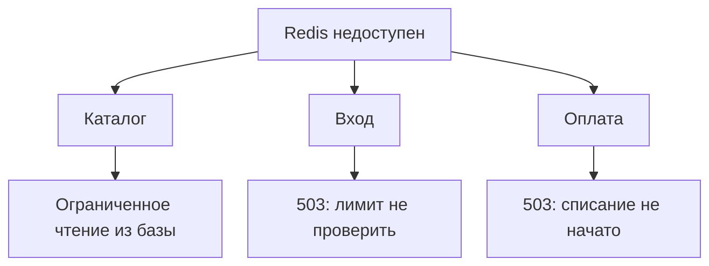

# Redis недоступен: какие запросы продолжают работать и почему PING об этом не скажет {#redis-failures-and-health-checks}

<div class="bdr-post__hero" data-bdr-post="2026-09-30-redis-failures-and-health-checks" role="img" aria-label="Недоступная зависимость одна, а решений о том, как работать без неё, три" markdown="0"></div>

В интернет-магазине Redis обычно стоит рядом с основной базой: кеширует цены, считает попытки входа и не пускает повторные нажатия «Оплатить». Пока он работает, о нём не думают.

Когда Redis падает, магазин ещё может показывать цены из PostgreSQL, но вход и оплату, которые больше нечем защитить, должен отклонять. Успешный PING не скажет, где что.

Отключим Redis и решим, как ведёт себя каждый маршрут. Примеры проверены на Python 3.13, `redis-client-kit[settings]==0.3.0`, `redis==8.1.0` и Redis 7.4.11; полный код лежит в [практикуме](../lab/2026-09-07-when-should-redis-fail-open/README.md).

<!-- more -->

## Ограничиваем ожидание Redis {#timeouts}

Цены хранятся в PostgreSQL, так что у кеша есть запасной путь, но только если ожидание Redis оставляет время на чтение из базы. [redis-client-kit](https://bedrock-python.github.io/redis-client-kit/) собирает общий клиент `redis-py` из настроек; приложение создаёт его при запуске и закрывает через `await redis.aclose()`:

```python
from redis_client_kit import create_async_redis_client
from redis_client_kit.settings import (
    BaseRedisSettings,
    RedisConnectionSettings,
    RedisPoolSettings,
    RedisResponseSettings,
    RedisRetrySettings,
)


def make_redis(host="localhost", port=6379):
    return create_async_redis_client(BaseRedisSettings(
        key_prefix="shop",
        connection=RedisConnectionSettings(host=host, port=port),
        pool=RedisPoolSettings(
            max_connections=10,
            socket_connect_timeout=0.1,
            socket_timeout=0.1,
        ),
        response=RedisResponseSettings(decode_responses=True),
        retry=RedisRetrySettings(enabled=False, max_attempts=0),
        health_check_interval=0,
    ))
```

redis-py 8 по умолчанию повторяет неудачную команду десять раз; библиотека передаёт ноль, если повторы не включены, и в коде это записано явно. В практикуме одна попытка падает через 0,10 секунды, два повтора растягивают это до 0,33, а лимит 0,15 секунды ниже обрезает до 0,16. `health_check_interval=0` выключает `PING`, который redis-py отправляет перед командой на простаивающем соединении: без повторов он не спасёт мёртвое соединение и только добавит лишний круг до сервера. `key_prefix` обязателен для модели настроек, но к ключам не применяется, поэтому команды сами добавляют `shop:`. Пул тоже не ждёт свободного соединения: при `max_connections=10` одиннадцатая одновременная команда сразу падает, так что подбирайте размер пула под число одновременных обращений к Redis в процессе.

Каждый вызов Redis получает общий лимит времени:

```python
import asyncio
import logging

from redis.exceptions import RedisError

log = logging.getLogger("shop")
REDIS_FAILURES = (RedisError, TimeoutError)


class ServiceUnavailable(Exception):
    pass


async def redis_call(command):
    async with asyncio.timeout(0.15):
        return await command
```

Отмена со стороны вызывающего кода по-прежнему проходит: `CancelledError` не входит в `REDIS_FAILURES`. Команда, которая уже ушла на сервер, всё равно может там выполниться. Подбирайте лимиты от [дедлайна запроса](2026-09-06-timeouts-are-not-deadlines.md): с этими значениями самый долгий путь каталога занимает 0,15 + 0,5 + 0,15 секунды.

<div id="when-should-redis-fail-open" data-search-exclude></div>
<div id="before-deciding-anything-how-long-does-it-take-to-know" data-search-exclude></div>
<div id="the-cache-open-always" data-search-exclude></div>
<div id="the-rate-limiter-open-and-say-so" data-search-exclude></div>
<div id="the-idempotency-store-it-depends-on-what-repeating-costs" data-search-exclude></div>
<div id="health-what-readiness-should-depend-on" data-search-exclude></div>
<div id="and-then-it-comes-back" data-search-exclude></div>
<div id="the-shape" data-search-exclude></div>

## Три операции и три решения на случай сбоя {#failure-policy}

Для каждого маршрута решаем: продолжать работу без Redis (fail open) или отказывать (fail closed).

### Каталог: читаем из базы {#cache-fallback}

`load_price(sku)` читает цену из PostgreSQL; в практикуме вместо неё работает поиск со счётчиком вызовов:

```python
db_slots = asyncio.Semaphore(8)


async def product_price(redis, load_price, sku):
    key = f"shop:price:{sku}"
    cache_available = True
    try:
        cached = await redis_call(redis.get(key))
        if cached is not None:
            return cached
    except REDIS_FAILURES:
        cache_available = False
        log.warning("cache_read_failed", exc_info=True)

    try:
        async with asyncio.timeout(0.5):
            async with db_slots:
                price = await load_price(sku)
    except TimeoutError as error:
        raise ServiceUnavailable("Catalog is busy") from error

    if cache_available:
        try:
            await redis_call(redis.set(key, price, ex=60))
        except REDIS_FAILURES:
            log.warning("cache_write_failed", exc_info=True)
    return price
```

При промахе или ошибке Redis функция читает из базы, а если Redis был недоступен, не пытается записать в кеш. Семафор держит не больше восьми одновременных чтений из базы на процесс, и ни один запрос не ждёт слота и чтения дольше полсекунды. При перегрузке функция бросает `ServiceUnavailable`, и HTTP-обработчик отвечает 503. Практикум проверяет, что двум запросам подряд хватает одного чтения из базы, что при Redis на паузе следующее чтение идёт в базу и что при занятом семафоре лишний запрос получает отказ.

### Вход: отказываем {#login-rate-limit}

Лимит составляет пять попыток на аккаунт в минуту, считая от первой попытки. Без Redis проверить лимит нельзя, поэтому маршрут отвечает 503; а превышение лимита при работающем Redis даёт 429. `INCR` и `PEXPIRE` выполняются в одном Lua-скрипте, как в [шаблоне rate limiter из документации Redis](https://redis.io/docs/latest/commands/incr/#pattern-rate-limiter), чтобы падение между ними не оставило счётчик без TTL:

```python
LOGIN_WINDOW = """
local count = redis.call('INCR', KEYS[1])
if count == 1 then
    redis.call('PEXPIRE', KEYS[1], ARGV[1])
end
return count
"""


class TooManyRequests(Exception):
    pass


async def allow_login(redis, account_id):
    try:
        count = await redis_call(redis.eval(
            LOGIN_WINDOW, 1, f"shop:login:{account_id}", 60_000,
        ))
    except REDIS_FAILURES as error:
        raise ServiceUnavailable("Login protection unavailable") from error
    if count > 5:
        raise TooManyRequests("Login limit reached")
```

`account_id` получается из нормализованного логина, а проверка идёт до проверки пароля. Из восьми одновременных попыток практикум пропускает пять и отклоняет три. Если ответ на `EVAL` потерялся, попытка уже могла быть учтена, поэтому команду не повторяем. Лимит на аккаунт к тому же позволяет кому угодно заблокировать известный аккаунт, так что в настоящем входе нужны ещё лимиты по источнику запросов.

### Оплата: без допуска не списываем {#payment-admission}

Двойное нажатие «Оплатить» не должно запускать оплату дважды. Временный ключ через `SET NX` пропускает один обработчик, второй получает `PaymentBusy`, и HTTP-слой отвечает 409. Платёжный провайдер поддерживает идемпотентные списания: тот же ключ с той же суммой, даже одновременно, не создаёт второй платёж, а наши повторы передают и ключ, и сумму без изменений:

```python
class PaymentBusy(Exception):
    pass


async def pay_order(redis, charge, order_id, amount_minor):
    try:
        acquired = await redis_call(redis.set(
            f"shop:payment:{order_id}", "pending", nx=True, ex=30,
        ))
    except REDIS_FAILURES as error:
        raise ServiceUnavailable("Payment admission unavailable") from error
    if not acquired:
        raise PaymentBusy("A payment attempt already exists")

    return await charge(
        amount_minor=amount_minor,
        idempotency_key=f"shop:order:{order_id}",
    )
```

Значит, от второго списания защищает провайдер, а Redis лишь не даёт нашему сценарию выполниться дважды. Когда Redis недоступен, магазин отвечает 503 и не начинает списание. Это осторожный выбор: с провайдером, который сам отсекает одновременные дубли, работать без Redis тоже было бы допустимо.

Код никогда не удаляет ключ, поэтому 30 секунд любой повтор получает 409, даже после отказа банка. Если провайдер списал деньги, но ответ потерялся, повтор после истечения TTL отправит тот же `idempotency_key` и получит уже существующий результат; практикум проверяет, что число списаний не растёт. Ключ привязан к заказу, поэтому провайдер, который хранит и отказы, повторит отказ; если покупатель может попробовать другую карту, нужен ключ на каждую попытку оплаты. Без поддержки провайдера понадобятся учёт платежей и сверка, это разобрано в [статье об идемпотентности](2026-09-14-idempotency-in-apis-and-background-jobs.md).

<!-- diagram:concept -->
<figure class="bdr-diagram" markdown="1">
<figcaption><span class="bdr-diagram__eyebrow">ИДЕЯ В СХЕМЕ</span><strong>Один сбой Redis, три маршрута магазина</strong></figcaption>
<div class="bdr-diagram__viewport" markdown="1" data-search-exclude>



</div>
<p class="bdr-diagram__caption">Каталог переходит на ограниченное чтение из базы. Вход и оплата отвечают 503, а не пропускают свои проверки.</p>
</figure>
<!-- /diagram:concept -->

<div id="redis-health-checks-ping-is-not-the-whole-story" data-search-exclude></div>
<div id="what-ping-answers" data-search-exclude></div>
<div id="liveness-and-readiness-are-different-questions" data-search-exclude></div>
<div id="what-it-costs-and-what-it-does-not-answer" data-search-exclude></div>
<div id="the-rule" data-search-exclude></div>
<div id="the-pieces" data-search-exclude></div>

## Redis отвечает на PING, но не принимает запись {#capabilities}

После переключения мастера заданный адрес может указывать на бывший primary, который стал репликой только для чтения. `PING` проходит, но вход и оплата падают, потому что пишут. Так же ведёт себя primary, упёршийся в `maxmemory` при `noeviction`. С `write_key` библиотека `redis-client-kit` выполняет `PING`, а затем `SET` с TTL 60 секунд:

```python
from redis_client_kit import check_async_redis_health


async def redis_health(redis, *, require_write=False):
    try:
        return await redis_call(check_async_redis_health(
            redis,
            write_key="shop:health:write" if require_write else None,
        ))
    except TimeoutError:
        return False
```

На настоящих серверах [практикум с проверками](../lab/2026-09-07-redis-health-checks/README.md) получил такие результаты:

| Состояние Redis | `PING` | `PING` + `SET` |
|---|---|---|
| Исправный primary | `True` | `True` |
| Достигнут лимит памяти, `noeviction` | `True` | `False` |
| Реплика только для чтения | `True` | `False` |
| Процесс на паузе | `False` | `False` |
| Процесс возобновлён, тот же клиент | `True` | `True` |

Используйте отдельный ключ для проверки, в который приложению разрешено писать. Успешный `SET` не проверяет `EVAL`, большие записи и все слоты Cluster, а пройденная проверка не гарантирует успех следующего запроса.

## Что делать с readiness и liveness {#health}

Магазин обслуживает каталог во время сбоя Redis, а вход и оплата отказывают на своих маршрутах, поэтому readiness от Redis не зависит. Считайте отдельными метриками ошибки Redis, переходы на чтение из базы, ответы 429 от лимита и ответы 503 из-за недоступной защиты. Периодическая проверка с `require_write=True`, сохранённая вместе с меткой времени, может питать метрику деградации без сетевого вызова на каждую проверку.

Если бы отдельный платёжный сервис требовал Redis на каждый запрос и включил его в readiness, общий сбой оставил бы его Service без endpoints: клиенты получили бы общую ошибку балансировщика вместо «Payment admission unavailable», а восстановление ждало бы периодов проверок. В liveness Redis не место вовсе: перезапуск здорового процесса не поднимет упавший Redis (см. [руководство Kubernetes по проверкам](https://kubernetes.io/docs/concepts/workloads/pods/probes/)).

## Что взять в свой сервис {#conclusion}

Каталог переживает сбой кеша, пока база выдерживает нагрузку, вход останавливается, когда лимит нельзя проверить, а оплата не начинается без допуска, и от второго списания защищает провайдер. Успешный `PING` ничего из этого не скажет. [redis-client-kit](https://bedrock-python.github.io/redis-client-kit/) заменяет десять повторов redis-py по умолчанию на ноль и добавляет проверку записи; решения по маршрутам остаются в вашем приложении.

## Примеры и практикумы {#labs}

- [Кеш, лимит попыток, оплата и время ожидания Redis](../lab/2026-09-07-when-should-redis-fail-open/README.md)
- [Проверка записи: primary, исчерпанная память и реплика](../lab/2026-09-07-redis-health-checks/README.md)
