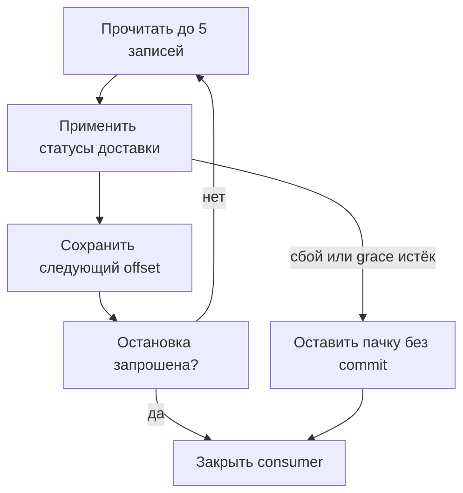

# Kafka в Python: отправка, обработка и остановка сервиса {#kafka-in-python-services}

<div class="bdr-post__hero" data-bdr-post="2026-10-02-kafka-in-python-services" role="img" aria-label="Статусы доставки: отправить, обработать, сделать commit и при остановке закончить текущую пачку" markdown="0"></div>

Сервис доставки публикует статусы посылок в Kafka, а сервис отслеживания читает их и показывает покупателю, где сейчас заказ. Самое хрупкое место здесь не отправка, а момент, когда consumer сообщает Kafka, что запись обработана.

Если consumer фиксирует offset раньше, чем обработчик закончил работу, после перезапуска эти записи будут пропущены. Consumer, остановленный посреди пачки, должен либо доделать её, либо не фиксировать вовсе, и тогда её заново прочитает следующий экземпляр.

Соберём оба сервиса на aiokafka-foundation-kit, уроним обработчик, остановим consumer посреди пачки и каждый раз проверим, откуда продолжит следующий экземпляр.

<!-- more -->

<div id="the-production-checklist-for-aiokafka" data-search-exclude></div>
<div id="the-producer" data-search-exclude></div>
<div id="the-consumer" data-search-exclude></div>
<div id="topics-and-health" data-search-exclude></div>
<div id="the-list-short" data-search-exclude></div>
<div id="the-pieces" data-search-exclude></div>

## Отправляем статус доставки {#producer}

Сначала договоримся о формате сообщения:

| Поле | Наш пример |
| --- | --- |
| Топик | `delivery.status`, создаётся до запуска сервиса |
| Ключ | ID доставки в байтах UTF-8: статусы одной доставки попадают в одну партицию и идут по порядку |
| Значение | JSON с `delivery_id`, `status` и растущим номером `revision` |
| Consumer group | `tracking`, общая для реплик сервиса отслеживания |

[aiokafka-foundation-kit](https://bedrock-python.github.io/aiokafka-foundation-kit/) даёт настройки, сериализацию JSON и управление жизненным циклом клиентов; модели настроек на Pydantic ставятся с extra `[models]`. Код взят из `kafka_flow.py` [практикума с клиентами](../lab/2026-09-07-aiokafka-checklist/README.md). Сервис доставки открывает один producer на всё время работы:

```python
from contextlib import asynccontextmanager

from aiokafka_foundation_kit import producer_lifecycle
from aiokafka_foundation_kit.contrib.models import BaseKafkaProducerSettings

TOPIC = "delivery.status"


@asynccontextmanager
async def delivery_producer(bootstrap):
    settings = BaseKafkaProducerSettings(
        bootstrap_servers=bootstrap,
        acks="all", enable_idempotence=True, compression_type="gzip",
    )
    async with producer_lifecycle(settings) as producer:
        yield producer
```

`acks="all"`, идемпотентность и gzip библиотека включает по умолчанию, здесь они записаны явно. `acks="all"` ждёт подтверждения от всех синхронных реплик (ISR), так что при `min.insync.replicas=1` хватает одного лидера.

```python
async def publish_status(producer, delivery_id, status, revision):
    return await producer.send_and_wait(
        TOPIC,
        value={"delivery_id": delivery_id, "status": status, "revision": revision},
        key=delivery_id.encode("utf-8"),
    )
```

`send_and_wait()` возвращает подтверждение брокера с партицией и offset; это не значит, что сервис отслеживания уже применил обновление. Идемпотентность закрывает только внутренние повторы producer ([гарантии producer в aiokafka](https://aiokafka.readthedocs.io/en/stable/producer.html#idempotent-produce)): если ваш код сам повторит `publish_status()` после таймаута, обновление может попасть в топик дважды. Чтобы сохранить данные вместе с сообщением, нужен [Outbox](2026-10-03-reliable-events-outbox-inbox-kafka.md).

## Обновляем витрину отслеживания, потом делаем commit {#consumer}

Обработчик хранит последний статус каждой доставки и пропускает повторные и устаревшие версии:

```python
class TrackingView:
    def __init__(self):
        self.deliveries = {}

    async def process(self, message):
        event = message.value
        delivery_id = event["delivery_id"]
        previous = self.deliveries.get(delivery_id)
        if previous is None or event["revision"] > previous["revision"]:
            self.deliveries[delivery_id] = event
```

Словарь нужен практикуму, чтобы было что проверить; настоящей витрине нужна надёжная база данных. Правило «оставить наибольший `revision`» подходит для полных снимков статуса. Если важен каждый переход (например, на каждый отправляется уведомление), наибольшего `revision` мало: событиям нужен номер без пропусков, а обработчик должен их замечать. Consumer делает commit вручную:

```python
from aiokafka_foundation_kit import consumer_lifecycle
from aiokafka_foundation_kit.contrib.models import BaseKafkaConsumerSettings


def tracking_settings(bootstrap, group="tracking"):
    return BaseKafkaConsumerSettings(
        bootstrap_servers=bootstrap, group_id=group,
        enable_auto_commit=False, auto_offset_reset="earliest",
        max_poll_records=5, max_poll_interval_ms=30_000,
    )
```

`earliest` срабатывает, только если у группы нет сохранённого offset; новый экземпляр продолжает с сохранённой позиции. Цикл получает уже запущенный consumer из `consumer_lifecycle`; как его открыть, показано в разделе про остановку:

```python
import asyncio


async def consume_batches(consumer, process, stop):
    while not stop.is_set():
        batches = await consumer.getmany(timeout_ms=500, max_records=5)
        async with asyncio.timeout(10):
            for partition, messages in batches.items():
                for message in messages:
                    await process(message)
                if messages:
                    await consumer.commit({partition: messages[-1].offset + 1})
```

Каждый опрос возвращает не больше пяти записей, а на обработку и commit пачки отведено десять секунд. Offset партиции фиксируется, когда все её записи обработаны: после записей 0–4 сохраняется offset 5, то есть следующий к чтению. Если обработка упала или не уложилась в лимит, цикл завершается, и offset за упавшей записью не фиксируется; партиции, обработанные раньше, прогресс сохраняют, а повторы отсекает проверка `revision`. Практикум проверяет одну партицию:

| Сценарий | Обработанные offset | Сохранённый offset | Новый экземпляр начинает с |
| --- | --- | --- | --- |
| Обработчик падает на третьей записи | 0, 1 | Нет | 0 |
| Все пять записей обработаны, commit вручную | 0-4 | 5 | 5 |
| Auto-commit после чтения пяти, обработаны две | 0, 1 | 5 | 5 |

Последняя строка показывает, почему auto-commit не подходит: он сдвигает точку восстановления за ещё не сделанную работу, и обычный перезапуск эти записи пропустит. После сбоя закройте consumer или верните его к сохранённому offset, прежде чем читать дальше: позиция в памяти уже за неудачной пачкой. Запись, которая падает всегда, будет останавливать партицию при каждом перезапуске, так что заранее решите, пропускать её или отправлять в dead-letter. Хуже всего с битым JSON: он падает внутри `getmany()`, обработчик его не видит, а `consumer_lifecycle()` в 0.1.3 не принимает свой десериализатор ([#50](https://github.com/bedrock-python/aiokafka-foundation-kit/issues/50)). Пока это не исправлено, создавайте consumer через `create_async_kafka_consumer(settings, topics, value_deserializer=...)` с десериализатором, который пропускает нераспознанные байты как есть, и отправляйте их в dead-letter из обработчика. Неудачный commit тоже должен останавливать цикл, а ребалансировка может забрать партицию, пока работа ещё идёт ([consumer group в aiokafka](https://aiokafka.readthedocs.io/en/stable/consumer.html#consumer-groups-and-topic-subscriptions)).

<div id="should-your-application-create-kafka-topics-on-startup" data-search-exclude></div>
<div id="what-the-broker-does-for-you" data-search-exclude></div>
<div id="what-the-application-does" data-search-exclude></div>
<div id="the-shape-is-decided-once-forever" data-search-exclude></div>
<div id="three-replicas-start-at-the-same-time" data-search-exclude></div>
<div id="a-shape-the-cluster-cannot-give-you" data-search-exclude></div>
<div id="so-should-it" data-search-exclude></div>

## Создаём топик до запуска сервиса {#topics}

Число партиций потом почти не изменить: их можно только добавить, и тогда ключи переедут в другие партиции, а порядок по ключу нарушится. Партиции, срок хранения и права задаёт команда-владелец, а не сервис, который стартовал первым; а сервису, который создаёт топики, к тому же нужны права на создание. Пусть `delivery.status` создаёт шаг развёртывания команды доставки:

```python
from aiokafka_foundation_kit import TopicConfig, ensure_topics_async


async def provision_delivery_topic(bootstrap, *, partitions=3, replicas=1):
    settings = BaseKafkaProducerSettings(bootstrap_servers=bootstrap)
    await ensure_topics_async([
        TopicConfig(
            name=TOPIC, num_partitions=partitions, replication_factor=replicas,
            topic_configs={"retention.ms": "604800000"},
        ),
    ], settings)
```

Одна реплика годится только для единственного брокера практикума. `ensure_topics_async()` создаёт отсутствующие топики и не приводит существующие к нужному виду, это видно в [практикуме с топиками](../lab/2026-09-07-topics-on-startup/README.md):

| Запрос | Результат |
| --- | --- |
| Три вызова одновременно просят один топик с тремя партициями | Все завершаются успешно; топик один, партиций три |
| Следующий вызов просит для него шесть партиций | У существующего топика по-прежнему три |
| Три реплики на одном брокере | `InvalidReplicationFactorError` |

Создание списка не атомарно: для `[valid_topic, invalid_topic, next_topic]` первый остаётся созданным, второй падает, а до третьего дело не доходит. Поэтому шаг развёртывания должен ещё проверять число партиций и настройки существующего топика и сообщать о частичном результате до запуска воркеров. С `producer_lifecycle(..., topics=[...])` топики создаются, только если передать ещё и `auto_create_topics=True`. Отдельно: на брокере в практикумах выключено `auto.create.topics.enable`, поэтому забытый шаг создания топика проявится ошибкой, а не тихо созданным топиком с настройками по умолчанию.

<div id="graceful-kafka-consumer-shutdown-in-kubernetes" data-search-exclude></div>
<div id="what-the-group-does-when-a-member-disappears" data-search-exclude></div>
<div id="measured-the-consumer-that-exits" data-search-exclude></div>
<div id="the-protocol" data-search-exclude></div>
<div id="the-numbers-to-set" data-search-exclude></div>

## Останавливаемся посреди пачки {#shutdown}

Во время выкатки старый экземпляр сервиса отслеживания прочитал пять записей и обработал две, когда сработало событие остановки. Если доделать оставшиеся три, он сохранит offset 5; если отменить работу, пачка останется для повторной обработки:

```python
async def run_tracking(bootstrap, process, stop, *, group="tracking", grace=5):
    async with consumer_lifecycle(
        tracking_settings(bootstrap, group), topics=(TOPIC,),
    ) as consumer:
        worker = asyncio.create_task(consume_batches(consumer, process, stop))
        stopping = asyncio.create_task(stop.wait())
        try:
            await asyncio.wait({worker, stopping}, return_when=asyncio.FIRST_COMPLETED)
            async with asyncio.timeout(grace):
                await worker
        finally:
            worker.cancel()
            stopping.cancel()
            await asyncio.gather(worker, stopping, return_exceptions=True)
```

`consume_batches()` проверяет `stop` перед следующим опросом, поэтому если остановку запросили во время обработки, цикл доделает текущую пачку и новых записей не возьмёт. Когда остановка запрошена, `grace` даёт этой пачке пять секунд, это меньше десятисекундного лимита на пачку, поэтому первым срабатывает `grace`; тогда работа отменяется, offset недоделанной партиции не фиксируется, и consumer закрывается. В сервисе на servicewright из практикума `DaemonEntrypoint` передаёт событие остановки в `run_tracking()`, а servicewright переходит к своей фазе остановки, только когда функция вернёт управление, поэтому `drain_grace_seconds` это ожидание не ограничивает ([servicewright #88](https://github.com/bedrock-python/servicewright/issues/88)): ограничивает только `grace`. Когда `grace` истекает, `run_tracking()` выбрасывает `TimeoutError`, и сервис завершается с ошибкой. При десяти записях в одной партиции и `grace` 0,05 секунды для случая с истечением времени:

| Сценарий | Обработанные offset | Сохранённый offset | Новый экземпляр начинает с |
| --- | --- | --- | --- |
| Отмена после двух записей | 0, 1 | Нет | 0 |
| Пачка доделана | 0-4 | 5 | 5 |
| Время `grace` истекло | 0, 1 | Нет | 0 |

<!-- diagram:concept -->
<figure class="bdr-diagram" markdown="1">
<figcaption><span class="bdr-diagram__eyebrow">ИДЕЯ В СХЕМЕ</span><strong>Сначала закончить принятую пачку, потом остановиться</strong></figcaption>
<div class="bdr-diagram__viewport" markdown="1" data-search-exclude>



</div>
<p class="bdr-diagram__caption">После обработки пачки фиксируется следующий offset. Сбой или истёкший grace оставляют пачку без commit для повторной обработки, и consumer закрывается.</p>
</figure>
<!-- /diagram:concept -->

Проверки построены на событии остановки, настоящем брокере и новых экземплярах consumer; выкатку в Kubernetes они не воспроизводят. Порядок остановки при развёртывании разобран в [статье о жизненном цикле сервиса](2026-09-20-python-service-lifecycle.md).

## Фиксируем только сделанную работу {#conclusion}

Фиксируйте только завершённую работу, а при сбое выходите из цикла. Следите за отставанием по сохранённому offset (конец лога минус сохранённый offset), а не только по позиции чтения: в практикуме consumer, который прочитал пять записей при сохранённом offset 0, показывает отставание позиции 0 и отставание по commit 5. [aiokafka-foundation-kit](https://bedrock-python.github.io/aiokafka-foundation-kit/) берёт на себя настройки, JSON-клиентов и жизненный цикл; контракт топика, надёжное сохранение результата, решение о commit и политика для записей, которые всегда падают, остаются в вашем приложении.

## Примеры и практикумы {#labs}

Проверено на Python 3.13, aiokafka-foundation-kit 0.1.3, aiokafka 0.14.0 и servicewright 0.13.1 с `confluentinc/cp-kafka:7.6.0` в режиме KRaft.

- [Практикум: JSON, commit и повторная доставка](../lab/2026-09-07-aiokafka-checklist/README.md)
- [Практикум: создание топиков и одновременный запуск](../lab/2026-09-07-topics-on-startup/README.md)
- [Практикум: consumer доделывает пачку и не укладывается в бюджет остановки](../lab/2026-09-07-kafka-consumer-shutdown/README.md)
