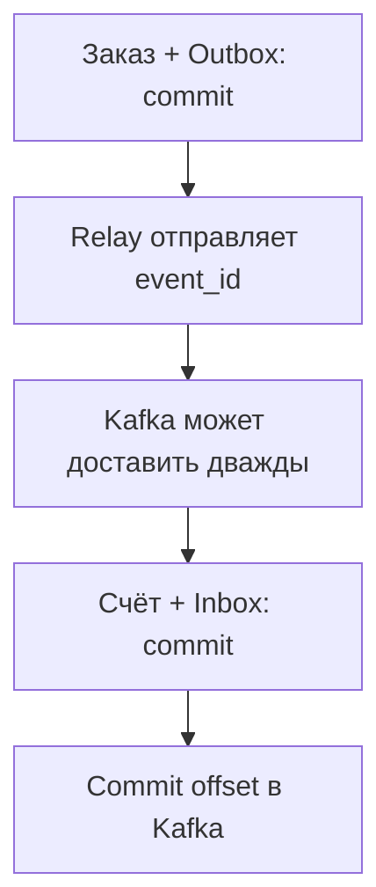

# Надёжная доставка событий: Outbox, Inbox и сбои Kafka {#reliable-events-outbox-inbox-kafka}

<div class="bdr-post__hero" data-bdr-post="2026-10-03-reliable-events-outbox-inbox-kafka" role="img" aria-label="Заказ и событие фиксируются вместе; биллинг справляется с повторной доставкой" markdown="0"></div>

Представьте: покупатель оформляет заказ. Сервис заказов сохраняет его в PostgreSQL и публикует событие в Kafka. Биллинг читает это событие и выставляет счёт.

Но заказ пишется в базу, а событие в Kafka, и одной транзакцией эти две записи не связать. Между ними остаётся окно. Упадёт сервис заказов после commit, но до отправки, и `order.created` потеряется: счёта не будет. Упадёт биллинг после commit счёта, но до commit offset, и после перезапуска он прочитает то же событие и выставит второй счёт.

От обоих сбоев защищают таблицы Outbox и Inbox в той же базе PostgreSQL. Соберём сервисы на omni-box, уроним их на каждой границе между commit, отключим брокер и посмотрим, что останется в PostgreSQL и Kafka.

<!-- more -->

<div id="the-transactional-outbox-pattern-in-python-omni-box" data-search-exclude></div>
<div id="the-dual-write-problem" data-search-exclude></div>
<div id="the-outbox-pattern" data-search-exclude></div>
<div id="using-omni-box" data-search-exclude></div>
<div id="the-inbox-side" data-search-exclude></div>
<div id="why-a-library" data-search-exclude></div>

## Заказ есть, а события нет {#outbox}

Вызов `producer.send_and_wait()` после commit оставляет это окно, а отправка до commit его только сдвигает, это видно в [практикуме с доставкой](../lab/2026-09-07-exactly-once-effects/README.md):

| Порядок и сбой | Заказов в PostgreSQL | Записей в Kafka |
| --- | --- | --- |
| Commit заказа; сбой до отправки | 1 | 0 |
| Отправка события; откат транзакции заказа | 0 | 1 |

Перестановкой двух независимых commit атомарности не добиться, а транзакция Kafka не может охватить транзакцию PostgreSQL ([семантика доставки Kafka](https://kafka.apache.org/41/design/design/#message-delivery-semantics)). Вместо этого сохраним заказ и строку с описанием события, строку Outbox, **в одной транзакции PostgreSQL**. [omni-box](https://bedrock-python.github.io/omni-box/) даёт модели событий, репозитории и компоненты доставки, а управление commit остаётся у приложения. `models.py` практикума описывает таблицы; `session_factory` здесь `async_sessionmaker` из SQLAlchemy:

```python
from uuid import UUID

from sqlalchemy.ext.asyncio import AsyncSession, async_sessionmaker

from omni_box import OmniBoxDomainService
from omni_box.infra.storage.postgres import PostgresOutboxRepository

from models import Order, OutboxEventDB


async def record_order(session: AsyncSession, order_id: UUID) -> UUID:
    session.add(Order(id=order_id))
    event = OmniBoxDomainService().create_outbox_event(
        aggregate_type="order",
        aggregate_id=order_id,
        event_type="order.created",
        topic="orders.created",
        partition_key=str(order_id),
        payload={"order_id": str(order_id)},
    )
    repo = PostgresOutboxRepository(session, model_class=OutboxEventDB)
    await repo.create(event)
    return event.id


async def place_order(session_factory: async_sessionmaker, order_id: UUID) -> UUID:
    async with session_factory.begin() as session:
        return await record_order(session, order_id)
```

`record_order()` добавляет обе строки без commit, а транзакцию открывает и фиксирует `place_order()`, так что сохраняются либо обе строки, либо ни одной. Когда функция вернула управление, заказ принят, а доставка ждёт своей очереди; обработчик запроса к Kafka вообще не обращается.

### Отправляем сохранённые события {#relay}

Отдельный воркер, **relay**, читает Outbox и отправляет события через идемпотентный `AIOKafkaProducer`, обёрнутый в `KafkaEventPublisher` из omni-box. С `EnvelopeEventConverter` из той же библиотеки он заворачивает данные в конверт и кладёт ID строки в заголовок `event_id`; при повторных попытках ID не меняется:

```python
from omni_box import OutboxPublisher
from omni_box.infra.brokers.kafka import KafkaEventPublisher


async def relay_batch(session: AsyncSession, broker: KafkaEventPublisher):
    repo = PostgresOutboxRepository(session, model_class=OutboxEventDB)
    return await OutboxPublisher(repo, broker, publish_timeout=2).publish_batch(
        worker_id="relay-1", batch_size=20,
    )


async def relay_once(session_factory: async_sessionmaker, broker: KafkaEventPublisher):
    async with session_factory.begin() as session:
        return await relay_batch(session, broker)
```

В omni-box 0.3.0 репозиторий PostgreSQL забирает ожидающие строки через `FOR UPDATE SKIP LOCKED`, а внешняя транзакция держит соединение и блокировки строк, пока пачка отправляется. Лимит в две секунды относится к каждой отправке, а не к пачке. Запускайте следующий цикл сразу только после полной пачки, в которой что-то отправилось (`processed_event_ids` не пуст); в остальных случаях делайте паузу. В 0.3.0 засчитанная ошибка повторяется без задержки ([#61](https://github.com/bedrock-python/omni-box/issues/61)), и без паузы одна плохая строка израсходует шесть попыток за миллисекунды.

Теперь прервём relay после подтверждения от Kafka, но до commit в PostgreSQL. Отметка о завершении откатывается, и следующий цикл отправляет строку ещё раз: в практикуме в Kafka оказываются две записи с одним `event_id`. Идемпотентность producer защищает от его собственных повторов, а не от двух отправок одной строки, так что повтор должен распознать биллинг.

<!-- diagram:concept -->
<figure class="bdr-diagram" markdown="1">
<figcaption><span class="bdr-diagram__eyebrow">ИДЕЯ В СХЕМЕ</span><strong>От заказа к одному счёту</strong></figcaption>
<div class="bdr-diagram__viewport" markdown="1" data-search-exclude>



</div>
<p class="bdr-diagram__caption">Заказ и событие фиксируются вместе. Счёт и запись Inbox фиксируются вместе. Доставка Kafka между ними может повториться.</p>
</figure>
<!-- /diagram:concept -->

<div id="transactional-inbox-the-other-half-of-the-outbox-pattern" data-search-exclude></div>
<div id="the-consumers-two-problems" data-search-exclude></div>
<div id="the-inbox-row" data-search-exclude></div>
<div id="measured-the-handler-fails-halfway" data-search-exclude></div>
<div id="what-the-inbox-does-not-do" data-search-exclude></div>
<div id="the-pair" data-search-exclude></div>

## Две доставки и один счёт {#inbox}

Биллинг сохраняет рядом со счётом строку **Inbox**, то есть запись о том, какое событие этот consumer уже обработал. Обе записи идут через одну сессию и одну транзакцию:

```python
from contextlib import asynccontextmanager

from omni_box.infra.storage.postgres import PostgresInboxRepository

from models import InboxEventDB


class InboxTransaction:
    def __init__(self, session_factory: async_sessionmaker):
        self.session_factory = session_factory

    @asynccontextmanager
    async def transaction(self):
        async with self.session_factory.begin() as session:
            yield PostgresInboxRepository(session, model_class=InboxEventDB)
```

```python
from sqlalchemy import insert

from omni_box import InboxEvent

from models import Invoice


async def create_invoice(event: InboxEvent, repo: PostgresInboxRepository):
    await repo.session.execute(
        insert(Invoice).values(order_id=UUID(str(event.payload["order_id"])))
    )
```

В практикуме у `Invoice.order_id` нет уникального ограничения, чтобы вторая вставка была видна; в боевом коде правило «один счёт на заказ» стоит закрепить отдельным ограничением. Биллинг читает `orders.created` с выключенным автоматическим commit, а выбранная стратегия фиксирует offset только после успешной транзакции Inbox:

```python
from aiokafka import AIOKafkaConsumer

from omni_box import AckStrategy, InboxConsumerRunner
from omni_box.infra.brokers.kafka import KafkaEventConsumer


def billing_runner(session_factory, bootstrap, *, topic="orders.created",
                   group="billing", handler=create_invoice):
    consumer = AIOKafkaConsumer(
        topic, bootstrap_servers=bootstrap, group_id=group,
        auto_offset_reset="earliest", enable_auto_commit=False,
    )
    return InboxConsumerRunner(
        consumer=KafkaEventConsumer(consumer),
        transaction_provider=InboxTransaction(session_factory),
        handler=handler,
        worker_id="billing-1", consumer_group=group,
        ack_strategy=AckStrategy.EXACTLY_ONCE_INBOX,
    )
```

Получив две записи от прерванного relay, runner при первой доставке создаёт счёт и делает commit, вторую узнаёт как дубль и только фиксирует её offset: счёт один. Ключ Inbox состоит из `(message_id, consumer_group)`, где `consumer_group` задаётся аргументом omni-box и не совпадает с `group_id` в Kafka. `message_id` берётся из заголовка `event_id`, если producer не задал свой заголовок `message_id`; в этом случае и он не должен меняться между повторами.

### Обработчик упал: что делать воркеру? {#consumer-restart}

Если `create_invoice()` падает после своего `INSERT`, транзакция откатывает и счёт, и строку Inbox. `process_one()` возвращает `committed=False`, если обработчик упал или не уложился в таймаут, а также если транзакция Inbox сорвалась уже после вставки строки; исключение он выбрасывает, если запись не удалось прочитать или разобрать, если не удалась вставка в Inbox или commit offset. В любом случае воркер должен остановиться сам:

```python
async def run_billing(runner: InboxConsumerRunner):
    try:
        await runner.start()
        while True:
            result = await runner.process_one()
            if not result.committed:
                raise RuntimeError(f"Retry message {result.message_id}")
    finally:
        await runner.stop()
```

Не используйте здесь `runner.run_forever()`: в omni-box 0.3.0 он продолжает работу после `committed=False`. Позиция в Kafka сдвигается при чтении записи, так что если запись с offset 0 не обработалась, а воркер пошёл дальше, то после записи с offset 1 зафиксируется offset 2, а перезапущенная группа продолжит с 2 и никогда не повторит 0. Запускайте его под супервизором, который перезапускает его с нарастающей паузой и той же группой, а для события, которое падает снова и снова, заведите явную процедуру исправления или dead-letter. Сообщайте об ошибке исключением. В omni-box 0.3.0 возврат `handler_retry(...)` фиксирует записи обработчика и оставляет строку Inbox заблокированной, поэтому `run_billing()` будет останавливаться на этой записи после каждого перезапуска ([#59](https://github.com/bedrock-python/omni-box/issues/59)).

Остаётся ещё одно окно, его тоже проверяет [практикум с Inbox](../lab/2026-09-07-transactional-inbox/README.md): PostgreSQL уже зафиксировал счёт, а commit offset не удался. После перезапуска runner снова получает ту же запись, находит завершённую строку Inbox, пропускает обработчик и фиксирует offset.

<div id="exactly-once-is-a-lie-exactly-once-effects-are-not" data-search-exclude></div>
<div id="messages-versus-effects" data-search-exclude></div>
<div id="every-window-measured" data-search-exclude></div>
<div id="the-outbox-closes-the-producer-side" data-search-exclude></div>
<div id="the-inbox-closes-the-consumer-side" data-search-exclude></div>
<div id="the-http-edge" data-search-exclude></div>
<div id="the-whole-path" data-search-exclude></div>
<div id="why-the-library-must-not-own-the-transaction" data-search-exclude></div>
<div id="what-it-looks-like" data-search-exclude></div>

## Где кончается эта защита {#boundaries}

В том же практикуме мы меняем по одному условию:

| Изменение | Результат |
| --- | --- |
| Две копии без `event_id` и `message_id` | Каждая запись получает ключ `topic:partition:offset`; создаются два счёта |
| Событие читает другая группа (и в Kafka, и в `consumer_group` omni-box) | Это другой получатель Inbox; обработчик выполняется снова |
| Удалить завершённую строку Inbox и повторить событие | Прежний результат забыт; обработчик выполняется снова |

Сохраняйте ID события на всём пути, держите `consumer_group` в omni-box постоянным для одного логического обработчика и храните строки Inbox не меньше, чем срок хранения топика плюс худшее отставание. `delete_old_completed(retention_days)` за один вызов удаляет не больше `batch_size` старых завершённых строк, так что вызывайте его, пока он не вернёт 0.

Порядок тоже не гарантирован. `partition_key=order_id` отправляет события одного заказа в одну партицию, но даже один relay может отправить более позднее событие раньше: отложенная или упавшая строка не задерживает те, что идут за ней. Если биллинг должен применить `created` раньше `cancelled`, передавайте версию заказа и решите, что делать с пропусками и устаревшими версиями.

Последняя граница проходит по внешним действиям: письмо, уже отправленное из транзакции, откат не вернёт. Сохраняйте задачу на отправку уведомления в той же транзакции, а внешнему вызову дайте собственный [контракт идемпотентности](2026-09-14-idempotency-in-apis-and-background-jobs.md).

<div id="what-happens-when-kafka-is-down-for-an-hour" data-search-exclude></div>
<div id="publishing-from-the-request-path" data-search-exclude></div>
<div id="the-outbox-during-the-outage" data-search-exclude></div>
<div id="what-an-hour-actually-costs-you" data-search-exclude></div>
<div id="what-it-does-not-solve" data-search-exclude></div>
<div id="the-pieces" data-search-exclude></div>

## Kafka недоступна, а заказы продолжают поступать {#outage}

Поставим брокер на паузу и оформим три заказа: сервис заказов сохраняет их вместе со строками Outbox. В [практикуме со сбоем](../lab/2026-09-07-when-kafka-is-down/README.md) relay трижды проходит цикл при остановленном брокере; незавершённые строки, сгруппированные по статусу, выглядят так:

```text
status  | events | attempts
pending | 3      | 0
```

В omni-box 0.3.0 таймаут отправки или `TransientError` откладывают работу, не тратя попытку. Любая другая ошибка считается попыткой; после шести попыток строка получает статус `failed` и остаётся в нём, пока её не вернут в очередь. Когда Kafka возвращается, все три события доходят до брокера, и ожидающих строк не остаётся. Отправка, прерванная по таймауту, всё равно может дойти, поэтому практикум проверяет доставленные ID событий, а не число записей.

Для долгого сбоя цифры лучше прикинуть заранее. При 100 событиях в секунду за час накопится 360 000 событий. Если relay выдерживает 300 в секунду (это нужно измерить), разбор такого хвоста при 100 новых событиях в секунду займёт около 30 минут. Следите за числом ожидающих событий, возрастом самого старого из них и строками `failed`.

## Outbox и Inbox вместе {#conclusion}

**Outbox сохраняет событие вместе с заказом, а Inbox сохраняет отметку об обработке события вместе со счётом.** При повторах ID события не меняется, а offset фиксируется только после commit в базе, поэтому доставка продолжается после любого из этих сбоев, а счёт на заказ остаётся один. [omni-box](https://bedrock-python.github.io/omni-box/) даёт репозитории, `OutboxPublisher` и `InboxConsumerRunner`; циклы relay и воркера, границы транзакций, срок хранения и политику для событий, которые падают снова и снова, решать вам.

## Примеры и практикумы {#labs}

Проверено на Python 3.13, omni-box 0.3.0, aiokafka 0.14.0, SQLAlchemy 2.0.54 и asyncpg 0.31.0 с `postgres:17-alpine` и `confluentinc/cp-kafka:7.6.0` в режиме KRaft.

- [Практикум: заказ, событие и повторная доставка](../lab/2026-09-07-exactly-once-effects/README.md)
- [Практикум: сбой обработчика и границы Inbox](../lab/2026-09-07-transactional-inbox/README.md)
- [Практикум: недоступный брокер и разбор накопившихся событий](../lab/2026-09-07-when-kafka-is-down/README.md)
