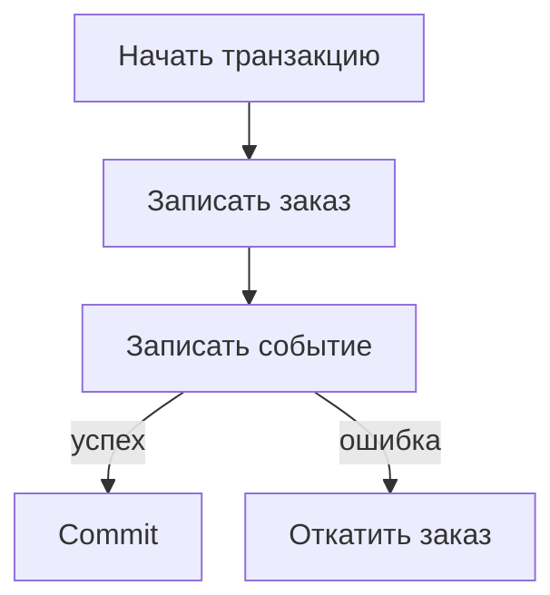

# Сессии и транзакции в SQLAlchemy: кто отвечает за commit {#sqlalchemy-sessions-and-transactions}

<div class="bdr-post__hero" data-bdr-post="2026-10-08-sqlalchemy-sessions-and-transactions" role="img" aria-label="Транзакцию открывает и фиксирует сам сценарий, один commit в конце" markdown="0"></div>

Представьте сервис заказов интернет-магазина. Покупатель оформляет заказ, сервис сохраняет его и пишет событие `created`, по которому о заказе узнают склад и доставка.

Так часто и пишут: репозиторий заказов делает commit, чтобы получить `id`, а репозиторий событий фиксирует свою запись отдельно. Однажды вставка события падает. Заказ уже в базе, покупатель видит его в личном кабинете, а склад о нём так и не узнает. Общая `AsyncSession` здесь не поможет. Поможет одна транзакция на всю бизнес-операцию, и commit в ней делает сама операция, а не репозитории.

Воспроизведём сбой на PostgreSQL, исправим его и добавим расчёт доставки, подписку на рассылку и чтение заказа с запретом записи. Проверено на Python 3.13, SQLAlchemy 2.0.54, asyncpg 0.31.0, sqlalchemy-foundation-kit 0.4.0 и PostgreSQL 17.11.

<!-- more -->

<div id="stop-passing-asyncsession-everywhere" data-search-exclude></div>
<div id="what-the-parameter-is-hiding" data-search-exclude></div>
<div id="what-the-same-session-is-worth" data-search-exclude></div>
<div id="what-it-costs-the-pool" data-search-exclude></div>
<div id="one-session-one-task" data-search-exclude></div>
<div id="what-leaves-the-block" data-search-exclude></div>
<div id="what-it-looks-like-when-the-session-has-an-owner" data-search-exclude></div>
<div id="the-pieces" data-search-exclude></div>

## Один engine на процесс, одна сессия на операцию {#ownership}

`Order` хранится в `orders`, `OrderEvent` хранится в `order_events` с внешним ключом на заказ и `CHECK (kind <> '')`, так что событие с пустым `kind` PostgreSQL отклонит, на этом и воспроизведём сбой. Событие хранится строкой в той же базе; как доставить его в брокер, разобрано в [статье про outbox](2026-10-03-reliable-events-outbox-inbox-kafka.md). При запуске создаём engine и фабрику сессий:

```python
from sqlalchemy.ext.asyncio import async_sessionmaker, create_async_engine


def open_database(url):
    engine = create_async_engine(
        url, pool_size=2, max_overflow=0, pool_timeout=0.5,
    )
    session_factory = async_sessionmaker(engine, expire_on_commit=False)
    return engine, session_factory
```

`open_database(url)` вызывается один раз, а `await engine.dispose()` при остановке. Крошечный пул (два соединения, `pool_timeout` 0,5 с) нужен только для эксперимента с нехваткой соединений ниже; в production его не переносите. `expire_on_commit=False` оставляет загруженные атрибуты доступными после commit: по умолчанию commit помечает их устаревшими, и чтение `order.id` потребовало бы запроса к базе, а неявно `AsyncSession` его сделать не может. Каждая операция открывает свою сессию: сессия отслеживает объекты и берёт соединение только на первом SQL-запросе, а какие записи фиксируются вместе, решает транзакция.

<div id="the-unit-of-work-pattern-in-sqlalchemy-2" data-search-exclude></div>
<div id="before-repositories-that-commit" data-search-exclude></div>
<div id="after-the-use-case-owns-the-boundary" data-search-exclude></div>
<div id="read-only-means-read-only" data-search-exclude></div>
<div id="savepoints-one-failed-step-not-one-failed-transaction" data-search-exclude></div>
<div id="the-use-case-under-test" data-search-exclude></div>
<div id="who-owns-the-transaction" data-search-exclude></div>

## Два commit: заказ есть, события нет {#partial-commit}

Если убрать из примера с вступления обёртки репозиториев, остаётся такая последовательность:

```python
from models import Order, OrderEvent


async def place_order_broken(session_factory, sku, *, event_kind="created"):
    async with session_factory() as session:
        order = Order(sku=sku, delivery_cents=0)
        session.add(order)
        await session.commit()

        session.add(OrderEvent(order_id=order.id, kind=event_kind))
        await session.commit()
        return {"order_id": order.id}
```

При `event_kind=""` заказ сохраняется, а затем PostgreSQL отклоняет событие, и вылетает `IntegrityError`. Одна сессия выполнила две транзакции, и откат второй не отменяет первую. Счётчики, прочитанные через другую сессию:

```text
two commits + rejected event: orders=1, events=0
```

## Фиксируем заказ и событие в одной транзакции {#transaction}

Решение о commit переносим на уровень всей операции, и для этого хватает `session_factory.begin()` из SQLAlchemy:

```python
async def place_order_native(session_factory, sku, *, event_kind="created"):
    async with session_factory.begin() as session:
        order = Order(sku=sku, delivery_cents=0)
        session.add(order)
        await session.flush()
        session.add(OrderEvent(order_id=order.id, kind=event_kind))
        result = {"order_id": order.id}
    return result
```

`flush()` отправляет `INSERT` заказа, и заказ получает `id`, а транзакция остаётся открытой. При выходе из блока SQLAlchemy делает commit или, если событие нарушает ограничение, откатывает обе строки. Тот же сбой теперь оставляет `orders=0, events=0`. Между `flush()` и commit другая сессия заказа не видит: ID у заказа уже есть, но сам заказ ещё не зафиксирован.

<!-- diagram:concept -->
<figure class="bdr-diagram" markdown="1">
<figcaption><span class="bdr-diagram__eyebrow">ИДЕЯ В СХЕМЕ</span><strong>Заказ и событие в одной транзакции</strong></figcaption>
<div class="bdr-diagram__viewport" markdown="1" data-search-exclude>



</div>
<p class="bdr-diagram__caption">Если запись события не удалась, заказ откатывается. Успешная транзакция сохраняет обе строки вместе.</p>
</figure>
<!-- /diagram:concept -->

## Собираем репозитории в Unit of Work {#unit-of-work}

Commit делает бизнес-операция, а репозитории только добавляют объекты и вызывают flush. В [sqlalchemy-foundation-kit](https://bedrock-python.github.io/sqlalchemy-foundation-kit/) это правило реализует `AsyncSQLAlchemyUnitOfWork`. Для одной функции `session_factory.begin()` справляется не хуже. Выигрыш в другом: бизнес-код получает `uow`, а не фабрику сессий. Репозитории доступны только внутри `transaction()` или `query()`, а точки сохранения и уровень изоляции везде задаются одинаково.

```python
class OrderRepository:
    def __init__(self, session):
        self.session = session

    async def add(self, sku, delivery_cents=0):
        order = Order(sku=sku, delivery_cents=delivery_cents)
        self.session.add(order)
        await self.session.flush()
        return order


class EventRepository:
    def __init__(self, session):
        self.session = session

    async def add(self, order_id, kind="created"):
        self.session.add(OrderEvent(order_id=order_id, kind=kind))
        await self.session.flush()
```

```python
from sqlalchemy_foundation_kit import (
    AsyncSQLAlchemyUnitOfWork,
    AsyncSQLAlchemyUowTransaction,
)


class OrderTransaction(AsyncSQLAlchemyUowTransaction):
    @property
    def orders(self):
        return OrderRepository(self.session)

    @property
    def events(self):
        return EventRepository(self.session)


def make_uow(session_factory):
    return AsyncSQLAlchemyUnitOfWork(
        session_factory, transaction_factory=OrderTransaction,
    )


async def place_order(uow, sku, *, delivery_cents=0, event_kind="created"):
    async with uow.transaction() as tx:
        order = await tx.orders.add(sku, delivery_cents)
        await tx.events.add(order.id, event_kind)
        result = {"order_id": order.id}
    return result
```

Каждый вызов `uow.transaction()` открывает свою сессию: обычный выход фиксирует изменения, исключение их откатывает. `uow` хранит только фабрику сессий, поэтому один `uow` можно отдать нескольким параллельным задачам, а одну `AsyncSession` нельзя ([документация SQLAlchemy](https://docs.sqlalchemy.org/en/20/orm/extensions/asyncio.html#using-asyncsession-with-concurrent-tasks)). Если один из параллельных заказов упал, уже зафиксированные останутся в базе, а те, что ещё выполнялись, `TaskGroup` отменит, и они откатятся. Пачке, которая должна сохраниться целиком или никак, нужна одна транзакция.

## Получаем расчёт доставки до начала транзакции {#lifetime}

Стоимость доставки считает внешний сервис; спрашиваем его до начала транзакции:

```python
async def place_order_after_quote(uow, quote_shipping, sku):
    delivery_cents = await quote_shipping(sku)
    return await place_order(uow, sku, delivery_cents=delivery_cents)
```

Если ждать расчёт внутри транзакции, соединение занято всё время ожидания: в [практикуме с сессиями](../lab/2026-09-07-stop-passing-asyncsession-everywhere/README.md) два таких запроса забирают весь пул, а третий падает по таймауту (на метриках пула это видно в [статье про PgBouncer](2026-10-09-sqlalchemy-pgbouncer-pools.md#held-connection)). Если получить расчёт заранее, соединение на время ожидания не занято, но сам расчёт к моменту commit может устареть: если у него есть срок действия, проверьте его уже внутри транзакции.

## Точка сохранения: заказ проходит, даже если подписка уже есть {#savepoints}

При оформлении заказа покупатель ещё и подписывается на рассылку. Адрес служит первичным ключом `newsletter_subscriptions`, и если он уже есть, заказ всё равно должен пройти. Оборачиваем в точку сохранения только необязательную вставку:

```python
from sqlalchemy.exc import IntegrityError

from models import NewsletterSubscription


async def place_order_with_subscription(uow, sku, email):
    async with uow.transaction() as tx:
        order = await tx.orders.add(sku)
        await tx.events.add(order.id)
        try:
            async with tx.savepoint():
                tx.session.add(NewsletterSubscription(email=email))
                await tx.session.flush()
        except IntegrityError as error:
            if error.orig.sqlstate != "23505":
                raise
        result = {"order_id": order.id}
    return result
```

Других уникальных ключей в таблице нет, поэтому `23505` означает только, что адрес уже есть; остальные ошибки пробрасываются и откатывают всё. После выхода из точки сохранения внешней транзакцией снова можно пользоваться: в практикуме оформляем два заказа с одним адресом, и оба сохраняются, а подписка остаётся одна. Обязательные записи держите вне точки сохранения и уже сброшенными в базу: `begin_nested()` перед SAVEPOINT делает flush всего накопленного, и ошибка обязательной записи вылетела бы внутри `try`, написанного для подписки. Здесь репозитории уже сделали flush ([документация о SAVEPOINT](https://docs.sqlalchemy.org/en/20/orm/session_transaction.html#using-savepoint)). Для одной вставки проще `insert(...).on_conflict_do_nothing()` из `sqlalchemy.dialects.postgresql`; точка сохранения окупается, когда необязательный шаг состоит из нескольких запросов или чужого кода.

## Читаем заказ и явно запрещаем запись {#read-only}

`uow.query()` закрывает сессию без commit. В версии 0.4.0 он не запрещает запись, а сессия с первым же запросом неявно открывает транзакцию и держит соединение до конца блока ([#56](https://github.com/bedrock-python/sqlalchemy-foundation-kit/issues/56)). Чтобы запись отклонял сам PostgreSQL, выполните `SET TRANSACTION READ ONLY` до любой записи:

```python
from sqlalchemy import text


async def read_order(uow, order_id):
    async with uow.query() as tx:
        await tx.session.execute(text("SET TRANSACTION READ ONLY"))
        order = await tx.session.get(Order, order_id)
        if order is None:
            raise LookupError(order_id)
        return {
            "order_id": order.id,
            "sku": order.sku,
            "delivery_cents": order.delivery_cents,
        }
```

В практикуме запись в обычном блоке `query()` без commit пропадает, но вызвать commit явно ничто не мешает. После [`SET TRANSACTION READ ONLY`](https://www.postgresql.org/docs/17/sql-set-transaction.html) PostgreSQL отклоняет `INSERT` с кодом `25006`. Функция возвращает готовый словарь, пока сессия открыта, поэтому при сериализации ответа к базе обращаться уже не придётся.

## Что взять в свой сервис {#conclusion}

Commit делает бизнес-операция, а не репозитории. Обращайтесь к внешним сервисам до начала транзакции, давайте параллельным задачам отдельные сессии, используйте точку сохранения только для необязательной части и пусть запрет записи обеспечивает PostgreSQL. Если потерялся ответ на сам `COMMIT`, исход неизвестен, и для безопасного повтора операции нужна [идемпотентность](2026-09-14-idempotency-in-apis-and-background-jobs.md). [sqlalchemy-foundation-kit](https://bedrock-python.github.io/sqlalchemy-foundation-kit/) оформляет commit и откат как `transaction()`, а точки сохранения как `savepoint()`; `query()` же только закрывает сессию без commit.

## Примеры и практикумы {#labs}

- [Commit, откат, точка сохранения и READ ONLY в PostgreSQL](../lab/2026-09-07-unit-of-work-sqlalchemy-2/README.md)
- [Ожидание внешнего API, пул соединений и параллельные задачи](../lab/2026-09-07-stop-passing-asyncsession-everywhere/README.md)
