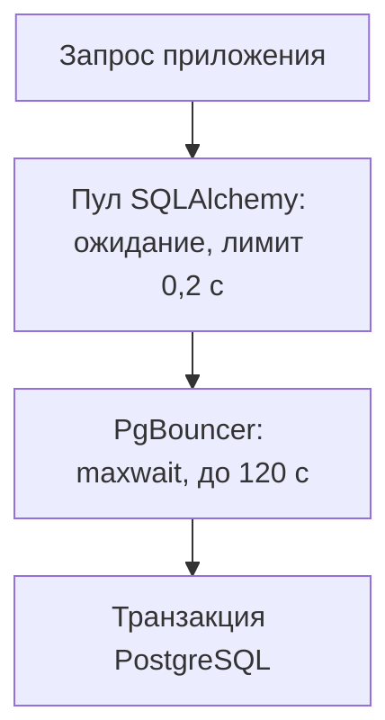

# SQLAlchemy и PgBouncer: настройка и диагностика пула соединений {#sqlalchemy-pgbouncer-pools}

<div class="bdr-post__hero" data-bdr-post="2026-10-09-sqlalchemy-pgbouncer-pools" role="img" aria-label="В транзакционном режиме PgBouncer выдаёт соединение заново на каждую транзакцию, и состояние сессии этого не переживает" markdown="0"></div>

Когда сервисов и подов становится много, соединений с PostgreSQL перестаёт хватать, и перед базой ставят PgBouncer. Код приложения при этом обычно не трогают, хотя с базой он теперь работает иначе.

Через PgBouncer в транзакционном режиме закешированные prepared statements могут сломаться, а параметры подключения могут отклоняться или теряться. Медленный запрос при этом может ждать не в пуле SQLAlchemy, а в очереди самого PgBouncer.

Воспроизведём каждый случай на сервисе заказов, который читает заказ 42 и запрашивает у сервиса доставки расчёт, а пул приложения и его метрики настроим через `sqlalchemy-foundation-kit`.

<!-- more -->

<div id="pgbouncer-transaction-mode-and-async-sqlalchemy-the-production-setup-nobody-documents-enough" data-search-exclude></div>
<div id="what-transaction-mode-takes-away" data-search-exclude></div>
<div id="the-prepared-statement-error-and-when-it-stopped-happening" data-search-exclude></div>
<div id="the-setting-that-actually-breaks-the-connection" data-search-exclude></div>
<div id="pool-sizing-when-there-is-a-pool-in-front-of-your-pool" data-search-exclude></div>
<div id="what-to-monitor" data-search-exclude></div>
<div id="closing-pools-during-a-rollout" data-search-exclude></div>
<div id="the-configuration" data-search-exclude></div>

## Читаем заказ через PgBouncer {#pooling}

PgBouncer в практикуме работает в транзакционном режиме:

```ini
[pgbouncer]
pool_mode = transaction
default_pool_size = 2
max_client_conn = 50
max_prepared_statements = 200
```

После каждого commit или rollback PgBouncer возвращает соединение с PostgreSQL в свой пул, и следующая транзакция клиента может выполниться уже на другом. Состояние сессии за клиентом не переходит. Хуже того, если выполнить обычный `SET` для параметра, который PgBouncer не отслеживает (например, `search_path` или `statement_timeout`), значение останется на серверном соединении и достанется следующему клиенту. Что работает в этом режиме, перечислено в [таблице возможностей](https://www.pgbouncer.org/features.html). Библиотеке передаём хост и порт PgBouncer, а не PostgreSQL:

```python
from pydantic import SecretStr
from sqlalchemy_foundation_kit import create_async_session_manager
from sqlalchemy_foundation_kit.contrib.settings import (
    BasePostgresConfig, ConnectionSettings, PoolSettings, QuerySettings,
)


def database_config(host, port, user, password, database):
    return BasePostgresConfig(
        connection=ConnectionSettings(
            host=host, port=port, user=user,
            password=SecretStr(password), database=database,
        ),
        application_name="orders-api",
        db_schema="app",
        jit=None,
        use_orjson_serialization=False,
        pool=PoolSettings(size=2, max_overflow=0, timeout=0.2, pre_ping=False),
        query=QuerySettings(
            statement_cache_size=100,
            prepared_statement_cache_size=100,
        ),
    )
```

`size=2` и `max_overflow=0` ограничивают менеджер двумя клиентскими соединениями, а `timeout=0.2` ограничивает ожидание свободного соединения 200 мс. По умолчанию библиотека включает pre-ping; здесь он выключен намеренно. SQLAlchemy выполняет каждую проверку в отдельной транзакции, поэтому через PgBouncer в транзакционном режиме она обходится в лишнюю серверную транзакцию на каждое получение соединения, а её ожидание в PgBouncer попало бы во время получения соединения. Цена такого решения: сломанное соединение с PgBouncer уронит первый SQL-запрос, а не будет тихо заменено. `use_orjson_serialization=False` нужен потому, что значение по умолчанию требует необязательного extra `orjson`. Менеджер создаётся один раз через `create_async_session_manager(config)`. Чтение заказа выглядит так:

```python
from sqlalchemy import text


async def get_order(manager, order_id):
    async with manager.get_transaction() as session:
        row = (await session.execute(
            text("SELECT id, total FROM orders WHERE id = :id"),
            {"id": order_id},
        )).mappings().one()
        return dict(row)
```

`get_order(manager, 42)` возвращает `{"id": 42, "total": 1999}`; выход из `get_transaction()` делает commit или rollback и возвращает соединение в пул.

### Prepared statements требуют отслеживания в PgBouncer {#prepared-statements}

Если `statement_cache_size` в asyncpg больше нуля, подготовленные запросы SQLAlchemy получают имена и должны пережить смену соединения с PostgreSQL. Для этого нужен PgBouncer 1.21 или новее с [`max_prepared_statements`](https://www.pgbouncer.org/config.html#max_prepared_statements) больше нуля; начиная с 1.24 по умолчанию там 200. Если отслеживание выключено, оставьте оба кеша нулевыми, как и настроено в библиотеке по умолчанию: тогда asyncpg 0.31 отправляет безымянные запросы, которые не живут дольше транзакции (см. [заметки SQLAlchemy о кеше prepared statements](https://docs.sqlalchemy.org/en/20/dialects/postgresql.html#prepared-statement-cache)). Практикум воспроизводит смену соединения на голом asyncpg, без SQLAlchemy: клиент A создаёт именованный подготовленный запрос, клиент B забирает освободившееся серверное соединение, и следующая транзакция A попадает на другой серверный процесс:

| Настройка | Результат после смены серверного процесса |
|---|---|
| Отслеживание включено, `max_prepared_statements=200` | Тот же подготовленный запрос возвращает `42` |
| Отслеживание выключено, `max_prepared_statements=0` | Повторное использование запроса падает с SQLSTATE `26000` |

Проверочная нагрузка через SQLAlchemy (четыре воркера, 40 запросов) проходит в обоих безопасных вариантах: с отслеживанием и кешами по 100, как в конфигурации выше, и без отслеживания с нулевыми кешами.

### Задаём параметры внутри транзакции {#transaction-settings}

Если передать `jit=off` и `search_path=app` параметрами подключения, PgBouncer практикума отклонит соединение. `ignore_startup_parameters=jit,search_path` пропускает его, но [отбрасывает эти параметры](https://www.pgbouncer.org/config.html#ignore_startup_parameters): PostgreSQL по-прежнему показывает `jit=on` и `search_path` по умолчанию. Поэтому `jit=None` вообще не передаёт параметр, а `db_schema="app"` библиотека применяет в начале каждой транзакции и только на её время. Через PgBouncer `SHOW` возвращает `search_path=app` и `application_name=orders-api` (`application_name` PgBouncer отслеживает), а после транзакции `search_path` возвращается к прежнему значению. Чтобы выключить JIT, используйте `ALTER ROLE … SET jit = off` или `SET LOCAL jit = off`.

Так же работает лимит на время SQL-запроса: `SET LOCAL statement_timeout = '100ms'` отменяет медленный `pg_sleep(1)` с SQLSTATE `57014`, а следующая транзакция снова получает исходное значение. Этот лимит действует только на выполнение SQL: ни ожидание соединения, ни обработку всего входящего запроса он не ограничивает.

## Считаем соединения всех процессов {#capacity}

При четырёх подах, двух воркерах на под и одном менеджере на процесс приложение может открыть `4 × 2 × (2 + 0) = 16` соединений с PgBouncer, и это с запасом укладывается в `max_client_conn=50`. Но для этой пары базы и пользователя PgBouncer держит не больше двух соединений с PostgreSQL, так что одновременно выполняются только две транзакции, а остальные ждут в очереди PgBouncer до `query_wait_timeout`, по умолчанию 120 секунд, что куда дольше локальных 200 мс. У каждого экземпляра PgBouncer свои пулы, поэтому число экземпляров × число пар база/пользователь × (`default_pool_size` + `reserve_pool_size`) должно укладываться в `max_connections` PostgreSQL с запасом на служебные подключения. Лимиты для продакшена подбирайте по замерам: сколько одновременных транзакций база действительно выдерживает.

<!-- diagram:concept -->
<figure class="bdr-diagram" markdown="1">
<figcaption><span class="bdr-diagram__eyebrow">ИДЕЯ В СХЕМЕ</span><strong>Две очереди перед запросом</strong></figcaption>
<div class="bdr-diagram__viewport" markdown="1" data-search-exclude>



</div>
<p class="bdr-diagram__caption">Сначала запрос ждёт свободное соединение в пуле SQLAlchemy (это видно в метрике ожидания), а затем серверное соединение внутри PgBouncer; если pre-ping выключен, второе ожидание видно только в статистике самого PgBouncer.</p>
</figure>
<!-- /diagram:concept -->

<div id="what-to-monitor-in-a-sqlalchemy-connection-pool" data-search-exclude></div>
<div id="the-run" data-search-exclude></div>
<div id="saturation-is-not-an-incident" data-search-exclude></div>
<div id="the-wait-is-the-requests-latency" data-search-exclude></div>
<div id="held-time-is-the-cause" data-search-exclude></div>
<div id="the-timeout-counter-is-your-error-budget" data-search-exclude></div>
<div id="throughput-and-what-it-tells-you-about-capacity" data-search-exclude></div>
<div id="the-six-to-graph" data-search-exclude></div>
<div id="the-pieces" data-search-exclude></div>

## Ищем, где запрос тратит время {#metrics}

Передайте `PostgresMetrics` при создании менеджера, чтобы библиотека измеряла, сколько запрос ждёт соединение и сколько его держит:

```python
from sqlalchemy_foundation_kit.contrib.metrics import PostgresMetrics


def instrumented_manager(config, prefix="orders"):
    metrics = PostgresMetrics(prefix=prefix)
    return create_async_session_manager(config, metrics=metrics)
```

Создавайте менеджер один раз при запуске: метрики регистрируются в стандартном реестре Prometheus, и попытка создать второй менеджер с тем же префиксом закончится ошибкой `DuplicateTimeseries`. Полные имена метрик начинаются с `orders_postgres_db_`:

| Суффикс | Что показывает |
|---|---|
| `connection_checkout_wait_seconds` | Время получения локального соединения, включая его создание и pre-ping, если он включён |
| `connection_held_duration_seconds` | Время удержания: от получения соединения до возврата в пул |
| `connection_timeouts_total` | Таймауты получения соединения; в 0.4.0 сюда попадают и таймауты драйвера во время запроса |
| `pool_size`, `pool_checked_out` | Размер пула и занятые соединения |

### Случай 1: пул приложения заполнен {#local-pool-wait}

В случаях 1 и 2 практикум подключается к PostgreSQL напрямую, без PgBouncer, чтобы смотреть только на пул приложения. Пул сокращён до одного соединения, и одна транзакция держится открытой; второй `get_order` не получает соединения за 200 мс, SQLAlchemy бросает `sqlalchemy.exc.TimeoutError`, а `connection_timeouts_total` растёт на единицу. Когда первая транзакция заканчивается, следующее чтение проходит.

### Случай 2: SQL быстрый, а доставка медленная {#held-connection}

Если обработчик ждёт `shipping.quote(order_id)` внутри транзакции, всё это время занято одно соединение, хотя SQL уже выполнился. Двух таких запросов хватает, чтобы исчерпать `size=2`, и третий попадает в случай 1. Если операция только читает, сначала закончите работу с базой и только потом идите в доставку:

```python
async def order_with_quote_after(manager, order_id, shipping):
    order = await get_order(manager, order_id)
    quote = await shipping.quote(order_id)
    return {**order, "shipping": quote}
```

Теперь во время ожидания ни одно соединение не занято, а ответ собирается из прочитанного заказа и более позднего расчёта. Время удержания растёт и от медленного SQL: `SELECT pg_sleep(0.2)` добавляет к нему около 200 мс. Чтобы отличить одно от другого, сравните время удержания со временем выполнения из `pg_stat_statements`: большая разница значит, что соединение держат, пока делают что-то кроме SQL. Операции с записью разобраны в статье [о сессиях и транзакциях](2026-10-08-sqlalchemy-sessions-and-transactions.md).

### Случай 3: соединение получено, но PgBouncer ждёт {#pgbouncer-wait}

В практикуме у PgBouncer одно серверное соединение (`default_pool_size=1`), а у SQLAlchemy их два; pre-ping и настройка схемы выключены, поэтому перед запросом не выполняется лишний SQL. Первая транзакция занимает серверное соединение; второй запрос получает соединение из пула, а затем ждёт на первом же SQL-запросе, `SELECT 42`. [Консоль администратора](https://www.pgbouncer.org/usage.html) PgBouncer показывает `cl_waiting=1` в `SHOW POOLS`, а локальный счётчик таймаутов остаётся нулём; когда первая транзакция завершается, вторая возвращает `42`. Для оповещений используйте `maxwait` из `SHOW POOLS` и `avg_wait_time` из `SHOW STATS`. С включённым pre-ping то же ожидание происходило бы при получении соединения и попадало бы в `connection_checkout_wait_seconds`.

## Что взять в свой сервис {#conclusion}

- Если PgBouncer не отслеживает prepared statements, оставьте оба кеша, `statement_cache_size` и `prepared_statement_cache_size`, нулевыми, как и настроено в библиотеке по умолчанию.
- Задавайте параметры сессии на транзакцию через `SET LOCAL` или на роль через `ALTER ROLE`. Параметрами подключения передавайте только то, что PgBouncer отслеживает, например `application_name`. Обычный `SET` не используйте.
- Не ждите внешние сервисы внутри транзакции.
- Настройте оповещения на ожидание и таймауты из метрик библиотеки и на `maxwait` и `avg_wait_time` PgBouncer.

При остановке сначала завершите принятую работу, а потом вызывайте `await manager.aclose()`, как описано в статье [о жизненном цикле сервиса](2026-09-20-python-service-lifecycle.md). [sqlalchemy-foundation-kit](https://bedrock-python.github.io/sqlalchemy-foundation-kit/) берёт на себя настройку пула, транзакции через контекстные менеджеры и метрики ожидания и удержания соединений.

## Примеры и практикумы {#labs}

Практикумы запускают настоящие контейнеры PostgreSQL 17 и PgBouncer 1.25.2 с SQLAlchemy 2.0.54, asyncpg 0.31.0 и sqlalchemy-foundation-kit 0.4.0.

- [Практикум: режим транзакций PgBouncer и асинхронный SQLAlchemy](../lab/2026-09-07-pgbouncer-async-sqlalchemy/README.md)
- [Практикум: что отслеживать в пуле соединений SQLAlchemy](../lab/2026-09-07-sqlalchemy-pool-metrics/README.md)
