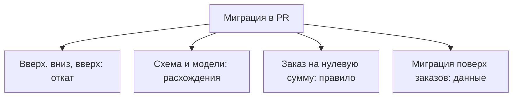

# Как проверять миграции Alembic в CI {#testing-alembic-migrations-in-ci}

<div class="bdr-post__hero" data-bdr-post="2026-10-11-testing-alembic-migrations-in-ci" role="img" aria-label="История ревизий проходит вперёд, назад и снова вперёд, а затем сверяется с моделями, правилами и данными" markdown="0"></div>

Миграции схемы обычно проверяют в CI одним шагом: накатывают их на пустую базу. Если шаг зелёный, миграцию считают безопасной.

Но успешный `alembic upgrade head` на пустой БД доказывает одно: миграции накатываются с нуля. Сломанный откат, ослабленный CHECK или удаление строк такая проверка не заметит.

Поймаем каждую из этих ошибок на примере магазина с пользователями и заказами и посмотрим, какие проверки можно отдать alembic-gauntlet. В практикуме используются PostgreSQL 17, Alembic 1.20.0, SQLAlchemy 2.0.54, asyncpg 0.31.0 и alembic-gauntlet 0.3.0.

<!-- more -->

<div id="the-five-migration-tests-every-python-project-should-run-in-ci" data-search-exclude></div>
<div id="the-test-most-pipelines-have" data-search-exclude></div>
<div id="five-bugs-one-file-each" data-search-exclude></div>
<div id="five-tests-by-hand" data-search-exclude></div>
<div id="what-each-test-caught" data-search-exclude></div>
<div id="the-thing-the-naming-test-taught-me" data-search-exclude></div>
<div id="running-it-in-ci" data-search-exclude></div>
<div id="the-contract-with-envpy" data-search-exclude></div>
<div id="the-five-tests-as-one-import" data-search-exclude></div>

## Четыре ревизии и несколько способов их сломать {#checks}

История миграций магазина линейная:

| Ревизия | Изменение |
|---|---|
| `0001` | Создаёт `users` с уникальным email |
| `0002` | Создаёт `orders`, внешний ключ, индекс и enum `order_status`: `new`, `paid`, `shipped` |
| `0003` | Добавляет CHECK `amount > 0` с именем `amount_positive`; соглашение об именовании превращает его в `chk_orders_amount_positive` |
| `0004` | Добавляет `users.is_active`: NOT NULL, серверное значение по умолчанию `true` |

В практикуме есть эта исправная история и четырнадцать сломанных вариантов, в каждом изменён один файл миграции. Одним тестом их все не поймать:

<!-- diagram:concept -->
<figure class="bdr-diagram" markdown="1">
<figcaption><span class="bdr-diagram__eyebrow">ИДЕЯ В СХЕМЕ</span><strong>Для каждой ошибки своя проверка</strong></figcaption>
<div class="bdr-diagram__viewport" markdown="1" data-search-exclude>



</div>
<p class="bdr-diagram__caption">Stairway-тест ловит сломанный откат, сравнение с моделями ловит расхождение схемы, вставка заказа на нулевую сумму проверяет правило, а строки, записанные до обновления, проверяют сохранность данных.</p>
</figure>
<!-- /diagram:concept -->

<div id="testing-database-migrations-with-testcontainers-up-down-and-up-again" data-search-exclude></div>
<div id="step-1-a-database-that-exists-only-for-the-test-session" data-search-exclude></div>
<div id="step-2-pytest-configuration" data-search-exclude></div>
<div id="step-3-the-contract-with-envpy" data-search-exclude></div>
<div id="step-4-the-test-file" data-search-exclude></div>
<div id="step-5-ci" data-search-exclude></div>
<div id="what-it-costs" data-search-exclude></div>

## Подключаем Alembic к тестовой БД {#isolation}

`tests/conftest.py` поднимает один контейнер PostgreSQL на сессию pytest. Если задана `MIGRATION_TEST_URL`, тесты берут готовую базу по этому адресу; так `run_matrix.py` (о нём ниже) прогоняет все истории на одном контейнере:

```python
@pytest.fixture(scope="session")
def migration_db_url():
    if url := os.getenv("MIGRATION_TEST_URL"):
        yield url
        return
    with PostgresContainer("postgres:17-alpine", driver="asyncpg") as postgres:
        yield postgres.get_connection_url()
```

`alembic_config` указывает Alembic на проверяемую историю; каталог выбирает переменная окружения `VARIANT`, по умолчанию `clean`:

```python
@pytest.fixture
def alembic_config() -> Config:
    config = Config("alembic.ini")
    config.set_main_option("version_locations", f"migrations/versions/{VARIANT}")
    return config
```

Плагин alembic-gauntlet для pytest создаёт по `migration_db_url` фикстуру `migration_engine`. Тесты создают и удаляют схемы и откатывают миграции до base, а если схема не дойдёт до `env.py`, он возьмёт `public`. Поэтому в `MIGRATION_TEST_URL` передавайте только одноразовую БД.

`env.py` должен принять соединение и схему, которые передаёт тест:

```python
# The test runner injects the schema it created for this test; production gets "public".
target_schema = config.attributes.get("target_schema") or os.getenv("MIGRATION_SCHEMA", "public")


def do_run_migrations(connection: Connection) -> None:
    quoted_schema = connection.dialect.identifier_preparer.quote_schema(target_schema)
    connection.execute(
        text("SELECT set_config('search_path', :schema, true)"),
        {"schema": quoted_schema},
    )
    context.configure(
        connection=connection,
        target_metadata=target_metadata,
        version_table_schema=target_schema,
    )
    with context.begin_transaction():
        context.run_migrations()
```

`version_table_schema` кладёт `alembic_version` рядом с таблицами, а `search_path` на время транзакции указывает на тестовую схему, поэтому таблицы без явной схемы создаются в ней. Если тест передал соединение, транзакцией управляет он; иначе `env.py` создаёт engine, и `engine.begin()` фиксирует миграции:

```python
injected = config.attributes.get("connection")
if injected is not None:
    do_run_migrations(injected)  # the test runner owns the connection and the transaction
else:
    asyncio.run(run_migrations_online())
```

`run_migrations_online()` открывает асинхронный engine и вызывает `connection.run_sync(do_run_migrations)`, этот приём описан в [рецептах Alembic](https://alembic.sqlalchemy.org/en/latest/cookbook.html#using-asyncio-with-alembic).

## Применяем, откатываем, применяем снова {#round-trip}

Если downgrade ревизии `0003` удаляет `positive_amount` вместо `amount_positive`, откат упадёт на несуществующем ограничении. Это поймает любой тест отката. С оставшимся enum хитрее: уберите `order_status.drop(op.get_bind())` из downgrade ревизии `0002`, и таблица `orders` удалится без ошибок, но тип в PostgreSQL останется. Повторное применение `0002` упадёт: такой тип уже есть.

Stairway-тест (вверх-вниз-вверх) применяет каждую ревизию, откатывает её на шаг и применяет снова:

```python
async def test_every_revision_up_down_up(migration_engine: AsyncEngine, alembic_config: Config) -> None:
    """The stairway: each revision applied, rolled back one step, applied again."""
    revisions = revisions_base_to_head(alembic_config)
    async with fresh_schema(migration_engine) as schema:
        for i, revision in enumerate(revisions):
            await migrate(migration_engine, alembic_config, schema, command.upgrade, revision)
            assert await current_revision(migration_engine, schema) == revision
            await migrate(migration_engine, alembic_config, schema, command.downgrade, revisions[i - 1] if i else "base")
            await migrate(migration_engine, alembic_config, schema, command.upgrade, revision)
```

Вспомогательные функции лежат в `tests/helpers.py`: `revisions_base_to_head` читает историю, `migrate` выполняет команду Alembic на тестовом соединении, `current_revision` читает таблицу версий. В alembic-gauntlet есть готовые аналоги (`create_isolated_migration_schema`, `run_alembic_upgrade`, `get_current_revision`, `get_all_revisions`); практикум держит свои, чтобы показать, как это устроено. Если в проекте есть намеренно необратимые миграции, тестируйте тот способ восстановления, который вы действительно поддерживаете.

<div id="your-models-and-your-schema-have-drifted-would-ci-notice" data-search-exclude></div>
<div id="where-drift-comes-from" data-search-exclude></div>
<div id="the-six-drifts" data-search-exclude></div>
<div id="the-check-that-catches-half-of-them" data-search-exclude></div>
<div id="the-one-it-will-not-look-at-unless-you-ask" data-search-exclude></div>
<div id="the-two-it-will-never-look-at" data-search-exclude></div>
<div id="what-to-run-in-ci" data-search-exclude></div>
<div id="the-pieces" data-search-exclude></div>

## Сравниваем БД с моделями {#schema-drift}

Допустим, миграция делает `is_active` nullable, а модель требует значение. Или задаёт значение по умолчанию `false`, а в модели `true`. Обе истории применяются к пустым таблицам без ошибок. Такие проверки повторяются из проекта в проект, и alembic-gauntlet поставляет их базовым классом; вот весь `tests/test_gauntlet.py`:

```python
import pytest
from alembic_gauntlet import MigrationTestBase
from sqlalchemy import MetaData

from shop.models import Base


@pytest.mark.integration
class TestMigrations(MigrationTestBase):
    migration_diff_compare_server_default = True

    @pytest.fixture
    def orm_metadata(self) -> MetaData:
        return Base.metadata
```

В версии 0.3.0 базовый класс `MigrationTestBase` добавляет в тестовый класс семь тестов: свой stairway-тест, сравнение схемы с моделями, единственный head, откат до base, соглашение об именовании, имена CHECK и значения enum. Серверные значения по умолчанию сравниваются только по запросу: без `migration_diff_compare_server_default = True` gauntlet не заметит `false` из примера выше.

| Намеренная ошибка | Какая проверка падает |
|---|---|
| У `0003` и `0004` общий родитель `0002` | Единственный head; `upgrade head` тоже падает |
| Неверные nullable, тип или default, нет индекса, лишняя колонка | Сравнение схемы с моделями |
| Нет `chk_orders_amount_positive` | Сравнение имён CHECK |
| В `order_status` нет `shipped` | Сравнение значений enum |
| CHECK добавлен сырым SQL, и соглашение его не именует | Проверки соглашения об именовании и имён CHECK |

По умолчанию `compare_metadata` в Alembic не сравнивает CHECK-ограничения и значения enum (в 1.20 есть подключаемый плагин сравнения CHECK по именам), поэтому gauntlet проверяет их отдельно: CHECK по именам, а не по условиям, а enum по списку значений с учётом порядка.

Stairway-тест из gauntlet ни разу не применяет последнюю ревизию повторно. В варианте `head_noop_downgrade` downgrade ревизии `0004` ничего не делает: все семь проверок проходят, а падает только наш ручной stairway-тест, потому что `is_active` уже существует. Поэтому ручной тест стоит оставить рядом с базовым классом.

## Проверяем правило, а не имя {#constraint-behavior}

Замените `amount > 0` на `amount >= 0`, сохранив имя ограничения. Все семь унаследованных проверок по-прежнему проходят, но теперь БД примет заказ на нулевую сумму. Заметит это только вставка:

```python
@pytest.mark.parametrize("amount", [0, -1])
async def test_order_amount_must_be_positive(migrated_connection, amount):
    await migrated_connection.execute(
        text("INSERT INTO users (id, email) VALUES (1, 'buyer@example.test')")
    )
    with pytest.raises(IntegrityError) as raised:
        async with migrated_connection.begin_nested():
            await migrated_connection.execute(
                text("INSERT INTO orders (id, user_id, amount, status) "
                     "VALUES (42, 1, :amount, 'new')"),
                {"amount": amount},
            )
    assert raised.value.orig.sqlstate == "23514"
```

Фикстура `migrated_connection` накатывает миграции до `head` и открывает транзакцию в тестовой схеме. Пользователя вставляем заранее, чтобы заказ не упал на внешнем ключе. Неудачная вставка изолирована в savepoint, а SQLSTATE `23514` подтверждает, что её отклонил именно CHECK. Исправная история отклоняет и `0`, и `-1`; с `>= 0` случай `0` падает с `DID NOT RAISE`.

## Обновляем БД, в которой уже есть заказы {#data}

Добавьте `DELETE FROM orders` в upgrade ревизии `0004`. Схема по-прежнему совпадает с моделями, и на пустых таблицах все семь унаследованных проверок проходят. Чтобы поймать такую миграцию, запишите строки на ревизии `0003`, накатите `0004` и прочитайте их:

```python
async def test_existing_orders_survive(migration_engine, alembic_config):
    async with fresh_schema(migration_engine) as schema:
        await migrate(migration_engine, alembic_config, schema, command.upgrade, "0003")
        async with migration_engine.begin() as connection:
            await connection.execute(text(f'SET LOCAL search_path TO "{schema}"'))
            await connection.execute(text(
                "INSERT INTO users (id, email) VALUES (1, 'buyer@example.test')"
            ))
            await connection.execute(text(
                "INSERT INTO orders (id, user_id, amount, status) "
                "VALUES (42, 1, 19.99, 'paid')"
            ))

        await migrate(migration_engine, alembic_config, schema, command.upgrade, "0004")
        async with migration_engine.connect() as connection:
            await connection.execute(text(f'SET LOCAL search_path TO "{schema}"'))
            users = (await connection.execute(
                text("SELECT id, email, is_active FROM users ORDER BY id")
            )).all()
            orders = (await connection.execute(
                text("SELECT id, user_id, amount, status FROM orders ORDER BY id")
            )).all()
        assert users == [(1, "buyer@example.test", True)]
        assert orders == [(42, 1, Decimal("19.99"), "paid")]
```

С исправной миграцией пользователь `1` получает `is_active=True`, а у заказа `42` сохраняются пользователь, сумма и статус `paid`. В варианте с удалением тест не находит ни одного заказа: структурные проверки не знают, какие данные миграция обязана сохранить. Если миграция преобразует значения, добавьте в этот тест их граничные случаи. Длительность блокировок на больших таблицах проверяйте отдельно, на объёме, близком к рабочему.

## Запускаем те же проверки в CI {#ci}

Нужны только Docker и `uv`; команды запускаются из каталога практикума:

```bash
uv run --no-project --python 3.13 --with-requirements requirements.txt python -m pytest -q
uv run --no-project --python 3.13 --with-requirements requirements.txt python run_matrix.py
```

Первая команда прогоняет исправную историю: 20 тестов, из них семь унаследованных. Вторая перебирает все пятнадцать историй и падает, если сломанная история проходит, если ожидаемая проверка на ней не падает или если пропуск либо ошибка настройки маскируют дыру в проверках. Шаблон GitHub Actions из практикума запускает первую команду; в `working-directory` укажите каталог своих тестов миграций:

```yaml
name: Migration checks
on:
  pull_request:
  push:
    branches: [master]
permissions:
  contents: read
jobs:
  migrations:
    runs-on: ubuntu-24.04
    timeout-minutes: 10
    defaults:
      run:
        working-directory: docs/blog/lab/2026-09-07-five-alembic-migration-tests
    steps:
      - uses: actions/checkout@v7
      - uses: astral-sh/setup-uv@v10.3.0
      - run: uv run --no-project --python 3.13 --with-requirements requirements.txt python -m pytest -q
```

Обе команды мы запускали локально; workflow служит шаблоном, а не отчётом о прогоне в GitHub.

## Что взять в свой проект {#conclusion}

Одно применение миграций к пустой БД пропустило бы всё, кроме ветвления с двумя head-ревизиями: сломанный откат, оставшийся enum, downgrade, который ничего не делает, расхождение схемы, ослабленный CHECK и потерянные заказы.

Изоляцию схем и повторяющиеся проверки истории, имён и моделей отдайте [alembic-gauntlet](https://bedrock-python.github.io/alembic-gauntlet/). Рядом оставьте три ручных теста: stairway-тест вместе с последней ревизией, правила БД, на которые опирается код, и проверку, что строки, записанные до новой ревизии, переживают обновление.

## Примеры и практикумы {#labs}

- [Практикум: тесты миграций Alembic](../lab/2026-09-07-five-alembic-migration-tests/README.md)
