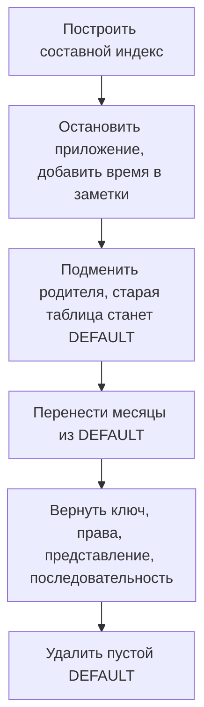

# Как перевести таблицу PostgreSQL на партиционирование {#partitioning-an-existing-postgresql-table}

<div class="bdr-post__hero" data-bdr-post="2026-10-17-partitioning-an-existing-postgresql-table" role="img" aria-label="Подготовить ключи, подключить старую таблицу как DEFAULT и проверить каждый шаг миграции" markdown="0"></div>

Таблица событий растёт годами, и однажды запросы и удаление старых данных упираются в её размер. Тогда её решают разбить на месячные партиции.

Сразу выясняется, что в PostgreSQL нельзя сделать обычную таблицу партиционированной. У новой родительской первичный ключ должен включать столбец партиционирования, а связи и права остаются у старой.

Переведём на месячные партиции таблицу `events` сервиса аналитики, на которую ссылается `event_notes`, и сохраним имя `events` для запросов приложения. Миграцию проводим в окно обслуживания: приложение не читает и не пишет, пока мы не проверим данные и зависимости. Всё работает на PostgreSQL 17 с pg-partsmith 1.8.0, SQLAlchemy 2.0.54 и asyncpg 0.31.0.

<!-- more -->

## Начинаем с таблицы и её связей {#keys}

Исходная схема. Роль `events_app` получает права приложения, а `event_summary` сделано нарочно простым представлением для отчёта:

```sql
CREATE TABLE events (
    id bigserial PRIMARY KEY,
    created_at timestamptz NOT NULL,
    kind text NOT NULL,
    payload text NOT NULL
);
CREATE INDEX events_created_at_idx ON events (created_at);
CREATE TABLE event_notes (
    id bigserial PRIMARY KEY,
    event_id bigint NOT NULL REFERENCES events (id),
    note text NOT NULL
);
CREATE VIEW event_summary AS SELECT count(*) AS total FROM events;
CREATE ROLE events_app NOLOGIN;
GRANT USAGE ON SCHEMA public TO events_app;
GRANT SELECT, INSERT ON events TO events_app;
GRANT USAGE ON SEQUENCE events_id_seq TO events_app;
```

Практикум заполняет её 616 событиями за июль–сентябрь 2026 года и двадцатью заметками и сохраняет копию для сравнения.

Самый очевидный вариант, `CREATE TABLE ... (LIKE events INCLUDING ALL) PARTITION BY RANGE (created_at)`, падает с SQLSTATE `0A000`: `PRIMARY KEY (id)` не содержит ключ партиционирования, а [ограничения PostgreSQL 17](https://www.postgresql.org/docs/17/ddl-partitioning.html#DDL-PARTITIONING-DECLARATIVE-LIMITATIONS) этого требуют. Удалить этот ключ тоже не выйдет: `2BP01`, потому что на него ссылается `event_notes`.

Новым первичным ключом делаем `(id, created_at)`, и заметки будут ссылаться на оба значения. **Уникальность одного `id` больше не гарантирована**: практикум проверяет, что та же пара отклоняется, а тот же id с другим временем проходит. Если `id` должен оставаться уникальным сам по себе, партиционирование по времени не подходит, и решить это нужно до миграции.

Новый уникальный индекс строим до паузы: с `CONCURRENTLY` запись не блокируется. Если построение упадёт, останется индекс в состоянии INVALID, и перед повтором его нужно удалить:

```python
async def build_key_index(connection):
    await connection.execute("""
        CREATE UNIQUE INDEX CONCURRENTLY events_id_created_at_key
        ON events (id, created_at)
    """)
```

Затем останавливаем приложение, ждём завершения активных транзакций и добавляем заметкам время события:

```python
async def prepare_notes(connection):
    await connection.execute("""
        ALTER TABLE event_notes ADD COLUMN event_created_at timestamptz;
        UPDATE event_notes AS n
        SET event_created_at = e.created_at
        FROM events AS e WHERE e.id = n.event_id;
        ALTER TABLE event_notes ALTER COLUMN event_created_at SET NOT NULL;
    """)
```

`event_created_at` объявлен NOT NULL, чтобы заметка без времени не обошла будущий составной внешний ключ. Код, который пишет заметки, тоже должен передавать это время: то, что таблица по-прежнему называется `events`, от правки в коде не избавляет.

<div id="how-to-partition-an-existing-postgresql-table-without-rewriting-your-application" data-search-exclude></div>
<div id="step-1-the-primary-key-has-to-contain-the-partition-column" data-search-exclude></div>
<div id="step-2-the-swap" data-search-exclude></div>
<div id="step-3-the-first-maintenance-tick" data-search-exclude></div>
<div id="step-4-the-drain" data-search-exclude></div>
<div id="step-5-the-foreign-key-comes-back-composite" data-search-exclude></div>
<div id="step-6-the-empty-default-and-the-sequence" data-search-exclude></div>
<div id="the-result" data-search-exclude></div>
<div id="the-order-and-where-the-risk-is" data-search-exclude></div>
<div id="the-pieces" data-search-exclude></div>

## Подменяем родительскую таблицу в одной транзакции {#cutover}

Переименовываем старую таблицу, создаём партиционированную родительскую и подключаем старую как партицию DEFAULT:

```python
async def cutover(connection):
    async with connection.transaction():
        await connection.execute("SET LOCAL lock_timeout = '200ms'")
        await connection.execute("""
            LOCK TABLE events, event_notes IN ACCESS EXCLUSIVE MODE;
            ALTER TABLE event_notes DROP CONSTRAINT event_notes_event_id_fkey;
            ALTER TABLE events DROP CONSTRAINT events_pkey,
                ADD CONSTRAINT events_pkey PRIMARY KEY USING INDEX events_id_created_at_key;
            ALTER TABLE events RENAME TO events_legacy;
            ALTER TABLE events_legacy RENAME CONSTRAINT events_pkey TO events_legacy_pkey;
            ALTER INDEX events_created_at_idx RENAME TO events_legacy_created_at_idx;
            CREATE TABLE events (LIKE events_legacy INCLUDING ALL)
                PARTITION BY RANGE (created_at);
            ALTER TABLE events ATTACH PARTITION events_legacy DEFAULT;
        """)
```

Переименования освобождают имена `events_pkey` и `events_created_at_idx`, и `LIKE ... INCLUDING ALL` даёт новой таблице чистые имена. Подключение в качестве DEFAULT, пока других партиций нет, не требует проверочного сканирования, а родительская таблица забирает себе существующие первичный ключ и индекс вместо того, чтобы строить новые. Можно было бы подключить старую таблицу как один исторический диапазон и вообще не переносить строки, но тогда вся история осталась бы в одной партиции, которую нельзя ни отсекать в запросах, ни удалять по месяцам.

`lock_timeout` здесь важен: пока запрос на ACCESS EXCLUSIVE ждёт, все следующие запросы к `events` встают в очередь за ним; 200 мс взяты для практикума. В практикуме открытая читающая транзакция заставляет `cutover` упасть с `55P03` и откатиться, ничего не тронув; когда она завершается, переключение проходит.

Теперь новая родительская таблица возвращает все 616 строк из `events_legacy`. На новую родительскую таблицу не перешли четыре вещи: внешний ключ (мы его удалили), права, представление (оно по-прежнему смотрит на `events_legacy`) и `OWNED BY` у последовательности. Таким же образом проверьте в своей схеме триггеры, политики RLS, внешние ключи, которые ссылаются на таблицу, представления и права.

<!-- diagram:concept -->
<figure class="bdr-diagram" markdown="1">
<figcaption><span class="bdr-diagram__eyebrow">ИДЕЯ В СХЕМЕ</span><strong>Шесть шагов от таблицы к партициям</strong></figcaption>
<div class="bdr-diagram__viewport" markdown="1" data-search-exclude>



</div>
<p class="bdr-diagram__caption">Под нагрузкой строится только составной индекс. Всё остальное, от паузы до удаления пустой партиции DEFAULT, выполняется в окно обслуживания.</p>
</figure>
<!-- /diagram:concept -->

## Переносим строки из DEFAULT и проверяем промежуточный результат {#movement}

Если сразу создать июльскую партицию, PostgreSQL ответит SQLSTATE `23514`: новый диапазон сужает DEFAULT, а в DEFAULT ещё лежат строки этого диапазона.

Эту проблему обходит [pg-partsmith](https://bedrock-python.github.io/pg-partsmith/). Он создаёт неподключённую таблицу для месяца, переносит в неё строки порциями (каждая порция один запрос `DELETE ... RETURNING` / `INSERT`) и подключает таблицу, когда в DEFAULT не остаётся строк этого месяца. До подключения эти строки через родительскую таблицу не видны, поэтому приложение и стоит на паузе. Каждый ATTACH к тому же сканирует всё, что осталось в DEFAULT, под блокировкой ACCESS EXCLUSIVE: N месяцев истории дают N сканирований всё меньшего DEFAULT плюс однократный перенос каждой строки; `batch_rows` меняет только то, как эта работа делится на порции, но не её объём.

```python
def migration_toolkit(engine):
    config = TablePartitionConfig(
        schema="public",
        table_name="events",
        partition_column="created_at",
        granularity=PartitionGranularity.MONTH,
    )
    return PartitionToolkit.from_engine(engine), config


async def move_batch(toolkit, config, *, max_batches=10):
    result = await toolkit.service.partition_data(
        config, batch_rows=100, max_batches=max_batches,
    )
    if result.issues:
        raise RuntimeError(f"Data movement needs attention: {result.issues}")
    return result


async def finish_ranges(toolkit, config):
    while True:
        result = await move_batch(toolkit, config)
        if result.complete:
            return result
        if result.rows_moved == 0:
            raise RuntimeError("Data movement made no progress")
```

`engine` здесь `AsyncEngine` из SQLAlchemy для той же базы. `move_batch(toolkit, config, max_batches=1)` останавливается после одной порции, и промежуточное состояние можно измерить:

| Что видно после первой порции | Результат |
|---|---|
| `rows_moved`, `batches`, `complete` | `100`, `1`, `False` |
| Строк через `events` | `516` |
| Строк в неподключённой `events__2026_07` | `100` |
| Строки из обоих мест вместе | Ровно исходные 616 |

Затем практикум закрывает пул соединений (`engine.dispose()`), создаёт новый toolkit и вызывает `finish_ranges`. Эта функция продолжает перенос с того, что уже закоммичено, проверяет `issues` после каждого вызова и останавливается, если вызов ничего не перенёс. После этого все сохранённые строки снова должны быть видны через `events`. Если `max_batches` кончится сразу после порции, которая опустошила месяц, этот месяц останется неподключённым до следующего вызова, а `plan()` покажет его как `unattached_rows`. Число строк через родительскую таблицу всё равно сверяйте.

## Восстанавливаем связи до возобновления работы {#verification}

Прежний внешний ключ на один столбец вернуть нельзя: у родительской таблицы нет уникального ограничения на один `id`. Составной ключ добавляйте только после переноса всех строк: пока он есть, `partition_data` не переносит строки, на которые ссылаются, и сообщает об этом в `issues`. Восстанавливаем ссылку, снова делаем `events.id` владельцем последовательности, пересоздаём представление и выдаём права на родительскую таблицу:

```python
async def restore_references(connection):
    async with connection.transaction():
        await connection.execute("SET LOCAL lock_timeout = '200ms'")
        await connection.execute("""
            ALTER TABLE event_notes ADD CONSTRAINT event_notes_event_fkey
                FOREIGN KEY (event_id, event_created_at)
                REFERENCES events (id, created_at);
            ALTER SEQUENCE events_id_seq OWNED BY events.id;
            CREATE OR REPLACE VIEW event_summary AS SELECT count(*) AS total FROM events;
            GRANT SELECT, INSERT ON events TO events_app;
        """)
```

Существующие заметки проверяются при добавлении ключа. Вставка заметки без времени по-прежнему падает с `23502` (NOT NULL), а несуществующая пара `(event_id, event_created_at)` теперь падает с `23503`. Без нового представления `event_summary` продолжает считать опустевшую `events_legacy` и показывает ноль. Без `OWNED BY` последовательность принадлежит `events_legacy` и удалилась бы вместе с ней, а от неё зависит значение по умолчанию `events.id`, поэтому PostgreSQL отвечает `2BP01`.

Перед удалением DEFAULT создайте партицию на следующий месяц (практикум создаёт октябрь): без DEFAULT запись в месяц без партиции падает с `23514`. Затем удаляем DEFAULT, проверив под блокировкой родительской таблицы, что он пуст:

```python
async def remove_empty_default(connection):
    async with connection.transaction():
        await connection.execute("SET LOCAL lock_timeout = '200ms'")
        await connection.execute("LOCK TABLE events IN ACCESS EXCLUSIVE MODE")
        remaining = await connection.fetchval("SELECT count(*) FROM ONLY events_legacy")
        if remaining:
            raise RuntimeError(f"DEFAULT still contains {remaining} rows")
        await connection.execute("ALTER TABLE events DETACH PARTITION events_legacy")
        await connection.execute("DROP TABLE events_legacy")
```

В конце репетиция проверяет не только число строк:

| Проверка | Ожидаемый результат |
|---|---|
| Все сохранённые события и заметки | Не изменились |
| Составной внешний ключ | Неверные ссылки отклоняются |
| Исходная вставка приложения от `events_app` | Работает с восстановленными правами и последовательностью |
| `event_summary` | Считает строки через новую родительскую таблицу |
| Июльский диапазон в `EXPLAIN (FORMAT JSON)` | Сканирует только `events__2026_07` |
| Вставка в месяц без партиции | Падает с `23514` |

Отклонять такие записи решили в этом примере; можно и оставить DEFAULT и следить за ним. Дальше нужно регулярное [обслуживание партиций](2026-10-18-postgresql-partition-maintenance.md).

<div id="uuidv7-as-a-postgresql-partition-key" data-search-exclude></div>
<div id="one-column-in-the-primary-key" data-search-exclude></div>
<div id="the-bounds-are-uuids" data-search-exclude></div>
<div id="pruning-happens-on-the-id-not-on-the-timestamp" data-search-exclude></div>
<div id="the-three-ids-that-do-not-fit" data-search-exclude></div>
<div id="retention-has-the-same-edge" data-search-exclude></div>
<div id="when-to-reach-for-it" data-search-exclude></div>

## Когда UUIDv7 позволяет сохранить ключ из одного столбца {#uuidv7}

Если id уже UUIDv7 и по времени внутри него и нужно делить таблицу, PostgreSQL примет `id uuid PRIMARY KEY ... PARTITION BY RANGE (id)`: ключ содержит столбец партиционирования. `UUIDv7BoundaryCodec` из pg-partsmith превращает границы месяцев в границы UUID: запрос по диапазону id сканирует одну партицию, а то же условие по отдельному столбцу `created_at` сканирует все. Строка попадает в партицию по времени из id, а не по `created_at`, и границы диапазонов не проверяют версию UUID: специально собранный v4 может попасть в месяц, если версию не проверяет CHECK. В PostgreSQL 18 появилась функция `uuidv7()`; на 17 id генерирует приложение. Это другая схема ключей, а не способ перевести существующие случайные id.

## Что перенести в свою миграцию {#conclusion}

- Составной уникальный индекс стройте `CONCURRENTLY` до паузы, а всё остальное делайте в окно обслуживания.
- Подключайте старую таблицу как DEFAULT: проверочного сканирования нет, а её индексы становятся индексами родителя. Зато каждый месячный ATTACH заново сканирует остаток DEFAULT; на это и на перенос строк и уходит окно.
- Составной внешний ключ добавляйте только после переноса строк, а права, представления и владельца последовательности восстанавливайте явно.
- Перед возобновлением работы сравните строки через родительскую таблицу с сохранённой копией.

## Примеры и практикумы {#labs}

Каждый практикум поднимает одноразовый контейнер PostgreSQL 17; команда `uv` есть в его README.

- [Практикум: партиционирование существующей таблицы в окно обслуживания](../lab/2026-09-07-partition-existing-table/README.md)
- [Практикум: UUIDv7 как ключ партиционирования в PostgreSQL](../lab/2026-09-07-uuidv7-partition-key/README.md)
