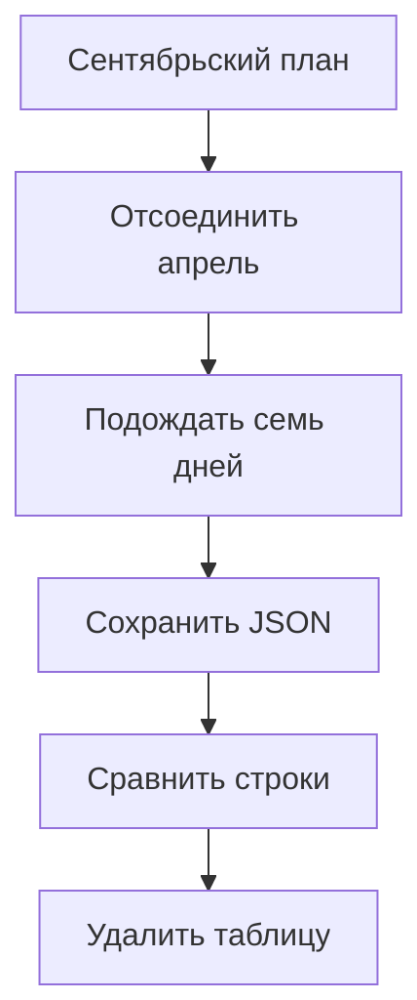

# Обслуживание партиций PostgreSQL: от плана до проверенного архива {#postgresql-partition-maintenance}

<div class="bdr-post__hero" data-bdr-post="2026-10-18-postgresql-partition-maintenance" role="img" aria-label="Создать будущие диапазоны, отсоединить старые партиции, проверить архив перед удалением" markdown="0"></div>

Месячные партиции требуют ухода: каждый месяц кто-то должен создать таблицу на следующий месяц и убрать старую.

Ломается это в двух местах: вставка падает, если таблицы на следующий месяц нет, а старую таблицу удаляют раньше, чем проверили архив.

Разберём один запуск обслуживания в сервисе аналитики 15 сентября 2026 года: партиции на октябрь нет, квитанция всё ещё ссылается на майское событие, а старую таблицу можно удалить только через семь дней после отсоединения и после проверки архива. Потом заберём обслуживание таблицы у pg_partman. Практикумы работают на PostgreSQL 17 и pg-partsmith 1.8.0.

<!-- more -->

<div id="managing-postgresql-partitions-one-failure-at-a-time" data-search-exclude></div>
<div id="not-knowing-what-maintenance-will-do" data-search-exclude></div>
<div id="dropping-something-you-did-not-make" data-search-exclude></div>
<div id="two-replicas-tick-at-once" data-search-exclude></div>
<div id="the-team-with-no-python-in-it" data-search-exclude></div>
<div id="the-archiver-has-to-run-before-the-drop" data-search-exclude></div>
<div id="wiring-it-with-an-assistant-in-the-loop" data-search-exclude></div>

## Задаём правила в календарных месяцах {#planning}

В `events` три столбца: `id bigint`, `created_at timestamptz` и `payload text`; первичный ключ `(id, created_at)`, ключ партиционирования `created_at`. Квитанция ссылается на майское событие составным ключом `(event_id, event_at)`. Отчётам нужны текущий месяц и два предыдущих, а для записи заранее готовим ещё два месяца вперёд:

```python
def events_config(*, protect_references=True):
    retention = KeepNewest(count=3)
    if protect_references:
        retention = ExpireIf(
            when=AllOf(members=(retention, Unreferenced())),
        )
    return TablePartitionConfig(
        schema="public",
        table_name="events",
        partition_column="created_at",
        granularity=PartitionGranularity.MONTH,
        lifecycle=LifecyclePolicy(
            creation=CreateAhead(count=3),
            retention=retention,
            drop=DropAfter(grace=timedelta(days=7)),
        ),
    )
```

| Настройка в сентябре | Что означает |
|---|---|
| `CreateAhead(count=3)` | Гарантирует партиции на сентябрь, октябрь и ноябрь: текущий месяц тоже входит в счёт |
| `KeepNewest(count=3)` | Храним июль, август и сентябрь; будущие диапазоны историю не сокращают |
| `Unreferenced()` вместе с правилом хранения | Старая партиция остаётся подключённой, пока на её строки ссылается другая таблица |
| `DropAfter(grace=timedelta(days=7))` | Отсоединённую таблицу удаляем не раньше чем через семь дней после отметки об отсоединении |

Правила работают с месяцами целиком, фиксированного срока жизни строки нет: сентябрьская строка остаётся, пока декабрьский запуск не отсоединит сентябрь.

План строится без DDL, печатается и применяется отдельным шагом; `toolkit` здесь создан как `PartitionToolkit.from_engine(engine)` поверх `AsyncEngine` из SQLAlchemy:

```python
async def preview(toolkit, config, *, now=None):
    plan = await toolkit.service.plan(config, now=now)
    print(plan.describe())
    return plan


async def apply_reviewed(toolkit, config, plan):
    result = await toolkit.service.apply(config, plan)
    if result.error or result.issues:
        raise RuntimeError(f"Maintenance needs attention: {result}")
    return result
```

Кроме обычных месячных партиций, в базе есть три необычные таблицы:

| Таблица | Что с ней происходит |
|---|---|
| `events_may_manual`, созданная вручную с границами мая | Обслуживается как обычная месячная партиция; пока её защищает квитанция |
| `events__2026_03` с 1 февраля по 1 апреля | Остаётся нетронутой, план сообщает `unmanaged_partition` |
| `events_export_2025_01`, отдельная и без метки | В план не попадает |

Практикум строит план с `now=datetime(2026, 9, 15, tzinfo=UTC)`. План создаёт октябрь и ноябрь, отсоединяет апрель и июнь и оставляет май, на который ссылается квитанция; удалений пока нет. Построение плана ничего не меняет в каталоге.

## Какие таблицы библиотека считает своими {#ownership}

Для подключённой RANGE-партиции pg-partsmith смотрит на границы, а не на имя или на то, кто её создал: если границы укладываются в один настроенный период, партицию обслуживают. Поэтому месячные партиции, созданные вручную или другим инструментом, становятся кандидатами на отсоединение, а неровный диапазон вроде февраля–марта попадает в отчёт и остаётся как есть.

Перед самым отсоединением библиотека записывает в комментарий к таблице имя родителя и время отсоединения. По этой метке следующие запуски находят таблицы, которые можно удалить.

<div id="where-to-read-more" data-search-exclude></div>
<div id="partition-retention-is-not-drop-table" data-search-exclude></div>
<div id="the-job-everybody-writes" data-search-exclude></div>
<div id="print-the-plan-first" data-search-exclude></div>
<div id="detach-and-drop-are-two-steps" data-search-exclude></div>
<div id="the-archive-runs-before-the-drop-and-may-refuse-it" data-search-exclude></div>
<div id="what-a-foreign-key-does-to-retention" data-search-exclude></div>

## Отсоединяем старые диапазоны и сохраняем данные {#retention}

После `apply_reviewed` счётчики такие: `created=2`, `detached=2`, `dropped=0`. Октябрьская вставка, которую до обслуживания отклоняла SQLSTATE `23514`, теперь проходит. Апрель и июнь исчезают из запросов через `events`, но их таблицы и четыре строки на месте. Вставка запоздавшего апрельского события теперь падает с `23514`: партиции DEFAULT нет.

Чтобы проверить защиту внешним ключом, построим план без `Unreferenced()`. Май попадает в план, но PostgreSQL отказывается его отсоединять из-за квитанции: в результате `success=True` и непустой `issues`, а май и квитанция на месте. **`success` означает, что не было фатальной ошибки, а не то, что все операции прошли.** Когда квитанцию удаляют, обычная политика отсоединяет май. Неудачная попытка в 1.8.0 оставляет след: отметку об отсоединении библиотека пишет до запроса, и она остаётся на майской таблице. Когда май потом действительно отсоединяется, отметка не обновляется, и семь дней отсчитываются от неудачной попытки ([#105](https://github.com/bedrock-python/pg-partsmith/issues/105)).

Операции не объединены в одну транзакцию: поздний сбой не откатывает уже созданные или отсоединённые партиции, поэтому повторный запуск начинается с текущего состояния. В режиме по умолчанию `AUTO` pg-partsmith выполняет `DETACH ... CONCURRENTLY`, которому на родителе нужна только SHARE UPDATE EXCLUSIVE, но он ждёт завершения всех транзакций, работающих с родителем. PostgreSQL отказывает в этом варианте, например если у родителя есть партиция DEFAULT, и только тогда pg-partsmith выполняет обычный DETACH: ACCESS EXCLUSIVE на родителе и партиции и SHARE (блокирует запись) на каждой таблице, чьи внешние ключи ссылаются на родителя. Блокирующие шаги ждут блокировку не дольше `ddl_lock_timeout_ms`, по умолчанию три секунды, и вместо очереди за длинными транзакциями сообщают об ошибке в `issues`. Удаление уже отсоединённой таблицы не трогает родительскую таблицу, поэтому отсоединение и удаление разделены на два шага; остальные ограничения перечислены в описании [ALTER TABLE](https://www.postgresql.org/docs/17/sql-altertable.html#SQL-ALTERTABLE-DETACH-PARTITION).

<!-- diagram:concept -->
<figure class="bdr-diagram" markdown="1">
<figcaption><span class="bdr-diagram__eyebrow">ИДЕЯ В СХЕМЕ</span><strong>Путь апрельской партиции до удаления</strong></figcaption>
<div class="bdr-diagram__viewport" markdown="1" data-search-exclude>



</div>
<p class="bdr-diagram__caption">Сентябрьское обслуживание отсоединяет апрель. Через семь дней обработчик сохраняет и проверяет архив, и только потом таблицу можно удалить.</p>
</figure>
<!-- /diagram:concept -->

## Архивируем строки, а затем разрешаем удаление {#archive}

Обработчик `before_drop` вызывается перед удалением каждой таблицы. Исключение в нём останавливает запуск перед этим DROP, и все следующие операции пропускаются; с `continue_on_error=True` сбой вместо этого попадает в `issues`. Наш обработчик сначала проверяет, что у таблицы всё ещё OID из плана, потом сохраняет строки в JSON, перечитывает файл и сравнивает каждое поле:

```python
class JsonArchive(BasePartitionLifecycleHooks):
    def __init__(self, connection, directory: Path):
        self.connection = connection
        self.directory = directory

    async def before_drop(self, event: PartitionEvent):
        oid = await self.connection.fetchval("SELECT to_regclass($1)::oid", event.partition.name)
        if oid != event.operation.oid:
            raise RuntimeError(f"{event.partition.name} is not the planned table")
        schema, name = event.partition.name.split(".", 1)
        quoted = ".".join('"' + part.replace('"', '""') + '"' for part in (schema, name))
        rows = await self.connection.fetch(
            f"SELECT id, created_at, payload FROM {quoted} ORDER BY id, created_at",
        )
        data = [[row["id"], row["created_at"].isoformat(), row["payload"]] for row in rows]
        document = {"table": event.partition.name, "rows": data}
        path = self.directory / f"{oid}.json"
        if not path.exists():
            temporary = path.with_suffix(".tmp")
            temporary.write_text(json.dumps(document, ensure_ascii=False), encoding="utf-8")
            temporary.replace(path)
        if json.loads(path.read_text(encoding="utf-8")) != document:
            raise RuntimeError(f"Archive verification failed: {path.name}")
```

Обработчик подключается через `PartitionToolkit.from_engine(engine, hooks=[JsonArchive(connection, directory)])`; ему нужны `asyncpg.Connection` и существующий каталог. Файл называется по OID, поэтому повторный вызов проверяет уже записанный архив, а расхождение запрещает удаление. Настоящему архиву нужен потоковый экспорт в надёжное хранилище архивов и своя проверка восстановления; запись в отсоединённые таблицы до экспорта остановите.

Практикум проверяет весь путь:

| Ситуация | Что проверяется в БД и архиве |
|---|---|
| Семь дней ещё не прошли | В плане нет `DROP` |
| Срок прошёл, хранилище архивов недоступно | Обработчик бросает исключение; обе таблицы на месте |
| Существующий архив с неверным содержимым | Проверка запрещает удаление |
| Повтор после исправления | Две таблицы удалены; все четыре строки восстановлены из JSON во временную таблицу и совпадают с исходными |

## Запускаем по расписанию и замечаем частичные отказы {#scheduling}

Запускайте обслуживание из CronJob с `concurrencyPolicy: Forbid` или с каждой реплики: advisory lock таблицы пропускает к работе только одного воркера за раз.

```python
async def maintenance_tick(toolkit, config):
    try:
        result = await toolkit.maintainer.run_maintenance(config)
    except LockAcquisitionError:
        print({"skipped": "another worker holds the maintenance lock"})
        return None
    print({
        "created": result.created_count,
        "detached": result.detached_count,
        "dropped": result.dropped_count,
        "duration_ms": result.duration_ms,
        "issues": [issue.model_dump() for issue in result.issues],
    })
    if result.issues:
        raise RuntimeError("Partition maintenance finished with issues")
    return result
```

`run_maintenance` строит и применяет план под advisory lock таблицы. Если блокировку держит другой воркер, `LockAcquisitionError` превращает этот запуск в пропуск, а не в сбой; любое другое исключение роняет задачу, как и непустой `issues`, даже при `success=True`. `run_maintenance_safe` мы не используем: он превращает любое исключение, включая отмену, в `result.error`, и `asyncio.timeout()` не может его остановить ([#107](https://github.com/bedrock-python/pg-partsmith/issues/107)).

Блокировку берёт сессионный `pg_try_advisory_lock`, поэтому воркерам нужно прямое подключение к базе, а не PgBouncer в транзакционном режиме, и одинаковый `lock_prefix`; с другими инструментами она не согласуется. Отдельно настройте оповещения на время с последнего чистого запуска и на наличие будущих диапазонов. Если есть партиция DEFAULT, считайте строки в ней сами: 1.8.0 сообщает о них как `rows_in_default`, но не при политике с `Unreferenced()`, как здесь ([#108](https://github.com/bedrock-python/pg-partsmith/issues/108)).

<div id="the-checklist-for-a-retention-job" data-search-exclude></div>
<div id="the-pieces" data-search-exclude></div>
<div id="migrating-from-pg_partman-to-application-managed-partitions" data-search-exclude></div>
<div id="what-pg_partman-built" data-search-exclude></div>
<div id="the-configuration-is-the-migration" data-search-exclude></div>
<div id="adoption-is-not-a-step" data-search-exclude></div>
<div id="running-both-at-once" data-search-exclude></div>
<div id="switching-pg_partman-off" data-search-exclude></div>
<div id="what-you-give-up-and-what-you-get" data-search-exclude></div>

## Передаём обслуживание от pg_partman {#migration}

Во втором практикуме обслуживание месячной таблицы переходит от pg_partman 5.5.0, и три настройки переносятся напрямую. `premake = N` будущих таблиц превращается в `CreateAhead(count=N + 1)`, потому что pg-partsmith считает и текущий месяц; `retention = '3 months'` хранит текущий месяц и три предыдущих, то есть это `KeepNewest(count=4)`; `retention_keep_table = true` превращается в `DropNever()`. При таком соответствии первый план pg-partsmith пуст, и это и есть приёмочная проверка передачи.

Сначала сохраните `part_config`, OID таблиц и число строк. Выставьте `automatic_maintenance = 'off'` и остановите задачи, которые явно вызывают `run_maintenance('public.events')`: [этот флаг их не останавливает](https://github.com/pgpartman/pg_partman/blob/v5.5.0/doc/pg_partman.md#maintenance-objects). Дождитесь завершения текущих вызовов и удалите строку таблицы из `partman.part_config`; после этого даже явный вызов ничего не меняет. На границе следующего месяца проверьте, что pg-partsmith создал партицию: в практикуме он создаёт одну и отсоединяет самую старую.

Кое-что остаётся вам: из-за `events_default`, созданной pg_partman, отсоединение будет только блокирующим, таблица-шаблон pg_partman никуда не девается, ранее отсоединённые им таблицы не имеют метки pg-partsmith и никогда не удаляются, а новые партиции получают имена вида `events__YYYY_MM` рядом со старыми `events_pYYYYMMDD`.

## Что проверить в своём сервисе {#conclusion}

Перед тем как включать обслуживание по расписанию, проверьте, что партиции подготовлены хотя бы на месяц вперёд, что каждый DETACH в следующем плане вы бы одобрили и что `before_drop` отказывает при несовпадении архива. Оповещения настраивайте на исключения и `issues`, а не на `success`.

## Примеры и практикумы {#labs}

Каждый практикум поднимает одноразовый контейнер PostgreSQL 17; для практикума с pg_partman сначала нужно собрать образ, как описано в его README.

- [Практикум: хранение партиций и проверка архива](../lab/2026-09-07-partition-retention/README.md)
- [Практикум: переход с pg_partman на pg-partsmith](../lab/2026-09-07-migrating-from-pg-partman/README.md)
