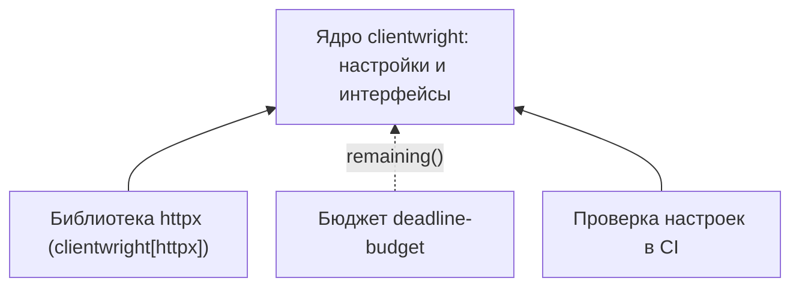

# Ядро без зависимостей: подключаем только нужные интеграции {#zero-dependency-cores-why-optional-dependencies-matter-in-infrastructure-libraries}

<div class="bdr-post__hero" data-bdr-post="2026-10-21-zero-dependency-cores" role="img" aria-label="Общие настройки клиента работают сами по себе; API заказов добавляет к ним HTTP и бюджет времени" markdown="0"></div>

Инфраструктурную библиотеку ставят во многие сервисы, и каждая её обязательная зависимость попадает в каждый из них, даже туда, где она не нужна.

Возьмём clientwright. API заказов запрашивает через него остатки у склада по HTTP, а задача в CI загружает те же настройки и читает, какие возможности заявляет каждый адаптер. API нужна HTTP-библиотека, а задаче в CI не нужна, как и сервису, который работает через aiohttp вместо httpx. Лишняя зависимость обходится ограничениями версий, размером образа и временем импорта.

Посмотрим, что работает на базовой установке, где появляется первая ошибка из-за недостающего extra и что ставит каждый extra. **Extra** называют именованный набор необязательных зависимостей в метаданных пакета: `clientwright[httpx]` ставит clientwright и httpx. Как объявлять такие наборы, описано в [руководстве по упаковке Python-проектов](https://packaging.python.org/en/latest/guides/writing-pyproject-toml/#dependencies-and-requirements).

<!-- more -->

## Общие настройки до выбора транспорта {#what-a-good-core-looks-like}

В `warehouse_policy.py` описаны настройки клиента на типах из ядра [clientwright](https://github.com/bedrock-python/clientwright):

```python
from clientwright import ClientConfig, RetryConfig, TimeoutConfig


def warehouse_config(base_url):
    return ClientConfig(
        service_name="warehouse",
        base_url=base_url,
        timeout=TimeoutConfig(total=2),
        retry=RetryConfig(max_attempts=1),
        circuit_breaker=None,
        deadline_header="X-Deadline-Ms",
        on_unsupported="strict",
    )
```

Повторы и circuit breaker выключены, чтобы пример остался про зависимости. `deadline_header` передаёт оставшееся время в миллисекундах, а `on_unsupported="strict"` заставляет `build()` упасть, если адаптер не умеет применить какую-то настройку.

Когда установлен только `clientwright==0.5.0`, практикум создаёт эту конфигурацию, читает таблицу возможностей и получает список адаптеров: `aiohttp`, `httpx`, `httpx2`, `requests` и `urllib3`. Имя в реестре не значит, что библиотека установлена: `find_spec("httpx")` подтверждает, что httpx нет. Реестр хранит пути для импорта, поэтому даже `import clientwright.adapters.httpx` не загружает HTTP-код, пока адаптер не выберет `build()`. CI может прочитать, что заявляет каждый адаптер, без единого транспорта, но применит ли адаптер настройки целиком, покажет только `build()` с `on_unsupported="strict"`.

<!-- diagram:concept -->
<figure class="bdr-diagram" markdown="1">
<figcaption><span class="bdr-diagram__eyebrow">ИДЕЯ В СХЕМЕ</span><strong>Что подключается к ядру</strong></figcaption>
<div class="bdr-diagram__viewport" markdown="1" data-search-exclude>



</div>
<p class="bdr-diagram__caption">Настройки клиента и интерфейс бюджета работают без HTTP-библиотеки. Библиотеку httpx и deadline-budget ставят только там, где они нужны приложению.</p>
</figure>
<!-- /diagram:concept -->

## Недостающий extra называет себя сам {#the-message-is-the-feature}

Теперь API заказов пробует создать клиент в том же окружении без httpx:

```python
from clientwright import build
from warehouse_policy import warehouse_config

build("httpx", warehouse_config("http://127.0.0.1:1"))
```

```text
ImportError: httpx support requires clientwright[httpx]; install it.
```

Без такой защиты ошибка звучала бы как `No module named 'httpx'`, а очевидное исправление (поставить httpx отдельно) могло бы принести версию, которую clientwright не поддерживает. Extra несёт поддерживаемый диапазон `httpx>=0.28,<1`. Импорт модуля адаптера на базовой установке проходит, поэтому проверяйте операцию, которой нужна интеграция, а не импорт.

servicewright, библиотека для запуска и остановки сервиса, падает раньше: базовый пакет импортируется, а импорт `servicewright.adapters.fastapi` бросает ошибку с подсказкой `servicewright[fastapi]`. Там защита важнее: адаптеру нужны ещё starlette, pydantic и deadline-budget, и без неё недостающий пакет был бы назван своим именем.

## Ставим extra и делаем запрос {#install-extra}

Когда в зависимостях API есть `"clientwright[httpx]==0.5.0"`, сервис запрашивает остаток с теми же настройками:

```python
from clientwright import build

from warehouse_policy import warehouse_config


async def fetch_stock(base_url, deps=None):
    async with build("httpx", warehouse_config(base_url), deps) as client:
        response = await client.get("/stock/sku-42")
        response.raise_for_status()
        return response.json()
```

Локальный сервер практикума отвечает `{"available": 3}` и получает в `X-Deadline-Ms` не больше 2000. `build()` возвращает настоящий `httpx.AsyncClient`, так что код под API httpx не меняется. FastAPI, aiohttp и requests по-прежнему не установлены. Модуль настроек импортирует только clientwright, а HTTP-клиент сервис создаёт тогда, когда ему нужен HTTP.

## Остаток времени через маленький интерфейс {#protocols}

Допустим, запрос к складу должен уложиться в 500 мс, это меньше двухсекундного лимита клиента. Приложение передаёт в `build()` контекст deadline-budget как источник дедлайна:

```python
from clientwright import AdapterDeps
from deadline_budget import BudgetContext

from http_flow import fetch_stock


async def fetch_with_budget(base_url):
    budget = BudgetContext.create(total_seconds=0.5)
    return await fetch_stock(base_url, AdapterDeps(deadline_source=budget))
```

Протокол `DeadlineSource` в clientwright требует один метод: `remaining() -> float | None`. У `BudgetContext` он есть, поэтому clientwright deadline-budget не импортирует, а extra `[deadline]` лишь фиксирует совместимую версию `>=0.1,<1`. Теперь сервер получает в `X-Deadline-Ms` не больше 500. Без установленного deadline-budget импорт `budget_flow.py` падает, и так и задумано: приложение, которое обещает 500 мс, не должно тихо откатываться к двум секундам. Раз приложение импортирует deadline-budget само, пусть и указывает его в своих зависимостях. Интеграция может быть необязательной для библиотеки и обязательной для сервиса.

## Что на самом деле устанавливается {#what-each-library-costs}

| Установка | Дистрибутивов | Что проверяет практикум |
|---|---|---|
| `deadline-budget==0.1.3` | 1 | Бюджет работает без HTTP-библиотек и веб-фреймворков |
| `clientwright==0.5.0` | 1 | Настройки и таблица возможностей доступны |
| `clientwright[httpx]==0.5.0` | 8 | httpx-клиент отправляет запрос; deadline-budget ещё не установлен |
| `clientwright[httpx,deadline]==0.5.0` | 9 | В `X-Deadline-Ms` того же запроса не больше 500 |
| `servicewright==0.13.1` | 1 | FastAPI-адаптер называет недостающий extra |
| `servicewright[fastapi]==0.13.1` | 22 | Адаптер импортируется, точка входа создаётся |

Числа получены на Python 3.13 под Windows, сама библиотека входит в счёт. Extra для httpx добавляет семь дистрибутивов, а extra для FastAPI добавляет двадцать один: кроме FastAPI, он приносит uvicorn со стандартными дополнениями и инструментирование Prometheus. На Linux и macOS из-за uvloop их двадцать два.

## Не навязываем сервису чужие ограничения версий {#the-failure-mode-this-prevents}

Если бы библиотека жизненного цикла требовала FastAPI, воркер, которому нужен только жизненный цикл, унаследовал бы ограничения FastAPI на версии starlette и pydantic. Достаточно одного несовместимого pydantic в другом пакете, и зависимости воркера перестают разрешаться, хотя он вообще не принимает HTTP-запросы. Extra ограничивает проблему приложениями, которые его выбрали. Конфликты там, где FastAPI действительно нужен, он **не убирает**, а если везде ставить `[all]`, преимущество пропадёт.

## Когда зависимость должна быть обязательной {#when-a-hard-dependency-is-right}

Критерий простой: есть ли у библиотеки полезный сценарий без этой зависимости? clientwright поддерживает пять транспортов, и сервису на aiohttp остальные четыре не нужны. Воркеру хватает servicewright без FastAPI. А пакет, который существует ради интеграции с SQLAlchemy, вполне может требовать SQLAlchemy. У необязательных интеграций есть цена: защитные импорты, больше вариантов установки для тестов и недостающий extra, который падает не при установке, а в `build()` уже развёрнутого сервиса. В [практикуме про сборку сервиса](../lab/2026-09-07-what-every-microservice-reimplements/README.md) в одном сервисе стоят `servicewright[fastapi,postgres]`, `clientwright[httpx,deadline]` и deadline-budget.

<div id="the-pieces" data-search-exclude></div>

## Начните с ядра, добавьте нужную интеграцию {#conclusion}

Ставьте `clientwright[httpx]`, если сервису нужен httpx-клиент; `[deadline]` и deadline-budget в собственных зависимостях, если сервис передаёт бюджет; `servicewright[fastapi]` для точки входа на FastAPI; базовую установку везде, где хватает ядра. Если вы поддерживаете библиотеку с extras, заведите в CI задачу на каждый extra: сначала базовая установка и тесты ядра, затем extra и его тесты. Окружение разработчика со всеми дополнениями не покажет, что базовая установка работает.

## Запуск примера {#labs}

Из корня репозитория сайта, с установленным uv:

```bash
cd docs/blog/lab/2026-09-07-zero-dependency-cores
uv run --no-project --python 3.13 python footprint.py
```

Скрипт сам создаёт временные окружения и локальный HTTP-сервер; для загрузки пакетов нужна сеть, а Docker не нужен. `--report results.json` сохраняет список пакетов, а `--measure` добавляет замеры импорта. Проверки и ограничения замеров описаны в [README практикума](../lab/2026-09-07-zero-dependency-cores/README.md).
