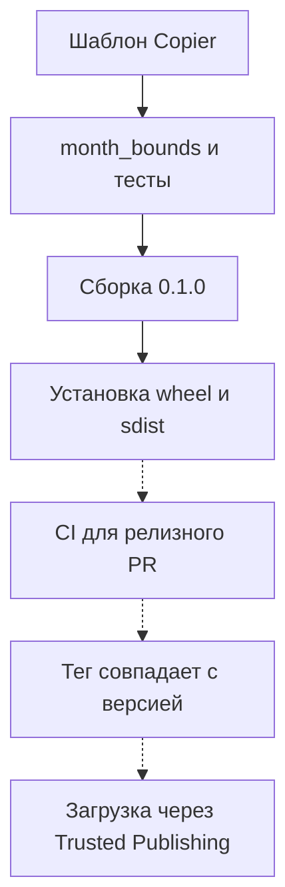

# Python-библиотека от шаблона до релиза {#python-library-from-template-to-release}

<div class="bdr-post__hero" data-bdr-post="2026-10-22-python-library-from-template-to-release" role="img" aria-label="Библиотека отчётных периодов проходит путь от генерации проекта через тесты до установки пакета" markdown="0"></div>

Небольшой общий код часто живёт копиями: в каждом сервисе своя функция, и со временем они расходятся.

Так вышло с сервисом отчётов и воркером выгрузок: оба считают границы месяца в UTC каждый своей функцией, и одна из них ошибается в декабре. Выносим этот код в маленькую библиотеку с тестами.

Библиотека называется `report-periods`, и в ней одна публичная функция, `month_bounds()`. Сгенерируем проект из шаблона Bedrock, добавим функцию и тесты, соберём `0.1.0`, установим оба формата дистрибутива в чистые окружения и поправим два места, где CI и релизный workflow шаблона пропустили бы ошибку.

<!-- more -->

<div id="how-i-start-a-production-grade-python-library-in-2026" data-search-exclude></div>
<div id="one-command" data-search-exclude></div>
<div id="what-is-in-the-forty-one" data-search-exclude></div>
<div id="the-gate-has-to-run-what-it-claims" data-search-exclude></div>
<div id="the-things-a-template-cannot-give-you" data-search-exclude></div>
<div id="the-order-i-actually-work-in" data-search-exclude></div>
<div id="the-pieces" data-search-exclude></div>

## Создаём проект для библиотеки отчётных периодов {#template}

В примере используются [python-library-template на коммите `a1a1e7d`](https://github.com/bedrock-python/python-library-template/tree/a1a1e7d5eafdcac08aeed7c1a0daaff31c67ac8c) и Copier `9.18.2`; для года в лицензии шаблону ещё нужно расширение `jinja2-time`:

```bash
uvx --from copier==9.18.2 --with jinja2-time==0.2.0 copier copy --trust --vcs-ref a1a1e7d gh:bedrock-python/python-library-template report-periods
```

На вопросы Copier отвечаем так: имя дистрибутива `report-periods`, имя пакета для импорта `report_periods`, минимальная версия Python `3.11`. `--trust` нужен, потому что в шаблоне есть Jinja-расширение и задача после генерации; на этом коммите задача только печатает следующие шаги, но перед тем как доверять другой ревизии, [проверьте исполняемые части шаблона](https://copier.readthedocs.io/en/stable/configuring/#unsafe).

В сгенерированном `report_periods/` лежат `__version__.py`, `__init__.py` и маркер `py.typed`. Базовые проверки из каталога проекта:

```bash
uv sync --python 3.13 --group dev
uv run ruff check .
uv run ruff format --check .
uv run mypy report_periods
uv run pytest --cov=report_periods --cov-fail-under=90
```

Проверки проходят; тест пока один, он проверяет экспортируемую версию. `pytest -m integration` не находит тестов и завершается с кодом `5`, и сгенерированный CI это явно допускает.

## Пишем функцию, которая нужна обоим сервисам {#checks}

Контракт задаёт полуинтервал `start <= timestamp < end`. Обе границы приходятся на полночь по UTC. Значение с явным смещением сначала переводится в UTC, значение без смещения отклоняется. Это отчётные месяцы по UTC, а не месяцы в часовом поясе клиента.

- `2026-12-31T23:59:59+00:00` попадает в декабрь: `[2026-12-01, 2027-01-01)` по UTC.
- `2026-10-01T00:30:00+03:00` по UTC ещё сентябрь: `[2026-09-01, 2026-10-01)`.

Добавим `report_periods/periods.py`:

```python
"""UTC month boundaries for reports."""

from datetime import UTC, datetime


def month_bounds(value: datetime) -> tuple[datetime, datetime]:
    """Return the inclusive start and exclusive end of the containing UTC month."""
    if value.utcoffset() is None:
        raise ValueError("An explicit UTC offset is required")
    value = value.astimezone(UTC)
    start = value.replace(day=1, hour=0, minute=0, second=0, microsecond=0)
    if start.month == 12:
        return start, start.replace(year=start.year + 1, month=1)
    return start, start.replace(month=start.month + 1)
```

Экспортируем функцию через `report_periods/__init__.py`, чтобы потребители писали `from report_periods import month_bounds`:

```python
"""UTC month boundaries for reports."""

from .__version__ import __version__
from .periods import month_bounds

__all__ = ["__version__", "month_bounds"]
```

Тесты в `tests/unit/test_periods.py` покрывают обычный месяц, декабрь, февраль високосного года, перевод часового пояса в обе стороны и отсутствие смещения:

```python
"""Behavior tests copied into the generated package's unit suite."""

from datetime import UTC, datetime

import pytest

from report_periods import month_bounds

pytestmark = pytest.mark.unit


@pytest.mark.parametrize(
    ("value", "expected_start", "expected_end"),
    [
        ("2026-09-15T12:00:00+00:00", "2026-09-01", "2026-10-01"),
        ("2026-12-31T23:59:59+00:00", "2026-12-01", "2027-01-01"),
        ("2024-02-29T12:00:00+00:00", "2024-02-01", "2024-03-01"),
        ("2026-10-01T00:30:00+03:00", "2026-09-01", "2026-10-01"),
        ("2026-09-30T23:30:00-03:00", "2026-10-01", "2026-11-01"),
    ],
)
def test__month_bounds__aware_input__returns_utc_range(value: str, expected_start: str, expected_end: str) -> None:
    start, end = month_bounds(datetime.fromisoformat(value))
    assert start == datetime.fromisoformat(expected_start).replace(tzinfo=UTC)
    assert end == datetime.fromisoformat(expected_end).replace(tzinfo=UTC)
    assert start.tzinfo is UTC and end.tzinfo is UTC
    assert start <= datetime.fromisoformat(value) < end


def test__month_bounds__missing_offset__raises() -> None:
    value = datetime.fromisoformat("2026-09-01T00:00:00")
    with pytest.raises(ValueError, match="explicit UTC offset"):
        month_bounds(value)
```

Вместе со сгенерированным тестом версии это семь тестов, которые проходят на Python `3.11`, `3.12` и `3.13`; Ruff, форматирование, mypy и порог покрытия тоже проходят. Затем практикум дважды ломает код: убирает переход на следующий год в декабре, и тест падает; вставляет `datetime.now()` без часового пояса, и Ruff сообщает `DTZ005`.

<div id="twelve-libraries-one-engineering-standard-no-monorepo" data-search-exclude></div>
<div id="what-one-standard-means-in-practice" data-search-exclude></div>
<div id="the-template" data-search-exclude></div>
<div id="the-script" data-search-exclude></div>
<div id="releases-without-a-human-typing-a-version" data-search-exclude></div>
<div id="the-three-things-i-got-wrong" data-search-exclude></div>
<div id="why-not-a-monorepo" data-search-exclude></div>

## Чтобы статус `All checks passed` значил то, что написано {#repositories}

[`scripts/setup_repo.py`](https://github.com/bedrock-python/python-library-template/blob/a1a1e7d5eafdcac08aeed7c1a0daaff31c67ac8c/scripts/setup_repo.py) из шаблона делает `All checks passed` единственной обязательной проверкой. В сгенерированном CI эта задача падает на `failure` и `cancelled`, но считает `skipped` успехом. Сейчас ни у одной из трёх проверяемых задач нет `if:`, поэтому задачу пропускают, только когда упала задача, от которой она зависит, а это и так роняет итоговую проверку. Но стоит кому-то добавить к `test-unit` условие `if:` (например, по результату фильтра путей), и пропущенные тесты оставят итог зелёным ([#16](https://github.com/bedrock-python/python-library-template/issues/16)). Добавим `skipped` в условие:

```yaml
# Replace jobs.all-checks-passed in the generated ci.yml with this job.
all-checks-passed:
  name: All checks passed
  if: always()
  needs: [lint, test-unit, test-integration]
  runs-on: ubuntu-latest
  steps:
    - name: Check all jobs succeeded
      run: |
        if [[ "${{ contains(needs.*.result, 'failure') || contains(needs.*.result, 'cancelled') || contains(needs.*.result, 'skipped') }}" == "true" ]]; then
          echo "One or more required checks failed or were skipped."
          exit 1
        fi
        echo "All checks passed."
```

Практикум вычисляет это условие для всех 64 сочетаний результатов трёх задач: проходит только вариант, где все успешны, а исходное условие принимало ещё семь сочетаний, где хотя бы одна задача в состоянии `skipped`. При строгом условии задачу, которую пропускают намеренно, нужно убрать из `needs` или проверять отдельно: `dependency-review` в pg-partsmith запускается только для pull request, и в `needs` она роняла бы каждый push в master. Итоговая проверка видит результаты задач, а не их содержимое: интеграционная задача без тестов всё равно успешна.

`setup_repo.py` меняет настройки GitHub через `gh` и не поддерживает пробный запуск (dry run): прежде чем запускать скрипт, прочитайте, что он меняет, и дождитесь первого зелёного прогона CI в проекте.

## Готовим версию 0.1.0 и собираем пакет {#release}

Проект начинается с `0.0.0`. В настоящем репозитории Release Please по сообщениям коммитов готовит релизный PR с версией и changelog; практикум записывает те же значения `0.1.0` в `report_periods/__version__.py`, `.release-please-manifest.json` и `CHANGELOG.md` локально, без тега. Собираем из каталога проекта:

```bash
uv build
```

Получаются `dist/report_periods-0.1.0-py3-none-any.whl` и `dist/report_periods-0.1.0.tar.gz`. Практикум проверяет, что в обоих архивах одни и те же модули и `py.typed`, а в метаданных wheel есть имя, версия, `Requires-Python >=3.11` и нет ни одной зависимости.

<!-- diagram:concept -->
<figure class="bdr-diagram" markdown="1">
<figcaption><span class="bdr-diagram__eyebrow">ИДЕЯ В СХЕМЕ</span><strong>От полезной функции до установленного пакета</strong></figcaption>
<div class="bdr-diagram__viewport" markdown="1" data-search-exclude>



</div>
<p class="bdr-diagram__caption">Сплошные шаги практикум выполняет локально, от генерации до установки в чистые окружения. Пунктирные происходят в GitHub и PyPI и зависят от настроек, описанных ниже.</p>
</figure>
<!-- /diagram:concept -->

## Проверяем установку в чистом окружении {#verification}

Успешный импорт из каталога проекта может скрыть сломанный пакет: Python найдёт исходники рядом. Практикум создаёт отдельные окружения Python `3.11` для wheel и sdist, ставит каждый через `uv pip install`, переходит в пустой каталог и запускает этот скрипт через `python -I`:

```python
"""Run with the isolated interpreter of each clean installation."""
from datetime import UTC, datetime
from importlib.metadata import version
from importlib.resources import files
from pathlib import Path
import sys

import report_periods

assert report_periods.__version__ == version("report-periods") == "0.1.0"
assert Path(report_periods.__file__).resolve().is_relative_to(Path(sys.prefix).resolve())
assert files("report_periods").joinpath("py.typed").is_file()
assert report_periods.month_bounds(datetime.fromisoformat("2026-10-01T00:30:00+03:00")) == (
    datetime(2026, 9, 1, tzinfo=UTC), datetime(2026, 10, 1, tzinfo=UTC),
)
print("PASS installed artifact: version, public API, UTC result, py.typed, import from the clean environment")
```

Проверка пути подтверждает, что модуль импортирован из чистого окружения; остальные проверяют публичный API и метаданные. Установка sdist заодно собирает пакет из архива исходников. Обе установки проходят.

<div id="publishing-to-pypi-without-api-tokens-trusted-publishing-end-to-end" data-search-exclude></div>
<div id="what-replaces-the-token" data-search-exclude></div>
<div id="the-environment-is-the-gate" data-search-exclude></div>
<div id="from-a-merged-pull-request-to-a-tag" data-search-exclude></div>
<div id="the-publish-trigger-and-why-it-is-a-workflow_run" data-search-exclude></div>
<div id="the-day-something-goes-wrong" data-search-exclude></div>
<div id="what-this-buys-concretely" data-search-exclude></div>

## Что нужно до первого релиза на PyPI {#publishing}

При [Trusted Publishing](https://docs.pypi.org/trusted-publishers/) PyPI проверяет OIDC-токен, который GitHub выписывает запуску workflow, и взамен даёт короткоживущий токен для загрузки. Для проекта, которого на PyPI ещё нет, нужен [pending publisher](https://docs.pypi.org/trusted-publishers/creating-a-project-through-oidc/), и в нём есть ещё поле с именем проекта; имя не резервируется до первой загрузки:

| Поле издателя на PyPI | Пример значения |
|---|---|
| PyPI project name | `report-periods` |
| Repository owner | `example-org` |
| Repository name | `report-periods` |
| Workflow filename | `publish.yml` |
| Environment name | `pypi` |

Задача публикации работает с `environment: pypi`. PyPI требует `id-token: write`, а `contents: read` нужен для checkout:

```yaml
permissions:
  contents: read
  id-token: write
```

Само по себе окружение `pypi` ничего не защищает: ограничьте в его настройках ветки и теги, с которых можно публиковать, и при желании включите подтверждение.

Шаблон запускает публикацию, когда завершился Release Please:

```yaml
on:
  workflow_run:
    workflows: ["Release Please"]
    types: [completed]
```

[`workflow_run`](https://docs.github.com/en/actions/reference/workflows-and-actions/events-that-trigger-workflows#workflow_run) нужен потому, что теги и релизы, созданные с `GITHUB_TOKEN`, не запускают workflow на `push: tags` или `release`. Задача публикации не ждёт CI на коммите с тегом ([#11](https://github.com/bedrock-python/python-library-template/issues/11)), а через `workflow_dispatch` можно опубликовать любой тег, переданный на вход ([#10](https://github.com/bedrock-python/python-library-template/issues/10)); проверка ниже исправляет не это, а следующую проблему. Перед сборкой шаблон перезаписывает `__version__.py` по тегу. Тогда неверный тег молча уходит в публикацию, а загруженная версия расходится с закоммиченным файлом версии, changelog и манифестом. Замените этот шаг проверкой:

```yaml
# Replace the "Set version from release tag" step in the generated publish.yml with this step.
- name: Check that the tag matches the committed version
  env:
    TAG: ${{ needs.check.outputs.tag }}
  shell: python
  run: |
    import os, pathlib, re
    source = pathlib.Path("report_periods/__version__.py").read_text()
    version = re.search(r'__version__ = "([^"]+)"', source)[1]
    if os.environ["TAG"] not in (f"v{version}", f"report-periods-v{version}"):
        raise SystemExit(f"Tag {os.environ['TAG']} does not match version {version}")
```

Практикум выполняет код этого шага на закоммиченной версии: `v0.1.0` и `report-periods-v0.1.0` проходят, а `v0.2.0`, `other-v0.1.0`, `v0.1.0-extra` и `main` отклоняются.

CI для релизных PR, которые Release Please открывает с `GITHUB_TOKEN`, ждёт подтверждения, которого никто не даёт, и истекает, поэтому обязательная проверка по ним так и не приходит. В библиотеках Bedrock каждый релизный PR закрывают и открывают заново; токен GitHub App для Release Please избавляет от этого ([#12](https://github.com/bedrock-python/python-library-template/issues/12)). Практикум не проверяет ни эти настройки GitHub, ни OIDC, ни загрузку.

## Что получилось {#conclusion}

В `report-periods` есть функция границ месяца с тестами на крайние случаи, а оба формата дистрибутива проверены в чистых окружениях. Итоговая проверка CI теперь падает на пропущенных задачах, а шаг публикации отклоняет тег, который не совпадает с версией. До настоящей загрузки осталось два дела: заставить публикацию ждать CI на коммите с тегом и сделать настройки GitHub и PyPI, описанные выше.

## Как повторить пример {#labs}

[Практикум](../lab/2026-09-07-twelve-libraries-one-standard/README.md) выполняет всё описанное, кроме шагов в GitHub и PyPI. Нужны Git, uv и доступ к сети. Из корня репозитория сайта:

```bash
uv run --no-project --python 3.13 --with-requirements docs/blog/lab/2026-09-07-twelve-libraries-one-standard/requirements.txt python docs/blog/lab/2026-09-07-twelve-libraries-one-standard/generate_and_check.py --output build/report-periods-lab
```
