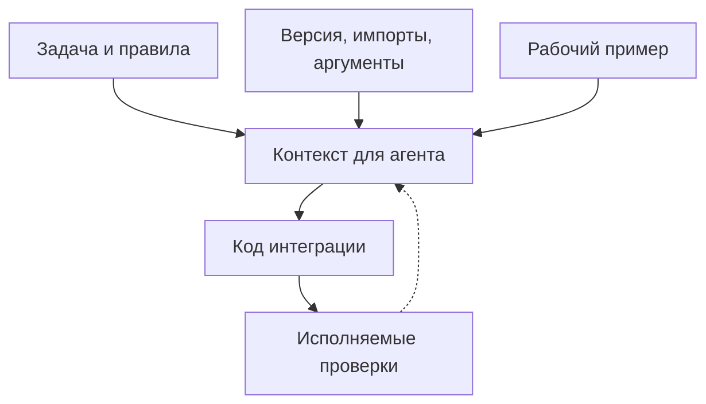

# Документация, с которой ИИ-агент пишет проверяемый код {#we-started-writing-documentation-for-ai-coding-agents}

<div class="bdr-post__hero" data-bdr-post="2026-10-26-documentation-for-ai-coding-agents" role="img" aria-label="Задача, описание API конкретной версии и рабочий пример помогают получить проверяемый код" markdown="0"></div>

Всё больше кода в сервисах пишут ИИ-агенты, и пишут его по той документации, которая есть у проекта. Чего в ней не хватает, агент додумывает сам, и не всегда верно.

Возьмём обычную задачу: добавить в сервис заказов расчёт доставки. Расчёт сначала проверяет остаток на складе, потом считает доставку; на оба шага 600 мс, на каждый не больше 400 мс. В проекте используется [deadline-budget](https://bedrock-python.github.io/deadline-budget/). Обзор библиотеки объясняет идею, но не отвечает на вопросы, от которых зависит код: точный импорт, какие методы синхронные, в каких единицах таймаут и кто отменяет работу.

Соберём это в задание и короткое описание API, напишем функцию и проверим тестами всё, что обещает документация. Это пример подготовки документации, а не замер качества ИИ-модели.

<!-- more -->

## Какой контекст нужен для задачи {#two-readers-two-questions}

Фраза «используй deadline-budget» оставляет открытыми несколько вопросов. Начинается ли отсчёт при создании бюджета? Нужен ли `await` перед `timeout_for_call()`? Отменит ли библиотека запрос к складу? Правдоподобная догадка в любом из этих мест может дать неверный код, и неважно, пишет его агент или человек. Для этой задачи задание вместе с нужными файлами может выглядеть так:

> Реализуй `shipping_quote(sku, *, stock, shipping)` на `deadline-budget==0.1.3` и Python 3.13.
>
> Проверка склада и расчёт доставки вместе должны уложиться в 600 мс, а каждый шаг не больше чем в 400 мс. Через 600 мс отменяй всю операцию; `DeadlineExceededError` и `TimeoutError` пробрасывай наружу. Если остаток нулевой или отрицательный, верни `None`, иначе верни расчёт доставки.
>
> Прежде чем выбирать вызовы, прочитай приложенное описание API и контракт адаптеров. Если чего-то в них нет, загляни в [руководство deadline-budget 0.1.3 для агентов](https://github.com/bedrock-python/deadline-budget/blob/deadline-budget-v0.1.3/docs/agents.md), а не угадывай. Запусти поведенческие тесты из `test_contract.py` и сообщи результат.

Адаптеры относятся к нашему приложению: `stock` возвращает количество товара целым числом, а `shipping` возвращает расчёт доставки. Обе функции асинхронные, принимают `sku` и именованный `timeout` в секундах, сами применяют этот таймаут и не подавляют отмену. Это сказано явно, чтобы читатель не решил, будто клиент склада входит в deadline-budget.

## Импорты, значения по умолчанию и ответственность в одном месте {#one-page-per-library}

В [шаблоне библиотек Bedrock](https://github.com/bedrock-python/python-library-template/blob/master/template/docs/agents.md.jinja) для этого есть страница `docs/agents.md`. Для нашей задачи хватит короткого описания API:

| Вопрос | Ответ для примера |
|---|---|
| Что установлено | `deadline-budget==0.1.3`, проверено на Python 3.13 |
| Откуда импортировать | `from deadline_budget import BudgetContext, DeadlineExceededError` |
| Как создать контекст | `BudgetContext.create(total_seconds, call_caps=None, *, min_timeout=0.1, safety_margin=0.0)` |
| Когда начинается отсчёт | В момент `create()` |
| Где нужен `await` | Нигде: `create()`, `remaining()` и `timeout_for_call()` синхронные; `await` нужен только для адаптеров |
| В каких единицах время | В секундах, `float` |
| Кто владеет бюджетом | Один контекст на расчёт доставки, общий для обоих шагов |
| Кто отменяет работу | Адаптеры и `asyncio.timeout()` в приложении |
| Какие ошибки важны | `DeadlineExceededError`, если таймаут считают после того, как бюджет кончился; `TimeoutError` от `asyncio.timeout()` или адаптера |

То же описание вместе с запускаемым кодом лежит в [README практикума](../lab/2026-09-07-documentation-for-ai-coding-agents/README.md). В нём указаны версия и границы задачи, чтобы читатель понимал, когда пора открывать [полное руководство для агентов](https://github.com/bedrock-python/deadline-budget/blob/deadline-budget-v0.1.3/docs/agents.md). Добавьте короткую карту чтения с подписью-вопросом у каждой ссылки (например, [статья о дедлайнах](2026-09-06-timeouts-are-not-deadlines.md) о том, как передавать бюджет между сервисами) вместо того, чтобы вставлять все страницы в каждую задачу.

## Показываем ошибку и как правильно {#wrong-then-right}

Опасные ошибки здесь тихие. Вот одна из них: новый контекст на втором шаге.

```python
caps = {"stock": 0.4, "shipping": 0.4}

# WRONG: the second context starts a fresh 600 ms
ctx = BudgetContext.create(total_seconds=0.6, min_timeout=0, call_caps=caps)
available = await stock(sku, timeout=ctx.timeout_for_call("stock"))
ctx = BudgetContext.create(total_seconds=0.6, min_timeout=0, call_caps=caps)
quote = await shipping(sku, timeout=ctx.timeout_for_call("shipping"))
```

Ничего не падает. Если проверка склада заняла 250 мс, доставка всё равно получит 400 мс вместо 350, и расчёт может выйти за 600 мс. Ошибка погромче, `await BudgetContext.create(...)`, падает с `TypeError` при первом же запуске, поэтому пару «неправильно / правильно» на странице для агентов лучше потратить на тихие ошибки. Практикум запускает обе.

## Правила внутри рабочего примера {#rules-that-hold-or-break-the-code}

Вот `shipping.py`. Единственный внешний импорт здесь настоящий API бюджета, а `stock` и `shipping` передаёт приложение:

```python
import asyncio

from deadline_budget import BudgetContext


async def shipping_quote(sku, *, stock, shipping):
    ctx = BudgetContext.create(
        total_seconds=0.6,
        min_timeout=0,
        call_caps={"stock": 0.4, "shipping": 0.4},
    )
    async with asyncio.timeout(ctx.remaining()):
        available = await stock(sku, timeout=ctx.timeout_for_call("stock"))
        if available <= 0:
            return None
        return await shipping(sku, timeout=ctx.timeout_for_call("shipping"))
```

Один контекст, созданный до проверки склада; таймаут каждого вызова считается прямо перед ним. Рядом с этим кодом нужно проговорить три детали:

- В версии 0.1.3 `min_timeout` по умолчанию равен 100 мс, и адаптеру могут велеть ждать 100 мс, когда осталось всего 20. В примере стоит ноль.
- Бюджет только считает числа, а отменяет задачу [`asyncio.timeout()`](https://docs.python.org/3.13/library/asyncio-task.html#asyncio.timeout), когда время вышло. Истекают они одновременно, поэтому медленный шаг, который отдаёт управление, заканчивается `TimeoutError`; `DeadlineExceededError` перед вторым шагом значит, что первый заблокировал цикл событий или проглотил отмену.
- У неизвестного имени в `call_caps` лимита нет. С опечаткой `"stcok"` вызов получает все 600 мс вместо 400, и никакой ошибки не возникает.

## Проверяем то, что может устареть {#keeping-it-true}

Практикум проверяет версию, импорты, значения по умолчанию и поведение функции. Кроме того, он сравнивает `shipping.py` с его копиями в README практикума и в этой статье на обоих языках по синтаксическому дереву: если поменять код и забыть про документацию, проверка упадёт. Эти проверки нужны тем, кто поддерживает страницу; реализацию агента оценивают поведенческие тесты.

<!-- diagram:concept -->
<figure class="bdr-diagram" markdown="1">
<figcaption><span class="bdr-diagram__eyebrow">ИДЕЯ В СХЕМЕ</span><strong>От описания задачи к проверяемому коду</strong></figcaption>
<div class="bdr-diagram__viewport" markdown="1" data-search-exclude>



</div>
<p class="bdr-diagram__caption">Задача, сведения об API и рабочий пример складываются в контекст для агента. Код интеграции проходит проверки, а найденные ошибки возвращаются в документацию.</p>
</figure>
<!-- /diagram:concept -->

В поведенческих тестах часы внутри модуля бюджета подменены, так что тест тратит время бюджета, не дожидаясь его; asyncio живёт по настоящим часам. Тесты проверяют таймауты 400 и 350 мс, версию с ошибкой из раздела выше, остаток в 20 мс, который доходит до адаптера без изменений, пустой склад, опечатку в имени вызова, зависший шаг, который отменяет `asyncio.timeout()`, и шаг, который выходит за лимит, не отдавая управление. Четырнадцать проверок работают на зафиксированной версии пакета и `unittest` из стандартной библиотеки, без модели, внешних сервисов и Docker:

```bash
cd docs/blog/lab/2026-09-07-documentation-for-ai-coding-agents
uv run --no-project --python 3.13 --with-requirements requirements.txt python test_contract.py
```

Если проверка упала, вместе с кодом поправьте описание или пример: следующий читатель, человек или агент, начнёт с них. Держите в описании только те вызовы, которые нужны задаче, и проверяйте их.

## Агент должен получить сам текст страницы {#the-page-has-to-reach-the-model}

URL в задании ещё не значит, что страницу прочитали. Агенту, который умеет загружать файлы, дайте прямую ссылку на Markdown, иначе вставьте страницу ему в контекст. Документация библиотек Bedrock публикуется в Markdown рядом с HTML: например, [страница deadline-budget для агентов](https://bedrock-python.github.io/deadline-budget/agents.md) лежит обычным `.md`-файлом, его создаёт [скрипт экспорта](https://github.com/bedrock-python/python-library-template/blob/master/template/scripts/emit_markdown.py) из шаблона.

<div id="what-it-did-for-the-humans" data-search-exclude></div>

## Оставляем следующему читателю проверяемую точку входа {#conclusion}

Для расчёта доставки в описании понадобились версия, импорты, значения по умолчанию, обязанности адаптеров, одна рабочая функция и команда, которая её проверяет. Ревьюеру получившегося кода нужны те же факты. Подключая библиотеку Bedrock, начинайте с её страницы для агентов на теге той версии, которую устанавливаете; для своего пакета возьмите [шаблон](https://github.com/bedrock-python/python-library-template) и добавьте тесты на поведение, обещанное в примерах.
