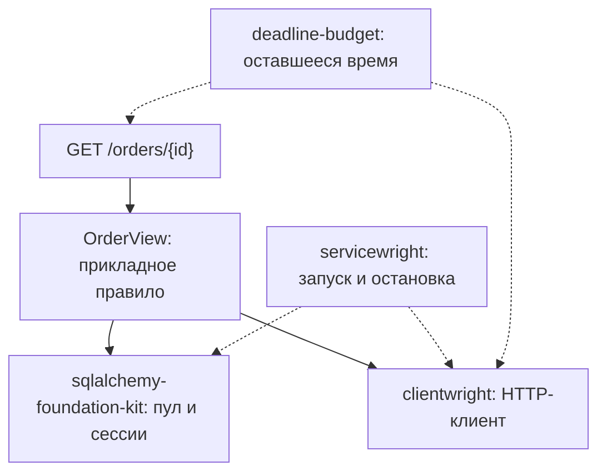

# Зачем выделять инфраструктуру Python-сервисов в библиотеки {#why-bedrock-python-libraries}

<div class="bdr-post__hero" data-bdr-post="2026-10-27-why-bedrock-python-libraries" role="img" aria-label="API заказов объединяет сессию БД, HTTP-клиент, дедлайн и закрытие ресурсов" markdown="0"></div>

Когда сервисов становится больше одного, у них появляется общая обвязка: пул соединений, ретраи, дедлайн запроса, порядок остановки. Обычно её копируют из сервиса в сервис, а вместе с ней и одни и те же баги. Чинить их потом приходится в каждой копии.

Bedrock Python начался с того, что я вынес эту обвязку в отдельные библиотеки. Покажу на примере API заказов, что берут на себя библиотеки, что остаётся за сервисом и как проверить, что всё работает вместе. API читает заказ из PostgreSQL, спрашивает остаток у склада и отвечает, хватит ли товара.

<!-- more -->

<div id="welcome-to-the-bedrock-python-blog" data-search-exclude></div>
<div id="why-this-exists" data-search-exclude></div>
<div id="the-decision" data-search-exclude></div>
<div id="what-to-expect-from-this-blog" data-search-exclude></div>

## Начинаем с решения, которое принимает сервис {#boundaries}

На неизвестный заказ API отвечает `404`, для найденного сравнивает остаток с заказанным количеством. Недоступный склад считается ошибкой, а не нулевым остатком. `OrderStore` и `StockReader` в `orders.py` описаны небольшими протоколами, и прикладной сценарий не импортирует ни FastAPI, ни инфраструктуру:

```python
class OrderView:
    def __init__(self, store: OrderStore, stock: StockReader):
        self.store, self.stock = store, stock

    async def get(self, order_id: int) -> dict:
        order = await self.store.find(order_id)
        if order is None:
            raise OrderMissing(order_id)
        available = await self.stock.available(order.sku)
        return {
            "order_id": order.id,
            "available": available,
            "can_fulfill": available >= order.quantity,
        }
```

Практикум проверяет этот класс с обычными объектами в памяти. Соединения и ретраи дают библиотеки, а сравнение количества и правило для неизвестного заказа остаются здесь. Это просмотр остатка, а не резервирование: остаток может измениться сразу после ответа.

<div id="what-every-production-python-microservice-reimplements" data-search-exclude></div>
<div id="the-list" data-search-exclude></div>
<div id="why-not-a-framework" data-search-exclude></div>
<div id="a-hundred-lines" data-search-exclude></div>
<div id="run" data-search-exclude></div>
<div id="how-the-pieces-stay-apart" data-search-exclude></div>

## Подключаем PostgreSQL и склад {#example}

`OrderStore` реализуем через [sqlalchemy-foundation-kit](https://github.com/bedrock-python/sqlalchemy-foundation-kit). Его `AsyncSessionManager` создаёт движок и выдаёт сессии, а в `aclose()` закрывает движок: отмена задачи это закрытие не прерывает, ждёт он не дольше 30 секунд (по умолчанию), после чего новых сессий не выдаёт. Адаптер сам выбирает запрос и границы сессии:

```python
class SqlOrderStore:
    def __init__(self, db):
        self.db = db

    async def find(self, order_id):
        async with self.db.get_session() as session:
            row = (
                (
                    await session.execute(
                        text("SELECT id, sku, quantity FROM orders WHERE id = :id"),
                        {"id": order_id},
                    )
                )
                .mappings()
                .one_or_none()
            )
            return Order(**row) if row is not None else None
```

Блок `async with` закрывается раньше, чем `OrderView` идёт на склад, поэтому медленный HTTP-ответ не держит соединение с БД. Для записи есть `get_transaction()`.

Общий HTTP-клиент даёт [clientwright](https://github.com/bedrock-python/clientwright):

```python
def stock_client(base_url):
    return build(
        "httpx",
        ClientConfig(
            service_name="orders",
            base_url=base_url,
            timeout=TimeoutConfig(total=5),
            retry=RetryConfig(max_attempts=2, methods=frozenset({"GET"})),
            deadline_header="X-Deadline-Ms",
            on_unsupported="strict",
        ),
        AdapterDeps(deadline_source=AmbientDeadlineSource()),
    )
```

Повторяем только `GET` и только один раз (`max_attempts=2`): запрос остатка ничего не меняет. Бюджет ретраев и circuit breaker на каждый адрес остаются включёнными по умолчанию. У клиента потолок в пять секунд, но `AmbientDeadlineSource` сокращает его до времени, которое осталось у запроса, а заголовок `X-Deadline-Ms` сообщает это время складу; учитывать его или нет, решает склад. С `on_unsupported="strict"` вызов `build()` падает, если адаптер httpx не умеет применить какую-то настройку.

Адаптер склада проверяет ответ. Если склад ответил `503` и после повтора или прислал некорректный остаток, адаптер поднимает прикладную ошибку `StockUnavailable`. Таймауты он пропускает дальше, чтобы обработчик ответил `504`:

```python
class HttpStockReader:
    def __init__(self, client):
        self.client = client

    async def available(self, sku):
        try:
            response = await self.client.get(f"/stock/{sku}")
            response.raise_for_status()
            available = response.json()["available"]
            if type(available) is not int or available < 0:
                raise ValueError("Expected a nonnegative stock count")
            return available
        except httpx.TimeoutException:
            raise
        except (httpx.HTTPError, ValueError, KeyError, TypeError) as error:
            raise StockUnavailable(sku) from error
```

Эти настройки годятся для чтения. Для повторов платежа нужны другие правила, они разобраны в [статье об HTTP- и gRPC-клиентах](2026-09-13-production-http-grpc-clients.md).

## Ограничиваем время всей операции {#deadline}

Часть времени может уйти на PostgreSQL ещё до первой HTTP-попытки, поэтому обработчик заводит на всю операцию один бюджет времени из [deadline-budget](https://github.com/bedrock-python/deadline-budget), а не запускает таймер заново на каждом шаге:

```python
@router.get("/orders/{order_id}")
async def get_order(
    order_id: int,
    unit: UnitScopeDep,
    x_deadline_ms: int = Header(default=800, ge=50, le=2000),
):
    budget = BudgetContext.create(total_seconds=x_deadline_ms / 1000)
    try:
        with use_budget(budget):
            async with asyncio.timeout(budget.remaining()):
                view = await unit.get(OrderView)
                return await view.get(order_id)
    except OrderMissing as error:
        raise HTTPException(404, "Order not found") from error
    except StockUnavailable as error:
        raise HTTPException(503, "Stock is temporarily unavailable") from error
    except (TimeoutError, httpx.TimeoutException) as error:
        raise HTTPException(504, "Order lookup deadline exceeded") from error
```

По умолчанию на запрос отводится 800 мс; `X-Deadline-Ms` принимается только от 50 до 2000 мс, иначе FastAPI ответит `422`. `use_budget()` из clientwright передаёт HTTP-клиенту оставшееся время, а `asyncio.timeout()` ограничивает всё, чего ждёт обработчик, включая чтение БД. deadline-budget здесь только отсчитывает время; clientwright его не импортирует и примет любой объект с `remaining()` и `expired()`. `UnitScopeDep` берётся из FastAPI-адаптера servicewright и возвращает область запроса, `unit.get(OrderView)` достаёт сценарий, а обработчик переводит прикладные ошибки в `404`, `503` и `504`.

## Создаём общие ресурсы один раз и закрываем последними {#composition}

Жизненным циклом процесса управляет [servicewright](https://github.com/bedrock-python/servicewright). Наш `Container` реализует обе области, которых ждёт servicewright: `app_scope()` владеет общими ресурсами, а `unit_scope()` даёт каждому запросу прикладной сценарий:

```python
@asynccontextmanager
async def app_scope(self):
    async with AsyncExitStack() as stack:
        self.db = await stack.enter_async_context(
            AsyncSessionManager(
                self.settings.database_url,
                poolclass="async_adapted_queue",
            )
        )
        self.http = await stack.enter_async_context(
            stock_client(self.settings.warehouse_url)
        )
        view = OrderView(SqlOrderStore(self.db), HttpStockReader(self.http))
        self.scope = Scope(self.db, view)
        yield self.scope
```

`AsyncExitStack` закрывает сначала HTTP-клиент, потом менеджер БД, в том числе если следующий шаг запуска упал. `poolclass="async_adapted_queue"` здесь важен: по умолчанию менеджер использует NullPool и открывает новое соединение на каждую сессию. `Scope` взят из практикума: это небольшой класс, который возвращает `OrderView`.

Остаётся настроить runtime и точку входа FastAPI:

```python
def build_service(settings, *, port=0, container=None):
    container = container or Container(settings)
    spec = AppSpec(
        service_name="orders",
        create_container=lambda _: container,
        warmers_factory=lambda ctx: [PostgresWarmer(ctx.container.db, timeout=2)],
        drain_delay_seconds=0.2,
        drain_grace_seconds=3,
        cleanup_timeout_seconds=2,
    )

    async def register_health(scope):
        spec.health.add_check(
            "postgres", PostgresHealthCheck(scope.db.session_maker, timeout=1)
        )

    spec.lifecycle.add_pre_start_hook(register_health)
    api = FastApiEntrypoint(
        config=HttpConfig(host="127.0.0.1", port=port, graceful_timeout=2),
        routers=(router,),
    )
    return Service(spec, entrypoints=[api]), api
```

До запуска HTTP-сервера прогрев выполняет настоящий запрос к PostgreSQL. Readiness проверяет PostgreSQL, а при недоступном складе ошибку отдаёт только эндпоинт заказа. При остановке readiness становится false, но сервер ещё `drain_delay_seconds` принимает соединения, чтобы балансировщик успел это заметить. Затем у активных запросов есть две секунды, столько же, сколько самый длинный дедлайн эндпоинта: `HttpConfig(graceful_timeout=2)` становится `timeout_graceful_shutdown` в uvicorn, и после него uvicorn отменяет всё, что не успело. Для HTTP реальный предел задаёт он, а не `drain_grace_seconds=3` ([servicewright #89](https://github.com/bedrock-python/servicewright/issues/89)). `cleanup_timeout_seconds` ограничивает собственные шаги servicewright после этого, например остановку сервера и хуки; на закрытие ресурсов контейнера он не действует, а у менеджера сессий свой предел в 30 секунд. `run_sync()` в `service.py` ставит обработчики SIGTERM и SIGINT, а практикум вызывает `service.run(settings, stop=stop)` и сам выставляет событие, чтобы один и тот же тест работал и на Windows, и на Linux.

<!-- diagram:concept -->
<figure class="bdr-diagram" markdown="1">
<figcaption><span class="bdr-diagram__eyebrow">ИДЕЯ В СХЕМЕ</span><strong>Один сценарий и явные владельцы ресурсов</strong></figcaption>
<div class="bdr-diagram__viewport" markdown="1" data-search-exclude>



</div>
<p class="bdr-diagram__caption">servicewright управляет общими ресурсами. OrderView читает заказ и запрашивает остаток; обработчик задаёт бюджет времени и переводит ошибки в HTTP-ответы.</p>
</figure>
<!-- /diagram:concept -->

## Проверяем поведение, а не только импорты {#verification}

Практикум поднимает PostgreSQL 17 в Docker, локальный HTTP-сервис склада и API заказов и проверяет:

| Ситуация | Ожидаемый результат |
|---|---|
| Известный заказ | Чтение по ID, запрос остатка по SKU, сравнение количества |
| Неизвестный заказ | `404`, склад не вызывается |
| Некорректный заголовок дедлайна | `422` |
| Склад один раз вернул `503` | Один повтор; у второго запроса оставшееся время меньше |
| Склад продолжает отвечать `503` или присылает некорректные данные | `503` |
| Склад перестал отвечать | `504` в пределах бюджета операции |
| Остановка во время запроса к складу | Запрос завершается в отведённое время, общие ресурсы закрываются после него |
| Прогрев PostgreSQL не удался | HTTP-сервер не запускается, открытые ресурсы закрываются |

Пока запрос к складу висит, практикум также проверяет, что из пула БД не взято ни одного соединения. В [практикуме](../lab/2026-09-07-what-every-microservice-reimplements/README.md) закреплены `servicewright[fastapi,postgres]` 0.13.1, `sqlalchemy-foundation-kit` 0.4.0, `clientwright[httpx,deadline]` 0.5.0 и `deadline-budget` 0.1.3; команда запуска есть в его README.

## Когда отдельная библиотека окупается {#tradeoffs}

Выигрыш видно на двух реальных исправлениях. В clientwright 0.2.0 общий дедлайн действовал только до заголовков ответа, и тело, приходившее по байту, читалось дольше `total=1.0`; в 0.2.2 это исправили один раз для всех сервисов, которые обновятся ([#25](https://github.com/bedrock-python/clientwright/issues/25)). `drain_delay_seconds`, который используется выше, появился в servicewright после [#46](https://github.com/bedrock-python/servicewright/issues/46): между снятием readiness и закрытием сервера не было паузы.

Цена тоже вполне конкретная. servicewright[grpc] 0.13.0 ограничил grpc-server-kit версиями ниже 0.2 и не ставился вместе с grpc-server-kit 0.2.0, которая вышла на полчаса раньше; исправили это в 0.13.1, которая и закреплена здесь ([#66](https://github.com/bedrock-python/servicewright/issues/66)). Независимые пакеты нужно проверять и вместе: даже если тесты каждого пакета зелёные, пример сломается, если HTTP-клиент не увидит общий бюджет времени или закроется раньше, чем закончится запрос. Практикум тоже входит в эту цену.

Пакет окупается, когда граница у него узкая (владелец сессий, политика клиента, жизненный цикл ресурса) и у него есть второй потребитель. Несколько строк, которые нужны одному сервису, не стоят отдельных релизов, забот о совместимости и документации.

## Что берут библиотеки, а что остаётся сервису {#conclusion}

Библиотеки взяли на себя пул, ретраи, дедлайн и порядок остановки. За сервисом остались правило для `404`, сравнение остатка и перевод ошибок в HTTP-ответы. Дальнейшие решения разобраны в [каталоге библиотек](../../libraries/index.md) и статьях о [жизненном цикле](2026-09-20-python-service-lifecycle.md), [транзакциях](2026-10-08-sqlalchemy-sessions-and-transactions.md) и [необязательных зависимостях](2026-10-21-zero-dependency-cores.md).

## Примеры и практикумы {#labs}

- [Практикум: API заказов на четырёх библиотеках](../lab/2026-09-07-what-every-microservice-reimplements/README.md)
