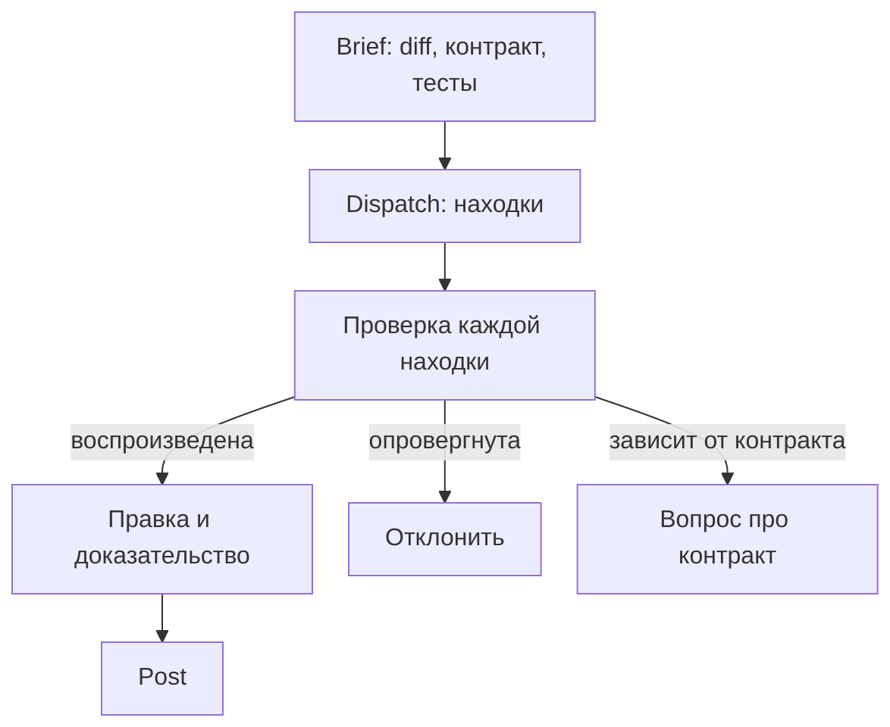

# Почему замечания ИИ-ревью нужно проверять {#ai-code-review-should-not-be-fully-autonomous}

<div class="bdr-post__hero" data-bdr-post="2026-10-29-ai-code-review-should-not-be-fully-autonomous" role="img" aria-label="Четыре находки ревью проходят проверку, и только одна становится комментарием с доказательством" markdown="0"></div>

Многие команды подключили к merge request ИИ-ревьюера. Он пишет замечания уверенно, как опытный коллега, но уверенный тон ещё не значит, что замечание верно.

Допустим, ИИ-ревьюер находит проблему в merge request коллеги: новый повтор резервирования на складе может создать дубликат, если ответ потеряется. Прежде чем эта находка станет комментарием, кто-то должен проверить, что она верна для этого склада.

Тот же проход вернул ещё три находки. Проверим все четыре, опубликуем ту, что подтвердится, и перепроверим её после исправления автора. Воспроизведение и исправление можно запустить; сами находки придуманы для разбора, это не оценка какой-либо модели.

<!-- more -->

## Начинаем с изменения и контракта {#how-i-started}

Сервис заказов вызывает `warehouse.reserve(order_id)`. В нашем примере каждый принятый вызов создаёт новый резерв, склад не убирает дубликаты по номеру заказа, а `TimeoutError` не говорит вызывающему коду, успела ли произойти запись. MR добавляет вторую попытку:

```python
async def reserve_with_retry(order_id, warehouse):
    for attempt in range(2):
        try:
            return await warehouse.reserve(order_id)
        except TimeoutError:
            if attempt == 1:
                raise
```

Этого контракта нет в репозитории, и модель о нём не узнает, если его не передать. В [mr-review](https://github.com/bedrock-python/mr-review#how-it-works) он идёт в дополнительные инструкции на этапе Brief вместе с целью изменения; как готовить такой контекст, разобрано в [статье о документации для агентов](2026-10-26-documentation-for-ai-coding-agents.md).

## Воспроизводим подозрение {#the-pipeline}

На этапе Dispatch модель возвращает по циклу четыре находки:

1. Потерянный ответ может создать два резерва.
2. После второго таймаута цикл заканчивается и функция возвращает `None`.
3. В вызов нужно добавить ключ идемпотентности.
4. Переменную `attempt` стоит переименовать.

Серьёзная из них первая, и её можно проверить. В практикуме `WarehouseStub` по порядку задаёт исход каждого вызова: `"timeout_after_write"` создаёт резерв и бросает `TimeoutError`, как будто ответ потерялся; `"ok"` создаёт ещё один резерв и возвращает его. Проверка считает резервы и игнорирует `ReservationOutcomeUnknown`: это исключение из исправления, которое появится позже.

```python
from reservation import ReservationOutcomeUnknown
from warehouse_stub import WarehouseStub


async def check_lost_reply(reserve):
    warehouse = WarehouseStub("timeout_after_write", "ok")
    try:
        await reserve("order-42", warehouse)
    except ReservationOutcomeUnknown:
        pass
    print(f"calls={len(warehouse.calls)}, reservations={len(warehouse.reservations)}")
    assert len(warehouse.reservations) == 1, (
        "One operation created duplicate reservations"
    )
```

С `reserve_with_retry` она печатает `calls=2, reservations=2` и падает: вызывающий код видит обычный результат, а первый резерв никуда не делся. Заглушка доказывает это только при заданном контракте; для настоящего склада нужна документация его API или интеграционный тест.

## Разбираем находки: ошибка, ложное утверждение, вопрос, шум {#what-goes-wrong-when-the-bot-posts}

| Находка | Что удалось установить | Что делаем |
|---|---|---|
| Потерянный ответ создаёт два резерва | Воспроизведение показывает две записи при заданном контракте | Публикуем вместе со сценарием и тестом |
| После второго таймаута цикл возвращает `None` | При `attempt == 1` блок `except` пробрасывает ошибку дальше; тест с двумя потерянными ответами получает `TimeoutError` | Отклоняем |
| Добавить ключ идемпотентности | Поможет, только если склад его соблюдает, а по контракту не соблюдает | Сначала спрашиваем про контракт |
| Переименовать `attempt` | Проблемы в поведении нет | Оставляем линтерам и правилам проекта |

Если опубликовать этот проход автоматически, в MR появятся четыре ветки обсуждения: одна настоящая ошибка, одно ложное утверждение, которое автору придётся опровергать, одно исправление, зависящее от непроверенного API, и одна придирка к стилю. Отклонить ложное утверждение в черновике ревьюер успеет за минуту, а опубликованное оно стоит автору разбирательства, а каждая ложная тревога делает следующую настоящую находку менее заметной. Воспроизведение агент мог бы написать и сам. Но он не прочитает контракт, которого нет в репозитории, не решит, что увидит покупатель при неизвестном исходе, и не ответит за комментарий, когда автор возразит.

## Где в этом процессе человек {#the-copilot-not-the-gatekeeper}

mr-review делит ревью на **Brief → Dispatch → Polish → Post**: контекст и инструкции, находки модели, правка ревьюером и комментарии к строкам MR. Код он не запускает, так что воспроизводить находку приходится отдельно, пока она ждёт на этапе Polish.

<!-- diagram:concept -->
<figure class="bdr-diagram" markdown="1">
<figcaption><span class="bdr-diagram__eyebrow">ИДЕЯ В СХЕМЕ</span><strong>От находки к проверенному комментарию</strong></figcaption>
<div class="bdr-diagram__viewport" markdown="1" data-search-exclude>



</div>
<p class="bdr-diagram__caption">Каждую находку после Dispatch проверяют до Post. Подтверждённую ошибку публикуют с доказательством, опровергнутую отклоняют, а находка, которая зависит от контракта, превращается в вопрос.</p>
</figure>
<!-- /diagram:concept -->

Автор может пройти тот же цикл до того, как позовёт коллег. В любом случае, если ИИ ничего не нашёл, это не доказывает, что MR корректен.

## Публикуем короткий комментарий, который можно отстоять {#review-is-a-conversation}

> Если склад создаст резерв, а ответ потеряется, этот повтор создаст второй резерв на тот же заказ. Приложенный тест имитирует таймаут после записи и заканчивается двумя резервами. Может, уберём автоматический повтор, пока API склада не умеет убирать дубликаты?

Прикладывайте сам тест, чтобы автор мог запустить его в своей ветке. Если автор ответит, что настоящий склад убирает дубликаты по номеру заказа, проверьте это и уточните или снимите замечание. Бот, который отвечает сам, продолжал бы защищать возражение, которое уже неверно.

## Исправление автора {#what-the-person-adds}

Автор соглашается и пушит минимальное исправление: без автоматического повтора и с явным неизвестным исходом:

```python
class ReservationOutcomeUnknown(RuntimeError):
    def __init__(self, order_id):
        self.order_id = order_id
        super().__init__(f"Reservation outcome is unknown for order {order_id}")


async def reserve_once(order_id, warehouse):
    try:
        return await warehouse.reserve(order_id)
    except TimeoutError as error:
        raise ReservationOutcomeUnknown(order_id) from error
```

Пока это отменяет цель MR: таймаут по-прежнему проваливает запрос, но вызывающий код узнаёт, что исход неизвестен. `ReservationOutcomeUnknown` не является `TimeoutError`, поэтому общий код «повторить при таймауте» его не повторит, а места, где ловили `TimeoutError`, придётся обновить. «Неизвестно» не значит «не удалось»: приложение должно выяснить исход проверкой статуса или сверкой. В перспективе лучшим решением может оказаться защита от дубликатов, но заголовка `Idempotency-Key` на нашей стороне мало: склад должен его соблюдать, как разобрано в [статье об идемпотентности](2026-09-14-idempotency-in-apis-and-background-jobs.md). Кто выясняет судьбу резерва и что видит покупатель, решает команда, а не воспроизведение.

## Перепроверяем находку на новой ревизии {#what-it-costs}

После пуша комментарий описывает цикл, которого больше нет. Та же проверка теперь печатает `calls=1, reservations=1` и проходит, а тесты подтверждают, что таймаут до записи даёт тот же `ReservationOutcomeUnknown`. Закройте ветку обсуждения, а не переносите старый текст дальше, и любой черновик, написанный до пуша, сверяйте с текущим diff.

## Запуск примера {#labs}

С установленным uv выполните из корня репозитория сайта:

```bash
cd docs/blog/lab/2026-09-13-ai-code-review-should-not-be-fully-autonomous
uv run --no-project --python 3.13 python reproduce.py before
uv run --no-project --python 3.13 python reproduce.py after
uv run --no-project --python 3.13 python test_review.py
```

`before` намеренно падает на `assert`, `after` проходит, а семь тестов покрывают обе реализации. Практикуму нужна только стандартная библиотека: ни модели, ни склада, ни публикации комментариев. Допущения перечислены в [README практикума](../lab/2026-09-13-ai-code-review-should-not-be-fully-autonomous/README.md).

## Доказательство вместе с замечанием {#conclusion}

Из четырёх правдоподобных находок проверку прошла одна; одна оказалась ложной, ещё одна превратилась в вопрос о контракте. Команде для этого хватит трёх правил: передавать в Brief задачу и контракты, проверять каждую находку до Post и оставлять обсуждение тому, кто опубликовал комментарий. Модель выдала находки за секунды. Чтобы понять, какие из них верны, понадобились контракт, тест и человек, готовый отвечать за комментарий.
